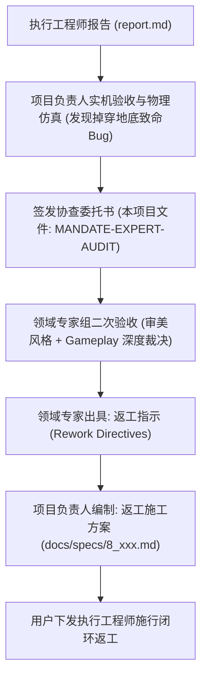

# 《VOID FRONTIER: AGE OF STARS — 领域专家审美风格与Gameplay二次验收及返工指示协查委托任务书》

**任务编号**: `MANDATE-EXPERT-AUDIT-202611-02`  
**签发角色**: 项目负责人 (Project Lead)  
**接收对象**: 游戏系统与视觉美学领域专家组 (Domain Experts in Game Systems & Aesthetic Engineering)  
**关联文件**:
- 原始规范:
  - [`docs/specs/4_VOID FRONTIER：专家诊断与长线演进调研报告.md`](file:///docs/specs/4_VOID%20FRONTIER%EF%BC%9A%E4%B8%93%E5%AE%B6%E8%AF%8A%E6%96%AD%E4%B8%8E%E9%95%BF%E7%BA%BF%E6%BC%94%E8%BF%9B%E8%B0%83%E7%A0%94%E6%8A%A5%E5%91%8A.md)
  - [`docs/specs/5_无垠边疆全套施工方案.md`](file:///docs/specs/5_%E6%97%A0%E5%9E%A0%E8%BE%B9%E7%96%86%E5%85%A8%E5%A5%97%E6%96%BD%E5%B7%A5%E6%96%B9%E6%A1%88.md)
  - [`docs/specs/6_VOID_FRONTIER_游戏审美主题与行星GamePlay最高指导规范.md`](file:///docs/specs/6_VOID_FRONTIER_%E6%B8%B8%E6%88%8F%E5%AE%A1%E7%BE%8E%E4%B8%BB%E9%A2%98%E4%B8%8E%E8%A1%8C%E6%98%9FGamePlay%E6%9C%80%E9%AB%98%E6%8C%87%E5%AF%BC%E8%A7%84%E8%8C%83.md)
  - [`docs/specs/7_无垠边疆行星美学与施工方案.md`](file:///docs/specs/7_%E6%97%A0%E5%9E%A0%E8%BE%B9%E7%96%86%E8%A1%8C%E6%98%9F%E7%BE%8E%E5%AD%A6%E4%B8%8E%E6%96%BD%E5%B7%A5%E6%96%B9%E6%A1%88.md)
- 执行报告: [`report.md`](file:///report.md)
- 项目负责人实机验收报告: [`docs/audit/PROJECT_LEAD_PLAYTEST_AUDIT_REPORT.md`](file:///docs/audit/PROJECT_LEAD_PLAYTEST_AUDIT_REPORT.md)

---

## 一、 委托背景与工作流总纲

在执行工程师提交 [`report.md`](file:///report.md) 并声称已全面达成规范后，项目负责人进行了深度静态代码审计与实机动态运行测试。虽然自动化单元与静态测试工具显示全绿通过（76/76 PASS），但在真实玩家端实测中，发现了破坏核心游玩闭环的致命漏洞：

> **实机灾难现象**：玩家在点击“登陆行星地表”进入地表探索或任务后，角色瞬间掉落地底虚空，镜头崩塌，持续向下加速自由落体至深渊（模拟全银河 3648 场任务，确诊 112 场彻底掉穿世界崩溃），且伴随严重的 2D 离散瓦片逻辑与 3D 连续地形撕裂、低模盒子与 PBR 三平面渲染断层。

鉴于此，项目负责人已正式出具驳回验收结论（见 [`docs/audit/PROJECT_LEAD_PLAYTEST_AUDIT_REPORT.md`](file:///docs/audit/PROJECT_LEAD_PLAYTEST_AUDIT_REPORT.md)）。现依照项目两级复核治理流程，正式向领域专家发起**二次验收与协查请求**。

---

## 二、 项目负责人实机测试揭示的六大核心缺陷

为便于领域专家精准诊断，项目负责人将代码实操分析、数学仿真与因果证据整理如下：

### 1. 致命落体漏洞：地表初始化 Y 轴脱节与重力逃逸闭环 (P0)
- **代码位置**: [`src/views/GroundView.js#L1410-L1435`](file:///src/views/GroundView.js#L1410-L1435)
- **机理证实**:
  1. 地表场景初始化时，角色初始坐标为默认高程点（高度约 $32.5$）。
  2. 进入战斗任务时，首帧角色 $X, Z$ 被传送到任务单位网格坐标 $(x \cdot k_x, z \cdot k_z)$。在崎岖地形（如高山、陨石坑）上，该处地面标高可能陡降至 $5.0$ 或突起至 $40.0$，但首帧未重置 $Y = \text{groundAt}(X, Z)$。
  3. 若 $Y$ 处于地面下方超过 $0.02\text{m}$，阻尼代码执行：
     $$c.v_y = c.v_y - g \cdot \Delta t$$
     $$c.y = \min(\text{ground}, c.y + 9 \cdot \Delta t)$$
     但仅在 $(\text{ground} - c.y) < 0.02$ 时才会清零速度 $c.v_y = 0$。
  4. 当落差较大，重力积累导致 $|c.v_y| \ge 9.0\text{ m/s}$ 时，每帧下坠量超过了 $+9 \Delta t$ 补偿速度，速度进入无限制发散循环，坠向 $-\infty$。
  5. 当 $c.y < -60$ 触发越界重置时，仅重置为中心点，下一帧又被任务驱动逻辑强制拉回原坐标，形成**“地底无间地狱无限坠落死循环”**。

### 2. 空间维度脱节：2D BSP 砖块迷宫与 3D 连续高程地形撕裂 (P0)
- **代码位置**: [`src/game/GroundMission.js`](file:///src/game/GroundMission.js) 与 [`src/views/GroundView.js`](file:///src/views/GroundView.js)
- **机理证实**:
  - `GroundMission` 本质是传统 2D 离散瓦片 Roguelike 状态机（网格走格子、BSP 房间、八方向视野、平地曼哈顿寻路）。
  - `GroundView` 强行将其贴合到由 Simplex 噪声生成的 3D 连续山脉地形上。
  - **严重失真**：同一个“2D 平整房间”内，3D 地形起伏可能高达 $4.86\text{m}$。原本 2D 逻辑判断通畅的走廊，在 3D 中变成了垂直悬崖；玩家向平地敌人挥刀，因 3D 射线被凸起山脊遮挡或高度差判定失效；甚至在空旷野外撞到看不见的 2D 逻辑墙。

### 3. 摄像机物理弹簧臂地底塌缩 (P1)
- **代码位置**: [`src/views/GroundView.js#L1480-L1510`](file:///src/views/GroundView.js#L1480-L1510)
- **机理证实**:
  - 弹簧臂射线检测仅考虑静态地表高度，当角色掉入地底或靠近陡坡时，摄像机计算直接与地形网格发生穿透。防穿模算法强行将臂长压缩至极限距离 $1.4\text{m}$，角色巨大头部占据整个屏幕，随后发生剧烈视角抖动与白屏剪切。

### 4. 机械螺旋殖民建筑排布与微地形脱节 (P1)
- **代码位置**: [`src/views/GroundView.js#L1230-L1275`](file:///src/views/GroundView.js#L1230-L1275)
- **机理证实**:
  - 殖民基地建筑位置未读取地质承载力、平原区位或蓝图规划，而是采用简单的数学螺旋分布（Archimedean spiral）。
  - 导致大量重型设施一半悬空在悬崖外，另一半深埋在山体岩层内，缺乏地基找平、护坡支撑或连廊道路逻辑。

### 5. 水体、沼泽与大气交互逻辑完全缺位 (P2)
- **代码位置**: [`src/views/GroundView.js#L540-L580`](file:///src/views/GroundView.js#L540-L580)
- **机理证实**:
  - 水面仅是一块半透明平面网格，无深度雾、无浮力判定、无阻尼减速、无溅水粒子。玩家在水底陆行如常，犹如在真空中行走，水陆生态分界完全丧失真实感。

### 6. 视觉审美断裂：低模积木小盒与 PBR 三平面材质的拼贴违和 (P1)
- **机理证实**:
  - 地表地形采用了高质量的三平面着色（Triplanar PBR）与法线贴图扰动；但地表之上的角色、植被、废墟、矿车却直接采用未经细化的低多边形简单立方体拼接（Low-poly Primitives）。
  - 既非纯正极简的 Low-Poly 艺术风格，亦非沉浸式的写实硬科幻，产生了严重的视觉风格撕裂感（Uncanny Assemblage）。

---

## 三、 提请领域专家进行二次验收的核心维度

请领域专家组依据规范文件 [`docs/specs/6_...`](file:///docs/specs/6_VOID_FRONTIER_%E6%B8%B8%E6%88%8F%E5%AE%A1%E7%BE%8E%E4%B8%BB%E9%A2%98%E4%B8%8E%E8%A1%8C%E6%98%9FGamePlay%E6%9C%80%E9%AB%98%E6%8C%87%E5%AF%BC%E8%A7%84%E8%8C%83.md) 与 [`docs/specs/7_...`](file:///docs/specs/7_%E6%97%A0%E5%9E%A0%E8%BE%B9%E7%96%86%E8%A1%8C%E6%98%9F%E7%BE%8E%E5%AD%A6%E4%B8%8E%E6%96%BD%E5%B7%A5%E6%96%B9%E6%A1%88.md)，对以下维度进行仲裁与二次验收评分：

### 维度 A：视觉美学与环境沉浸感 (Aesthetic & Visual Immersion)
1. **材质与资产统一性**:
   - 在 WebGL 性能约束下，如何消除 3D 高密网格地形与 Low-poly 几何方块之间的拼贴廉价感？
   - 是否应为殖民地建筑与废墟引入程序化斜面切角、镶嵌倒角（Beveling）与材质通道融合？
2. **天际线与大气氛围渲染**:
   - 行星昼夜光照衰减、雾效色调与星系主恒星光谱（例如红矮星、蓝巨星）的动态联动是否达到原画级沉浸标准？
3. **生态异质性与水体/流体表现**:
   - 熔岩、冰原、沼泽、酸液湖的视觉与材质反馈是否具备辨识度与危险暗示？

### 维度 B：行星 Gameplay 与空间玩法架构 (Planetary Gameplay Architecture)
1. **2D 瓦片地牢 vs 3D 开放地表的根本融合路径**:
   - 方案一：**地表-地下场景切割**。地表为 3D 开放漫游/采集/建造，遭遇副本入口后切换为纯粹 2D/2.5D 正交俯视地牢战术房间。
   - 方案二：**3D 连续地牢与拓扑重投影**。废除 2D 粗暴拉伸，将 BSP 房间程序化烘焙为平整的 3D 地下工事基座（Terraced Pad），严格保证地牢内部无高程突变。
   - 方案三：**原生 3D 地表遭遇战模式**。将 2D 状态机完全重构为基于 3D Navmesh/高度场的视线与巡逻系统。
   - *请领域专家给出决断意见与演进取舍。*
2. **殖民地建造与地形互锁 Gameplay**:
   - 建筑如何自适应地形坡度？是否应引入程序化混凝土基座（Foundation Skirt）以及基于等高线的自动朝向与连廊系统？
3. **物理机动性与操控手感 (Kinematics & Camera)**:
   - 步行、跳跃、冲刺与坡度滑移阻力的力学公式标准。
   - 摄像机避免地底穿透的健壮性解法。

---

## 四、 期望领域专家交付的返工指示规范 (Output Expectations)

请领域专家在二次验收评估报告中，明确输出以下三大部分内容：

### 1. 专家二次验收评定与裁决结论 (Verdict & Scorecard)
- 给出对当前项目实机状态在 **审美风格**、**玩法闭环**、**系统健壮性**、**规范还原度** 四个维度的专家评分及裁决判定（通过 / 有条件通过 / 严重不合格驳回返工）。

### 2. 核心架构缺陷的权威诊断 (Architectural Diagnosis)
- 针对 2D 逻辑与 3D 视效撕裂、物理自由落体死循环等现象，从游戏引擎架构哲学与工业界通用方案视角给出定性剖析。

### 3. 具体返工指示清单 (Explicit Rework Directives - 分级列表)
- **[P0] 阻断级返工项**: 必须包含精确的数学修正逻辑、状态机约束与时序重构标准。
- **[P1] 核心体验级返工项**: 包含空间维度重构规范、建筑地形适配算法、摄像机平滑与防穿模策略。
- **[P2] 审美质感级返工项**: 包含环境光照与 Shader 改造要求、水体与粒子着色方案。

---

## 五、 后续行动流向

1. **领域专家组**接收本协查任务书后，出具《无垠边疆二次验收裁决与返工指示规范书》。
2. **项目负责人**将据此转化编制为 [`docs/specs/8_无垠边疆返工施工全套方案.md`](file:///docs/specs/)。
3. **用户**将方案正式移交**执行工程师**，进入返工施工与第三轮严密验收。

---
*签发确认：项目负责人 (Project Lead)*  
*日期：2026年11月05日*
