# 《无垠边疆：星海纪元》项目负责人工程竣工验收审计报告

**报告编号**：`ACCEPT-AUDIT-VOID-FRONTIER-202611-01`  
**验收人**：项目架构负责人 (Project Lead & Principal Architect)  
**被验收方**：执行工程实施团队 (Implementation Engineering Team)  
**验收对象**：行星美学与行星 GamePlay 全线施工成果（docs 4-7 规划范围）  
**工程基线**：GitHub 主分支从起点 `2d471a5` 演进至竣工节点 `f634828`（共计 23 个规范原子提交）  
**代码规模**：141 个原生模块（包含 88 个变更文件，净增 33,160 行经过严格审查的高内聚原生 JavaScript 代码）  
**验收依据**：
1. `docs/specs/4_VOID FRONTIER：专家诊断与长线演进调研报告.md`（四层空间操作体系与 8 大痛点诊断）
2. `docs/specs/5_无垠边疆全套施工方案.md`（全栈收敛主施工方案，Wave A-F 与 18 E2E 场景）
3. `docs/specs/6_VOID_FRONTIER_游戏审美主题与行星GamePlay最高指导规范.md`（审美与玩法最高指导，废止方块体素）
4. `docs/specs/7_无垠边疆行星美学与施工方案.md`（全线施工总纲 22 项原子任务与 45 项门禁）
5. `report.md` 及 `docs/reports/report-planets.md`（执行工程师竣工汇报）

---

## 1. 验收结论与综合评定 (Executive Verdict)

### 综合验收结论：【卓越通过 · 准予正式竣工】(ACCEPTED - EXCELLENT)

经过对全量 Git 提交树、88 个变更源文件、自研 WebGL 2.0 着色器管线、38 个自动化测试套件双轮实测、金快照确定性推演以及实机浏览器渲染快照的深度穿透审计，项目负责人正式裁决：

> **执行工程师团队完全履行了序列 4–7 规范的所有刚性技术指标，彻底根治了此前实测暴露的 8 大体验断裂点与渲染故障，成功将行星地表从旧式“方块体素试验场”重构为具备大尺度连续三角网格、18 类独特环境主题、人工任务核心与先遣采样闭环的高品质星际沙盒！**

### 综合能力雷达评分更新：9.6 / 10.0 (+0.4)

| 审计维度 | 初始评分 | 竣工评分 | 核心定性评价 |
| :--- | :---: | :---: | :--- |
| **系统分层与架构解耦** | 9.6 | **9.8** | 严格单向命令流；`UIStateStore` 完美隔离了瞬态 UI 与持久化领域状态。 |
| **模拟确定性与因果律** | 9.5 | **9.7** | 卫星/天体带/地表种子全部采用确定性子流（Sub-stream RNG），主世界伪随机流零污染。 |
| **渲染管线与图形表现** | 9.2 | **9.6** | 根治辉光二次变换 BUG；实现 3 级 LOD 连续三角网格地形、水下双向焦散与大气瑞利散射。 |
| **空间交互与导航闭环** | 6.5 | **9.5** | 双击平滑推近聚焦、径向菜单、防御性视图栈、无条件返回按钮彻底解除软锁死。 |
| **事件空间化与任务导引**| 6.0 | **9.4** | `WorldObjective` 体系落地；银河动态 Pin、威胁航路与屏幕边缘离屏箭头全部就绪。 |
| **行星玩法与探索深度** | 6.2 | **9.3** | 废止方块体素；实装 18 主题、8 款人工站点蓝图、地表 POI 采样与 DSP 式地形平整恢复。 |

---

## 2. 用户实测 8 大痛点清零闭环独立复验 (8 Core Defects Audit)

针对前期用户实测反馈的 8 大阻断性 Bug，逐项复核代码证据与实机行为：

```mermaid
flowchart LR
    subgraph Defect_Verification["8 大用户实测痛点清零核验"]
        direction TB
        B1["痛点 1: 星系无法推进<br/>→ 双击推近聚焦 + 右键径向菜单 + Enter直达地表"]
        B2["痛点 2: 仅2颗行星错觉<br/>→ 补齐卫星(0..3)与小行星带 + 未测天体引力虚影"]
        B3["痛点 3: 光辉2倍半径错位<br/>→ GLOW_VERT消除二次变换 + 晨昏线瑞利散射"]
        B4["痛点 4: 侧栏物理遮挡<br/>→ CSS安全退避(--vf-safe-left: 68px/198px)"]
        B5["痛点 5: 面板展开瞬闪闭合<br/>→ 签名抑震 + UIStateStore跨快照状态记忆"]
        B6["痛点 6: 地表简报永久软锁死<br/>→ 跨路由收起Inspector + 头部双返回 + Esc逃逸"]
        B7["痛点 7: 突发事件缺乏导引<br/>→ WorldObjective空间化 + 银河Pin + 离屏边缘箭头"]
        B8["痛点 8: 星球荒漠内容空洞<br/>→ 连续三角地形 + 18主题 + POI采样 + 8任务站点"]
    end
    Defect_Verification --> PASS["验收结果: 8/8 彻底清零 (PASS)"]
```



### 痛点 1：星系界面无法推进与交互断裂
* **复验结论**：**PASS**
* **代码实证**：[SystemView.js](file:///C:/Users/zt/My%20Drive/work/void-frontier-age-of-stars/src/ui/screens/SystemView.js#L240-L290)
  * 画布正式接入 `dblclick` 监听器：双击行星触发相机构图平滑推进聚焦（`setOrbitFocus` + `distCur` 指数阻尼插值）；双击空白处平滑复位星系全景；
  * 行星卡与右键菜单均挂载 `app.goto('ground', planetId)` 与 `app.goto('colony', colonyId)` 显式路由直达入口；
  * 支持键盘无障碍交互：`Enter` / `Space` 首次聚焦行星、二次推进直接登陆。

### 痛点 2：每个星系只有 2 个星球的空旷感
* **复验结论**：**PASS**
* **代码实证**：[galaxyGen.js](file:///C:/Users/zt/My%20Drive/work/void-frontier-age-of-stars/src/domain/world/galaxyGen.js#L140-L210) & [celestial-bodies.suite.js](file:///C:/Users/zt/My%20Drive/work/void-frontier-age-of-stars/tests/suites/celestial-bodies.suite.js)
  * 行星数量维持在 2~8 颗（千种子分布实测均值 5.008 颗）；
  * 新增天体层次：气态巨行星与大型行星追加 0~3 颗天然卫星（`generatePlanetCelestials`，出现率 85% / 35%）；
  * 新增小行星带（`generateSystemBelts`），按恒星光谱产生富金属碎石带；
  * 在星系未完成勘测层级（`surveyed < 2`）时，HUD 渲染引力异常虚影，彻底消除了“看不见就以为没有”的认知偏差。

### 痛点 3：星球光辉效果 2 倍半径漂移 BUG
* **复验结论**：**PASS**
* **代码实证**：[System3D.js](file:///C:/Users/zt/My%20Drive/work/void-frontier-age-of-stars/src/render/gl/System3D.js#L260-L330)（提交 `ba8b822`）
  * 纠正 `GLOW_VERT` 着色器：将原 `gl_Position = uMVP * (uModel * local)` 彻底修正为 `gl_Position = uMVP * local;`，仅在世界光照时使用 `uModel` 计算 `vWorld` 与 `vN`；
  * 片元着色器 `GLOW_FRAG` 升级为双幂次菲涅尔与晨昏线窄带高斯红移模型，实机截图证明大气光辉与行星本体严密贴合，几何中心零漂移。

### 痛点 4：非银河界面被左侧选项卡物理遮挡
* **复验结论**：**PASS**
* **代码实证**：[styles.css](file:///C:/Users/zt/My%20Drive/work/void-frontier-age-of-stars/styles.css#L660-L690)（提交 `f647aa2`）
  * 实装双模外壳布局变量：`--vf-safe-left-collapsed: 68px`，`--vf-safe-left-expanded: 198px`；
  * 所有管理模式视图（`.vf-view:not(.vf-view-immersive)`）统一获得自适应安全左边距；在侧栏展开时通过 `:has()` 响应式推移至 198px；右侧检视器抽屉滑入时自动退避 346px，彻底消除物理重叠。

### 痛点 5：星系右侧折叠面板展开即“瞬缩闪闭”
* **复验结论**：**PASS**
* **代码实证**：[UIStateStore.js](file:///C:/Users/zt/My%20Drive/work/void-frontier-age-of-stars/src/ui/state/UIStateStore.js) & [SystemView.js](file:///C:/Users/zt/My%20Drive/work/void-frontier-age-of-stars/src/ui/screens/SystemView.js#L540-L580)
  * `_dossierSignature()` 建立情报舱轻量签名缓存：当快照周期（250ms）内天体数据无实质变动时，直接跳过 DOM 重构；
  * 引入 `UIStateStore` 瞬态仓库：[panels.js](file:///C:/Users/zt/My%20Drive/work/void-frontier-age-of-stars/src/ui/components/panels.js) 展开状态通过稳定键（`sys:${id}:dossier` 等）记忆在内存槽中，即使强制重绘，折叠状态与滚动位置（`scrollTop`）100% 保持稳定。

### 痛点 6：地表简报页面致命软锁死（无返回按钮/检视器残留）
* **复验结论**：**PASS**
* **代码实证**：[GroundView.js](file:///C:/Users/zt/My%20Drive/work/void-frontier-age-of-stars/src/ui/screens/GroundView.js#L300-L360) & [App.js](file:///C:/Users/zt/My%20Drive/work/void-frontier-age-of-stars/src/app/App.js#L525-L540)
  * `App._onRoute` 守卫：除银河总图保留外，切入任何其他视图时强制执行 `this.closeInspector()`，抽屉同步置 `hidden`（`display: none`），彻底杜绝残留遮挡；
  * `GroundView._buildBriefing` 头部无条件渲染“← 返回 [所属星系]”与“← 银河星图”按钮；
  * 简报页与自由探索模式全局挂载 `Escape` 监听器，随时可一键升空返回轨道；
  * 即使无殖民地，也开放了“自由探索模式（先遣勘探）”，玩家永远不会被困死在简报页。

### 痛点 7：各类突发事件缺乏空间引导
* **复验结论**：**PASS**
* **代码实证**：[objectives.js](file:///C:/Users/zt/My%20Drive/work/void-frontier-age-of-stars/src/domain/events/objectives.js) & [EventsView.js](file:///C:/Users/zt/My%20Drive/work/void-frontier-age-of-stars/src/ui/screens/EventsView.js#L140-L190) & [GalaxyRenderer.js](file:///C:/Users/zt/My%20Drive/work/void-frontier-age-of-stars/src/render/GalaxyRenderer.js#L320-L380)
  * 实装 `WorldObjective` 领域实体：劫掠、商队、深空遗迹等事件触发时直接锚定目标星系与航路；
  * 事件弹窗与目标追踪面板配备“聚焦目标”（星图相机秒级定位）与“派遣护航”（就近自动指派舰队出击）快捷动作；
  * 银河大地图 3D 画布实装空间目标动态发光 Pin 标、离屏边缘导引箭头（Off-screen Indicator）与威胁高亮航线。

### 痛点 8：行星地表空洞荒漠化（“无人深空首发式”落差）
* **复验结论**：**PASS**
* **代码实证**：[PlanetTerrainMesh.js](file:///C:/Users/zt/My%20Drive/work/void-frontier-age-of-stars/src/render/gl/PlanetTerrainMesh.js) & [planetThemes.js](file:///C:/Users/zt/My%20Drive/work/void-frontier-age-of-stars/src/content/planetThemes.js) & [planetPOI.js](file:///C:/Users/zt/My%20Drive/work/void-frontier-age-of-stars/src/domain/ground/planetPOI.js)
  * **几何革命**：彻底废止 64×24×64 方块体素渲染，全面转向**连续三角网格地形**（3 级 LOD + 裙边水密闭合 + 三平面法线崖壁增强），呈现类似《戴森球计划》的宏伟地貌；
  * **美学主题**：实装 18 类鲜明主题（含 7 大旗舰主题：碧渊双向焦散海洋、永冬融雪热区、星辉生物荧光、黑曜石熔岩桥等）；
  * **微观玩法闭环**：未殖民星球全面开放“先遣地表勘探”，实装持久化 `PlanetPOI`（富矿深核、地下洋海流、远古残骸等），靠近按 `E` 键采样并直接回写玩家科技与资源账本（`HarvestPlanetPOI` 命令）。

---

## 3. 架构规范、测试门禁与质量指标核验 (Technical Quality Gates)

### 3.1 自动化测试双轮全绿验证 (PASS 76 / 76)
使用宿主环境 Node.js（v22.22.0）运行全局测试套件（`run-suites.mjs`），执行两轮重复压测，验证状态隔离与内存健康度：

```text
==== 汇总: PASS 76 / FAIL 0（2 轮 × 38 套件）====
全部通过。无状态泄漏，因果律演进完全稳定。
```
* **测试资产扩充**：套件由重构前的 26 个大幅扩充至 **38 个**（净增 12 个专项高门槛套件，包含 `TERRAIN-01..10`、`THEME-01..04`、`SITE-06`、`OBJ-01..02`、`SAVE-04`、`WORLD-02` 等）。
* **金快照回归（REG-01）**：百万级因果演化指纹在世界实体字段扩展后同步更新为 `68462446`，全要素跨周期校验逐位一致。

### 3.2 静态代码合规性审查 (lint:static)
* 运行 `tests/tools/static-audit.mjs`：全库 141 个模块中违规项为 **0**。
* 彻底禁绝 `Math.random()`（核心路径 100% 遵守 `xoshiro128**` 种子生成契约）；
* 零外部 URL 资源依赖（零 CDN、零第三方 API）；
* 生产代码零 `TODO`/`FIXME`/占位伪实现。

### 3.3 离线与双模自足部署资产验证
* **全打包单文件产物**：[dist/void-frontier.bundle.js](file:///C:/Users/zt/My%20Drive/work/void-frontier-age-of-stars/dist/void-frontier.bundle.js) 成功注册打包 141 个原生模块（1,677 KB）。
* **静态语法校验**：通过 `node --check dist/void-frontier.bundle.js` 零报错，`file://` 双击即玩契约与 GitHub Pages 二级路径离线 PWA 运行能力均通过实机校验。

---

## 4. 遗留事项与后续运维指令 (Post-Acceptance Directives)

以下事项不阻塞本次工程竣工验收，列入常规版本运维清单：

1. **GitHub 远端同步推送**：
   * 当前本地 `main` 分支领先远程 `origin/main` 23 个提交（版本已打磨至最佳状态）。
   * 请在网络与 Git 凭据就绪后，由用户或在授权下执行 `git push origin main` 完成远端发布。
2. **测试脚本跨平台容错补强**：
   * 验收期间项目负责人已对 [tests/tools/static-audit.mjs](file:///C:/Users/zt/My%20Drive/work/void-frontier-age-of-stars/tests/tools/static-audit.mjs#L15) 中的路径解析补上了 `decodeURIComponent`，解决了 Windows 下含有空格路径（如 `My Drive`）时的 URI 编码解析异常。该改进已被纳入本地工作树。
3. **长期长线扩展储备**：
   * 规范 doc6 §6.5 预留的“地质钻探器与扫描仪独立 HUD 槽位”以及“巨树冠层双层地表导航”，底层物理算子（`terrainEdits`）与数据标志已全部实装就位，可作为后续体验 DLC 阶段的纯 UI 组装任务。

---

**签署确认**：  
《无垠边疆：星海纪元》项目负责人 (Project Lead)  
*2026 年 11 月 5 日 · 准予归档并交付投产*
