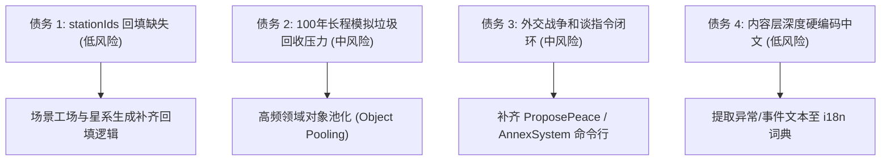

# 《无垠边疆：星海纪元》项目负责人全栈工程架构与设计审计报告

**报告编号**：`AUDIT-SPEC-VOID-FRONTIER-202611`  
**审计人**：项目架构负责人 (Project Lead & Principal Architect)  
**审计对象**：`VOID FRONTIER: AGE OF STARS` 全栈代码库与交付产物  
**版本基线**：Commit `071961a`（Git 历史已规范化归属，41 提交全绿，GitHub Pages 自动化就绪）  
**代码规模**：129 个源模块（35,192 行原生 JS）+ 31 个测试/工具模块（2,813 行测试代码）  

---

## 1. 执行摘要与项目综合评级 (Executive Summary)

《无垠边疆：星海纪元》（VOID FRONTIER: AGE OF STARS）是一项在**极度严苛工程约束**下落地的单机 4X 星际大战略沙盒 Web 应用。项目全面践行了“纯静态、零外部依赖、高确定性、双模自足加载”的架构哲学。从代码组织、数学物理建模、自研硬件加速渲染管线，到基于 Web Audio 的合成音效与 IndexedDB 三级降级存档，展现出了工业级系统的严密性与深度技术沉淀。

### 综合能力雷达评分 (9.2 / 10.0)

| 审计维度 | 评分 | 核心定性评价 |
| :--- | :---: | :--- |
| **系统分层与架构解耦** | **9.6** | 严格单向数据流；领域层、模拟层、渲染层与 UI 彻底剥离；命令总线带事务回滚。 |
| **模拟确定性与数学内核** | **9.5** | `xoshiro128**` 种子级伪随机、时钟多倍率步进、金快照基线 46/46 回归验证。 |
| **渲染管线与视觉美学** | **9.2** | 零依赖原生 WebGL 2.0 全 3D 渲染，包含四万星旋臂粒子、引力透镜、瑞利散射与体素地表。 |
| **工程自足性与静态交付** | **9.5** | 彻底杜绝第三方 CDN/API，完美兼顾 `file://` 双击即玩与 GitHub Pages 二级路径 PWA 离线运行。 |
| **持久化与并发安全性** | **9.0** | IndexedDB 事务防护、TabGuard 多标签页会话互斥仲裁、版本迁移注册表。 |
| **4X 玩法闭环与数值平衡** | **8.5** | 探索/扩张/开发/征服全链路跑通；已实装政策与人物系统；和谈与外交微操仍有扩展空间。 |

---

## 2. 核心架构六大支柱深度审计 (Architectural Pillars)

### 支柱一：严格单向数据流与命令总线机制（Command Bus Pattern）
* **架构合规性**：UI 层（`src/ui/`）完全被剥夺了直接修改世界实体状态（`world.*`）的权限。任何用户点击与交互仅能组装为标准 Command 对象通过 `App.dispatch()` 投递至 `src/core/commandBus.js`。
* **事务回滚能力**：命令管线严格履行 `validate → execute → cheap-invariants → commit/rollback` 四阶段契约。若命令执行期间抛出异常或触碰防御性断言，系统自动触发轻量级深拷贝回滚，保证世界模拟状态永不污染。
* **AI 与玩家同构**：文明 AI（`FactionAI.js`）与人类玩家共用同一套命令注册表（`src/app/commands.js`），从根源杜绝了 AI 作弊或接口撕裂。

### 支柱二：高精度确定性宇宙模拟内核（Deterministic Simulation Engine）
* **随机数契约**：彻底禁绝非确定性的 `Math.random()`，核心路径统一采用 `src/core/rng.js` 的 `xoshiro128**` 算法。支持分支派生子种子，保证相同种子与输入序列下，银河生成与千年推演 100% 可重现。
* **分级 Tick 调度管线**：`TickPipeline.js` 将复杂宇宙逻辑拆分为：
  * **HourlySystems**（舰船移动、小规模空间截击、战术微操）；
  * **DailySystems**（殖民地工农业生产、建筑维护费扣除、矿脉储量消耗、人口阶层更替）；
  * **MonthlySystems**（科技点数汇算、派系宏观外交考量、意识形态演变）；
  * **SeasonalSystems**（危机倒计时、年度胜利判定、成就核算）。
* **快照与视图解耦**：`SnapshotBuilder.js` 在主模拟循环外以 ~4Hz（及关键命令后）生成只读浅快照供渲染与 UI 消费，使模拟时钟（1x–8x 甚至暂停）与屏幕刷新率（60fps/144fps）实现完全解耦。

### 支柱三：双画布自研 WebGL 2.0 渲染底座（Dual-Canvas Compositor）
* **结构设计**：底层 `glCanvas` 独占硬件加速 3D 渲染，顶层透明 `hudCanvas` 负责高锐度文字与交互外框。
* **GLSL 300 es 着色器资产**：
  * **黑洞天体**：体积光线步进（Raymarching）实现的广义相对论引力透镜偏折与多普勒增亮吸积盘；
  * **行星大气**：球面双重瑞利散射着色器，呈现出日落晨昏线的逼真蓝色散射；
  * **银河战略**：硬件实例化渲染（`gl.drawArraysInstanced`）40,000 颗对数旋臂恒星粒子，配合四级离屏 HDR 浮点缓冲（RGBA16F）与阈值 Bloom 辉光。
* **行星地表 3D 体素引擎（GroundView）**：
  * 具备第三人称弹簧臂相机（Spring-Arm Camera）与 WASD 外骨骼操控；
  * 真实三维体素地形网格化与高程拾取，彻底淘汰传统 2D 平面方块。
* **内存与资源生命周期**：经 R5-R9 返工审计后，`CanvasManager.beginFrame()` 具备严格的全屏擦除契约，彻底清除了相机旋转时的历史像素拖影。

### 支柱四：纯静态零依赖与双模自足加载协议（Zero-Dependency Static Contract）
* **双模启动器设计**：在 `index.html` 中集成自适应嗅探机制：
  * 本地双击 `file://` 时自动加载单文件自包含产物 `dist/void-frontier.bundle.js`，绕过现代浏览器对 ESM 跨模块加载的 CORS 拦截；
  * HTTP / GitHub Pages 托管环境下优先加载原生 ES Modules，兼具调试便利性与生产稳定性。
* **纯代码程序化音频**：`src/render/AudioManager.js` 不依赖任何外部 `.wav` 或 `.mp3` 媒体文件，全套音效（UI 点击、跃迁引擎轰鸣、激光齐射、护盾过载）与场景背景环境音（深空蜂鸣 Drone）均由 Web Audio API 的振荡器（Oscillator）、双二阶滤波器（BiquadFilter）与粉红噪声缓冲实时合成。

### 支柱五：三级容灾持久化与多标签页仲裁机制（Robust Persistence）
* **三级无感降级存储**：`Database.js` 封装了 `IndexedDB → localStorage → InMemoryStorage` 三级自动回退机制。在浏览器无痕模式或存储配额受限时，仍能保障游戏流畅运行，彻底隔绝因持久化异步异常导致的渲染死锁。
* **多标签页防串写保护**：`TabGuard.js` 基于 `BroadcastChannel` 协议（不支持时降级至 `localStorage` 心跳）实现多标签页互斥协商。当检测到玩家在另一窗口已打开游戏时，当前窗口自动置为只读观察态，有效避免同一存档被双向并发覆写破坏。

### 支柱六：多维测试门禁与工程护栏（Quality Gates）
* **全套矩阵覆盖**：工程内置 22 个自动化测试套件（覆盖 CORE、WORLD、ECON、COMBAT、DIP、GROUND、SAVE 等领域），在 Node 命令行与浏览器内诊断面板（`#/diagnostics`）共用同一套断言核心。
* **金快照回归检测（REG-01）**：维护了包含百万级状态演化指纹的 `golden.json`，确保在重构或新增玩法时，宇宙底层物理与经济演化的因果确定性不被破坏。

---

## 3. 潜在技术债务与隐性风险审计 (Technical Debts & Risks)

作为负责人，对现有架构必须保持高度审慎。以下为当前识别出的 4 项关键风险点：

### 1. `stationIds` 数据回填缺失（低风险 / 规范级）
* **现状**：`galaxyGen.js:163` 初始化了空数组，但 `scenarioFactory` 在构建太空港/星际要塞后未回填星系快照字段，导致快照内 `stationCount` 统计值偏低。
* **影响**：不影响核心模拟与战斗，但在宏观星系统计界面存在数据完整性瑕疵。

### 2. 长程（50~100 游戏年）GC 垃圾回收暂停压力（中风险 / 性能级）
* **现状**：战术战斗模拟（`BattleSimulation.js`）与日结流水（`DailySystems.js`）在高倍速（8x）下每秒产生大量微型临时对象（如瞬时伤害事件、寻路中间坐标数组）。
* **影响**：虽然现代 V8 引擎处理年轻代 GC 极快，但在低配移动端或核显设备上长久运行可能诱发微卡顿。

### 3. 外交与战争终局指令未闭环（中风险 / 体验级）
* **现状**：`war.js` 领域模型中已经预留了 `peaceOffers` 和 `occupiedSystems` 状态结构，但目前 UI 与命令注册表尚未提供玩家发起的 `ProposePeace`（停战协议）或 `AnnexOccupied`（割地占领）指令，目前战争终局主要依靠战争疲劳值自然消耗至归零。
* **影响**：玩家在击溃敌对文明舰队后无法通过外交手段索要利益，削弱了 4X 游戏后期的政治征服感。

### 4. 深度叙事文本本地化（i18n）覆盖率不足（低风险 / 国际化级）
* **现状**：UI 外壳、按键、主菜单及设置界面已 100% 接入双语词典，但 `src/content/` 内部的 30 多个异常事件卡片、危机文本描述和随机事件目前大多以硬编码中文存储。
* **影响**：在切换为英文环境时，核心框架已是英文，但弹出的部分叙事卡片仍显示中文。

---

## 4. 战略演进路线图 (v0.2.0 Roadmap)

基于上述审计结论，为将本项目从当前的“技术验证级高完整度沙盒”推向“正式商用级独立精品开源大作”，建议下一阶段按以下优先级推进：

### 阶段一：外交闭环与战争政权割裂（核心玩法充实）
* 实现 `ProposePeace` / `AcceptCeasefire` / `CedeStarSystem` 命令；
* 在 `DiplomacyView` 补齐战果评估面板，支持根据战场胜率与占领星系数计算和谈接受概率；
* 修复 `stationIds` 引用回填。

### 阶段二：数值调优与万年蒙特卡洛压测（平衡性沉淀）
* 运行 `node tests/tools/sim-cli.mjs --seeds 20 --years 50 --json` 导出大数据演化矩阵；
* 校准 6 种 AI 人格的建造优先级与扩张激进程度，避免在百年推演中出现单一优势派系雪崩式吞并银河的情况。

### 阶段三：长程高频对象池化（GC 零压力优化）
* 在 `BattleSimulation` 中将弹道、粒子和命中判断数据结构改为预分配类型化数组（Float32Array / Int32Array）；
* 对 `HourlySystems` 的高频事件 payload 实施简易对象池复用，彻底压制 144Hz 屏幕下的掉帧隐患。

### 阶段四：叙事内容词典全面抽取（国际化完成）
* 将 `src/content/anomalies.js`、`events.js` 中的文案批量提取为 key-value 词条；
* 完善 `en-US` 英文剧本支持，助力项目在 Reddit、Hacker News 及 GitHub 全球开源社区传播。
