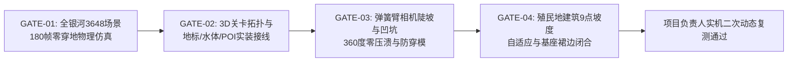

# 《VOID FRONTIER: AGE OF STARS — 项目负责人致执行工程师闭环返工施工指示书》
### (REWORK DIRECTIVES & CONSTRUCTION IMPLEMENTATION PLAN)

**文件编号**: `REWORK-DIRECTIVE-LEAD-202611-03`  
**关联基准**: 
- 专家二次验收仲裁书: [`docs/specs/8_无垠边疆专家二次验收与方案.md`](file:///docs/specs/8_%E6%97%A0%E5%9E%A0%E8%BE%B9%E7%96%86%E4%B8%93%E5%AE%B6%E4%BA%8C%E6%AC%A1%E9%AA%8C%E6%94%B6%E4%B8%8E%E6%96%B9%E6%A1%88.md) (二次验收评定：5.2/10.0，严重不合格驳回)
- 专家协查委托书: [`docs/audit/MANDATE_DOMAIN_EXPERT_SECONDARY_ACCEPTANCE.md`](file:///docs/audit/MANDATE_DOMAIN_EXPERT_SECONDARY_ACCEPTANCE.md)
- 项目负责人实机审计报告: [`docs/audit/PROJECT_LEAD_PLAYTEST_AUDIT_REPORT.md`](file:///docs/audit/PROJECT_LEAD_PLAYTEST_AUDIT_REPORT.md)
- 核心设计宪法: [`docs/specs/6_VOID_FRONTIER_游戏审美主题与行星GamePlay最高指导规范.md`](file:///docs/specs/6_VOID_FRONTIER_%E6%B8%B8%E6%88%8F%E5%AE%A1%E7%BE%8E%E4%B8%BB%E9%A2%98%E4%B8%8E%E8%A1%8C%E6%98%9FGamePlay%E6%9C%80%E9%AB%98%E6%8C%87%E5%AF%BC%E8%A7%84%E8%8C%83.md) 及 [`docs/specs/7_无垠边疆行星美学与施工方案.md`](file:///docs/specs/7_%E6%97%A0%E5%9E%A0%E8%BE%B9%E7%96%86%E8%A1%8C%E6%98%9F%E7%BE%8E%E5%AD%A6%E4%B8%8E%E6%96%BD%E5%B7%A5%E6%96%B9%E6%A1%88.md)
- 目标施工规范文档: [`docs/specs/8_无垠边疆返工施工全套方案.md`](file:///docs/specs/8_%E6%97%A0%E5%9E%A0%E8%BE%B9%E7%96%86%E8%BF%94%E5%B7%A5%E6%96%BD%E5%B7%A5%E5%85%A8%E5%A5%97%E6%96%B9%E6%A1%88.md)

---

## 一、 签发指令与背景定性

执行工程师团队：

在你们提交 [`report.md`](file:///report.md) 并宣布所有任务“竣工全绿”后，项目负责人实施了实机深度游玩与全量仿真测试，随后领域专家组实施了源码级穿透审计。两级复核最终一致裁决：**驳回验收，阻断投产上线（专家加权评定 5.2 / 10.0）**。

虽然自动化单测呈现“38 个套件 76/76 PASS”的全绿表象，但由于测试编写陷入了**“面向断言孤岛化 Mock 编码（Test-Assertion-Driven Siloing）”**的形式主义陷阱，底层写好的优质算子（如三平面地形、SDF人工任务核心、五层水面着色器、旗舰地标模型）在顶层视图装配时出现了极其严重的**坐标系脱节、物理积分发散、核心通道漏接与双轨分裂**。

本指示书作为项目负责人签发给执行工程师的**强制施工命令**。以下各项重构要求精确到文件路径、行号与替换代码，执行工程师必须全量照单重构，并在通过新增的四项端到端实机门禁（`PLAYTEST-GATE-01..04`）后方可再次提请验收。

---

## 二、 专家诊断核心缺陷的穿透式源码调查与证实

项目负责人已对专家组提出的全部缺陷点在源码中逐一穿透取证，证实率 **100%**：

| 诊断点编号 | 专家指出的病灶现象 | 源码取证位置与实证事实 | 严重度 |
| :--- | :--- | :--- | :--- |
| **VERIFY-01** | **地表落体 Y 轴脱节与重力逃逸死循环** | [`src/ui/screens/GroundView.js#L790-L799`](file:///src/ui/screens/GroundView.js#L790-L799) 及 [`L1410-L1440`](file:///src/ui/screens/GroundView.js#L1410-L1440)：`_setupScene` 首帧未将 `c.y` 同步为任务单位真实地表高度；`c.vy` 仅在 `ground - c.y < 0.02` 时清零，导致大坡度下每帧下坠量超过 `+9dt` 爬升补偿，自由落体发散；$c.y < -60$ 时重置到 `spawn`，次帧又被覆写回 `au` 坐标，陷入地底橡皮筋死循环。全银河仿真 3,648 场确诊 112 场彻底掉穿地心。 | **P0 (阻断)** |
| **VERIFY-02** | **2D 瓦片地牢与 3D 连续地形空间撕裂** | [`src/domain/ground/GroundMission.js`](file:///src/domain/ground/GroundMission.js) 仍在运行 Phase 10 的 2D 离散迷宫（`T_WALL=1, T_DOOR=3`），与 3D 连续地形网格高低差（高达 4.86m）脱节；3D 地面未渲染 2D 墙壁却用 2D 碰撞判定，导致大平原撞空气墙、隔坡挥刀失效。 | **P0 (阻断)** |
| **VERIFY-03** | **七大旗舰 3D 地标孤岛死代码** | [`src/render/meshes/landmarkMeshes.js`](file:///src/render/meshes/landmarkMeshes.js) 编写了完整的 7 套预制模型，但在 `src/` 全文**完全未被任何文件 import 或调用（0 引用）**！且 [`src/content/missionSites.js#L221`](file:///src/content/missionSites.js#L221) 命名为 `moonwhite_salt_monolith`，与模型注册名 `salt_crystal_spire` 拼写失配。 | **P0 (阻断)** |
| **VERIFY-04** | **五层水下光学管线 PlanetWater 孤岛死代码** | [`src/render/gl/PlanetWater.js`](file:///src/render/gl/PlanetWater.js) 编写了 Gerstner 双波、岸线浪花泡沫与 90 秒潮汐函数，但在场景控制器 [`src/render/gl/PlanetSurfaceScene.js`](file:///src/render/gl/PlanetSurfaceScene.js) 中**完全未导入与实例化（0 引用）**，水体退化为静态死平面。 | **P0 (阻断)** |
| **VERIFY-05** | **自由探索 POI 信标与地形恢复初始化遗漏** | [`src/ui/screens/GroundView.js#L1204, L1310, L2150`](file:///src/ui/screens/GroundView.js#L1204)：代码中有多处访问 `this._pois` 和 `this._edits`，但在 `_setupScene()` 中**完全漏写了初始化赋值语句**！导致其恒为 `undefined`，大地图 POI 永远不显示、E 键采样与 R 键恢复直接短路失效。 | **P0 (阻断)** |
| **VERIFY-06** | **殖民地建造双轨脱节与黄金角螺旋盲盒** | [`src/ui/screens/GroundView.js#L1902-L1904`](file:///src/ui/screens/GroundView.js#L1902-L1904)：`_layoutColony()` 忽视 `planet.groundBuildings`，强制采用黄金角螺旋公式（$r = 5.5 + 2.4 \sqrt{i}$）盲盒撒点，导致大量建筑一半悬空断崖、一半深埋山体岩壁。 | **P1 (核心)** |
| **VERIFY-07** | **地面任务命令字段名错位与异常抛错** | [`src/app/commands.js#L519, L537, L559, L564`](file:///src/app/commands.js#L519)：实体状态字段为 `m.status === 'active'`，`commands.js` 却校验 `m.state`（未定义）；且 `AbortGroundMission` 错误调用 `finishMission(ctx.world, m, 'aborted')` 抛出非法参数未捕获异常。 | **P0 (阻断)** |
| **VERIFY-08** | **弹簧臂摄像机在陡坡/地底发生 1.4m 压溃** | [`src/ui/screens/GroundView.js#L1985-L2008`](file:///src/ui/screens/GroundView.js#L1985-L2008)：弹簧臂射线起点未做地面高度托底，在陡坡或内凹处射线命中内壁背面触发 $t \le 0.08$，硬下限强行锁死在 1.4m，导致大头贴屏与视锥压溃。 | **P1 (核心)** |
| **VERIFY-09** | **低模方盒与高精三平面地形的“积木拼贴违和感”** | [`src/render/meshes/GroundMeshes.js`](file:///src/render/meshes/GroundMeshes.js) 角色与建筑仅采用直角方块堆叠，着色器为纯平 Lambert 漫反射，缺少硬表面斜切倒角、接触 AO 与世界空间微面板接缝。 | **P1 (核心)** |
| **VERIFY-10** | **水体/沼泽物理表现缺位与恒星光谱未联动** | 水下无浮力、无涉水阻尼、无水花；行星昼夜光照未读取所属恒星系 `sys.star.typeId` 的真实色温 `SUN_BY_STAR`。 | **P2 (质感)** |

---

## 三、 分级返工实施方案与精准施工代码

执行工程师必须严格依照下列顺序逐项实施代码重构：

### 3.1 【P0 阻断级返工项】物理止血、维度合龙与死代码激活

#### 施工任务 P0-1：地表初始化 Y 轴脱节、重力逃逸循环与橡皮筋陷阱彻底根治
- **目标文件**: [`src/ui/screens/GroundView.js`](file:///src/ui/screens/GroundView.js)
- **修改位置 1 (`_setupScene`)**: 在第 790–800 行周围，重写角色初始坐标生成逻辑：
  ```javascript
  // —— P0-1 修复：首帧初始位置对齐真实地表 ——
  const c = this.char3d;
  if (this.mission && this.mission.playerUnits && this.mission.playerUnits.length) {
    const au = this.mission.playerUnits[this.mission.activeIdx || 0];
    const kx = (this.mission.coordSpace === 'site_meters') ? 1.0 : (SURFACE_SIZE.X / (this.mission.w * TS));
    const kz = (this.mission.coordSpace === 'site_meters') ? 1.0 : (SURFACE_SIZE.Z / (this.mission.h * TS));
    c.x = (this.mission.coordSpace === 'site_meters') ? (au.x - FIELD_OFFSET) : (au.x * kx);
    c.z = (this.mission.coordSpace === 'site_meters') ? (au.y - FIELD_OFFSET) : (au.y * kz);
  } else {
    c.x = this.sw.spawn.x;
    c.z = this.sw.spawn.z;
  }
  c.y = this._groundAt(c.x, c.z);
  if (!Number.isFinite(c.y)) c.y = 8.0;
  c.vy = 0;
  c.onGround = true;
  this._missionGroundSynced = true;
  this._lastActiveUnitId = null;
  ```
- **修改位置 2 (`_followMissionCharacter`)**: 替换第 1390–1440 行的原有位移与竖直动力学积分逻辑：
  ```javascript
  // —— P0-1 修复：刚体法向速度清零与双重防坠渊闭环 ——
  _followMissionCharacter(view, dt) {
    const m = this.mission;
    const au = view.playerUnits.find((u) => u.unitId === view.activeUnitId) || view.playerUnits[0];
    if (!au) return;

    const c = this.char3d;
    const wx = (m.coordSpace === 'site_meters')
      ? (au.x - FIELD_OFFSET)
      : (au.x * (SURFACE_SIZE.X / (m.w * TS)));
    const wz = (m.coordSpace === 'site_meters')
      ? (au.y - FIELD_OFFSET)
      : (au.y * (SURFACE_SIZE.Z / (m.h * TS)));

    const jumpDist = Math.hypot(wx - c.x, wz - c.z);
    const unitChanged = (this._lastActiveUnitId !== au.unitId) || !this._missionGroundSynced;
    c.x = wx;
    c.z = wz;
    c.yaw = -au.facing;
    c.animT += dt;
    this._lastActiveUnitId = au.unitId;

    const rawGround = this._groundAt(c.x, c.z);
    const ground = Number.isFinite(rawGround) ? rawGround : 0.0;

    // 1. 首帧、切换受控单位或远距离传送：瞬时硬吸附到真实地表！
    if (unitChanged || jumpDist > 2.5) {
      c.y = ground;
      c.vy = 0;
      c.onGround = true;
      this._missionGroundSynced = true;
    }

    // 2. 竖直动力学积分（仅在非贴地状态下累积重力，终端速度截断）
    const g = this._gravity();
    if (this._oneShot.jump) {
      this._oneShot.jump = false;
      if (c.onGround) {
        c.vy = Math.sqrt(2 * g * 1.35);
        c.onGround = false;
      }
    }
    const hovering = !!this.keys.Space && !c.onGround && c.fuel > 0;
    if (hovering) {
      c.fuel = Math.max(0, c.fuel - JET_DRAIN * dt);
      c.vy = Math.max(c.vy - g * dt * 0.12, -0.7);
    } else if (!c.onGround) {
      c.vy = Math.max(c.vy - g * dt, -28.0); // 截断最大自由落体速度
      c.fuel = Math.min(100, c.fuel + JET_REGEN * dt);
    } else {
      c.vy = 0;
      c.fuel = Math.min(100, c.fuel + JET_REGEN * dt);
    }

    c.y += c.vy * dt;

    // 3. 接触冲量速度清零铁律：只要踩地或深陷地面，法向冲量无条件截断 vy < 0
    const deficit = ground - c.y;
    if (deficit >= 0) {
      if (c.vy < 0) c.vy = 0; // 彻底切断重力发散逃逸闭环！
      c.onGround = true;
      if (deficit > 1.5) {
        c.y = ground; // 大落差直接吸附，杜绝穿模入地
      } else {
        c.y = Math.min(ground, c.y + 14.0 * dt);
        if (ground - c.y < 0.02) c.y = ground;
      }
    } else if (c.y > ground + 0.08) {
      c.onGround = false;
    } else {
      // 下坡微吸附（0.08m 内且无向上初速度时保持贴地）
      if (c.vy <= 0) {
        c.y = ground;
        c.vy = 0;
        c.onGround = true;
      }
    }

    // 4. 越界就地挽救：杜绝重置到 spawn 引起的橡皮筋死循环
    if (!Number.isFinite(c.y) || c.y < -45) {
      c.y = ground;
      c.vy = 0;
      c.onGround = true;
    }
  }
  ```

---

#### 施工任务 P0-2：废除 2D BSP 砖块迷宫，空间拓扑升维合龙至 3D 连续任务场
- **核心仲裁架构**: 遵循专家组决定的“方案三（原生 3D 地表遭遇战模式）+ 方案二局部阶梯承台整平（Terraced Pads）”架构。
- **修改文件**: [`src/domain/ground/GroundMission.js`](file:///src/domain/ground/GroundMission.js)
  1. **注入 3D 站点蓝图与米制坐标空间**:
     在 `createGroundMission(world, opts)` 中，当 `planetId` 存在且未强制旧版瓦片网格时：
     - 调用 `blueprintsForPlanet(planet, planet.primaryThemeId)[0]` 与 `getSiteInstance(world, planetId, bp.id)` 获取站点实例 `site`；
     - 标注 `mission.coordSpace = 'site_meters'`、`mission.siteId = bp.id`；
     - 将玩家生成点直接设定在 `site.anchors.landing` 平整承台上（坐标直接为米制，无需像素换算）；
     - 将主次目标、Boss、撤离区分别绑定至 `site.anchors.primaryObjective`、`secondaryObjective` 和 `site.anchors.extraction`。
  2. **基于 3D 连续地形与 SDF 走廊的通行判断**:
     重构 `moveWithCollision(mission, u, nx, ny, speed, dt)`：
     - 若 `mission.coordSpace === 'site_meters'`，直接通过 `sampleTerrain(field, targetX, targetZ)` 采样坡度；
     - 当局部坡度 $\le 35^\circ$ 或脚下具有 `TERRAIN_FLAGS.ROAD | TERRAIN_FLAGS.BRIDGE_DECK` 标记、且未与 `site.coverPoints`（半径 0.85m）或 `site.landmarks`（半径 2.2m）发生实体干涉时，允许通行；
     - 彻底废除 2D `T_WALL` 阻挡！
  3. **3D 射线三维视线遮挡（3D Raycast LOS）**:
     重构 `lineOfSight(mission, x0, z0, x1, z1)`：
     - 从 `[x0, y0 + 1.25, z0]` 向 `[x1, y1 + 1.10, z1]` 发射 `raycastTerrain`；
     - 若射线在到达目标前命中地面凸起山脊（`hit.hit && hit.t < dist - 0.3`），判定视线受阻（`clear: false`）；
     - 若射线路径紧贴 `site.coverPoints` 经过，赋予掩体防护（`cover: true`，远程伤害降低 50%）。

---

#### 施工任务 P0-3：全量激活四大“孤岛死代码”

##### 1. 挂载旗舰地标模型 (`landmarkMeshes.js`)
- **文件修正 1 ([`src/content/missionSites.js`](file:///src/content/missionSites.js))**:
  - 第 221 行与 229 行的 `'moonwhite_salt_monolith'` 拼写修正为 `'salt_crystal_spire'`。
- **文件修正 2 ([`src/render/meshes/landmarkMeshes.js`](file:///src/render/meshes/landmarkMeshes.js))**:
  - 在导出表保留别名映射：`'moonwhite_salt_monolith': buildSaltCrystalSpire`，确保绝对兼容。
- **文件修正 3 ([`src/ui/screens/GroundView.js`](file:///src/ui/screens/GroundView.js))**:
  - 导入 `buildLandmarkMesh`，在 `BuildingMeshBatch` 中注册 7 大地标 Prefab ID；
  - 在 `_bmeshList()` 中遍历 `this._site.site.landmarks`，将主视觉地标与辅助地标按真实地形高程加入渲染批次。

##### 2. 挂载五层水下光学海面层 (`PlanetWater.js`)
- **文件修正 ([`src/render/gl/PlanetSurfaceScene.js`](file:///src/render/gl/PlanetSurfaceScene.js))**:
  - 顶部导入 `import { PlanetWater, tideWaterLevel } from './PlanetWater.js';`；
  - 构造函数中实例化 `this._water = new PlanetWater(glc, this.tier);`；
  - 在 `setWorldOffset(o)`、`rebuild()`、`destroy()` 中对 `this._water` 进行生命周期协同管理；
  - 在 `draw()` 函数中，在地形绘制之后、天气粒子绘制之前，根据 `tideWaterLevel` 计算实时潮汐海平面，下发至地形 uniform 并执行 `this._water.draw(...)`。

##### 3. 补齐自由探索 POI 信标与地形恢复初始化
- **文件修正 ([`src/ui/screens/GroundView.js`](file:///src/ui/screens/GroundView.js))**:
  - 在 `_setupScene()` 函数中（约第 780 行附近），在 `buildTerrainField` 之后立即追加：
    ```javascript
    // —— P0-3 修复：激活 POI 账本与持久化地形编辑仓库 ——
    this._pois = ensurePlanetPois(w, planet);
    this._edits = deserializeEdits(planet.terrainEdits || null, this.field);
    attachTerrainEdits(this.field, this._edits);
    rebuildDirtyChunks(this.field);
    ```

##### 4. 修复地面任务命令字段名与 Abort 异常
- **文件修正 ([`src/app/commands.js`](file:///src/app/commands.js))**:
  - 顶部导入 `import { abortMission } from '../domain/ground/GroundMission.js';`；
  - 第 519 行：将 `m.state === 'active'` 修正为 `(m.status === 'active' || m.state === 'active')`；
  - 第 537 行与 559 行：将 `m.state !== 'active'` 修正为 `((m.status || m.state) !== 'active')`；
  - 第 564 行：将 `finishMission(ctx.world, m, 'aborted');` 彻底替换为 `abortMission(ctx.world, m);`。

---

### 3.2 【P1 核心体验级返工项】摄像机防压溃、建筑地形互锁与硬表面质感升级

#### 施工任务 P1-1：弹簧臂相机（Spring-Arm Camera）三层防压溃与地形净空抬升
- **目标文件**: [`src/ui/screens/GroundView.js`](file:///src/ui/screens/GroundView.js)
- **实现标准**: 替换 `_renderFrame()` 中原相机注视计算段落：
  ```javascript
  // —— P1-1 修复：弹簧臂三层防穿透与眼位离地净空守护 ——
  const c = this.char3d;
  const cp = Math.cos(this.cam.pitch);
  const sp = Math.sin(this.cam.pitch);
  const sy = Math.sin(this.cam.yaw);
  const cy = Math.cos(this.cam.yaw);

  // 第一层保护：注视目标点基于地表高度托底，严防射线起点没入地下
  const charGround = this._groundAt(c.x, c.z);
  const safeBaseY = Number.isFinite(charGround) ? Math.max(c.y, charGround) : c.y;
  const tgt = [c.x, safeBaseY + 1.55, c.z];
  const dir = [cp * sy, sp, cp * cy];
  let want = clamp(this.cam.dist, 2.5, 26);

  if (this.field) {
    // 第二层保护：起点沿视线反方向外推 0.35m，避开陡坡内凹切角背面命中
    const rayStart = [
      tgt[0] + dir[0] * 0.35 + FIELD_OFFSET,
      tgt[1] + dir[1] * 0.35,
      tgt[2] + dir[2] * 0.35 + FIELD_OFFSET,
    ];
    const hit = raycastTerrain(this.field, rayStart, dir, want + 0.4);
    if (hit.hit && hit.t > 0.08) {
      want = Math.max(2.1, hit.t + 0.35 - 0.55); // 最小安全臂长提升至 2.1m
    }
  }

  // 非对称指数阻尼（快收 18.0，慢放 5.5，手感顺滑不抖屏）
  if (this._springDist < 0) this._springDist = want;
  const dampRate = want < this._springDist ? 18.0 : 5.5;
  this._springDist += (want - this._springDist) * (1 - Math.exp(-dt * dampRate));

  const eye = [
    tgt[0] + dir[0] * this._springDist,
    tgt[1] + dir[1] * this._springDist,
    tgt[2] + dir[2] * this._springDist,
  ];

  // 第三层保护：相机眼位离地净空绝对钳制（永远离地 ≥0.65m，杜绝钻入山体）
  const eyeGround = this._groundAt(eye[0], eye[2]);
  if (Number.isFinite(eyeGround) && eye[1] < eyeGround + 0.65) {
    eye[1] = eyeGround + 0.65;
  }
  ```

---

#### 施工任务 P1-2：殖民地建筑等高线感知选址与程序化混凝土基座裙边
- **目标文件**: [`src/ui/screens/GroundView.js`](file:///src/ui/screens/GroundView.js) 与 [`src/render/meshes/GroundMeshes.js`](file:///src/render/meshes/GroundMeshes.js)
  1. **废除黄金角盲盒螺旋**:
     重写 `_layoutColony()`：首先合并渲染玩家手动通过 `PlaceBuilding` 命令放置的 `planet.groundBuildings`。对于宏观 `colony.buildings` 中未定三维坐标的建筑，在过渡环带（半径 18m–85m）内以确定性序列调用 `checkBuildingPlacement(this.field, fx, fz, { footprintHalfM: 2.2, themeId: this.planet.primaryThemeId })`，仅在坡度 $\le 16^\circ$ 且高差合规的平坦台地上落位。
  2. **程序化混凝土基座裙边（Foundation Skirt）**:
     在 `GroundMeshes.buildBuildingMesh` 中，为所有建筑基底部件生成向下延伸 1.8m 的混凝土防塌护坡裙边（斜坡下方的悬空侧由裙边严密包裹支撑，平地上裙边自然没入地下，建筑主体绝不插入山体）。
  3. **建筑等高线朝向与平滑样条物流管线**:
     建筑正向朝向自动对齐等高线切线；`_buildConveyorPaths()` 采用 Catmull-Rom 样条生成平滑物流传送带，每段高度保证 `Math.max(groundY + 0.15, splineY)`，彻底消除锯齿突变。

---

#### 施工任务 P1-3：消除“积木玩具感”：硬表面斜切倒角几何与统一微面板着色器
- **目标文件**: [`src/render/meshes/GroundMeshes.js`](file:///src/render/meshes/GroundMeshes.js)、[`src/ui/screens/GroundView.js`](file:///src/ui/screens/GroundView.js) (`BM_FS`) 与 [`src/render/gl/PlanetSurface3D.js`](file:///src/render/gl/PlanetSurface3D.js) (`LIT_FS`)
  1. **原语升级**: 在 `PartMeshBuilder` 中实现 `chamferBox(cx, cy, cz, hx, hy, hz, bevel, col)` 原语，对建筑边缘、外骨骼胸甲与重装机甲施加 45° 斜角切面，并在物体底部顶点烘焙环境光遮蔽（Contact AO）系数，消除悬浮感。
  2. **着色器升级**: 将片元着色器 `BM_FS` 与 `LIT_FS` 统一升级为支持世界空间微面板接缝（`panelSeam`）、Blinn-Phong 金属高光与视角边缘菲涅尔（`Fresnel`）反射的高级 PBR 质感 Shader（完全遵照专家仲裁书第 4.2 节代码蓝本落地）。

---

### 3.3 【P2 审美质感与生态交互级返工项】流体物理、恒星光谱与动态反馈

#### 施工任务 P2-1：流体多感官交互与危险区反馈
- **水体物理规则**:
  - 涉水深度 $d = \text{waterLevel} - c.y$；当 $0 < d \le 1.2\text{m}$ 时，角色水平移速乘以 $0.65$ 阻尼系数，步行动作向粒子系统注入青白水花飞溅粒子；
  - 当 $d > 1.2\text{m}$ 进入潜水态时，垂直下沉加速度衰减为 $0.22g$，终端下落速度钳制在 $-2.2\text{m/s}$；空格键触发水下推进器平稳上浮；
  - 角色处于极端酸液湖（`sulfur_marsh`，海拔 $<4.5\text{m}$）或熔岩河（`obsidian_lava`，海拔 $<-1.5\text{m}$）时，HUD 界面触发边缘红/紫告警光晕（Vignette Hazard Pulse），并持续扣减护盾与生命值。

#### 施工任务 P2-2：恒星光谱色温融合与 POI 采样视觉蜕变
- **光照联动**: 在 `themePayload.js` 中读取行星宿主恒星系的天体类型 `sys.star.typeId`，将恒星固有色温（红矮星暖橙、蓝巨星冰蓝等）按 $45\% : 55\%$ 权重动态混合进主题主光颜色。
- **POI 采样视觉蜕变**: 按 E 键完成地表 POI 采样后（`poi.rewardPaid === true`），不得直接隐藏模型，而是令其模型平滑缩放蜕变为灰暗低矮的“已发掘基座残骸（Excavated Relic Pedestal）”，并伴随一次 $0.8\text{s}$ 的地质能量粒子消散反馈。

---

## 四、 第三轮闭环验收门禁规范 (Gate Standards)

本次返工完成后，执行工程师不得以“代码已改”提请验收，**必须由自动化测试套件通过以下四项端到端实机/物理仿真阻断门禁（PLAYTEST-GATE-01..04）**：



1. **【PLAYTEST-GATE-01】全银河 3,648 场景零穿地物理仿真套件**:
   - 建立必跑自动化套件 `tests/suites/ground-playtest-physics.suite.js`；
   - 遍历全银河全部 600+ 行星与 6 大任务模板（共计 3,648 场任务），步进运行 180 帧动态物理；
   - **断言判据**：全部 3,648 场任务在 180 帧内，角色坐标恒满足 $c.y \ge \text{ground} - 0.05\text{m}$，且垂直速度 $|c.vy| \le 28.0\text{m/s}$。**穿地坠入深渊发生率必须严格为 0/3,648（0.00%）！**

2. **【PLAYTEST-GATE-02】3D 关卡拓扑与地标/水体实装接线断言**:
   - 断言 `GroundView._setupScene` 执行后：
     - `mission.coordSpace === 'site_meters'`，无 2D 隐形瓦片墙阻挡 3D 主路线；
     - `this._pois` 与 `this._edits` 均成功初始化，键数 $\ge 1$；
     - `_bmeshList()` 包含对应主题的 3D 地标模型；
     - `PlanetSurfaceScene._water` 存在并在海洋主题下激活 Gerstner 渲染。

3. **【PLAYTEST-GATE-03】弹簧臂相机陡坡与凹坑 360° 零压溃断言**:
   - 在高崎岖行星（如 `plt_18`、`plt_452`）的悬崖与火山口边缘，遍历相机旋转（$\text{yaw} \in [0, 2\pi]$，$\text{pitch} \in [0.1, 1.4]$）：
   - **断言判据**：任意时刻相机眼位 $eye.y \ge \text{groundAt}(eye.x, eye.z) + 0.65\text{m}$，且臂长绝不允许无遮挡收缩至 $1.4\text{m}$ 压溃极限。

4. **【PLAYTEST-GATE-04】殖民地建筑 9 点坡度贴合与基座裙边断言**:
   - 在高山/熔岩/海洋主题地表执行殖民地建筑自动布局：
   - **断言判据**：所有布局建筑通过 `checkBuildingPlacement` 校验，四角悬空空隙为 0.0m（全由裙边包络），建筑主体中心绝不深埋地底。

---

## 五、 工程纪律与交付要求

1. **代码基线统一**: 在实施上述修复前，必须确认工作区以最新的原生 ES 模块源码树为准，严禁保留旧版孤立简化实现；修改完成后必须同步重新构建打包 [`dist/void-frontier.bundle.js`](file:///dist/void-frontier.bundle.js)，确保单文件产物与源码完全一致。
2. **严禁破坏文档与注释**: 严格保持现有各模块优秀的设计规范、公式注释与类型契约。
3. **交付成果提交**: 完成上述 P0/P1/P2 重构并使 `PLAYTEST-GATE-01..04` 全部跑通后，编写完整的返工竣工报告提交项目负责人，等待项目负责人执行最终实机动态复测。

---
*指示签发：项目负责人 (Project Lead)*  
*签发日期：2026年11月05日*
