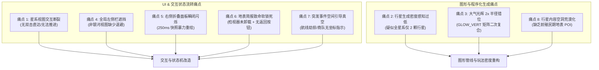
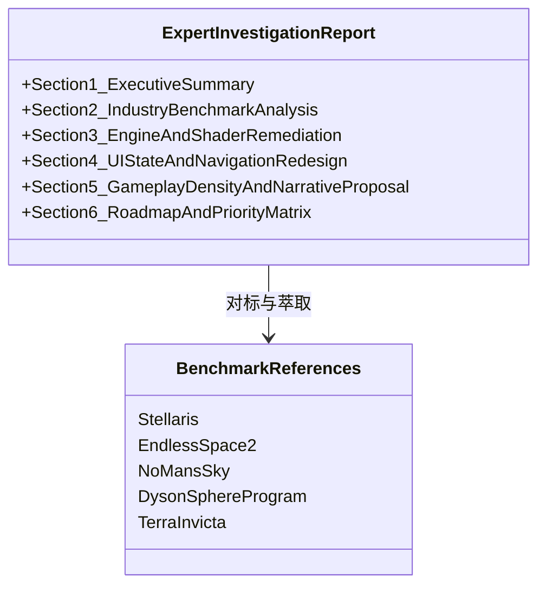

# 《无垠边疆：星海纪元》领域专家调研请求任务委托书
**Document Identifier**: `MANDATE-RFP-VOID-FRONTIER-202611-01`  
**委托方**: 《无垠边疆：星海纪元》项目负责人 (Project Lead) & 核心架构组  
**受托方**: 4X 大战略游戏设计、计算机图形学与复杂交互系统领域专家 (Domain Expert & Game Architect)  
**基准版本**: GitHub 主分支（Commit `2d471a5` / 纯静态零依赖原生 WebGL2 4X 沙盒）  
**日期**: 2026 年 11 月  

---

## 1. 委托背景与项目概况 (Project Context)

《无垠边疆：星海纪元》（*VOID FRONTIER: AGE OF STARS*）是一款以**纯静态、零外部构建依赖、高确定性推演**为技术基石的单机 4X 星际大战略沙盒 Web 应用。项目底层采用原生 WebGL 2.0 双画布自研引擎（实现 40,000 恒星粒子银河、广义相对论引力透镜黑洞、日冕与瑞利散射大气、3D 体素行星地表），搭载 `xoshiro128**` 种子级确定性时钟模拟管线与 IndexedDB 三级容灾持久化。

在完成代码库全栈工程审计与开源脱敏后，项目负责人与核心测试团队在全链路实测中，发现了数项**严重阻断玩家核心心流、破坏沉浸感甚至引发状态机永久软锁死**的工程与设计缺陷。为确保系统从“硬核技术底座交付”向“高完成度、高耐玩性商业级 4X 佳作”顺利跨越，特向领域专家发起本次全面调研与方案委托。

---

## 2. 核心调研需求：8 大现存缺陷与深层痛点深度剖析

请专家针对以下 8 项核心痛点，结合行业标杆（如 *Stellaris*《群星》、*Endless Space 2*《无尽空间2》、*No Man's Sky*《无人深空》、*Dyson Sphere Program*《戴森球计划》、*Terra Invicta* 等），提供系统性归因剖析、行业优秀交互范式、数学/着色器修正代码以及玩法机制重构方案。



---

### 痛点 1：星系层级交互断裂与深度迷航 (Navigation & Interaction Paralysis)
* **用户实测现象**：访问 `index.html#/system/sys_396` 等星系视图时，界面无法继续深入交互。点击或双击行星无法“前往”、“聚焦”或“降落”，星系视图沦为纯观赏性质的旋转画布。
* **工程现状剖析**：
  * 在 `SystemView.js` 中，Canvas 交互仅监听了 `mousedown`、`mousemove`、`mouseup`、`click` 和 `wheel`。
  * `click` 仅调用了 `this._renderer.pick(p.x, p.y)` 并触发 `this.app.select('planet', hit)` 联动高亮右侧悬浮情报舱的行星卡片；完全未监听 `dblclick`（双击）。
  * 玩家缺乏类似主流 4X 游戏的视线交互（如双击天体相机平滑推近、弹出径向动作环、快捷“派遣舰队/设立前哨/视察地表”上下文菜单）。
* **专家调研要点**：
  1. 现代 4X 游戏（如《群星》星系内视图、《无尽空间2》天体轮盘）从星系全局向单一天体推进的交互基元范式；
  2. Canvas 空间内射线拾取后，双击平滑插值运镜（Camera Orbit Lerp）与径向快捷行动菜单（Radial Action Menu）的最佳工程落地设计。

---

### 痛点 2：天体生成密度与多样性感知不足 (System Generation & Habitability Bias)
* **用户实测现象**：玩家直观感知“每个星系普遍只有 2 个星球”，缺乏充盈宏大的恒星系纵深感。
* **工程现状剖析**：
  * 代码库在 `galaxyGen.js` 中设定了 `const nPlanets = RNG.intRange(world, 2, 8);`。
  * 产生“仅 2 个星球”感知的深层原因可能涵盖：
    1. 战争迷雾/勘测层级（Fog of War / Survey Level）：未调查完成的星系可能过滤或折叠了部分天体；
    2. 轨道步进与相机视锥裁剪（Frustum Culling / Orbit Clamping）：外层行星轨道超出当前相机默认 FOV 视窗范围；
    3. 伪随机算法在小样本下的分布偏移或种子截断。
* **专家调研要点**：
  1. 天体物理学分布与 4X 游戏观感平衡：不同光谱恒星（O/B/A/F/G/K/M 矮星、巨星、双星系统）的行星数量、小行星带（Asteroid Belts）、柯伊伯带及天然卫星的黄金分布比例；
  2. 迷雾下未探测天体的“虚影雷达回波/未知引力源”展示范式，避免玩家误判为系统空无一物。

---

### 痛点 3：WebGL 着色器视觉几何严重错位 (Atmosphere Glow 2x Radius Offset Bug)
* **用户实测现象**：星系视图中，星球的大气光辉（Glow）效果与星球本体不重叠，视觉呈现出“距离恒星轨道中心恰好为 2 倍半径”的严重几何漂移。
* **工程根因精确代码定位**：
  * 查阅 `System3D.js` 的大气顶点着色器 `GLOW_VERT`：
    ```glsl
    uniform mat4 uMVP;
    uniform mat4 uModel;
    uniform float uRadius;
    in vec3 aPos;
    out vec3 vN;
    out vec3 vWorld;
    void main() {
      vec4 w = uModel * vec4(aPos * uRadius, 1.0); // <-- 第一次应用 Model 平移与缩放
      vWorld = w.xyz;
      vN = mat3(uModel) * aPos;
      gl_Position = uMVP * w;                       // <-- uMVP 内部再次包含了 Model！
    }
    ```
  * 在 CPU 驱动端 `_drawGlows(gl)` 中：
    ```javascript
    mat4Translate(s.model, e.world[0], e.world[1], e.world[2]);
    mat4Multiply(s.vm, s.view, s.model);
    mat4Multiply(s.vp, s.proj, s.vm); // <-- s.vp 已经是 proj * view * model！
    gl.uniformMatrix4fv(P.u.uMVP, false, s.vp);
    gl.uniformMatrix4fv(P.u.uModel, false, s.model);
    ```
  * **数学实证**：`uMVP` 实际为 $P \times V \times M$。着色器执行 `uMVP * w` 相当于 $(P \times V \times M) \times (M \times P_{local})$。由于 $M$ 为恒星原点到行星位置的平移变换，平移向量被叠加了两次，导致辉光壳在世界坐标系中被精确平移至 $2 \times \vec{r}_{planet}$，完美印证了用户的敏锐观察！
* **专家调研要点**：
  1. 提供标准化着色器变换流水线规范，杜绝矩阵二次复合错误；
  2. 针对 WebGL2 双通道渲染（不透明本体 + 背面剔除加性大气壳），给出考虑日照方向散射与晨昏线渐变的高性能大气菲涅尔实现。

---

### 痛点 4：全局视图层级与侧栏悬浮遮挡冲突 (View Layout & Nav Dodge Breakdown)
* **用户实测现象**：除了银河界面（GalaxyView）外，其余所有子界面（殖民地、科研、外交、法案、舰队、舰船设计、市场、纪年、设置等）均未对左侧悬浮选项卡（`.vf-sidebar`）做退避，导致内容被物理遮挡在选项卡下方。
* **工程现状剖析**：
  * `styles.css` 中 `.vf-sidebar` 采用 `position: fixed; left: 10px; width: 46px; z-index: 100`。
  * 银河界面设计初衷为“沉浸式全屏星图”，故悬浮侧栏符合预期；
  * 但绝大多数功能界面的根容器 `.vf-view-body` 缺少响应式 `margin-left` 或统一的 CSS 网格/Flex 布局约束，导致信息列表、表单、二级选项卡被遮挡在最左侧 56px~176px 区域内。
* **专家调研要点**：
  1. 现代 4X 游戏在“沉浸式全屏地图模式（Immersive Map Mode）”与“重数据管理面板模式（Heavy Management Dashboard Mode）”之间的布局容器动态适配方案；
  2. 零外部框架下的纯 CSS Variable 与 HTML 容器类名动态流转架构（例如使用 `:has()`、容器查询或自适应 CSS 类）。

---

### 痛点 5：响应式组件状态保持与快照节流冲突 (Accordion Flash-Collapse Bug)
* **用户实测现象**：在星系界面（如“星系-岚托”）右侧情报舱，点击任意折叠面板（Collapse Accordion）试图展开查看详情时，面板展开后瞬时闪烁并自动缩回闭合。
* **工程根因精确代码定位**：
  * 查阅 `SystemView.js`：
    ```javascript
    onSnapshot(snap) {
      if (!this._mounted) return;
      const now = performance.now();
      if (now - this._lastRefresh < 250) return; // 250ms 节流
      this._lastRefresh = now;
      this._refreshAll(); // <-- 核心诱因！
    }
    ```
  * `_refreshAll()` 内部调用 `_buildDossier()`，其执行的第一行就是暴力清空 DOM：`this._dossier.innerHTML = '';`！
  * 所有折叠面板是通过 `panel({ title, open: false })` 动态新建的。
  * **时序实证**：玩家点击展开面板后，至多经过 250ms，底层的模拟时钟快照触发 `onSnapshot`，`_buildDossier()` 立即清空整个右侧 DOM 并按照初始默认状态重建，导致刚刚展开的面板被暴力销毁并重建为闭合状态，呈现“展开即闪缩”的严重交互缺陷！
* **专家调研要点**：
  1. 无前端框架（Vanilla JS）架构下，如何设计轻量高效的**局部 DOM 差异更新（Micro Patching）**或**UI 瞬态缓存机制（Ephemeral State Store）**；
  2. 模拟时钟数据快照推送与用户交互状态（聚焦、折叠、滚动条位置）的解耦规范。

---

### 痛点 6：视图生命周期流转死锁与软锁闭 (Catastrophic GroundView Softlock)
* **用户实测现象**：从银河地图进入星系视图，在星系界面不点击任何空白处、直接点击“登陆行星地表”进入地表简报页。此时：
  1. 右侧恒星信息检视器（Inspector）不会隐藏；
  2. 简报页面中没有任何“返回”或“退出”按钮；
  3. 若玩家尚未建立殖民地，无法发起行动，游戏陷入彻底的无响应永久软锁死（Permanent Softlock）。
* **工程现状剖析**：
  * **抽屉未清理**：在银河与星系视图中，点击天体会触发 `app.select('system', ...)` 或 `app.select('planet', ...)`，这令右侧的 `Inspector.js` 处于 `.open` 激活态。路由切换至 `ground` 时，全局路由守卫（Router / App）并未调用 `app.select(null)` 关闭抽屉。
  * **导航断头路**：查看 `GroundView.js`：
    ```javascript
    _buildBriefing(resumeMission) {
      this.mode = 'briefing';
      this._setHead('简报', []); // <-- 按钮列表传入空数组 []！
      // ...
      if (!planetSel.childElementCount) {
        p1.appendChild(el('div', { text: '尚无玩家殖民地——先在星系视图建立前哨站。' }));
      }
    }
    ```
    在没有可用任务时，头部按钮完全为空，页面没有“返回星系”、“返回银河”的任何路径，由于左侧栏被覆盖或未对齐，玩家被彻底封死在该视图中！
* **专家调研要点**：
  1. 复杂单页游戏（SPA Game）的通用视图路由栈设计（View Stack & Breadcrumbs），保证任意叶子节点页面具备防御性兜底逃逸逻辑（`Esc` 键、回退堆栈）；
  2. 跨视图生命周期的全局单例面板（检视器、模态窗）自动卸载与清理契约。

---

### 痛点 7：突发空间事件的导引与感知真空 (Event Spatial Guidance Vacuum)
* **用户实测现象**：各类突发事件（如“航线劫掠”、“商船队遭袭”、“神秘深空信号”等）弹出对话框并提供选项，但文本结束后，完全没有明确的空间与视觉引导告诉玩家“该去哪个星系/哪条航路”。
* **工程现状剖析**：
  * `src/content/events.js` 中的事件定义主要为纯叙事文本、条件判定与资源算子操作。
  * 事件未携带结构化空间元数据（`targetSystemId`, `targetLaneId`, `targetCoords`）。
  * UI 层缺少“聚焦目标（Focus Camera）”、“标记航线（Highlight Route）”、“派遣舰队快捷按钮”等空间行动锚点。
* **专家调研要点**：
  1. *Stellaris*《群星》与 *Crusader Kings III* 等大战略游戏的“通知日志与事件空间锚定系统（Event Notification & Map Pinning System）”最佳实践；
  2. 银河大地图视角下的屏幕边缘离屏指标箭头（Off-screen Waypoint Indicator）与动态航线威胁警示特效实现方案。

---

### 痛点 8：行星地表内容空洞与“黑天鹅式”荒漠感 (Barren Universe & Content Void)
* **用户实测现象**：未殖民星球极度缺乏可玩交互与探索内容。“这空白程度赶上刚发售时的无人深空了，与游戏史上的黑天鹅事件有得一拼”。
* **工程现状剖析**：
  * 宇宙中绝大多数星球仅有枯燥的数值（引力、大气、矿脉等级），没有前哨站就无法进入殖民管理；
  * 地表 3D 视图（GroundView）具备极强的体素渲染与小队操控能力，但在无殖民地时直接提示“尚无玩家殖民地”，无法进入探索；
  * 缺乏前殖民期（Pre-colonization）的先遣科考探险、坠毁残骸打捞、古代外星遗迹（Ruins）、极端气候生存采集等微观玩法。
* **专家调研要点**：
  1. 从《无人深空》的惨痛教训到《群星》（行星异常点/考古遗址）与《环世界》的成熟经验，4X 游戏如何通过程序化涌现叙事（Emergent Procedural Narrative）填补宏观星图与微观地表之间的内容断层；
  2. 低成本、高代入感的前期地表勘探玩法原型设计：如何在现有 3D 地表引擎上快速实装“地表先遣科考小队探险”、“远古遗物发掘”与“环境危害采样”机制。

---

## 3. 专家调研产出与交付物规格 (Deliverables Specification)

请受托专家基于全球 4X 与图形工程领域成熟经验，在调研报告中按以下结构提交研究成果：



### 交付物章节规范：
1. **执行摘要与破局战略 (Executive Strategy)**：针对上述 8 大痛点的综合定性评价与系统解耦重构原则。
2. **行业顶级 4X 交互与设计对标 (Industry Benchmarks)**：深度解构《群星》《无尽空间 2》《戴森球计划》等经典作品在天体分层推进、事件地图导引与地表勘探的设计精髓。
3. **图形与着色器数学修复实施例 (Graphics & Shader Fixes)**：
   * 提供修正后的 `GLOW_VERT` 与 `_drawGlows` 完整代码及数学推导。
   * 给出星系天体轨道布局与相机视锥自适应算法。
4. **前端无框架架构下的状态机与增量渲染方案 (Vanilla Architecture Optimization)**：
   * 针对 250ms 快照推送信标，给出保持折叠面板状态与输入焦点的虚拟 DOM 或局部 Patching 极简设计方案。
   * 给出全局抽屉（Inspector）与全局面包屑（Breadcrumbs）视图栈调度方案。
5. **程序化宇宙内容填充与前殖民期地表玩法方案 (Procedural Content Generation)**：
   * 提出一套轻量级、数据驱动的“未殖民行星先遣地表探险系统”设计方案（含数据结构、任务生成公式与收益闭环）。
   * 设计事件空间化元数据结构与地图 Pin / 指针导航机制。
6. **实施路径与优先级矩阵 (Implementation Roadmap & Impact Matrix)**：按工期、技术风险、用户体验影响划分 P0（阻断级）、P1（急需级）、P2（进阶级）开发路线图。

---

**任务委托确认**:  
*本委托书已正式归档入项目工程审计与决策序列。请受托专家以此基准开展系统性深度调研，协助《无垠边疆：星海纪元》完成工业级体验飞跃。*
