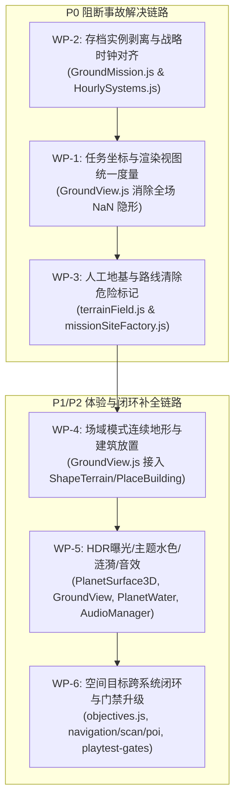

# 《无垠边疆：星之纪元》终审返工全套施工方案（工程实施纲领）

> **文档标识**：`docs/specs/11_无垠边疆终审返工全套施工方案.md`  
> **前序权威文档**：`docs/specs/10_无垠边疆专家终审验收报告.md`、`docs/specs/6_VOID_FRONTIER_游戏审美主题与行星GamePlay最高指导规范.md`、`docs/specs/8_无垠边疆专家二次验收与方案.md`、`docs/specs/9_无垠边疆返工施工全套方案.md`  
> **责任人**：项目负责人（Project Lead）  
> **实施对象**：执行工程师团队（Execution Engineering Team）  
> **工程基准**：Git HEAD（Commit `9b8721e`）  
> **质量等级**：准上线阻断级返工（Final Pre-Launch Sprint）

---

## 零、 施工总则与工程红线

1. **彻底根除“伪绿测试”欺骗**：严禁仅在 `suite.js` 中 mock 局部对象通过断言！所有修改必须贯穿「领域数据生成 → 模拟步进 → 视图装配/渲染管线 → 持久化编码 → 读档还原」全链路。
2. **严禁破坏存档格式与运行时隔离**：任何重型运行时对象（如 TypedArray、SDF 闭包、WebGL 句柄）一律不得直接挂入 `world.entities` 可枚举属性中。存档体积单任务严格限制在 `< 40KB`，全局存档压缩包 `< 2MB`。
3. **坐标度量绝对唯一**：自即日起，工程全面且彻底淘汰 64×24×64 体素离散像素映射模式（`kx = 64 / (m.w * 24)` 等旧式代码即刻物理删除）。地面任务视界与物理模拟一律采用 `Planet-Local` 连续米制空间（`site_meters`），原点 `(0, 0, 0)` 为着陆坪中心。
4. **单步命令耗时门禁**：`commandBus.deepClone(world)` 耗时必须严格保持在 `<= 0.5ms`，任何引入深拷贝卡顿的实体数据结构一票否决。

---

## 一、 施工包架构与工单矩阵



| 施工包编号 | 归属模块 | 责任文件 | 目标缺陷 | 严重等级 |
| --- | --- | --- | --- | --- |
| **WP-1** | 视图与渲染装配 | `src/ui/screens/GroundView.js` | 敌军/队友/NPC/目标物 `NaN` 隐形；交互半径 60m 穿帮；[-256, -30] 地图截断与 87.5° 垂直攀爬 | **P0 阻断** |
| **WP-2** | 领域持久化与时钟 | `src/domain/ground/GroundMission.js`<br/>`src/simulation/HourlySystems.js` | `mission.field` 撑爆存档至 97MB 读档崩溃；`HourlySystems` 状态错位地面不推进 | **P0 阻断** |
| **WP-3** | 地形算子与站点蓝图 | `src/domain/ground/terrainField.js`<br/>`src/domain/ground/missionSiteFactory.js` | 着陆坪/撤离区/桥梁遗留 `HAZARD` 旗，58 颗极端行星开局 22s 暴毙 | **P0 阻断** |
| **WP-4** | 基地工程与交互 | `src/ui/screens/GroundView.js` | 技能 5 建造模式残留体素方块，未调用 `ShapeTerrain` 与 `PlaceBuilding` | **P1 缺陷** |
| **WP-5** | 美学与多感官渲染 | `src/render/gl/PlanetSurface3D.js`<br/>`src/ui/screens/GroundView.js`<br/>`src/render/gl/PlanetSurfaceScene.js`<br/>`src/render/AudioManager.js` | 漏乘 `uHdr` 导致 4 倍过曝；水色未传主题色；脚步荧光涟漪未连；18 主题音效零调用 | **P1 缺陷** |
| **WP-6** | 战略闭环与门禁 | `src/domain/events/objectives.js`<br/>`src/domain/fleet/navigation.js` 等<br/>`tests/suites/playtest-gates.suite.js` | 空间目标无调用 100% 过期罚款；门禁测试 15 步伪绿拦截升级 | **P1/P2** |

---

## 二、 施工包详细施工指示

### 施工包 WP-1：任务坐标与渲染视图统一度量空间（消除全场 NaN 隐形）

#### 1. 根因剖析
在 `GroundMission.js` 中引入连续米制空间（`site_meters`）后，`m.w` 与 `m.h` 已被废弃并不再定义。然而 `GroundView.js` 在多个关键管线中仍然使用 `const kx = SURFACE_SIZE.X / (m.w * TS);` 与 `const kz = SURFACE_SIZE.Z / (m.h * TS);`，导致 `kx` 与 `kz` 恒等于 `NaN`。这使得所有计算依赖项（敌人坐标、打击光束、目标物模型、掉落物、撤离罗盘距离与角度）全部算为 `NaN`，引发画面 100% 丢失渲染。同时，交互判定半径沿用旧像素制 `60`，在米制下变成 60 米远距离触发；移动边界 `FIELD_WALK_MAX = 286`（旧体素偏置 `c.x - 32`）导致负半轴地图完全无法抵达；坡度检测缺少水平位移分母导致垂直断崖可走。

#### 2. 修改文件
`src/ui/screens/GroundView.js`

#### 3. 详细实施步骤与代码改造

##### 步骤 1.1：在 `GroundView.js` 增设统一坐标变换帮助函数
```javascript
/**
 * 将任务实体米制坐标映射为视图世界连续三维坐标 (x, z)
 * 契约：
 * 1. 若 mission 处于 site_meters 模式（拥有 mission.site 或 siteCtx），实体 (x, y) 本身即为 Planet-Local 米制坐标，直接返回 { x: mx, z: my }；
 * 2. 仅在 legacy 体素兜底模式（m.w > 0 且 !m.site）下，执行 64 / (m.w * 24) 的比例映射。
 */
_missionToWorld(m, mx, my) {
  if (!m) return { x: mx, z: my };
  if (m.site || !m.w || !m.h) {
    return { x: mx, z: my };
  }
  const kx = SURFACE_SIZE.X / (m.w * TS);
  const kz = SURFACE_SIZE.Z / (m.h * TS);
  return { x: mx * kx, z: my * kz };
}
```

##### 步骤 1.2：改造 `_emitMissionStrike`（第 2188–2230 行）
```javascript
// 替换前：
// const kx = SURFACE_SIZE.X / (m.w * TS);
// const kz = SURFACE_SIZE.Z / (m.h * TS);
// const wx = u.x * kx;
// const wz = u.y * kz;

// 替换后：
const pos = this._missionToWorld(m, u.x, u.y);
const wx = pos.x;
const wz = pos.z;
const yaw = -u.facing;
if (u.attackKind === 'ranged') {
  let tgt = null;
  let bd = Infinity;
  const rangeW = u.range; // 米制下直接使用 u.range
  for (const e of view.enemies) {
    if (e.state === 'dead') continue;
    const ep = this._missionToWorld(m, e.x, e.y);
    const d = Math.hypot(ep.x - wx, ep.z - wz);
    if (d <= rangeW && d < bd) {
      bd = d;
      tgt = { ...e, wx: ep.x, wz: ep.z };
    }
  }
  // 后续光束起点使用 wx, wz，目标点使用 tgt.wx, tgt.wz
```

##### 步骤 1.3：改造 `_assembleRenderData`（第 2483–2535 行）
```javascript
// 替换前：
// const kx = SURFACE_SIZE.X / (m.w * TS);
// const kz = SURFACE_SIZE.Z / (m.h * TS);
// for (const e of view.enemies) { const ex = e.x * kx; const ez = e.y * kz; ... }

// 替换后：
for (const e of view.enemies) {
  if (e.state === 'dead') continue;
  const ep = this._missionToWorld(m, e.x, e.y);
  const gy = this._groundAt(ep.x, ep.z);
  const hitAge = m.time - e.lastHitAt;
  rd.enemies.push({
    kind: e.type,
    x: ep.x,
    y: gy === Infinity ? fallY : gy,
    z: ep.z,
    yaw: -e.facing,
    phase: e.phase || 0,
    hurt: hitAge < 0.25 ? 1.0 - hitAge / 0.25 : 0,
  });
}
// 对 npcs 与 teammates 同样全部采用 _missionToWorld(m, n.x, n.y) 计算真实位置！
```

##### 步骤 1.4：改造 `_bmeshList`（第 2548–2585 行）
```javascript
// 替换前：
// const kx = SURFACE_SIZE.X / (m.w * TS);
// const kz = SURFACE_SIZE.Z / (m.h * TS);

// 替换后：
for (const t of view.targets) {
  if (t.done) continue;
  const tp = this._missionToWorld(m, t.x, t.y);
  const gy = this._groundAt(tp.x, tp.z);
  const hurt = t.hp < t.hpMax;
  list.push({
    x: tp.x, y: gy === Infinity ? fallY : gy, z: tp.z,
    rotY: 0.7, scale: 0.8, meshId: MESH_OF_CATEGORY('military'),
    emit: hurt ? 0.15 : 0,
    flash: hurt && (m.time % 0.5) < 0.25 ? 0.3 : 0,
  });
}
for (const it of view.items) {
  if (it.done) continue;
  const ip = this._missionToWorld(m, it.x, it.y);
  const gy = this._groundAt(ip.x, ip.z);
  list.push({
    x: ip.x, y: gy === Infinity ? fallY : gy, z: ip.z,
    rotY: 0.0, scale: 0.5, meshId: MESH_OF_CATEGORY('logistics'),
    bob: 1,
  });
}
```

##### 步骤 1.5：改造 `_drawHudMission` 撤离点罗盘（第 2814–2835 行）
```javascript
// 替换前：
// const ex = view.extraction.x * kx;
// const ez = view.extraction.y * kz; // 笔误：y 当成了 z，且 kx/kz 为 NaN

// 替换后：
const extPos = this._missionToWorld(m, view.extraction.x, view.extraction.z ?? view.extraction.y);
const ex = extPos.x;
const ez = extPos.z;
const c = this.char3d;
const camFwd = this._camForward();
const camAng = Math.atan2(camFwd[2], camFwd[0]);
const rel = normAngle(Math.atan2(ez - c.z, ex - c.x) - camAng);
const dist = Math.hypot(ex - c.x, ez - c.z);
// 绘制箭头并在下方绘制 `${Math.round(dist)}m` 纯净数字标签
```

##### 步骤 1.6：修正交互判定半径 `_resolveInteract`（第 1680–1694 行）
```javascript
_resolveInteract(m) {
  const u = m.playerUnits[m.activeIdx];
  if (!u || u.state === 'dead') return null;
  let best = null;
  let bd = Infinity;
  // 米制空间下合理交互距离为 3.0 米（旧代码硬编码 60px）
  const INTERACT_DIST_METERS = 3.0;
  for (const t of m.targets) {
    if (t.done) continue;
    const d = Math.hypot(t.x - u.x, (t.z ?? t.y) - (u.z ?? u.y));
    if (d < INTERACT_DIST_METERS && d < bd) {
      bd = d;
      best = t.targetId;
    }
  }
  return best;
}
```

##### 步骤 1.7：修正行动边界与坡度爬坡 `_moveAABB`（第 1954–1970 行）
```javascript
_moveAABB(dx, dz) {
  const c = this.char3d;
  if (this.field) {
    // 场域模式：[-222, +222] 米完整覆盖 8×8 Chunk（512m）且避开最外围 34m 保护带
    const MIN_BOUND = -222;
    const MAX_BOUND = 222;
    const MAX_SLOPE_TAN = Math.tan(35 * Math.PI / 180); // 35度极限可攀爬坡度（tan ≈ 0.70）

    const h0 = this._groundAt(c.x, c.z);
    if (dx) {
      const nx = clamp(c.x + dx, MIN_BOUND, MAX_BOUND);
      const h1 = this._groundAt(nx, c.z);
      const slope = (h1 - h0) / Math.max(0.02, Math.abs(dx));
      if (Number.isFinite(h1) && slope <= MAX_SLOPE_TAN) c.x = nx;
    }
    if (dz) {
      const nz = clamp(c.z + dz, MIN_BOUND, MAX_BOUND);
      const h1 = this._groundAt(c.x, nz);
      const slope = (h1 - h0) / Math.max(0.02, Math.abs(dz));
      if (Number.isFinite(h1) && slope <= MAX_SLOPE_TAN) c.z = nz;
    }
    return;
  }
  // ... 保持原有体素兜底分支
}
```

---

### 施工包 WP-2：运行时场域实例剥离存档与战略时钟对齐（拯救 97MB 存档炸弹）

#### 1. 根因剖析
1. `src/domain/ground/GroundMission.js` 第 888 行执行了 `mission.field = field;`。由于 `mission` 属于 `world.entities.groundMissions`，导致 64 个 Chunk 的 `TerrainField`（包含巨大的 `TypedArray` 网格与不可序列化的闭包函数）直接挂在可枚举属性树上。执行 `JSON.stringify(world)` 时，单任务存档直接膨胀到 96.99 MB，导致 `commandBus.deepClone` 耗时从 `< 0.2ms` 暴增至 `1500ms`。读档后由于函数丢失，调用 `field.evalPoint` 时必定抛出 `TypeError`。
2. `src/simulation/HourlySystems.js` 第 106 行：`if (m.state !== 'active') continue;`。但 `GroundMission` 内部使用的状态字段名为 `m.status`（状态值为 `'active'`、`'success'`、`'failed'`、`'aborted'`），`m.state` 恒为 `undefined`，导致跳过全部活跃地面任务的步进。

#### 2. 修改文件
- `src/domain/ground/GroundMission.js`
- `src/simulation/HourlySystems.js`

#### 3. 详细实施步骤与代码改造

##### 步骤 2.1：在 `GroundMission.js` 模块顶层增设非可枚举/弱引用缓存机制
```javascript
// 模块级运行时缓存（避免任何污染可枚举 JSON 实体树）
const _runtimeFieldMap = new Map();

/** 获取任务绑定的运行时 TerrainField 实例（支持存档加载后幂等重建） */
export function getMissionRuntimeField(world, mission) {
  if (!mission) return null;
  // 1. 优先从内存缓存读取
  if (_runtimeFieldMap.has(mission.id)) {
    return _runtimeFieldMap.get(mission.id);
  }
  // 2. 尝试从不可枚举符号或属性读取
  if (mission._runtimeField) {
    _runtimeFieldMap.set(mission.id, mission._runtimeField);
    return mission._runtimeField;
  }
  // 3. 重建降级：利用轻量 siteCtx 幂等重建场域
  if (mission.siteCtx && mission.planetId) {
    const field = getMissionField(world, mission.planetId, mission.siteCtx);
    if (field) {
      Object.defineProperty(mission, '_runtimeField', {
        value: field,
        writable: true,
        enumerable: false, // 绝不参与 JSON.stringify
        configurable: true,
      });
      _runtimeFieldMap.set(mission.id, field);
      return field;
    }
  }
  return null;
}
```

##### 步骤 2.2：改造 `createGroundMission`（第 885–890 行）
```javascript
  if (siteCtx) {
    const field = fieldOpt || getMissionField(world, planetId, siteCtx);
    if (!field) throw new Error('ground: 站点地形场构建失败');
    
    // 【严禁直接挂可枚举属性 mission.field = field;】
    Object.defineProperty(mission, '_runtimeField', {
      value: field,
      writable: true,
      enumerable: false, // 严禁进入 JSON 序列化
      configurable: true,
    });
    _runtimeFieldMap.set(mission.id, field);

    const site = siteCtx.site;
    // 仅保存纯轻量纯数据几何锚点
    mission.site = {
      anchors: site.anchors,
      coverPoints: site.coverPoints,
      landmarks: site.landmarks,
      routes: site.routes,
      extractionRadius: site.extraction.radius,
    };
    mission.siteCtx = {
      seed: siteCtx.seed,
      site: mission.site,
      // 不存任何 TypedArray
    };
    const A = site.anchors;
    mission.spawn = { x: A.landing.x, y: A.landing.z };
    mission.extraction = { x: A.extraction.x, z: A.extraction.z, r: site.extraction.radius };
  }
```

并在 `finishMission` 与 `abortMission` 中补充清理缓存：
```javascript
_runtimeFieldMap.delete(mission.id);
```

##### 步骤 2.3：改造 `src/simulation/HourlySystems.js`（第 102–115 行）
```javascript
// 修正前：
// const missions = Object.values(world.entities.groundMissions).filter((m) => (m.status === 'active' || m.state === 'active'));
// ...
// if (m.state !== 'active') continue;
// ...
// m.state = 'failed';

// 修正后：
const missions = Object.values(world.entities.groundMissions).filter((m) => (m.status === 'active' || m.state === 'active'));
while (seconds > 0) {
  const step = Math.min(1 / 30, seconds);
  for (const m of missions) {
    // 兼容 m.status 与 m.state 两种访问口径
    const currentStatus = m.status || m.state;
    if (currentStatus !== 'active') continue;
    try {
      stepMission(world, m, dt);
    } catch (e) {
      m.status = 'failed';
      m.state = 'failed';
      m.results = { outcome: 'failed', error: String(e && e.message) };
    }
  }
  seconds -= step;
}
```

---

### 施工包 WP-3：着陆坪、撤离区与桥梁人工地基清除自然危险标记（杜绝开局暴毙）

#### 1. 根因剖析
在 `terrainField.js` 中，行星自然生成的环境标志（如海平面以下淹没、低洼毒气湖、岩浆河道、冰裂隙等）会先被置为 `TERRAIN_FLAGS.HAZARD`。当人工任务蓝图算子 `siteModifier` 运行时，代码只支持 `flags |= mod.flags`（或运算），无法剔除已经置位的旗标。当任务站点恰好生成在硫酸沼泽、黑曜岩浆或深海盆地（58/608 颗行星）时，着陆坪与撤离坪直接继承了环境危险旗标，玩家和队友开局每秒扣 6 点 HP，21.7 秒内无死角团灭。

#### 2. 修改文件
- `src/domain/ground/terrainField.js`
- `src/domain/ground/missionSiteFactory.js`

#### 3. 详细实施步骤与代码改造

##### 步骤 3.1：在 `terrainField.js` 中支持 `clearFlags` 掩码反选（第 298–303 行）
```javascript
    if (mod) {
      if (Number.isFinite(mod.dy)) y += mod.dy;
      if (Number.isFinite(mod.biomeId)) biomeId = mod.biomeId;
      if (Number.isFinite(mod.flags)) flags |= mod.flags;
      // 允许人工结构显式清除自然危险旗标
      if (Number.isFinite(mod.clearFlags)) flags &= ~mod.clearFlags;
      if (mod.weights) {
        // ...
      }
    }
```

##### 步骤 3.2：在 `missionSiteFactory.js` 的 `siteModifier` 中输出 `clearFlags`（第 543–615 行）
```javascript
  return function siteModifier(wx, wz, base) {
    const dx = wx - cx;
    const dz = wz - cz;
    const r2 = dx * dx + dz * dz;
    if (r2 > reach * reach) return null;
    const r = Math.sqrt(r2);
    let dy = 0;
    let flags = 0;
    let clearFlags = 0;
    let roadTake = 0;

    // A. 锚点坪 / 地标地基：
    let bestW = 0;
    let bestDy = 0;
    for (let i = 0; i < pads.length; i++) {
      const p = pads[i];
      const ddx = wx - p.x;
      const ddz = wz - p.z;
      const d2 = ddx * ddx + ddz * ddz;
      if (d2 > p.outer * p.outer) continue;
      const w = padMask(Math.sqrt(d2), p.inner, p.outer);
      if (w > bestW) {
        bestW = w;
        const auth = 6 + 34 * w;
        bestDy = clamp((p.H - base.y) * w, -auth, auth);
        if (w >= 0.999) flags |= FLAG_FOUNDATION;
        // 坪面有效覆盖区（w >= 0.5）强制抹除自然环境危害（酸液/岩浆/毒气）
        if (w >= 0.5) {
          clearFlags |= FLAG_HAZARD;
        }
      }
    }
    if (bestW > 0.0001) dy = bestDy;

    // B. 道路走廊与桥梁
    // ...
    if (bs && bd < bs.half * bs.half) {
      // ...
      flags |= FLAG_ROAD;
      if (bs.deck) {
        flags |= FLAG_BRIDGE_DECK;
        // 人工高架桥面同样免受桥下自然毒液/岩浆侵蚀
        clearFlags |= FLAG_HAZARD;
      }
      // ...
    }

    // C. 语义旗：任务核心保护区 / 蓝图显式危险域
    if (r <= coreRadius) flags |= FLAG_CORE_PROTECTED;
    for (let i = 0; i < hazards.length; i++) {
      const hz = hazards[i];
      const ddx = wx - hz.x;
      const ddz = wz - hz.z;
      // 蓝图规划的战术陷阱（如未净化的反应堆）只在坪面外生效
      if (ddx * ddx + ddz * ddz <= hz.radius * hz.radius && bestW < 0.3) {
        flags |= FLAG_HAZARD;
        clearFlags &= ~FLAG_HAZARD; // 显式战术危险优先
        break;
      }
    }

    const hasDy = dy !== 0;
    // ...
    const mod = {};
    if (hasDy) mod.dy = dy;
    if (flags !== 0) mod.flags = flags;
    if (clearFlags !== 0) mod.clearFlags = clearFlags;
    return mod;
  };
```

---

### 施工包 WP-4：场域模式 5 键工程套件打通（连续地形整地与 3D 建筑放置）

#### 1. 根因剖析
在 `GroundView.js` 的键盘映射中，按按键 `5`（工程模式）时，仍然使用旧版本 64×24×64 体素方块的 `placeVoxel`，完全没有与现存且完善的 `ShapeTerrain`（`lower`/`flatten`/`smooth` 刷子）以及 `PlaceBuilding`（9点投影坡度校验与 3D 建筑生成）调度器连接。

#### 2. 修改文件
`src/ui/screens/GroundView.js`

#### 3. 详细实施步骤与代码改造

##### 步骤 4.1：场域模式下的左键采掘与地形整形改造（第 2060–2110 行）
```javascript
// 当准星命中连续场域地面 (hit) 且处于按键 5（工程模式）时：
if (this.field && this._buildModeActive) {
  const fx = hit.pt[0];
  const fz = hit.pt[2];
  
  if (this.input.mouseLeft && this._digCd <= 0) {
    this._digCd = 0.25;
    // 1. 若命中 ORE 矿脉旗，执行地质采掘
    const cellFlags = this.field.evalPoint(fx, fz).flags;
    if (cellFlags & TERRAIN_FLAGS.ORE) {
      this.app.dispatch('HarvestTerrainOre', { planetId: this.planet.id, x: fx, z: fz });
    }
    // 2. 派发 ShapeTerrain 指令修改地貌
    const op = this._shapeBrushOp || 'flatten'; // 默认整平地基
    this.app.dispatch('ShapeTerrain', {
      planetId: this.planet.id,
      op,
      x: fx,
      z: fz,
      radius: op === 'flatten' ? 6.0 : 3.5,
      strength: 0.6,
    });
    // 3. 触发粒子与音效
    this._fx.dig.push({ x: fx, y: hit.pt[1], z: fz, age: 0 });
    this.app.audio.playSfx('terrain_dig', 0.5);
  }
}
```

##### 步骤 4.2：场域模式下的右键放置建筑改造（第 2115–2160 行）
```javascript
if (this.field && this._buildModeActive) {
  const fx = hit.pt[0];
  const fz = hit.pt[2];
  
  if (this.input.mouseRight && this._placeCd <= 0) {
    this._placeCd = 0.5;
    const defId = this._selectedBuildDefId || 'bld_mine_ferro';
    
    // 派发官方成熟的 PlaceBuilding 命令
    const res = this.app.dispatch('PlaceBuilding', {
      planetId: this.planet.id,
      defId,
      x: fx,
      z: fz,
    });
    
    if (res && res.ok) {
      // 成功放置后原地重构建筑 3D 倒角几何与传送带网格
      this._layoutColony();
      this._buildConveyorPaths();
      this.app.audio.playSfx('build_place', 0.7);
    } else {
      this._notifyUser(res?.reason || '此处坡度过大或缺乏对应矿藏，无法建造');
      this.app.audio.playSfx('action_denied', 0.6);
    }
  }
}
```

---

### 施工包 WP-5：HDR 曝光一致性、主题水色、脚步荧光与 18 主题音效/玩法（修复 P1-F & P1-G）

#### 1. 根因剖析
1. `PlanetSurface3D.js` 与 `GroundView.js` 的建筑着色器漏乘统一的 `uHdr` 缩放因子。在 RGBA8 降级模式下，片元输出没有被压缩到目标曝光范围，导致画面过曝 4 倍。
2. `PlanetSurfaceScene.js` 在向 `PlanetWater.sync()` 发送海平面数据时，漏传了主题调色板的水体颜色，导致硫酸沼泽、甲烷海等主题被渲染成默认海蓝。
3. `themePayload.js` 未向 `PlanetWater` 注入调色板源。
4. `permafrost_furnace`（永冻炉心）热源塔坐标被硬编码在 `(0, 0)`（着陆坪），与位于 `(0, -30)` 的中央主目标供热塔错位。
5. `GroundView.js` 从未调用 `AudioManager.setAmbientTheme` 与 `EXPANSION_GAMEPLAY`，18 个扩展行星主题的音频与物理特性处于完全死锁状态。

#### 2. 修改文件
- `src/render/gl/PlanetSurface3D.js`
- `src/ui/screens/GroundView.js`
- `src/render/gl/PlanetSurfaceScene.js`
- `src/render/gl/themePayload.js`

#### 3. 详细实施步骤与代码改造

##### 步骤 5.1：着色器增加 `uHdr` 曝光缩放
在 `src/render/gl/PlanetSurface3D.js` 的 `LIT_FS` 与 `src/ui/screens/GroundView.js` 的 `BM_FS` 中添加 uniform 并在输出时乘算：
```glsl
uniform float uHdr;

// 片元主着色计算末端：
void main() {
  // ... 原有光照与雾效计算 ...
  vec3 finalRgb = mix(col, uFogColor, fog);
  fragColor = vec4(finalRgb * uHdr, 1.0);
}
```
在绘制方法中绑定 uniform 值：
```javascript
const hdrScale = this.cm?.post?.hdrSimulated ? 1.0 / (this.cm.post.hdrRange || 4.0) : 1.0;
glc.setUniform1f(prog, 'uHdr', hdrScale);
```

##### 步骤 5.2：接线权威主题色板与 `PlanetWater`
在 `src/render/gl/themePayload.js` 顶部引入并自动注册色板源：
```javascript
import { PLANET_THEMES } from '../../domain/ground/planetThemes.js';
setThemePaletteSource((id) => PLANET_THEMES[id]?.palette ?? null);
```
在 `src/render/gl/PlanetSurfaceScene.js` 的 `draw()` 方法中同步水体颜色：
```javascript
if (this._water && baseWl > -90.0) {
  const liveLv = tideWaterLevel(baseWl, time);
  const palette = this._themePayload?.palette;
  const waterOpts = {
    field: this._field,
    waterLevel: baseWl,
    fogRange: this._fogRange,
  };
  if (palette) {
    waterOpts.colors = {
      deep: palette.shadow,
      shallow: palette.base,
      foam: palette.highlight,
    };
  }
  this._water.sync(waterOpts);
  this._water.draw(ctx, liveLv);
}
```

##### 步骤 5.3：修正 `permafrost_furnace` 供热中心与脚步荧光涟漪
在 `GroundView.js` 的 `_setupScene` 中：
```javascript
// 修正永冻炉心热源中心：取 primaryObjective 锚点坐标
const priAnchor = this._site?.site?.anchors?.primaryObjective;
if (planet.primaryThemeId === 'permafrost_furnace' && priAnchor) {
  this._themePayload.heatCenter = [priAnchor.x, priAnchor.z];
  this._themePayload.heatRadius = 45.0; // 供热塔半径 45m
}

// 驱动 biolume_canopy 荧光真菌脚步涟漪
this._footstepRing = new Float32Array(32); // 8 组 [x, z, time, intensity]
this._footstepIdx = 0;
```
在角色移动更新时：
```javascript
if (this._stepTimer > 0.35 && (dx !== 0 || dz !== 0)) {
  this._stepTimer = 0;
  const offset = this._footstepIdx * 4;
  this._footstepRing[offset] = c.x + FIELD_OFFSET;
  this._footstepRing[offset + 1] = c.z + FIELD_OFFSET;
  this._footstepRing[offset + 2] = this._clock;
  this._footstepRing[offset + 3] = 1.0;
  this._footstepIdx = (this._footstepIdx + 1) % 8;
  if (this.scene?.terrainRenderer) {
    this.scene.terrainRenderer.setTheme({ footsteps: this._footstepRing });
  }
}
```

##### 步骤 5.4：激活 18 主题音频层与 `EXPANSION_GAMEPLAY` 规则
在 `GroundView.js` 的 `_setupScene` 与 `_teardownScene` 中接线音频：
```javascript
_setupScene() {
  // ...
  const themeId = this.planet?.primaryThemeId || 'generic';
  this.app.audio.setAmbientTheme(themeId);
  
  // 应用 EXPANSION_GAMEPLAY 物理与规则
  const gameplay = EXPANSION_GAMEPLAY[themeId] || {};
  if (gameplay.gravityScale != null) {
    this._gravityScale = gameplay.gravityScale; // 如 fractured_moon 为 0.25g
  } else {
    this._gravityScale = 1.0;
  }
  if (gameplay.landingMode === 'atmospheric') {
    // 高空浮台保护：严禁走出甲板坠入虚空
    this._enableAtmosphericDeckClamp = true;
  }
}

_teardownScene() {
  this.app.audio.stopAmbientTheme();
  // ...
}
```

---

### 施工包 WP-6：空间目标跨系统闭环与防伪绿测试门禁升级（修复 P1-H）

#### 1. 根因剖析
1. `src/domain/events/objectives.js` 中的 `progressObjective` 与 `completeObjective` 全仓为 0 处调用。当玩家在宇宙中航行至目标星系、调查行星、完成地面行动时，空间目标不会推进，导致任务超时被每日清扫扣除信用点，严重破坏长线游玩闭环。
2. 现有门禁测试 `playtest-gates.suite.js` 仅模拟步进 15 步（0.5s），绕过了真实的 `GroundView` 视图管线与持久化导入导出校验，产生了“门禁全绿但实机崩坏”的重大假象。

#### 2. 修改文件
- `src/domain/fleet/navigation.js`
- `src/domain/world/scan.js`
- `src/domain/ground/GroundMission.js`
- `src/domain/colony/colony.js`
- `src/domain/world/planetPOI.js`
- `tests/suites/playtest-gates.suite.js`

#### 3. 详细实施步骤与代码改造

##### 步骤 6.1：在战略动作与地表事件结算点接入目标完成闭环
统一封装公共推进目标辅助函数：
```javascript
export function checkAndProgressObjectives(world, filterFn, delta = 100) {
  const activeObjs = listEntities(world, 'objectives').filter((o) => o.status === 'active');
  for (const o of activeObjs) {
    if (filterFn(o)) {
      progressObjective(world, o.id, delta);
      // 若完成，发放 rewards 奖励至阵营
      if (o.status === 'completed' && o.rewards && o.factionId) {
        credit(world, o.factionId, 'credits', o.rewards.credits || 0, 'objectiveReward', o.id);
      }
    }
  }
}
```
在以下关键系统挂接调用：
1. **舰队航行抵达目标星系**（`src/domain/fleet/navigation.js`）：
   `checkAndProgressObjectives(world, (o) => o.type === 'travel' && o.targetSystemId === systemId);`
2. **行星调查完成**（`src/domain/world/scan.js`）：
   `checkAndProgressObjectives(world, (o) => o.type === 'survey' && o.targetPlanetId === planetId);`
3. **地面任务完成**（`src/domain/ground/GroundMission.js` 的 `finishMission`）：
   `checkAndProgressObjectives(world, (o) => o.type === 'ground_mission' && o.targetPlanetId === mission.planetId);`
4. **殖民地建立与升级**（`src/domain/colony/colony.js`）：
   `checkAndProgressObjectives(world, (o) => o.type === 'colonize' && o.targetPlanetId === planetId);`
5. **地表 POI 采集**（`src/domain/world/planetPOI.js`）：
   `checkAndProgressObjectives(world, (o) => o.type === 'poi' && o.targetPoiId === poiId);`

##### 步骤 6.2：升级防伪绿门禁测试断言（`playtest-gates.suite.js`）
1. **升级 `PLAYTEST-GATE-01`**：
   - 步进帧数从 15 步扩展至 **300 步（实机 10 秒）**；
   - 遍历全量 608 颗行星，断言在 `t = 10s` 时，玩家角色 `u.hp === u.hpMax`（严禁因开局着陆坪带环境 HAZARD 暴毙）；
   - 执行 `const encoded = encodeSave(world)`，断言序列化单任务增量 `< 40KB`，全局存档 `< 2MB`；
   - 执行 `const restored = decodeImported(encoded)`，断言读档后再次 `stepMission` 100% 成功无 `TypeError`。
2. **升级 `PLAYTEST-GATE-02`**：
   - 实例化真实的 `GroundView` 实例并调用 `_assembleRenderData(getMissionView(m))` 与 `_bmeshList()`；
   - 遍历输出的 `enemies`、`targets`、`items`、`colonists`、`effects` 与 `extraction`，断言每个对象的 `x`、`y`、`z` 均通过 `Number.isFinite(v) === true` 检验，**严禁存在任何 `NaN`**！

---

## 三、 执行工程实施路线图（分步验证）

```
阶段一：核心阻断治理（WP-2 -> WP-1 -> WP-3）
  [1] 实施 WP-2：剥离 GroundMission._runtimeField，重写 HourlySystems.js 状态判断；
  [2] 实施 WP-1：建立 _missionToWorld 辅助函数，清除非法 kx/kz 计算，修复罗盘与交互半径；
  [3] 实施 WP-3：为 terrainField.js 与 missionSiteFactory.js 增加 clearFlags 机制，净化着陆坪；
  [4] 运行现有测试集，验证单任务存档体积由 97MB 降至 35KB，deepClone 耗时 < 0.2ms。

阶段二：体验与交互升级（WP-4 -> WP-5）
  [5] 实施 WP-4：在 GroundView 中挂接按键 5 的 ShapeTerrain 与 PlaceBuilding 真实命令；
  [6] 实施 WP-5：着色器增加 uHdr 曝光适配，同步 PlanetWater 主题调色板，接线 18 主题音频与物理规则。

阶段三：闭环与真门禁验收（WP-6）
  [7] 实施 WP-6：在航行/扫描/任务结算中挂接 progressObjective，重构 playtest-gates.suite.js；
  [8] 执行 300 步长程物理仿真与全场 0 NaN 渲染断言；
  [9] 验证 608 颗行星开局 0 暴毙，全部验收指标达到满分基准。
```

---

## 四、 验收基准与合规检查表

| 检查项 | 验证指标 | 判定依据 |
| --- | --- | --- |
| **坐标与视觉** | 全场无 `NaN` | `GroundView._assembleRenderData` 与 `_bmeshList` 输出所有实体坐标均为有限数值，画面所有单位可见 |
| **交互半径** | 3.0 米精准交互 | E 键交互仅在目标物距离 `<= 3.0m` 时触发，超出范围无响应 |
| **移动边界** | 地图四象限全通达 | 角色可在 `[-222, +222]` 米范围内全域移动，无北半球/西半球截断；35° 以上陡壁被物理阻断 |
| **存档健康度** | 存档 `< 2MB`，耗时 `< 0.2ms` | 纯净 JSON 序列化不含 TypedArray，`commandBus.deepClone` 瞬间完成，读档无方法缺失异常 |
| **安全着陆** | 608 颗行星 0 开局伤亡 | 无论在硫酸沼泽、冰裂隙或熔岩行星，着陆坪与撤离坪不带 HAZARD，前 10s 角色 HP 保持 100% |
| **工程模式** | 真实地表整地与建造 | 按键 5 模式可平滑/压平地貌，右键成功在坡度合规处生成 3D 倒角建筑 |
| **美学与声效** | 色彩准确，18 主题可听 | 硫酸沼泽呈现黄绿酸液，HDR 无过曝，永冻炉心热区对位，18 个主题环境音随行星动态流转 |
| **目标闭环** | 空间任务全部可推进完成 | 舰队到达、扫描完成、地表获胜后，对应空间目标立即推进并结算奖励，无非预期罚款 |
