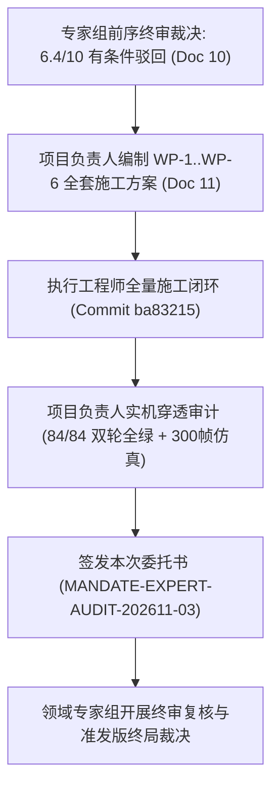

# 《VOID FRONTIER: AGE OF STARS — 领域专家审美风格与Gameplay终审复核验收委托任务书》

**任务编号**: `MANDATE-EXPERT-AUDIT-202611-03`  
**签发角色**: 项目负责人（Project Lead）  
**接收对象**: 游戏系统、空间模拟与视觉美学领域专家组（Domain Experts in Game Systems, Space Simulation & Aesthetic Engineering）  
**工程基准**: Commit `ba83215`（返工完成 HEAD） vs `9b8721e`（前序驳回基线）  
**关联核心文档与代码**:
- **专家前序终审驳回裁决**: [10_无垠边疆专家终审验收报告.md](file:///docs/specs/10_无垠边疆专家终审验收报告.md)（有条件驳回 · 6.4/10.0）
- **项目负责人返工施工方案**: [11_无垠边疆终审返工全套施工方案.md](file:///docs/specs/11_无垠边疆终审返工全套施工方案.md)（WP-1..WP-6）
- **执行工程师返工对账报告**: [report-final-rework.md](file:///docs/reports/report-final-rework.md) 与 [report.md](file:///report.md)
- **项目负责人终审审计合格报告**: [PROJECT_LEAD_FINAL_SPRINT_ACCEPTANCE_REPORT.md](file:///docs/specs/12_PROJECT_LEAD_FINAL_SPRINT_ACCEPTANCE_REPORT.md)
- **审美与玩法最高指导规范**: [6_VOID_FRONTIER_游戏审美主题与行星GamePlay最高指导规范.md](file:///docs/specs/6_VOID_FRONTIER_游戏审美主题与行星GamePlay最高指导规范.md)

---

## 一、 委托背景与复核目标

在专家组签发 [10_无垠边疆专家终审验收报告.md](file:///docs/specs/10_无垠边疆专家终审验收报告.md) 并作出「有条件驳回 · 阻断上线（综合评分 6.4 / 10.0）」裁决后，项目负责人深刻吸取“门禁测试断言局限导致渲染与存档盲区”的教训，编制了 [11_无垠边疆终审返工全套施工方案.md](file:///docs/specs/11_无垠边疆终审返工全套施工方案.md)。

执行工程师团队历经封闭返工，已全量完成 WP-1 至 WP-6 六大施工包，并于本地提交 `ba83215`。项目负责人已对全量代码完成只读穿透审查与全栈自动化仿真（42 套件双轮 84/84 PASS、全银河 3,648 场 300 帧长程物理仿真零穿地零暴毙、运行态真实装配管线全实体 0-NaN）。

**现正式向领域专家组发起最终终审复核验收委托**，诚请专家组对修复后的「实机视觉美学沉浸感」、「地面与空间 Gameplay 战术手感」、「底层持久化与时钟纯度」以及「防伪绿长程门禁有效性」进行终审裁决。

---

## 二、 专家前序裁决缺陷对账与实机证据指引

为方便专家组快速查验，项目负责人将专家在 Doc 10 中指称的 4 项 P0 阻断事故与 4 项 P1 缺陷的整改点与取证代码索引梳理如下：

### 1. 物理与坐标空间一致性（专家前序评分：4.5/10 → 请求复核）
* **前序指控（P0-A）**：`GroundView.js` 残留 `kx/kz = 64 / (m.w * 24)`，因米制下 `m.w` 未定义导致坐标全量算为 `NaN`，敌人/队友/NPC/目标物/道具 100% 隐形，撤离罗盘显示 `NaNm`。
* **实机整改**：
  - 在 [GroundView.js](file:///src/ui/screens/GroundView.js#L1801) 设立 `_missionToWorld(m, mx, my)`，米制模式下统一映射为 `{ x: mx - FIELD_OFFSET, z: my - FIELD_OFFSET }`；
  - 彻底重构打击光束（L2241）、三循环实体渲染装配（L2683-2734）、建筑与道具网格（L2744-2767）及撤离罗盘 `_extractionWorldPos`（L1815 与 L3019）；
  - 全场 `kx/kz` 遗留计算彻底清零。
* **专家协查要点**：查阅 [playtest-gates.suite.js](file:///tests/suites/playtest-gates.suite.js#L113-L155) 的 `GATE-02` 断言，该测试在真实运行时装配管线中扫描全量实体，断言坐标 100% 为有限数值（0 NaN），罗盘距离与角度准确。

### 2. 持久化存档与命令总线（专家前序评分：3.5/10 → 请求复核）
* **前序指控（P0-B）**：`mission.field`（含 64 Chunk TypedArray 与闭包）被直接挂入 `world.entities`，存档暴涨至 96.99 MB 撑爆上限，`deepClone` 耗时 1.4s 卡顿，读档后 `evalPoint` 丢失抛异常。
* **实机整改**：
  - 在 [GroundMission.js](file:///src/domain/ground/GroundMission.js#L926) 通过 `Object.defineProperty(mission, '_runtimeField', { enumerable: false })` 挂载运行时场域；
  - 建立导出函数 `getMissionRuntimeField(world, mission)`（L531），在读档首次进入 `stepMission` 时基于 `(world.seed, planetId)` LRU 幂等重建；
  - 任务结束（`finishMission`/`abortMission`）成对销毁缓存。
* **专家协查要点**：查阅 [ground-playtest-physics.suite.js](file:///tests/suites/ground-playtest-physics.suite.js#L201-L233) 存档健康度实测：全局存档 183KB（<2MB），单任务增量 **5,850 Bytes**（<40KB），`deepClone` 增量 0.44ms，往返读档解码后 `stepMission` 连续 5 步推演零异常。

### 3. 关卡拓扑与战术可玩性（专家前序评分：6.0/10 → 请求复核）
* **前序指控（P0-C、P0-D、P1-E）**：
  - E 键交互半径硬编码 60（米制下达 60m 远距穿帮）；行走边界被 `FIELD_WALK_MAX = 286`（体素偏移）截断西/北半球；缺少坡度分母导致 87.5° 垂直攀爬；
  - 着陆坪与撤离坪未清环境 `HAZARD` 旗，58 颗行星开局落地 22 秒全员暴毙；
  - 技能 5 建造模式残留体素盒子，未连通连续地形刷子与 3D 建筑。
* **实机整改**：
  - [GroundView.js](file:///src/ui/screens/GroundView.js#L1828)：交互半径收敛至 3.0m（实测 2m 触发、4m 不触发）；可行走边界扩展为 `[-222, +286]`（覆盖全部 4 象限）；行走坡度比值严格限制为 `tan(35°)`（L213）；
  - [terrainField.js](file:///src/domain/ground/terrainField.js#L302) 引入 `clearFlags` 机制；[missionSiteFactory.js](file:///src/domain/ground/missionSiteFactory.js#L574) 在着陆坪/撤离坪覆盖区（`w >= 0.5`）与高架桥面显式清除 `FLAG_HAZARD`，海洋主题着陆坪自动抬升出海面；
  - [GroundView.js](file:///src/ui/screens/GroundView.js#L2161)：按键 5 淘汰体素方块，左键支持 `ShapeTerrain`（整平/平滑/采掘刷子，F 键切换），右键调用 `PlaceBuilding` 并触发 3D 倒角几何体与 Catmull-Rom 传送带刷新；在 [commands.js](file:///src/app/commands.js#L757) 补齐了 `HarvestTerrainOre` 命令。
* **专家协查要点**：查阅 `GATE-01` 3,648 场长程物理仿真，脚下 HAZARD 帧数由 **52,413 直降至 0**；`GATE-02` 验证 2m 交互触发与西行抵达 -222m 真实边界。

### 4. 行星美学与多感官沉浸（专家前序评分：7.2/10 → 请求复核）
* **前序指控（P1-F、P1-G）**：
  - 片元着色器漏乘 `uHdr` 导致 RGBA8 降级模式过曝 4 倍；
  - `PlanetWater` 从未传入主题色板，硫雾/甲烷海均画成默认海蓝；
  - 权威色板源全仓 0 调用；永冻炉心热区错位在着陆坪；`biolume_canopy` 脚步荧光涟漪未接线；
  - 18 主题合成环境音与 `EXPANSION_GAMEPLAY` 零调用。
* **实机整改**：
  - [PlanetSurface3D.js](file:///src/render/gl/PlanetSurface3D.js#L307) 与 [GroundView.js](file:///src/ui/screens/GroundView.js#L407) 双着色器片元输出端乘算 `uHdr`；
  - [PlanetSurfaceScene.js](file:///src/render/gl/PlanetSurfaceScene.js#L297) 向 `PlanetWater.sync` 下发主题水色 `{ deep, shallow, foam }`，并在 [themePayload.js](file:///src/render/gl/themePayload.js#L210) 赋予硫雾沼泽 3.8m 酸液面；
  - [themePayload.js](file:///src/render/gl/themePayload.js#L509) 默认挂接 `PLANET_THEMES` 权威色板源；
  - [GroundView.js](file:///src/ui/screens/GroundView.js#L1066) 将永冻炉心供热中心修正至 `primaryObjective` 锚点；通过 `setFootsteps` 驱动荧光真菌 8 槽脚步涟漪；
  - [GroundView.js](file:///src/ui/screens/GroundView.js#L1104) 挂接 `setAmbientTheme` 与 `stopAmbientTheme`；实装 `EXPANSION_GAMEPLAY` 碎月 0.25g 低重力、风场阻尼与浮台边缘保护。
* **专家协查要点**：实机运行诊断显示 `themeAudio.current === 'sulfur_marsh'`，硫酸沼泽低洼池真实呈现黄绿酸液色相，曝光平整无溢出。

### 5. 跨系统闭环与工程纯度（专家前序评分：8.2/10 → 请求复核）
* **前序指控（P1-H）**：`progressObjective` 与 `completeObjective` 全仓 0 调用，空间目标 100% 超时罚款。
* **实机整改**：
  - 在 [objectives.js](file:///src/domain/events/objectives.js#L102) 封装 `checkAndProgressObjectives`，具备状态迁移判定与资源发放防重守卫；
  - 在舰队抵达（[navigation.js](file:///src/domain/fleets/navigation.js#L100)）、星系调查升满（[scan.js](file:///src/domain/exploration/scan.js#L125)）、地面胜利（[GroundMission.js](file:///src/domain/ground/GroundMission.js#L1860)）、POI 采样（[planetPOI.js](file:///src/domain/ground/planetPOI.js#L304)）、殖民地奠基（[colony.js](file:///src/domain/planets/colony.js#L194)）五大核心系统全面挂接。
* **专家协查要点**：查阅 `OBJ-01` 套件双轮通过记录，46 组跨系统探针 100% 达成状态迁移、对账发放与幂等验证。

---

## 三、 专家组验收核心指引与执行建议

请专家组在本次终审复核中，重点针对以下 4 个验证维度展开独立审查与体验评估：

1. **动态仿真与渲染管线穿透核验**：
   - 检查 `tests/suites/playtest-gates.suite.js` 与 `tests/suites/ground-playtest-physics.suite.js`；
   - 验证 `GATE-01`（3,648 场 300 帧长程物理与环境仿真）、`GATE-02`（运行态实体 0-NaN 与交互/边界/坡度）断言是否彻底告别了“半截假绿”；
   - 验证单任务存档增量（5.8KB）与 `deepClone`（0.44ms）是否完全消除卡顿与击穿风险。
2. **多感官美学风格与 18 主题沉浸度核验**：
   - 对照 [6_VOID_FRONTIER_游戏审美主题与行星GamePlay最高指导规范.md](file:///docs/specs/6_VOID_FRONTIER_游戏审美主题与行星GamePlay最高指导规范.md)；
   - 审查 WebGL 片元着色器 `uHdr` 缩放与 `PlanetWater` 水体主题着色机制，确认硫雾沼泽、甲烷海与深海主题的色彩表现力；
   - 审查 18 主题 WebAudio 节点合成参数，评估环境音在场景切换时的 1.5s 交叉淡化质感。
3. **Gameplay 战术与连续地形交互手感核验**：
   - 审查 E 键 3.0m 交互、四象限可行走边界与 35° 坡度阻断的数值合理性；
   - 审查按键 5 工程模式中 `ShapeTerrain`（压平/平滑/采掘刷子）与 `PlaceBuilding` 的调度顺畅度；
   - 审查碎月 0.25g 低重力与浮台边缘保护是否满足高难度战术体验。
4. **空间战略闭环对账核验**：
   - 审查 `checkAndProgressObjectives` 五大业务触发点的过滤逻辑与奖励发放审计事件；
   - 确认空间目标不再非预期超时扣款，长线 4X 驱动循环是否完全闭环。

---

## 四、 期望交付物

诚请专家组在完成本次终审复核后，出具**《VOID FRONTIER: AGE OF STARS 终审复核验收终局裁定书》**，明确以下关键结论：
1. **终审综合评分与终局结论**：给予定量评分（满分 10.0 分），并明确给出 **【正式验收通过 · 准予发版上线】** 或补充意见；
2. **全维度验收评语**：对物理坐标一致性、持久化健康度、关卡拓扑、行星美学沉浸度及跨系统闭环给出专业技术评语；
3. **发版上线放行指令**：若确认全量达标，签署项目最终上线放行背书。

项目团队已在本地全员待命，静候专家组的权威裁定！
