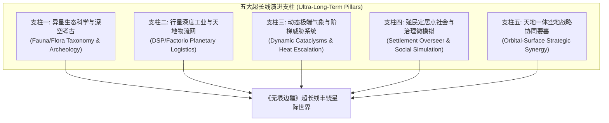

# 《VOID FRONTIER: AGE OF STARS — 超长线行星内容深度与演化开发协助调研任务委托书》

**任务编号**: `MANDATE-EXPERT-ULTRA-LONG-TERM-ROADMAP-202611-04`  
**签发角色**: 项目负责人（Project Lead）  
**接收对象**: 游戏系统、空间模拟与视觉美学领域专家组（Domain Experts in Game Systems, Space Simulation & Aesthetic Engineering）  
**关联基石文档**:
- **专家终审通过裁定书**: [`docs/specs/14_无垠边疆终审返工专家验收.md`](file:///docs/specs/14_%E6%97%A0%E5%9E%A0%E8%BE%B9%E7%96%86%E7%BB%88%E5%5审%E8%BF%94%E5%B7%A5%E4%B8%93%E5%AE%B6%E9%AA%8C%E6%94%B6.md)（9.7分 · 准予发版上线）
- **长线演进调研报告**: [`docs/specs/4_VOID FRONTIER：专家诊断与长线演进调研报告.md`](file:///docs/specs/4_VOID%20FRONTIER%EF%BC%9A%E4%B8%93%E5%AE%B6%E8%AF%8A%E6%96%AD%E4%B8%8E%E9%95%BF%E7%BA%BF%E6%BC%94%E8%BF%9B%E8%B0%83%E7%A0%94%E6%8A%A5%E5%91%8A.md)
- **审美主题与玩法宪法**: [`docs/specs/6_VOID_FRONTIER_游戏审美主题与行星GamePlay最高指导规范.md`](file:///docs/specs/6_VOID_FRONTIER_%E6%B8%B8%E6%88%8F%E5%AE%A1%E7%BE%8E%E4%B8%BB%E9%A2%98%E4%B8%8E%E8%A1%8C%E6%98%9FGamePlay%E6%9C%80%E9%AB%98%E6%8C%87%E5%AF%BC%E8%A7%84%E8%8C%83.md)
- **研发任务书**: [`docs/specs/1_VOID_FRONTIER_星际游戏长线研发任务书.md`](file:///docs/specs/1_VOID_FRONTIER_%E6%98%9F%E9%99%85%E6%B8%B8%E6%88%8F%E9%95%BF%E7%BA%BF%E7%A0%94%E5%8F%91%E4%BB%BB%E5%8A%A1%E4%B9%A6.md)

---

## 一、 委托背景与设计哲学转向：从“星体数量堆砌”到“行星内涵丰饶”

在经历三轮扎实的工程攻坚后，《无垠边疆：星之纪元》已于 Commit `84127db` 达成了全仓 142 模块、42 套件双轮全绿、全银河 3,648 场长程物理零穿地零暴毙，并获得了专家组 9.7 分的终审通过与发版放行背书。

然而，项目决策层在复盘现状时确立了至关重要的**第二阶段设计哲学转向**：

> **核心洞察（Core Design Thesis）**：  
> **单纯一味地堆砌星球个数（如 608 颗行星）绝不代表游戏内容丰富；行星系统的终极生命力，在于玩家踏足每颗星球时，切实有深度的游戏内容可体验、可干预、可沉淀。**  
> 
> 正如行业经典案例《无人深空》（*No Man's Sky*）的漫长蜕变史所证明的：发售初期虽号称拥有 1840 亿亿颗星球，但因玩法机制匮乏、地表活动单一，被玩家批评为“一里之宽、一寸之深（A mile wide, an inch deep）”；而历经多年持续深耕“异星科考扫描、模块化基地建造、工业提取与物流管线、异构体/哨兵威胁升级、定居点自治管理、水下深潜与废弃货船地牢”，最终逆袭成为内容极为丰饶的星际旷世之作。

《无垠边疆》作为一款融合了 **Stellaris 式宏观银河 4X 战略** 与 **Factorio / DSP / Helldivers 式地表微观战术建造** 的独立硬核作品，当前地表虽已具备三维连续地形、18 主题视听、按键 5 连续工程与基础站点战斗，但行星地表玩法依然处于“前哨站雏形阶段”。

为此，项目负责人正式向领域专家组发起**《无垠边疆超长线行星演化开发协助调研》**任务委托，诚请专家组为游戏未来 1~2 年的行星游戏性深化提供系统级的战略调研、机制推演与技术路线规划。

---

## 二、 现状痛点诊断：当前行星地表系统的深度瓶颈

为便于专家组对症下药，项目负责人总结当前行星层级的四大核心内容短板：

1. **探索目的性匮乏（缺乏持久驻留动机）**：
   玩家在完成预设站点任务（遗迹调查/营救/斩首）并采集了 1~2 个 POI 后，该行星即失去探索价值；地表动植物生态仅为视效装点，缺乏图鉴系统、生物基因提取与科学数据库驱动的科考闭环。
2. **工业链条扁平化（尚未释放 3D 地形与物流网潜力）**：
   当前地表建造仅限于铁矿井等单一设施，缺乏类似戴森球计划（DSP）或异星工厂（Factorio）的多级原料提炼、电力网络输送、传送带立体交错、货运穿梭火箭与轨道电梯物流联动。
3. **环境动态与威胁演进静态（缺乏涌现式战术对抗）**：
   虽然消除了开局 HAZARD 暴毙，但自然灾害（如热浪暴风、酸雨侵蚀、电磁极光干扰、极端潮汐）尚未形成动态推进的生存压力；敌对威胁固定在驻点巡逻，缺少随玩家开采度提升而递进的“异星哨兵治安度 / 原生虫群袭扰（Sentinel/Swarm Heat Level）”机制。
4. **天地战略脱节（微观地表与宏观 4X 割裂）**：
   地表聚落尚未形成有生命的自治社会；宏观舰队在轨道上缺乏对地表的直接战术支援（如轨道轨道炮定点空袭、战术空投补给舱），地表也缺乏反制轨道的行星级离子防御要塞。

---

## 三、 超长线演化五大核心调研方向（委托命题）

诚请专家组针对以下五大支柱方向开展深度调研，给出可实施的机制设计原型与阶段落地构想：

### 支柱一：异星生态科学与深空考古（科考与图鉴闭环）
* **对标参考**：《无人深空》动植物分析仪图鉴系统、《星空》异星动植物调查、《群星》先驱者考古遗址挖掘。
* **调研命题**：
  1. 如何在现有确定性种子体系下，程序化派生具有生态链逻辑的异星动植物外形、习性与扫描图鉴？
  2. 如何构建“外星上古文明多阶段考古遗址（Multi-stage Monolith Ruins）”，通过地表多点勘测解密古代科技、外星方言，最终反哺帝国科研树？

### 支柱二：行星级工业自动化与天地物流网（工业与建造闭环）
* **对标参考**：《戴森球计划》（DSP）行星间物流运输塔、《异星工厂》（Factorio）传送带与生产链。
* **调研命题**：
  1. 如何在现存的 3D 连续地形网格与 Catmull-Rom 传送带基础上，扩展电力网格辐射（Power Grid）、初中高级加工厂（Smelter/Assembler）、物料分流器（Splitter）？
  2. 如何设计“轨道货运发射井（Planetary Freight Catapult）”与“近地轨道中转站”，将行星富余产出自动化打包装箱，稳定供给母星轨道船坞建造泰坦级巨舰？

### 3. 支柱三：动态气象灾变与阶梯威胁系统（生存与战术闭环）
* **对标参考**：《绝地潜兵2》（Helldivers 2）环境危害与增援巡逻、《无人深空》极端天气与哨兵警戒度。
* **调研命题**：
  1. 如何利用现有 `PlanetAtmosphere` 与 GLSL 雾效系统，实现周期性推进的“异星风暴事件”（超温热浪、腐蚀性酸雹、电磁等离子风暴、极端引力颠簸），迫使玩家寻找庇护所或升级外骨骼防护模块？
  2. 如何建立“地表开采警戒指数（Planetary Threat Index）”，当采掘扰动超过阈值时，触发从潜伏异形、轻型机械守卫到超巨型漫游利维坦（Leviathan）的分波次增援反扑？

### 支柱四：殖民聚落自治生态与社会微模拟（4X 治理闭环）
* **对标参考**：《霜汽时代》（Frostpunk）法典与希望值、《无人深空》定居点总督（Frontiers Settlement）。
* **调研命题**：
  1. 如何让殖民地居民不再只是空洞的数据统计，而是在地表倒角建筑间有规律通勤、作业、休憩的生活实体？
  2. 如何引入前哨站总督治理机制（处理劳资纠纷、外星疫情隔离、走私犯罪镇压、法典政策签署），将微观聚落繁荣度直接转化为帝国的信用点与特种科技点产出？

### 5. 支柱五：天地一体空地战略协同要塞（军事与战略闭环）
* **对标参考**：《星际争霸》行星要塞与核弹发射井、《群星》轨道轰炸与行星护盾发生器。
* **调研命题**：
  1. 如何打通从舰队视图（Galaxy/System3D）向地表视图（GroundView）的战术支援呼叫（如轨道激光定点清除阻碍地貌、轨道空投装甲车/机甲支援）？
  2. 如何允许玩家在行星高地上修筑“行星对空离子加农炮（Planetary Ion Battery）”，在敌方舰队跃迁入轨实施行星封锁时，从地面向轨道发起越级反击？

---

## 四、 技术架构边界与性能红线约束

专家组在进行机制与系统推演时，必须恪守本工程业已确立的硬核技术底线，严禁提出脱离工程实际的乌托邦方案：

1. **确定性与随机数红线**：所有程序化生成必须受控于 `world.seed`、`planet.id` 与 `splitmix32/mulberry32`，全程严禁使用未经播种的 `Math.random()`。
2. **内存与持久化红线**：任何新增的复杂系统（工业设施、动植物实例、聚落居民）其持久化形态必须为纯数据扁平结构（Plain Data），单星体持久化序列化增量严格限制在 `<= 50KB`，绝不可重新将重型对象或函数闭包挂入存档树。
3. **单线程算力与深拷贝红线**：`commandBus.deepClone(world)` 每步耗时必须守住 `<= 0.5ms` 上限，海量逻辑需依靠按需推演、时间分片（Hourly/Daily Systems）或稀疏网格采样实现。
4. **WebGL 2.0 渲染性能红线**：单屏 Draw Call 必须严格控制在 `<= 50`，所有工业建筑、动植物与单位必须继续走 `BuildingMeshBatch` / 实例化渲染（Instanced Rendering）管线。

---

## 五、 期望专家组交付成果

诚请领域专家组在消化本委托书后，出具**《无垠边疆：超长线行星游戏性深度演进调研与架构设计白皮书》**，包含以下核心交付板块：

1. **《无人深空》与同类标杆深度解构与启示录**：提炼成功经验与避坑指南，明确《无垠边疆》的差异化突围生态位；
2. **五大演进支柱的系统架构蓝图与玩法循环图（Loop Diagrams）**；
3. **分阶段里程碑演化路线图（Milestone Roadmap v0.2 ~ v1.0）**：明确每个版本的核心体验交付物与依赖关系；
4. **技术预研清单与原型验证指引**：列出需要前置攻坚的数据结构、算法原型与着色器实验。

项目团队热切期待专家组高屋建瓴的宏观擘画，携手将《无垠边疆》从坚实的工程底座打造成一座真正深邃、生动、百玩不厌的星际史诗！
