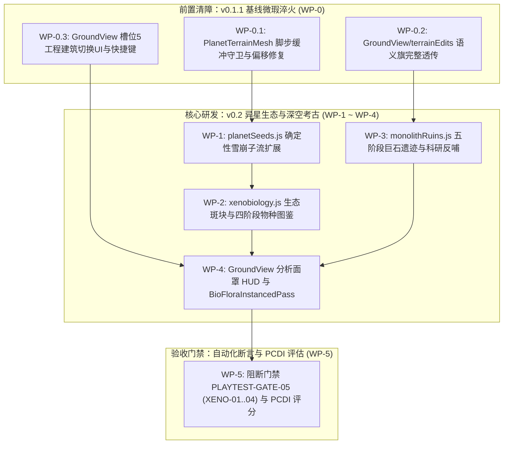

# 《无垠边疆：星之纪元》v0.2 异星生态与深空考古全套施工方案（工程实施任务书）

> **文档标识**：`docs/specs/18_v0.2异星生态与深空考古施工方案.md`  
> **最高总纲规范**：`docs/specs/16_超长线行星游戏性深化与世界演化总体方案.md`（最高设计总纲）  
> **底层架构规范**：`docs/specs/17_《无垠边疆》超长线演化架构方案.md`（技术架构白皮书）  
> **前序工程验收**：`docs/specs/14_无垠边疆终审返工专家验收.md`  
> **责任人**：项目负责人（Project Lead）  
> **实施对象**：执行工程师团队（Execution Engineering Team）  
> **工程基准**：Git HEAD（Commit `84127db`）  
> **目标版本**：v0.1.1（基线微瑕淬火） $\to$ v0.2.0（异星博物志 · Xeno-Archive）  
> **门禁套件**：`tests/suites/playtest-gates.suite.js` 扩展 `PLAYTEST-GATE-05` (XENO-01..04) 与 PCDI 深度闭环

---

## 零、 最高总纲约束与四大工程红线

1. **最高总纲设计定位（Doc 16 §1~§4）**：
   - 彻底告别“贴图换色动物随机乱跑与一次性 POI 打卡”的伪丰富，确立「行星生命世界系统」（Planetary Living World System）。
   - **首发三颗旗舰验证星球（Doc 16 §8.1）**：首发必须在三颗特征鲜明的旗舰世界上完成端到端闭环验证：
     - `sulfur_marsh`（硫雾沼泽）：生化极端微生物、酸腐蚀耐受菌与古代地下水循环设施；
     - `biolume_canopy`（荧光冠层）：发光蕨类、夜行共生动植物链与复杂生态通道；
     - `red_regolith_frontier`（赤红边疆）：荒漠极端耐旱生物与先驱者巨构导航中继站。
   - **物种发现四阶段（Doc 16 §4.3）**：动植物研究严禁“一扫即解锁”，必须严格遵循 **Observed（初见） $\to$ Identified（识别） $\to$ Analyzed（采样分析） $\to$ Mastered（掌握基因应用）** 四层渐进状态机，且研究成果必须反哺帝国科研与特种抗性科技。
   - **生态斑块（Ecological Patch）轻量统计模型（Doc 16 §4.2）**：禁止逐草、逐树、逐兽创建对象，按区域生态斑块统计生物量、土壤养分、水分与种群密度：
     $$\Delta N_i = B_i - D_i + M_i + \sum_j I_{ij}$$
2. **确定性与随机数红线（Doc 17 §3.1）**：
   - 严禁调用 `Math.random()`，严禁在任何新增逻辑中读取或步进 `world.rng`！动植物与遗迹子流必须 100% 由 `derivePlanetSeeds(world, planetId)` 扩展纯函数派生，确保回归测试金快照哈希 `68462446` 逐字节零漂移。
3. **内存与持久化紧凑元组化（Doc 17 §3.2）**：
   - 单星生态与考古新增状态在 UTF-8 JSON 序列化下严格限制在 $\le 10\text{ KB}$（占 50 KB 红线的 20% 以下）。未扫描动植物形态基因由种子实时算力重建，存档仅存扫描位掩码 `scannedMask`；五阶段遗迹仅存固定紧凑元组。
4. **WebGL 2.0 批处理红线（Doc 17 §3.4）**：
   - 全图所有程序化植物与动物必须合流至新增的 `BioFloraInstancedPass`，严格限定为 **2 次 Draw Call**（通道 A 植被风摆 1 DC，通道 B 动物游荡 1 DC），单屏峰值 Draw Call 严守 $\le 50\text{ DC}$。

---

## 一、 施工包架构与工单依赖拓扑



---

## 二、 施工包详细施工指示

### 施工包 WP-0：v0.1.1 基线微瑕淬火（前置清障）

#### 1. 目标文件
- `src/render/gl/PlanetTerrainMesh.js`
- `src/ui/screens/GroundView.js`
- `src/domain/ground/terrainEdits.js`

#### 2. 精确修改指示

##### 步骤 0.1：修复 `uFootsteps` 环形缓冲类型守卫与坐标偏移
在 `src/render/gl/PlanetTerrainMesh.js` 的 `setTheme(theme)` 方法中（约第 198 行）：
```javascript
// 修复前：
// if (Array.isArray(t.footsteps)) { ... }

// 修复后：兼容 Float32Array 环形缓冲区，防止静默拦截
if (t.footsteps instanceof Float32Array && t.footsteps.length === 32) {
  this._footsteps.set(t.footsteps);
} else if (Array.isArray(t.footsteps) && t.footsteps.length === 32) {
  this._footsteps.set(t.footsteps);
}
```
在 `src/ui/screens/GroundView.js` 的 `_moveAABB`（约第 2196 行）写入脚步坐标时，修正为场域偏移坐标：
```javascript
const fx = c.x + FIELD_OFFSET;
const fz = c.z + FIELD_OFFSET;
this._footstepsBuffer[this._footstepPtr * 4 + 0] = fx;
this._footstepsBuffer[this._footstepPtr * 4 + 1] = fz;
this._footstepsBuffer[this._footstepPtr * 4 + 2] = this._sceneTime;
this._footstepsBuffer[this._footstepPtr * 4 + 3] = isRunning ? 1.0 : 0.5;
this._footstepPtr = (this._footstepPtr + 1) % 8;
```

##### 步骤 0.2：修复 `siteModifier` 包装链语义旗透传
在 `src/ui/screens/GroundView.js`（约第 1046 行）与 `src/domain/ground/terrainEdits.js`（`attachTerrainEdits` 约第 231 行）：
```javascript
const baseRes = baseSiteMod ? baseSiteMod(worldX, worldZ) : null;
return {
  ...baseRes,
  dy: (baseRes?.dy || 0) + total,
  height: (baseRes?.height || 0) + total,
  flags: baseRes?.flags || 0,
  clearFlags: baseRes?.clearFlags || 0,
  weights: baseRes?.weights || null,
  biomeId: baseRes?.biomeId || null,
};
```

##### 步骤 0.3：补齐工程模式快捷键与建筑型号切换
在 `src/ui/screens/GroundView.js` 中接入 `[` 与 `]` 键及 `B` 键循环切换建筑类型：
```javascript
if (this._toolMode === 5) {
  if (e.key === '[' || e.key === 'ArrowLeft') {
    this._selectedBuildDefIndex = (this._selectedBuildDefIndex - 1 + this._availableBuildDefs.length) % this._availableBuildDefs.length;
    this._renderBuildHudNotification();
  } else if (e.key === ']' || e.key === 'ArrowRight') {
    this._selectedBuildDefIndex = (this._selectedBuildDefIndex + 1) % this._availableBuildDefs.length;
    this._renderBuildHudNotification();
  }
}
```

---

### 施工包 WP-1：`planetSeeds.js` 确定性雪崩子流扩展

#### 1. 目标文件
- `src/domain/ground/planetSeeds.js`

#### 2. 精确实施规范
导出 `mix32` 雪崩算子与扩展子流发生器 `derivePlanetSeedsExtended(world, planetId)`：
```javascript
import { hash32 } from './SurfaceSandbox.js';

const SALT_SITE    = 0x85ebca6b;
const SALT_FLORA   = 0x9e3779b9;
const SALT_FAUNA   = 0x7f4a7c15;
const SALT_RUIN    = 0x6c8e9cf5;
const SALT_WEATHER = 0xb5297a4d;
const SALT_DILEMMA = 0x1b56c4e9;

export function mix32(h) {
  let z = (h >>> 0);
  z = Math.imul(z ^ (z >>> 16), 0x85ebca6b) >>> 0;
  z = Math.imul(z ^ (z >>> 13), 0xc2b2ae35) >>> 0;
  return (z ^ (z >>> 16)) >>> 0;
}

export function createSubRng(seed32) {
  let a = seed32 >>> 0;
  return function nextFloat() {
    a = (a + 0x6D2B79F5) >>> 0;
    let t = Math.imul(a ^ (a >>> 15), 1 | a);
    t = (t + Math.imul(t ^ (t >>> 7), 61 | t)) ^ t;
    return ((t ^ (t >>> 14)) >>> 0) / 4294967296;
  };
}

export function derivePlanetSeedsExtended(world, planetId) {
  const worldSeed = world && Number.isFinite(world.seed) ? world.seed >>> 0 : 0;
  const base = mix32(worldSeed ^ hash32(String(planetId)));
  return {
    planetSeed: base,
    themeSeed: mix32(base ^ hash32('theme')),
    macroTerrainSeed: mix32(base ^ hash32('macro')),
    biomeSeed: mix32(base ^ hash32('biome')),
    decorationSeed: mix32(base ^ hash32('deco')),
    cosmeticSeed: mix32(base ^ hash32('cosmetic')),
    missionSiteSeed(siteId, blueprintVersion = 1) {
      const v = Number.isFinite(blueprintVersion) ? blueprintVersion >>> 0 : 1;
      return mix32(base ^ hash32(`site:${siteId}`) ^ Math.imul(v || 1, SALT_SITE));
    },
    poiSeed(poiId) {
      return mix32(base ^ hash32(`poi:${poiId}`));
    },
    floraSeed(speciesIdx) {
      return mix32(base ^ Math.imul((speciesIdx >>> 0) + 1, SALT_FLORA));
    },
    faunaSeed(speciesIdx) {
      return mix32(base ^ Math.imul((speciesIdx >>> 0) + 1, SALT_FAUNA));
    },
    ruinSeed(siteId) {
      return mix32(base ^ hash32(`ruin:${siteId}`) ^ SALT_RUIN);
    },
    weatherCycleSeed(dayIndex) {
      return mix32(base ^ Math.imul((dayIndex >>> 0) + 1, SALT_WEATHER));
    },
    dilemmaSeed(tick) {
      return mix32(base ^ Math.imul((tick >>> 0) + 1, SALT_DILEMMA));
    },
  };
}
```

---

### 施工包 WP-2：`xenobiology.js` 生态斑块与四阶段物种图鉴

#### 1. 目标文件
- `src/domain/ground/xenobiology.js` (新增模块)
- `src/content/planetThemes.js`

#### 2. 数据契约与持久化格式
在 `planet` 实体上新增紧凑持久化对象 `planet.eco`：
```javascript
planet.eco = {
  v: 1,
  // 物种四阶段位掩码（每个物种占 2-bit：00:未发现, 01:Observed, 10:Identified, 11:Mastered）
  discoveryMask: 0,
  // 5 个核心生态斑块状态元组：[biomass, nutrients, water, contamination, speciesDensityMask]
  patches: [
    [70, 50, 60, 0, 0b1011],
    [40, 60, 30, 5, 0b0101],
    [85, 45, 90, 0, 0b1110],
    [30, 20, 10, 0, 0b0010],
    [50, 70, 40, 2, 0b0111]
  ],
  surveyAwarded: false,
  ruin: null // 详见 WP-3
};
```

#### 3. 核心领域逻辑实现
1. **物种确定性派生**：纯函数 `derivePlanetEcology(world, planet)`：
   - 气态巨行星与真空碎环月不生成地表生物；
   - 其余行星派生 4~8 种原生植物/菌落（第一营养级）、1~2 种初级草食动物（第二营养级）、1~2 种掠食者/清道夫（第三营养级）；
   - 形态基因码 `genome` 由 `floraSeed(i)` 与 `faunaSeed(i)` 确定性计算；
2. **四阶段物种科考状态机推进**：
   - **阶段 1：Observed（远距离目击）**：准星在 60m 内对准物种 1.0s，记录外观与活动习性；
   - **阶段 2：Identified（光谱识别）**：准星在 25m 内按住右键 2.0s，解锁营养级定位与弱点属性；
   - **阶段 3：Analyzed（实体采样）**：靠近按 E 键采集活体组织或排泄物，入账科研点数与生物质；
   - **阶段 4：Mastered（基因逆向与培育）**：在殖民地实验室完成分析，解锁特种科技节点（如抗酸防腐涂层）。
3. **扫描与采样命令处理**：
   ```javascript
   export function advanceSpeciesDiscovery(world, planetId, speciesIdx, targetStage) {
     const planet = world.entities.planets[planetId];
     if (!planet) return { ok: false, reason: 'PlanetNotFound' };
     if (!planet.eco) planet.eco = { v: 1, discoveryMask: 0, surveyAwarded: false, ruin: null };

     const shift = speciesIdx * 2;
     const currentStage = (planet.eco.discoveryMask >>> shift) & 0b11;
     if (targetStage > currentStage) {
       planet.eco.discoveryMask = (planet.eco.discoveryMask & ~(0b11 << shift)) | (targetStage << shift);
     }

     // 检查是否达成 100% 全测绘（全部物种均达到 Mastered 状态）
     const total = getPlanetSpeciesCount(planet);
     let allMastered = true;
     for (let i = 0; i < total; i++) {
       if (((planet.eco.discoveryMask >>> (i * 2)) & 0b11) < 3) {
         allMastered = false;
         break;
       }
     }

     let newlyAwarded = false;
     if (allMastered && !planet.eco.surveyAwarded) {
       planet.eco.surveyAwarded = true;
       newlyAwarded = true;
       world.player.credits = (world.player.credits || 0) + 500;
       world.research.researchData = (world.research.researchData || 0) + 60;
     }
     return { ok: true, currentStage: Math.max(currentStage, targetStage), newlyAwarded };
   }
   ```

---

### 施工包 WP-3：`monolithRuins.js` 五阶段巨石遗迹与科研反哺

#### 1. 目标文件
- `src/domain/ground/monolithRuins.js` (新增模块)
- `src/domain/research/research.js`
- `src/content/technologies.js`

#### 2. 五阶段状态机契约
在 `planet.eco.ruin` 中持久化紧凑元组：
`[stage, dialectMask, pylonRotationsMask, guardianDefeated, coreHarvested]`
- **阶段 1（除障 Excavation）**：主碑坐标 `monolith_core`，调用 `getElevation` 检测周围 4 点平均覆土高度，需使用工程刻槽刷子将高度降至阈值下方；
- **阶段 2（方言拓印 Dialect Triangulation）**：激活 3 座副碑（半径 120m 处），靠近按 E 键拓印，向 `world.narrative.lexiconMask` 写入语素位；
- **阶段 3（谐振对光 Resonance Alignment）**：3 座导流塔按 E 键每次旋转 45°，调用 `raycastTerrain` 检验视线直达主碑无山脊遮挡；
- **阶段 4（机偶守卫战 Guardian Awakening）**：合龙瞬间刷出 `automata_warden`（600 HP），击败后进入阶段 5；
- **阶段 5（核心破译与科技反哺 Precursor Tech Feedback）**：提取先驱者核心，直接解锁 `tech_precursor_shield_harmonics` 或 `tech_precursor_mass_catapult`，入账 `ancientData × 15`。

---

### 施工包 WP-4：`GroundView.js` 分析面罩与 `BioFloraPass.js` 实例化渲染

#### 1. 目标文件
- `src/ui/screens/GroundView.js`
- `src/render/gl/PlanetSurfaceScene.js`
- `src/render/gl/BioFloraPass.js` (新增着色管线)

#### 2. 渲染实现细节
1. **快捷键 V 开启分析面罩（Analysis Visor）**：
   - 2D Canvas HUD 叠加青色测距六边形阵列与声谱波形；
   - 准星对准生物并在 25m 内保持锁定 2.0s，触发 `advanceSpeciesDiscovery`；
   - 激活 `uFootsteps` 槽位 7 发射高斯扩张扫描波环。
2. **`BioFloraInstancedPass` 双通道批处理（严守 2 DC）**：
   - **通道 A（植被风摆 1 DC）**：单 VAO 图集容纳 1,024 个实例。顶点着色器接入 `uTime` 与 `uWind`，对 $y > 0.3\text{m}$ 顶点施加正弦摇摆偏移；
   - **通道 B（生物群落 1 DC）**：单 VAO 图集容纳 128 个实例。四足迈步与双翼扇动在顶点着色器内按移动速度代数计算，CPU 零骨骼更新负担。

---

### 施工包 WP-5：阻断门禁 `PLAYTEST-GATE-05` (XENO-01..04) 与 PCDI 深度闭环

#### 1. 目标文件
- `tests/suites/playtest-gates.suite.js`

#### 2. 断言矩阵实现
在套件中追加 `PLAYTEST-GATE-05`，包含以下 5 项子断言：
1. **XENO-01（随机数零污染与确定性）**：
   遍历 100 颗随机行星，提取 `derivePlanetEcology` 前后 `JSON.stringify(world.rng)`，断言逐字节严格相等；
2. **XENO-02（四阶段物种发现推进与全满贯奖励幂等）**：
   模拟完整推进单星全部物种从 Observed 至 Mastered，断言 `discoveryMask` 正确写入、全额测绘大奖仅且仅发放一次；二次推进已达成物种断言幂等拒发；
3. **XENO-03（五阶段遗迹前置条件严苛性）**：
   断言未清理覆土前无法拓印方言、未校准导流塔光路前无法激活守卫战、未消灭守卫前无法提前提取核心；
4. **XENO-04（性能与存档预算门禁）**：
   在 10 颗激活生态与遗迹的行星上执行标准 JSON 序列化，断言单星 `planet.eco` 增量 $< 3\text{ KB}$，`commandBus.deepClone(world)` 耗时 $< 0.5\text{ ms}$；
5. **XENO-05（首发三颗旗舰世界 PCDI 深度评估 · Doc 16 §9）**：
   针对 `sulfur_marsh`、`biolume_canopy`、`red_regolith_frontier` 执行 PCDI 评分断言，三颗旗舰世界在生态与考古维度的加权深度得分必须 $\ge 85\text{ 分}$。

---

## 三、 执行工程师实施检查单 (Checklist)

- [ ] 完成 v0.1.1 的 3 项微瑕代码补丁并通过原有 42 个回归套件；
- [ ] 扩展 `planetSeeds.js`，验证派生子流不修改主 `world.rng`；
- [ ] 编写 `xenobiology.js` 与 `monolithRuins.js` 纯函数领域模块；
- [ ] 实现 `BioFloraPass.js`，挂载进 `PlanetSurfaceScene.js` 并实测同屏 Draw Call $\le 36\text{ DC}$；
- [ ] 接入 `GroundView.js` 分析面罩 HUD 与 V 键扫描交互；
- [ ] 确保三颗首发旗舰世界完整跑通生态科考闭环；
- [ ] 运行 `node tests/suites/playtest-gates.suite.js`，确保 `PLAYTEST-GATE-05` 全绿通过。
