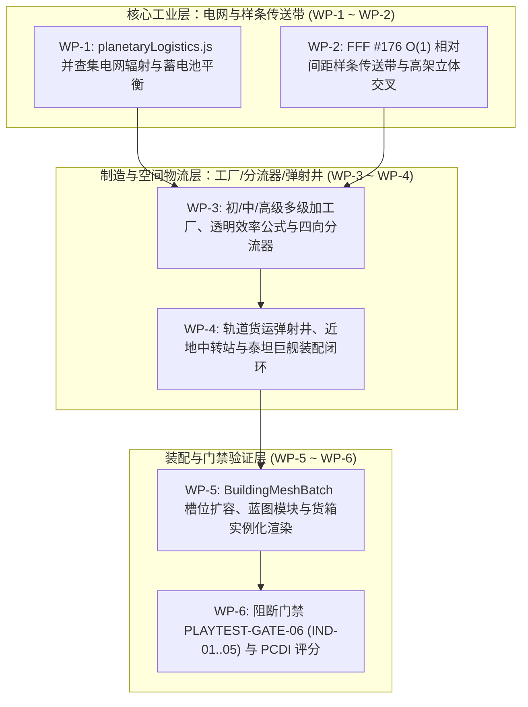

# 《无垠边疆：星之纪元》v0.4 行星深度工业与天地物流网全套施工方案（工程实施任务书）

> **文档标识**：`docs/specs/19_v0.4行星深度工业与天地物流施工方案.md`  
> **最高总纲规范**：`docs/specs/16_超长线行星游戏性深化与世界演化总体方案.md`（最高设计总纲）  
> **底层架构规范**：`docs/specs/17_《无垠边疆》超长线演化架构方案.md`（技术架构白皮书）  
> **前序工程规范**：`docs/specs/18_v0.2异星生态与深空考古施工方案.md`  
> **责任人**：项目负责人（Project Lead）  
> **实施对象**：执行工程师团队（Execution Engineering Team）  
> **工程基准**：Git HEAD（Commit `84127db`）+ v0.2 基线代码  
> **目标版本**：v0.4.0（星际母厂 · Forge of Worlds）  
> **门禁套件**：`tests/suites/playtest-gates.suite.js` 扩展 `PLAYTEST-GATE-06` (IND-01..05) 与 PCDI 深度闭环

---

## 零、 最高总纲约束与四大工程红线

1. **最高总纲设计定位（Doc 16 §4.7~§4.13）**：
   - 彻底告别“仅在建筑列表拖入工厂并从全局库存瞬间扣料”的无空间感模拟，确立**三级工业模拟架构**：
     - **L1：殖民地战略总产能**：保留既有建筑配方与总平衡；
     - **L2：行星局部空间物流**：传送带、管线、仓储、分流器、电网连通与瓶颈解算；
     - **L3：星际物流与轨道造舰**：货运发射井、近地中转站与跨星系班轮。
   - **生产效率全透明因果公式（Doc 16 §4.10）**：UI 面板必须明确展示各项瓶颈系数，杜绝玩家盲猜停工根因：
     $$P_{\text{actual}} = P_{\text{base}} \times F_{\text{power}} \times F_{\text{input}} \times F_{\text{transport}} \times F_{\text{staff}} \times F_{\text{environment}}$$
   - **可消耗矿脉枯竭与深层钻探（Doc 16 §4.11）**：地表矿脉新增储量（`reserves`）、品位（`grade`）、最大开采速率与枯竭预期寿命，采掘伴随开采污染。
   - **工业蓝图与阈值自动化（Doc 16 §4.13）**：支持单建筑与区域模块化蓝图，支持库存低阈值自动触发跨星球采购订单。
2. **物流 $O(1)$ 常数时间步进铁律（Doc 17 §3.2）**：
   - 严禁为传送带上的每个矿石货箱创建独立对象！全面落实《异星工厂》FFF #176 架构，整条样条传送带仅以紧凑整型数组元组持久化，货箱沿带推进仅执行首尾间距（`headGap_mm`、`tailGap_mm`）整数加减与位掩码位移，步进复杂度严格限定为 $O(1)$。
3. **并查集电网拓扑懒更新（Doc 17 §3.3）**：
   - 地表电网采用 `src/core/spatial.js` 的 `UnionFind` 拓扑求解，仅在放置或拆除电力建筑时触发单次子图划分与连通分量重构，严禁每帧（60 Hz）重算图遍历。
4. **单星体持久化与单批次渲染门禁（Doc 17 §3.2/§3.4）**：
   - 满载 64 座工业节点与 48 条样条传送带的极限工业星，在 UTF-8 JSON 序列化下增量严格控制在 $\le 15\text{ KB}$，`commandBus.deepClone(world)` 耗时严守 $\le 0.5\text{ ms}$。
   - 扩容 `BuildingMeshBatch` 至 384 容积，将输电塔、四向分流器与货运弹射井整合入单 VAO 图集通道（恒定消耗 **1 次 Draw Call**）；流动货箱复用 `PlanetSurface3D.progBox` 硬件实例化通道，同屏 Draw Call 严守 $\le 36\text{ DC}$。

---

## 一、 施工包架构与工单依赖拓扑



---

## 二、 施工包详细施工指示

### 施工包 WP-1：并查集 3D 连续地形电网拓扑与蓄电池求解器

#### 1. 目标文件
- `src/domain/industry/planetaryLogistics.js` (新增模块)
- `src/content/buildings.js`

#### 2. 电力基础设施定义
在 `buildings.js` 中新增三类电力节点定义：
- `bld_power_pylon`（输电塔）：连接半径 $R_{\text{wire}} = 24.0\text{m}$，环形供电覆盖半径 $R_{\text{supply}} = 14.0\text{m}$，造价 2 alloy；
- `bld_substation`（区域变电站）：连接半径 $R_{\text{wire}} = 42.0\text{m}$，供电覆盖半径 $R_{\text{supply}} = 28.0\text{m}$，造价 6 alloy + 2 conductor；
- `bld_accumulator_bank`（蓄能电池阵列）：储能上限 $50\text{ MWh}$，最大充放电功率 $5.0\text{ MW}$，造价 8 alloy + 4 powerCell。

#### 3. 紧凑节点元组与并查集拓扑实现
在 `planet.ind.nodes` 中，每座工业建筑编码为 13 元组：
`[id, defIdx, x_dm, z_dm, y_dm, rot, state, recipeIdx, prog_permille, in0, in1, out0, gridId]`
```javascript
import { UnionFind } from '../../core/spatial.js';

export function rebuildPowerGrids(indState, buildingDefs) {
  const nodes = indState.nodes || [];
  const uf = new UnionFind(nodes.map(n => n[0]));
  
  for (let i = 0; i < nodes.length; i++) {
    const a = nodes[i];
    const defA = buildingDefs[a[1]];
    const rA = defA?.wireRadiusM || 0;
    for (let j = i + 1; j < nodes.length; j++) {
      const b = nodes[j];
      const defB = buildingDefs[b[1]];
      const rB = defB?.wireRadiusM || 0;
      const maxLinkDm = Math.max(rA, rB) * 10;
      if (maxLinkDm <= 0) continue;
      const dx = a[2] - b[2];
      const dz = a[3] - b[3];
      if (dx * dx + dz * dz <= maxLinkDm * maxLinkDm) {
        uf.union(a[0], b[0]);
      }
    }
  }

  const comps = uf.components();
  const gridMap = new Map();
  indState.grids = comps.map((memberIds, idx) => {
    const gid = idx + 1;
    for (const id of memberIds) gridMap.set(id, gid);
    return { id: gid, genKW: 0, loadKW: 0, accMWh: 0, accMaxMWh: 0, etaPermille: 1000 };
  });
  for (const n of nodes) {
    n[12] = gridMap.get(n[0]) || 0;
  }
}
```

---

### 施工包 WP-2：基于 FFF #176 的 $O(1)$ 相对间距样条传送带模型

#### 1. 目标文件
- `src/domain/industry/planetaryLogistics.js`

#### 2. 紧凑传送带 12 元组数据契约
在 `planet.ind.belts` 中，每条连接上游输出口与下游输入口的样条传送带存储为 12 元组：
`[lineId, fromNode, fromSlot, toNode, toSlot, tier, length_dm, headGap_mm, tailGap_mm, resTypeIdx, itemCount, occupancyMask32]`
- `headGap_mm`：队首货箱距传送带终点的剩余毫米数；
- `tailGap_mm`：队尾货箱距传送带起点的剩余毫米数；
- `occupancyMask32`：32 位无符号整数，记录 32 个 1 米间距槽位的货箱有无状态。

#### 3. $O(1)$ 常数时间步进算法
```javascript
const ITEM_SPACING_MM = 1000;
const BELT_SPEED_MM_S = [0, 1875, 3750, 5625]; // Tier 1..3

export function stepTransportLineO1(belt, srcNode, dstNode, dtSeconds, etaPermille = 1000) {
  const tier = belt[5] || 1;
  const speedMm = (BELT_SPEED_MM_S[tier] || 1875) * (etaPermille / 1000);
  const deltaMm = Math.round(speedMm * dtSeconds);
  if (deltaMm <= 0) return;

  const totalLenMm = belt[6] * 100;
  let count = belt[10];

  // 1. 整体推进：仅更新队首与队尾间距，复杂度 O(1)
  if (count > 0) {
    belt[7] = Math.max(0, belt[7] - deltaMm);
    belt[8] = Math.min(totalLenMm, belt[8] + deltaMm);
  } else {
    belt[7] = totalLenMm;
    belt[8] = totalLenMm;
  }

  // 2. 队首移交下游建筑输入口
  const dstSlot = belt[4] === 1 ? 10 : 9; // in1 or in0
  if (count > 0 && belt[7] === 0 && dstNode && dstNode[dstSlot] < 20) {
    dstNode[dstSlot] += 1;
    count -= 1;
    belt[10] = count;
    belt[11] = (belt[11] >>> 1) >>> 0;
    belt[7] = count > 0 ? ITEM_SPACING_MM : totalLenMm;
  }

  // 3. 上游建筑输出口喂入队尾
  if (count < 32 && belt[8] >= ITEM_SPACING_MM && srcNode && srcNode[11] > 0) {
    srcNode[11] -= 1;
    belt[11] = (belt[11] | (1 << count)) >>> 0;
    count += 1;
    belt[10] = count;
    belt[8] = 0;
    if (count === 1) belt[7] = totalLenMm;
  }
}
```

#### 4. 样条立体交叉高度规避
当两条 Catmull-Rom 传送带水平相交时，后铺设传送带在交点控制点处自动将高度提升 $+1.8\text{m}$，并在地面生成微型立柱支撑，实现 3D 无障碍立体高架。

---

### 施工包 WP-3：多级加工厂、透明效率公式与四向分流器

#### 1. 目标文件
- `src/content/buildings.js`
- `src/content/recipes.js`
- `src/domain/industry/planetaryLogistics.js`

#### 2. 加工厂梯队与透明瓶颈公式计算
- **初级冶炼厂（Smelter，1 输入口 $\to$ 1 输出口）**：电弧冶炼炉（`ferro ×2` $\to$ `alloy ×1`）、硅晶提纯窑、硫化分馏塔；
- **中级合成厂（Assembler Mk.I，2 输入口 $\to$ 1 输出口）**：超导线圈厂、高能电池封装线；
- **高级总装中心（Assembler Mk.II，3 输入口 $\to$ 1 输出口）**：舰船模块总装线、量子晶格仪。
- **UI 效率分解函数**：
  ```javascript
  export function computeProductionEfficiency(node, grid, planet) {
    const fPower = grid ? grid.etaPermille / 1000 : 0.0;
    const fInput = node[9] > 0 ? 1.0 : 0.0;
    const fTransport = node[11] < 20 ? 1.0 : 0.2; // 输出口未堵塞
    const fStaff = planet.colony?.staffingEta || 1.0;
    const fEnv = (planet.threat?.storm?.active) ? 0.7 : 1.0;
    
    const actual = fPower * fInput * fTransport * fStaff * fEnv;
    return {
      actual,
      factors: { fPower, fInput, fTransport, fStaff, fEnv }
    };
  }
  ```

#### 3. 四向物料分流器（`bld_splitter`）三模式路由
占地 $2\text{m} \times 2\text{m}$，内部维护 1-bit 状态位 `parity ^= 1`：
- **模式 0（Round-Robin 奇偶轮询均分）**：绝对确定性的 1:1 交替分配至左/右输出口；
- **模式 1（Priority Output 主副路优先）**：优先填满主输出口，仅当主路阻塞时溢出至副路；
- **模式 2（Item Filter 物品指定过滤）**：左路仅放行指定资源 ID，其余全部走右路。

---

### 施工包 WP-4：轨道货运弹射井与近地中转站造舰闭环

#### 1. 目标文件
- `src/domain/industry/catapult.js` (新增模块)
- `src/simulation/HourlySystems.js`
- `src/domain/ships/shipyard.js`

#### 2. 货运发射井物理能耗与打包规则
在传送带末端建造轨道货运发射井（`bld_freight_catapult`）：
- 每汇集 50 单位物资即装配为 1 个标准轨道货舱（Orbital Cargo Pod）；
- 发射单舱需消耗子电网储能：
  $$E_{\text{launch}} = E_0 \cdot \left(\frac{g}{g_0}\right) \cdot (1 + \beta \rho_{\text{atm}})$$
- 蓄能达 100% 时触发冷青色电弧音爆粒子，货舱以 45° 仰角射入近地轨道。

#### 3. 近地轨道中转站三级分发
发射升空的物资直接入账该行星绑定的近地中转站缓冲仓（`planet.ind.orbitalBuffer`），每战略小时在 `HourlySystems.js` 的 `production` 阶段自动结算：
1. **同星系轨道船坞直供**：优先向 `bld_shipyard` 供应 `alloy`、`shipModule` 与 `quantumCore`，合成终局旗舰**泰坦级无畏巨舰（`hull_titan`）**（硬性要求累计接收 20 舱装甲模块与 5 舱量子核心）；
2. **跨星系货运班轮**：当轨道中转站库存超过保留阈值时，自动调度空闲 `hull_industrial` 运输舰运往母星系；
3. **星际市场倾销**：按每日商业汇率向星系自由市场出售换取信用点。

---

### 施工包 WP-5：`BuildingMeshBatch` 槽位扩容、蓝图模块与实例化渲染

#### 1. 目标文件
- `src/ui/screens/GroundView.js`
- `src/render/gl/PlanetSurface3D.js`

#### 2. 渲染实现细节
1. 在 `GroundView.js` 中将 `BuildingMeshBatch.this.cap` 扩容至 384，追加 `pylon`、`splitter`、`catapult` 槽位，所有地面建筑同屏恒定只消耗 **1 次 Draw Call**；
2. 传送带流动物资统一调用 `PlanetSurface3D` 的 `progBox` 硬件实例化通道；
3. **蓝图模板支持**：支持玩家框选一个采矿与冶炼标准模块保存为 `BlueprintTemplate`，一键批量下发放置命令。

---

### 施工包 WP-6：阻断门禁 `PLAYTEST-GATE-06` (IND-01..05) 与 PCDI 深度闭环

#### 1. 目标文件
- `tests/suites/playtest-gates.suite.js`

#### 2. 断言矩阵实现
在套件中追加 `PLAYTEST-GATE-06`，包含以下 5 项子断言：
1. **IND-01（FFF #176 物流质量守恒）**：
   在单星部署包含 64 座节点与 48 条传送带的复杂产线，推进 1,000 个战略 tick 与 600 帧 3D 步进，断言全局流入、流出与暂存资源总数误差为 0；
2. **IND-02（电网拓扑连通与透明效率分解）**：
   断开主输电塔断开电网，断言子图分裂为两个独立 gridId，透明瓶颈公式准确展示 `fPower < 1.0` 并在 UI 中正确指示停机原因；
3. **IND-03（分流器三模式路由确定性）**：
   分别在轮询、优先与过滤模式下输入 100 箱矿石，断言左右输出口的物资数量与类型分布 100% 符合数学期望；
4. **IND-04（弹射井能耗与泰坦舰建造闭环）**：
   验证弹射 50 舱物资至近地中转站后，轨道船坞正确扣减物料并合拢泰坦巨舰龙骨；
5. **IND-05（性能、存档与工业世界 PCDI 评估）**：
   断言满载工业星单星 `planet.ind` 序列化增量 $< 15\text{ KB}$，`commandBus.deepClone(world)` 耗时 $< 0.5\text{ ms}$；在工业旗舰星球执行 PCDI 评分断言，工业与物流深度得分必须 $\ge 85\text{ 分}$。

---

## 三、 执行工程师实施检查单 (Checklist)

- [ ] 实现 `planetaryLogistics.js` 并查集电网拓扑划分算法与蓄电池充放电方程；
- [ ] 编写 FFF #176 传送带 $O(1)$ 相对间距步进函数 `stepTransportLineO1`；
- [ ] 扩展 `buildings.js` 与 `recipes.js`，实装初/中/高级工业配方与透明效率公式；
- [ ] 编写 `catapult.js`，打通天体物理弹射能耗与轨道船坞泰坦巨舰装配闭环；
- [ ] 扩容 `GroundView.js` 的 `BuildingMeshBatch`，实测工业满载场景下同屏总 Draw Call $\le 36\text{ DC}$；
- [ ] 运行 `node tests/suites/playtest-gates.suite.js`，确保 `PLAYTEST-GATE-06` 全绿通过。
