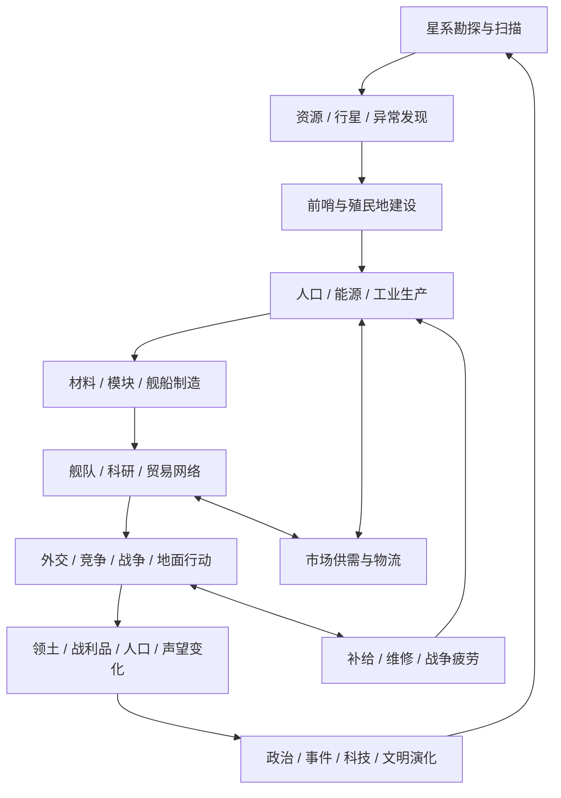

# **《无垠边疆：星海纪元》纯静态 Web 星际战略沙盒：长程全自主研发工程架构与执行规范任务书**

**项目代号：** `SPEC-VOID-FRONTIER-GHPAGES`  
**产品代号：** `VOID FRONTIER: AGE OF STARS`  
**交付形态：** 单一 Git 仓库、单一静态 Web 应用、单机离线存档、GitHub Pages 发布  
**研发模式：** 长程自主智能体执行、阶段性原子提交、确定性模拟内核、浏览器闭环验收  
**规范等级：** MUST / MUST NOT 为强制要求；SHOULD 为强烈建议；MAY 为可选实现

## 目录

- [0. 项目定义、目标边界与总体验收目标](#0-项目定义目标边界与总体验收目标)
- [1. 顶层架构哲学与长程自主工程演进范式](#1-顶层架构哲学与长程自主工程演进范式)
- [2. 宿主环境拓扑、单仓库结构与通用引擎底座](#2-宿主环境拓扑单仓库结构与通用引擎底座)
- [3. 银河世界模型与宇宙模拟内核](#3-银河世界模型与宇宙模拟内核)
- [4. 游戏系统规格（上篇：文明、殖民、经济、工业与科技）](#4-分项游戏系统技术规格与规则闭环上篇文明殖民经济工业与科技)
- [5. 游戏系统规格（下篇：外交、战争、探索、角色行动与文明危机）](#5-分项游戏系统技术规格与规则闭环下篇外交战争探索角色行动与文明危机)
- [6. 单一 Web 应用的信息架构、界面与交互规范](#6-单一-web-应用的信息架构界面与交互规范)
- [7. 渲染、场景管理与浏览器性能架构](#7-渲染场景管理与浏览器性能架构)
- [8. 存档、恢复、版本迁移与纯静态部署](#8-存档恢复版本迁移与纯静态部署)
- [9. 研发阶段、依赖拓扑与标准原子提交流程](#9-研发阶段依赖拓扑与标准原子提交流程)
- [10. 自动化测试体系、闭环断言矩阵与发布门禁](#10-自动化测试体系闭环断言矩阵与发布门禁)
- [11. 性能预算、稳定性、浏览器兼容与质量基线](#11-性能预算稳定性浏览器兼容与质量基线)
- [12. 长程自主执行协议与无人值守研发 Runbook](#12-长程自主执行协议与无人值守研发-runbook)
- [13. 首发内容规模、原创文明与基准战役定义](#13-首发内容规模原创文明与基准战役定义)
- [14. 长线研发风险登记、故障防御与架构收敛策略](#14-长线研发风险登记故障防御与架构收敛策略)
- [15. 最终交付清单与上线验收规范](#15-最终交付清单与上线验收规范)
- [16. 执行智能体的最终任务指令](#16-执行智能体的最终任务指令)

---

## **0. 项目定义、目标边界与总体验收目标**

本任务书定义一款具有完整世界状态、长期成长、战略决策、战术执行与叙事反馈的原创星际单机游戏。研发目标不是制作一个星空主题的静态展示页，也不是将若干互不关联的小游戏放入同一门户，而是构建一个能够持续运行、能够保存和恢复、能够在浏览器中独立完成从开局到终局的完整游戏产品。

游戏暂定名为《无垠边疆：星海纪元》（VOID FRONTIER: AGE OF STARS）。玩家从银河边缘的一支小型远航舰队开始，在未知星域进行勘探，获取资源，建立第一座殖民地，逐步构建工业、科研、舰队、外交与行政体系。游戏世界由多个相互影响的星际文明组成；玩家的贸易、殖民、科技、外交、战争和探索行为持续改变星系的政治、经济与军事状态。

### **0.1 产品定位**

游戏采用单人 4X 星际大战略作为主框架，融合舰船装配与经济物流、实时暂停式舰队战术、行星殖民与工业链、深空探索、外星文明接触、政治事件、船员成长以及小规模地面行动。各系统必须共享同一套实体、时间、资源、关系和事件模型。

| 设计维度 | 目标定义 | 核心体验 | 主要参考方向 |
| :--- | :--- | :--- | :--- |
| 银河级战略 | 星域扩张、势力边界、外交、战争、文明演化 | 从弱小势力发展成银河级力量 | Stellaris、Europa Universalis、Hearts of Iron |
| 星系级运营 | 恒星系勘探、轨道设施、行星殖民、航线控制 | 经营每个星系的区位与资源价值 | EVE、Stellaris |
| 经济与工业 | 资源采集、精炼、制造、贸易、供需与物流 | 通过产业链支撑扩张与战争 | EVE、Victoria |
| 舰队系统 | 舰船设计、模块装配、舰队编成、补给与维护 | 以舰船与战术体系构建军事优势 | EVE、StarCraft、Star Trek |
| 战术战斗 | 实时暂停、目标选择、阵型、射程、电子战、舰载机 | 每场战斗可观察、可干预、可复盘 | EVE、StarCraft |
| 科学探索 | 扫描、异常、遗迹、第一类接触、深空灾害 | 未知发现带来科技与剧情转折 | Star Trek、Interstellar |
| 行星行动 | 外骨骼角色、战术小队、地表任务、Boss 遭遇 | 将战略目标落实为可操作的局部行动 | Stellar Blade、StarCraft |
| 文明政治 | 政体、政策、派系、人物、继承、危机 | 内部治理与外部扩张相互牵制 | Crusader Kings、Victoria |
| 长线叙事 | 事件链、文明记忆、分支抉择、多种胜利条件 | 玩家选择塑造独特银河历史 | Paradox 系列、科幻影视作品 |

### **0.2 核心游戏循环**

游戏必须形成如下完整闭环，而不是仅完成各功能的界面展示：

1. **发现：** 派遣探索舰扫描星系，识别行星、资源、异常与潜在威胁。
2. **决策：** 根据航程、补给、风险、外交状态与资源价值决定探索、殖民、贸易或军事行动。
3. **开发：** 建立前哨、殖民地、采矿设施、科研站、船坞与轨道防御设施。
4. **生产：** 采集原料、精炼材料、制造模块和舰船，维持人口、能源和物流供给。
5. **扩张：** 研究科技、调整政策、建立贸易网络、签订条约、争夺航道与战略地点。
6. **冲突：** 以舰队和地面部队解决争端；战斗结果改变领土、舰船、人口、资源和外交关系。
7. **演化：** 世界模拟持续推进，AI 文明发展、联盟分裂、市场波动、事件链触发、危机升级。
8. **再投资：** 将战利品、科研成果、人口与政治影响力投入下一轮扩张，进入更高技术和战略层级。

任意一个核心系统的结果必须能影响至少一个其他系统。例如：失去矿区会造成合金短缺，合金短缺会拖慢舰船建造，舰队不足会削弱封锁能力，封锁失效会影响外交谈判和边境安全。不得出现只改变某个数字、却不进入其他系统的“装饰性数据”。

### **0.3 单一应用的硬性边界**

- 整个项目只有一个游戏应用、一个根入口 `index.html`、一套统一世界状态和一套持久化存档体系。
- 不得将殖民、战斗、外交、探索等设计成互相独立的 8 个或更多独立网站、独立沙盒或独立存档。
- 不得通过多个 iframe 拼装游戏。界面采用单页应用式视图切换；可以使用原生 ES Modules 和轻量路由，但模块必须运行于同一应用上下文。
- 游戏逻辑必须由统一模拟内核驱动。UI 只是读写命令和呈现世界状态，不得在 UI 组件中另造一套游戏规则。
- 产品为单机游戏，不包含在线多人、实时玩家市场、账户系统、服务端存档、排行榜或依赖远程 API 的功能。
- GitHub Pages 仅负责托管静态文件。所有游戏逻辑、AI、经济结算、战斗计算、内容触发和存档均在玩家浏览器本地完成。

### **0.4 原创性与参考作品使用边界**

参考作品仅提供类型、机制和设计方法层面的启发。不得复制其受版权保护的角色、名称、剧情、台词、专属美术、舰船外观、UI 布局、标志、音乐、地图或可识别的专有资产。必须建立原创文明、星区、舰船、武器、科技、人物、组织、事件、术语和视觉语言。

可以采用“舰船模块装配”“多资源工业链”“实时暂停战斗”“外交关系与派系政治”“程序化星系生成”“动作型 Boss 战”等通用机制，但其数值、名称、组合、表现与叙事必须自主设计。所有代码和静态资源必须具备明确来源与许可证记录；默认使用原创程序化资产。

---

## **1. 顶层架构哲学与长程自主工程演进范式**

本工程的主要复杂性来自多个耦合系统的长期状态收敛，而非单个页面的功能堆叠。研发必须优先建立稳定的世界模型、确定性时间调度、命令处理、经济账本、实体关系、存档迁移和可重复验证机制，再逐步加入复杂内容。

传统大型游戏项目容易通过服务端、在线资产库、包管理器、动态内容 API 和远程数据库获得便利，但这些能力不属于本项目的部署前提。为保证长期无人值守研发与 GitHub Pages 发布的可移植性，工程采用零服务端运行时、零远程 API、零生产环境 CDN、零第三方运行时依赖的静态工程方案。

### **1.1 核心架构原则**

**原则 A：一个世界模型。** 星系、行星、舰船、舰队、人物、组织、资源、外交关系和事件都必须是同一世界模型中的实体或关系。数据结构不得因 UI 页面而重复定义。

**原则 B：模拟与表现解耦。** 模拟内核只负责状态变化和规则计算；Canvas/WebGL 只负责绘制；UI 只负责输入命令、呈现数据和解释结果。渲染帧率不得改变战略模拟结果。

**原则 C：确定性优先。** 在同一初始存档、相同命令序列、相同模拟 tick 和相同游戏版本下，世界演化必须可复现。模拟逻辑严禁直接调用 `Math.random()` 或根据 `Date.now()` 决策。

**原则 D：纵向可玩。** 每个开发阶段都必须形成可启动、可操作、可保存、可测试的游戏增量。禁止只完成大批空壳页面后再尝试接通模拟逻辑。

**原则 E：静态部署自足。** 生产环境不得需要 Node 服务、Python 服务、WebSocket、数据库、登录、环境变量、构建服务器或密钥。部署到 GitHub Pages 后，浏览器从静态资源即可启动完整游戏。

**原则 F：渐进式复杂度。** 先实现可计算、可验证的简化规则，再增加更高保真度。不能因为追求物理真实性或复杂 AI 而牺牲完整游戏闭环与性能预算。

**原则 G：存档是产品核心。** 所有影响长期游戏的状态都必须能够持久化、导出、导入、校验和迁移。每次新增重要实体或规则时，必须同步更新存档 schema 与迁移测试。

### **1.2 游戏核心回路与系统因果图**



### **1.3 技术栈冻结**

| 层级 | 规定技术 | 使用边界 |
| :--- | :--- | :--- |
| 文档与结构 | 原生 HTML5 | 单一根入口、语义化区域、无框架运行时 |
| 样式 | 原生 CSS3、CSS Grid、Flexbox、CSS Variables | 不依赖 Bootstrap、Tailwind 或在线样式库 |
| 应用逻辑 | 原生 JavaScript ES2022+、ES Modules | 生产代码无需打包器即可由浏览器加载 |
| 数据计算 | JavaScript、TypedArray、纯函数模块 | 世界模拟与 UI 解耦；热路径尽量减少临时对象 |
| 2D 渲染 | Canvas 2D | 银河地图、战斗视图、粒子、星体与战术地图 |
| 3D/2.5D 渲染 | WebGL 2.0，可选 | 仅用于能产生明确体验收益的局部视图；必须有 Canvas 2D 退化方案 |
| 音频 | Web Audio API | 程序化合成、音量总线、用户交互后恢复 AudioContext |
| 并行计算 | Web Worker | 可转移 TypedArray；不得依赖 SharedArrayBuffer 或跨源隔离头 |
| 持久化 | IndexedDB + localStorage | IndexedDB 保存完整存档；localStorage 保存轻量设置与最近存档索引 |
| 离线缓存 | Service Worker，可选但建议 | 仅缓存本项目同源静态资源，不请求第三方资源 |
| 自动化测试 | 浏览器内测试框架 + Node.js 内置测试能力（开发期） | 生产游戏不得依赖 Node；无外部测试框架运行时依赖 |
| 发布 | GitHub Pages | 相对路径、HTTPS、静态资源；支持项目二级路径 |

### **1.4 零外部运行时依赖与静态资源策略**

生产运行时禁止：

- 加载第三方 CDN 脚本、字体、CSS、图片、音频、模型或 WASM 文件。
- 调用外部 API、远程数据库、云端认证、遥测或在线内容服务。
- 依赖开发服务器代理、环境变量注入、服务端路由或 API fallback。
- 在启动时执行远程版本检查、在线广告、分析 SDK 或自动更新。

所有视觉资产由 Canvas、SVG、CSS、着色器、矢量路径、确定性程序化纹理或仓库内原创静态文件生成。所有音频可使用 Web Audio 合成，也可使用仓库内经许可证审查的原创短音频文件。推荐默认采用程序化星空、行星、舰船、光束、爆炸、扫描、雷达与 UI 音效，以降低文件体积和许可风险。

生产代码若使用仓库内部 `.js`、`.css`、`.svg`、`.json` 文件，必须采用相对路径。禁止硬编码 `/assets/...` 等从域名根路径开始的绝对路径。GitHub Pages 项目站点通常部署于 `https://<user>.github.io/<repository>/`，所有资源路径必须通过二级路径测试。

### **1.5 统一模拟时间与确定性执行模型**

世界模拟使用整数 tick 和逻辑时间。建议初始约定：

- 战略时间单位：1 tick = 1 游戏小时。
- 经济结算：按小时累积、每日汇总、每月市场与人口维护、每季政治与大规模 AI 评估。
- 战术战斗：局部独立固定步长，建议 `1/30 s` 或 `1/60 s`，与战略 tick 不直接混用。
- 玩家暂停时停止战略时间；UI 动画与背景星空可继续渲染，但不得推进世界状态。
- 战略速度建议包含暂停、1×、2×、4×、8×；高倍速可降低装饰动画刷新率，但不得跳过必要模拟事件。
- 大规模 AI 文明可采用事件驱动和批量更新，但任何批量更新必须与逐 tick 参考模型在定义的精度范围内一致。

模拟器主循环采用固定步长累加器（Fixed Step Accumulator）。渲染循环 `requestAnimationFrame` 只消费最新快照；模拟循环不得由帧率决定。逻辑 RNG 必须使用可序列化的 Seeded PRNG（建议 PCG32 或 xoshiro128**），其内部状态纳入存档。

**禁止项：** 在经济、战斗、事件抽取、AI 决策、星系生成和战利品计算中直接使用 `Math.random()`；使用当前墙钟作为游戏事件的随机种子；以 UI 动画 delta time 代替模拟 delta time；在不同浏览器标签页中同时推进同一存档。

---

## **2. 宿主环境拓扑、单仓库结构与通用引擎底座**

工程根目录建议命名为 `void-frontier/`。项目不是 Monorepo 中的多个独立游戏，而是单个游戏仓库内的分层模块化工程。

### **2.1 标准目录结构**

```text
void-frontier/
├── index.html                    # 唯一游戏入口
├── 404.html                      # GitHub Pages 静态回退页（仅用于提示回到根入口）
├── styles.css                    # 全局设计系统与布局
├── manifest.webmanifest          # PWA 元数据（可选）
├── sw.js                         # 同源静态缓存（可选）
├── favicon.svg                   # 原创矢量图标
├── README.md                     # 启动、操作、部署、存档说明
├── LICENSE                       # 项目许可证
├── THIRD_PARTY_NOTICES.md        # 第三方素材与代码许可证清单
├── CHANGELOG.md                  # 版本与存档兼容记录
├── src/
│   ├── main.js                   # 应用启动器
│   ├── app/
│   │   ├── App.js                # 单应用根控制器
│   │   ├── Router.js             # hash 路由 / 页面状态
│   │   ├── CommandDispatcher.js  # 玩家命令统一入口
│   │   ├── ViewRegistry.js       # 页面与面板注册
│   │   └── Lifecycle.js          # 启停、切页、恢复与释放
│   ├── core/
│   │   ├── ids.js                # ID 生成与命名空间
│   │   ├── rng.js                # Seeded PRNG
│   │   ├── clock.js              # 战略与战术时钟
│   │   ├── scheduler.js          # 逻辑事件队列
│   │   ├── eventBus.js            # 领域事件总线
│   │   ├── commandBus.js          # 命令验证、执行与日志
│   │   ├── invariant.js           # 世界状态不变量
│   │   ├── math.js                # 通用数学算子
│   │   ├── spatial.js             # 空间索引与距离计算
│   │   └── serialization.js       # 稳定序列化与哈希
│   ├── domain/
│   │   ├── world/                 # World、Galaxy、StarSystem、Sector
│   │   ├── entities/              # Entity 基础类型与实体注册表
│   │   ├── factions/              # Faction、Government、Politics
│   │   ├── diplomacy/             # Relations、Treaties、Claims
│   │   ├── planets/               # Planet、Population、District、Colony
│   │   ├── economy/               # Resources、Ledger、Market、Production
│   │   ├── industry/              # Mining、Refining、Manufacturing、Shipyard
│   │   ├── research/              # TechTree、ResearchProject、Doctrine
│   │   ├── ships/                 # Hull、Module、Fitting、Ship
│   │   ├── fleets/                # Fleet、Formation、Orders、Supply
│   │   ├── combat/                # SpaceCombat、Weapons、Damage、EW
│   │   ├── exploration/           # Sensors、Anomalies、FirstContact
│   │   ├── ground/                # LandingOps、Squad、Exosuit、Mission
│   │   ├── characters/            # Character、Crew、Traits、Relationships
│   │   ├── events/                # Event、Choice、StoryArc、Crisis
│   │   ├── logistics/             # Routes、Convoys、Fuel、Maintenance
│   │   ├── ai/                    # FactionAI、FleetAI、EconomyAI
│   │   └── victory/               # Victory、Defeat、CampaignEnd
│   ├── simulation/
│   │   ├── WorldSimulation.js     # 统一世界推进器
│   │   ├── TickPipeline.js        # 各领域更新顺序
│   │   ├── HourlySystems.js       # 高频世界结算
│   │   ├── DailySystems.js        # 每日结算
│   │   ├── MonthlySystems.js      # 月度结算
│   │   ├── SeasonalSystems.js     # 季度/年度结算
│   │   ├── BattleSimulation.js    # 局部战术固定步长
│   │   └── SnapshotBuilder.js     # 只读渲染快照
│   ├── content/
│   │   ├── constants.js           # 平衡常量与规则参数
│   │   ├── resources.js           # 资源定义
│   │   ├── hulls.js               # 舰体定义
│   │   ├── modules.js             # 舰船模块
│   │   ├── weapons.js             # 武器定义
│   │   ├── technologies.js        # 科技树节点
│   │   ├── buildings.js           # 建筑和设施
│   │   ├── factions.js            # 原创文明与初始配置
│   │   ├── events.js              # 事件内容
│   │   ├── anomalies.js           # 异常与遗迹
│   │   ├── missions.js            # 行星行动任务模板
│   │   └── localization/          # zh-CN、en-US 文本
│   ├── render/
│   │   ├── CanvasManager.js       # Canvas 生命周期与 DPI
│   │   ├── GalaxyRenderer.js      # 银河地图
│   │   ├── SystemRenderer.js      # 星系与轨道
│   │   ├── BattleRenderer.js      # 舰队战斗
│   │   ├── PlanetRenderer.js      # 行星与殖民地
│   │   ├── GroundRenderer.js      # 地面行动
│   │   ├── Effects.js             # 粒子、光束、爆炸
│   │   ├── ProceduralAssets.js    # 程序化图形资产
│   │   └── shaders/               # WebGL2 着色器（仅在使用时）
│   ├── ui/
│   │   ├── shell/                 # 顶栏、侧栏、状态栏、弹窗
│   │   ├── screens/               # 银河、星系、行星、舰队等视图
│   │   ├── panels/                # 检视器、命令面板、日志与列表
│   │   ├── components/            # 通用控件
│   │   ├── charts/                # 资源曲线、市场、战斗复盘
│   │   └── accessibility/         # 键盘与无障碍辅助
│   ├── persistence/
│   │   ├── Database.js            # IndexedDB 封装
│   │   ├── SaveManager.js         # 新建、自动保存、槽位管理
│   │   ├── SaveCodec.js           # 编码、压缩、校验
│   │   ├── MigrationRegistry.js   # 版本迁移
│   │   └── ImportExport.js        # JSON 导入导出
│   ├── workers/
│   │   ├── simulation.worker.js   # 可选模拟 Worker
│   │   └── pathfinding.worker.js  # 可选路径与批量寻路 Worker
│   └── devtools/
│       ├── testRunner.js          # 浏览器内自动化测试入口
│       ├── diagnostics.js         # 性能、存档和模拟诊断
│       └── scenarioFactory.js     # 标准测试世界生成器
├── tests/
│   ├── core/                      # RNG、时钟、命令、序列化
│   ├── world/                     # 星系生成与空间拓扑
│   ├── economy/                   # 资源与生产链
│   ├── ships/                     # 装配和船体属性
│   ├── combat/                    # 战斗伤害和胜负
│   ├── diplomacy/                 # 关系和条约
│   ├── ai/                        # AI 决策与稳定性
│   ├── persistence/               # 保存、恢复、迁移
│   ├── integration/               # 完整游戏闭环
│   └── regression/                # 固定种子回归快照
└── docs/
    ├── ARCHITECTURE.md
    ├── DATA_SCHEMA.md
    ├── GAME_RULES.md
    ├── TEST_MATRIX.md
    ├── SAVE_FORMAT.md
    └── AUTONOMOUS_RUNBOOK.md
```

上述为推荐目录契约。允许在不破坏边界的前提下调整内部文件名，但不得将全部逻辑塞入 `main.js`、`app.js` 或一个巨型类中；也不得为每个系统建立独立入口或独立游戏目录。

### **2.2 分层架构与依赖方向**

系统依赖必须保持单向：

```text
UI / Input
    ↓ Commands
Application / Command Dispatcher
    ↓ Validated Domain Commands
Domain Model + Simulation Systems
    ↓ State Changes + Domain Events
World State / Persistence / Snapshot Builder
    ↓ Read-only Snapshot
Canvas / WebGL / UI Renderer
```

约束如下：

- `domain/` 不得导入 `ui/` 或 `render/`。
- `simulation/` 可调用 `domain/`，不得访问 DOM 或 Canvas。
- `render/` 只能消费只读快照及渲染配置，不得直接改变世界状态。
- `ui/` 只能通过命令分发器更改游戏状态，不允许直接写入实体字段。
- `persistence/` 序列化领域状态，不存储 DOM 节点、Canvas 对象、Worker 句柄、事件监听器或纹理对象。
- `content/` 保存静态定义与平衡参数；游戏运行时状态必须存在于 World 或其实体中。

### **2.3 统一实体与关系模型**

推荐采用带稳定 ID 的 Plain Data Entity，而非大量互相持有循环引用的复杂对象。示意：

```js
World = {
  schemaVersion: 1,
  seed: 0,
  tick: 0,
  date: { year: 1, month: 1, day: 1, hour: 0 },
  rngState: [0, 0, 0, 0],
  playerFactionId: "faction_player",
  entities: {
    factions: {}, systems: {}, planets: {}, ships: {}, fleets: {},
    characters: {}, colonies: {}, stations: {}, anomalies: {}
  },
  relations: {
    diplomacy: {}, tradeRoutes: {}, claims: {}, treaties: {}
  },
  economy: { ledgers: {}, markets: {}, transactions: [] },
  events: { queue: [], history: [], activeArcs: {} },
  research: { projects: {}, completed: [] },
  battle: { activeInstances: {}, history: [] }
};
```

每种实体至少包含 `id`、`type`、`createdAtTick` 和必要的所属关系字段。跨实体引用统一使用 ID，禁止将完整对象深层复制到多个实体中。删除实体时必须清理或显式保留其引用关系（例如舰船被摧毁后保留战斗记录与历史归属，但从活动舰队清单移除）。

### **2.4 命令总线、领域事件与事务语义**

用户操作不得直接篡改 World。每项操作都必须转换成命令，例如：

- `IssueScanOrder`：命令探索舰扫描目标。
- `FoundOutpost`：建立前哨。
- `SetProductionPriority`：设置殖民地生产优先级。
- `FitShipModule`：安装或拆卸舰船模块。
- `IssueFleetMoveOrder`：下达舰队移动命令。
- `DeclareWar`：正式宣战。
- `OfferTreaty`：提出条约。
- `StartResearch`：启动科研项目。
- `BeginLandingOperation`：启动行星行动。

命令必须包含执行方、目标实体、参数、提交 tick 和唯一 command ID。执行前检查权限、前置条件、资源成本、冷却、目标状态和版本冲突；执行后产生领域事件，例如 `AnomalyDiscovered`、`ColonyFounded`、`ShipCompleted`、`FleetEngaged`、`TreatySigned`。命令记录可用于事件日志、回放和调试。

一项复合操作（例如建造舰船）应作为事务处理：资源扣除、船坞队列创建、工期登记必须全部成功；任一步骤失败时不得留下部分扣费或无队列的资源损失。

### **2.5 通用计算内核**

`core/` 至少实现：向量与距离、角度归一化、圆/矩形碰撞、空间哈希、稳定排序、数值边界保护、PRNG、定点或整数计量工具、哈希与序列化、事件调度、命令验证与状态不变量。

- 货币与多数离散资源使用安全整数计量；显示层才格式化为 K/M/B。
- 百分比、命中概率、移动和冷却等连续数值可使用浮点数，但必须定义范围与舍入规则。
- 所有数组遍历、对象排序、事件排序必须有确定性顺序，不依赖对象属性的偶然插入次序。
- 每次 tick 后执行低成本不变量检查；完整检查可在调试模式、测试模式和玩家主动诊断时执行。

### **2.6 Worker 与主线程预算**

Worker 是性能优化，不是正确性前提。初始版本可在主线程执行世界模拟；当性能测试证明必要时，再把 AI 评估、批量寻路或远距离星系结算迁移至 Worker。Worker 通信使用明确版本化消息协议，传输普通结构化克隆对象或 Transferable TypedArray。

不得要求 `SharedArrayBuffer`、COOP/COEP 特殊响应头或服务器配置。GitHub Pages 无法由本项目自行注入任意服务器头，因此不能将跨源隔离当作启动前提。主线程必须存在可工作的退化路径。

---

## **3. 银河世界模型与宇宙模拟内核**

### **3.1 银河地图拓扑**

银河以星域（Sector）、星系（Star System）、天体（Celestial Body）和航路（Lane/Route）构成。地图的战略定位不要求严格复现真实银河天文学，但必须有空间连贯性、距离、航行约束、资源地理差异和势力边界。

建议基准规模：

| 规模项 | 初始目标 | 扩展目标 | 说明 |
| :--- | ---: | ---: | :--- |
| 可生成星系 | 96 | 256 | 依种子生成；新手局可限制在 64 个 |
| 初始主要文明 | 5 | 8 | 玩家文明 + AI 文明；文明可扩展 |
| 未知/中立星系 | 30–55 | 100+ | 包含无人区、遗迹与危险星域 |
| 每星系天体 | 2–8 | 2–12 | 恒星、行星、卫星、小行星带、异常点 |
| 可殖民行星 | 25–50 | 100+ | 取决于星系生成结果和科技条件 |
| 航路边 | 平均 2–4 | 平均 2–5 | 既保证可达性，也保留战略瓶颈 |

星系生成采用 seeded procedural generation。首先生成空间分布，再建立距离图与航路图，最后施加文明起源、资源带、危险区域和叙事地标约束。必须避免完全随机造成孤岛、资源失衡、势力出生点过近或完全无法扩张。

### **3.2 程序化星系生成**

生成步骤：

1. 根据世界种子与生成配置初始化 PRNG。
2. 采用 Poisson-disc、分层抖动网格或带间距约束的采样法生成星系坐标。
3. 使用 Delaunay/Voronoi 或近邻图建立候选航路。
4. 删除过长边、保留必要连通边，保证主要星区连通。
5. 按空间区块分配恒星类型、行星槽位和资源权重。
6. 生成宜居度、矿藏、挥发物、能源潜力、异常频率和空间危险度。
7. 为 AI 文明分配出生点与初始资源，确保开局公平但不完全对称。
8. 验证地图连通性、起始区域资源可用性、可扩张路径与星系数量。

恒星类型至少包括黄矮星、红矮星、蓝巨星、白矮星、中子星、脉冲星和黑洞。它们应影响宜居带、能源、辐射、航行危险、扫描特征和异常事件概率。

行星类别至少包括岩质行星、海洋行星、冰封行星、沙漠行星、气态巨行星、熔岩行星、贫氧/高毒大气行星和人工改造天体。行星基础属性包括半径等级、重力、温度带、大气、辐射、磁层、水储量、资源储量、生态复杂度、宜居度与开发上限。

### **3.3 航路、跃迁与星系内航行**

银河地图上以航路图进行战略寻路；星系内部以简化轨道和空间坐标表达舰船位置。两者不能混为一个距离模型。

- **常规航行：** 受舰船推进性能、质量、航程和燃料储量约束。
- **航道跃迁：** 沿已知跃迁通道快速移动，受引擎等级、航道容量、冷却与风险影响。
- **未知航道：** 需先由探索舰发现、测绘并完成航标部署。
- **虫洞/异常通道：** 可能缩短路线，但存在失稳、单向、塌缩、时间偏差或敌对实体风险。
- **轨道机动：** 星系内可通过简化的相对位置和轨道层级计算抵达行星、空间站和战场。

路线规划必须考虑距离、跃迁燃料、通道控制权、敌方封锁、补给节点、舰队最慢船只和路线危险度。路线成本应可解释，玩家应能看到预计抵达时间、燃料消耗和主要风险。

### **3.4 深空环境与相对论主题机制**

游戏允许采用经过抽象的物理规则，但不得将科幻叙事错误描述为精确天体物理。以下机制以游戏模型为准：

- 引力井：限制跃迁启动/退出区域，影响舰船机动和战场部署。
- 恒星耀斑：周期性提高辐射，伤害暴露设施并干扰传感器。
- 脉冲星：产生周期扫描干扰、能源窗口与特殊科研用途。
- 黑洞：形成强引力与观测异常区域，可触发高风险探索内容。
- 引力透镜：揭露隐藏信号、扭曲扫描结果或提供远距离观测加成。
- 时间膨胀：仅用于特定深空任务和剧情机制；必须区分“角色经历时间”与“银河标准时间”，明确展示对任务期限、人员年龄和外交事件的影响。

时间膨胀不应导致玩家存档不可理解，也不得在普通航行中无提示地跳过数年。涉及重大时间偏差时，必须展示进入前后时间对比、任务风险与不可逆后果，并在操作前提供确认。

### **3.5 未知探索、扫描与异常发现**

探索舰拥有扫描半径、频段、分辨率、深空探测器、分析实验室和信号处理能力。扫描结果分层：

1. **接触检测：** 发现一个未知信号或物体。
2. **分类识别：** 区分自然天体、人工结构、生命信号、能源异常、敌对舰队和噪声。
3. **定位解析：** 逐步缩小目标区域与误差范围。
4. **现场调查：** 进入星系或派遣探测器完成近距离分析。
5. **研究与回收：** 获取数据、样本、技术、资源或叙事线索。

异常类别至少包括古代遗迹、废弃舰船、失踪探测器、未知生命、空间天气、引力异常、信号循环、人工智能残留、失联殖民地和未知通道。异常必须有前置条件、阶段、风险、奖励和结束状态，不能仅以随机文本弹窗代替系统。

### **3.6 外星文明首次接触**

首次接触事件采用多阶段流程：未知信号、情报收集、语言/协议分析、接触尝试、身份识别、外交关系建立或敌对冲突。玩家可选择静默观察、主动广播、派遣无人探测器、派遣外交官或战舰护航接触。不同选择影响初始信任、科技交流、贸易开放和潜在战争风险。

首次接触必须记录发现者、接触时间、地点、证据完整度、双方已知信息和首次接触结果。文明并非全部以敌对或友善二元分类；至少支持孤立主义、贸易导向、扩张主义、宗教/意识形态导向、集体智能和未知动机等差异化行为模式。

---

## **4. 分项游戏系统技术规格与规则闭环（上篇：文明、殖民、经济、工业与科技）**

本章所有规则均属于同一世界模拟。各系统通过统一 Command、Domain Event、World State 和 Tick Pipeline 交互。所有资源成本、产出、人口变化和关系变化必须写入可审计状态，禁止通过仅在 UI 层修改显示数值来伪造系统效果。

### **4.1 玩家文明、政体与行政结构**

玩家控制一个可成长的星际政治实体。文明定义包括：文明 ID、名称、起源类型、母星、人口特征、政体类型、治理传统、伦理偏好、优势/劣势特质、初始科技、初始舰船、文化标记和外交标签。

起源类型建议包括：母星文明、舰队流亡者、深空采矿联合体、边境殖民者、失落殖民地重建者、人工智能自治体和环世界幸存者。起源只定义开局条件与剧情钩子，不得锁死全部科技树和玩法方向。

政体至少包括：议会联盟、集中统合政府、企业联合体、军事执政体、科技理事会、王朝/家族统治、自治共同体和机器治理。每种政体有行政效率、政策槽位、派系权重、稳定性、外交偏好、动员能力和事件倾向。

**行政资源：** 影响力（Influence）、行政容量（Administration Capacity）、合法性（Legitimacy）、稳定度（Stability）、治理负担（Governance Load）。这些数值必须有明确来源和用途。行政容量不足时，可以产生扩张成本、腐败、命令延迟或政策执行效率下降，不得只作为装饰条。

政府管理界面至少提供：

- 政体信息、当前领袖、核心职位、任期与继任规则。
- 政策列表：外交立场、移民、殖民、贸易、军事动员、科研投资、人口权利和人工智能监管。
- 行政容量、合法性、稳定度、影响力及其变化趋势。
- 政治派系、利益集团、支持度、诉求与潜在反对行动。
- 法令颁布、政策修改的成本、持续时间、冷却和预期影响。

### **4.2 人口、社会阶层与人口流动**

人口是殖民地经济和政治系统的基础，而非单一人口总数。人口数据至少按物种/来源、阶层、职业、生活水平、政治倾向和健康状态分组。基础人口类别可包含劳动者、工程师、研究人员、行政人员、军人、商贸人员与失业人口；不同物种/适应型可拥有独特的环境需求和岗位偏好。

核心人口属性：

| 属性 | 影响对象 | 规则要求 |
| :--- | :--- | :--- |
| 人口数量 | 劳动力、消费、税基、住房需求 | 生育、死亡、迁入、迁出和灾害必须有明确数量流 |
| 生活水平 | 稳定度、幸福度、消费和迁徙 | 与工资、物价、住房、医疗和必需品供应关联 |
| 健康/环境适应 | 生产效率、死亡率、寿命 | 受重力、大气、辐射、污染和医疗影响 |
| 职业结构 | 工业、科研、维护和服务 | 工作岗位、工资和教育共同决定职业分配 |
| 政治倾向 | 派系、政策支持、叛乱风险 | 根据生活水平、意识形态、种族政策和事件演化 |
| 文化/身份 | 同化、自治、忠诚与外交 | 由文明来源、教育、时间和政策共同影响 |

人口变化必须遵循质量账本：期末人口 = 期初人口 + 出生 + 迁入 - 死亡 - 迁出。任何因事件或战争产生的人口变化，必须留下可追溯来源。人口流动受航线安全、住房、工作、政策、环境适应、战争和文化关系影响。

### **4.3 殖民地与行星改造**

殖民地是行星级经营主体。行星是否适宜殖民取决于宜居度、重力、大气、温度、水、辐射、原生生态和当前科技。不可直接殖民的行星可以通过轨道居住站、地下穹顶、封闭生态、环境改造或特种物种定居。

殖民地视图必须展示：地表/轨道环境、人口结构、资源存量、资源净流、能源收支、食物与生活品供给、住房、建筑槽位、设施状态、污染、稳定度、税收、运输路线和建设队列。

建设区域可采用六角格、区域分区或槽位制。为了控制复杂度，初版优先使用区域分区 + 建筑槽位；六角格只用于行星行动地图，不要求宏观殖民经营也采用逐格放置。

建筑类别至少包括：

| 类别 | 示例 | 主要输入 | 主要输出/效果 |
| :--- | :--- | :--- | :--- |
| 采掘 | 金属矿井、挥发物井、深层稀有矿场 | 能源、劳动力、维护 | 原矿、稀有矿物 |
| 精炼 | 合金厂、气体分馏厂、晶体提纯厂 | 原矿、能源、化学品 | 合金、精炼气体、晶体 |
| 工业 | 模块工厂、舰船部件厂、消费品厂 | 合金、聚合物、劳动力 | 工业品、模块、消费品 |
| 农业/生态 | 水培农场、藻类生物反应器、生态穹顶 | 水、能源、营养物 | 食物、氧气、生物质 |
| 科研 | 实验室、深空分析中心、量子研究站 | 数据、能源、研究人员 | 科研点、发现进度 |
| 人口服务 | 住宅、医疗中心、教育中心、娱乐设施 | 能源、消费品、人员 | 住房、健康、教育、幸福度 |
| 军事 | 行星防御网、轨道炮台、兵营、维修厂 | 合金、弹药、能源 | 防御值、驻军、修理能力 |
| 行政/贸易 | 行政中心、港口、交易所、海关 | 消费品、行政容量 | 税收、贸易容量、稳定度 |

行星改造至少包含温室气体调节、气候加热/冷却、大气处理、水循环恢复、土壤/生态引入、辐射屏蔽与人工磁层等阶段。每个阶段消耗资源、时间和科研能力，并可能造成副作用。环境改造不能一键把所有行星变成母星复制品；不同地貌应保留优势与限制。

### **4.4 资源体系与统一经济账本**

经济系统采用“库存 + 流量 + 价格 + 运输 + 工期”的统一模型。所有资源必须在采集、生产、消耗、贸易、损毁和储存时写入账本。

初版资源分为以下组别：

| 资源组 | 资源项 | 主要用途 |
| :--- | :--- | :--- |
| 基础矿物 | 铁族金属、硅质矿物、稀土矿、重金属 | 建筑、结构件、精炼与电子工业 |
| 工业材料 | 合金、聚合物、复合材料、陶瓷、导体 | 舰船船体、模块、设施与装备 |
| 挥发物 | 氢、氦、氘、惰性气体、化学试剂 | 推进、反应堆、燃料与化工 |
| 生态资源 | 食物、水、氧气、生物质、药品 | 人口维持、地面任务与医疗 |
| 能源 | 电力、反应堆燃料、储能单元 | 建筑生产、舰船运行、设施维护 |
| 高级资源 | 量子晶体、暗物质样本、奇异材料、古代数据 | 后期科技、特殊模块与终局项目 |
| 经济资源 | 信用点、影响力、科研数据、情报点 | 贸易、行政、科研和秘密行动 |

每种资源定义：`id`、`nameKey`、`category`、`unit`、`basePrice`、`mass`、`volume`、`storageClass`、`rarity`、`isTradeable`、`isStrategic`、`decayRule`、`sourceTypes` 和 `sinkTypes`。

经济账本至少包含：初始库存、生产、消耗、进口、出口、损耗、战利品、拆解、转移、期末库存。必须满足：

\[
S_{t+1}=S_t+P_t+I_t+L_t-C_t-E_t-D_t
\]

其中 `S` 为库存、`P` 为生产、`I` 为进口、`L` 为战利品/转入、`C` 为消耗、`E` 为出口/转出、`D` 为损耗。每项流量都要能定位到设施、订单、舰队、战斗或事件来源。

信用点不允许凭空创造。税收、贸易利润、任务报酬、贷款、补贴、战争赔款和市场交易必须分别记录收入/支出原因。若存在货币销毁机制（维护费、税费、罚款等），也必须明确标记。

### **4.5 市场、贸易与产业链**

市场按星系或区域设置，价格受供需、库存、航运成本、封锁、风险、税率和垄断程度影响。市场不是连接其他玩家的网络市场，而是单机模拟市场，由玩家、AI 文明、中立商队和事件形成供需。

初期采用有边界的供需价格模型：

\[
P_r = P_{base}\cdot clamp\left(1 + \alpha\frac{D_r-S_r}{\max(S_r,\epsilon)}, P_{min}, P_{max}\right)
\]

必须加入价格上下限、单次变化限制和库存平滑，防止市场振荡或因库存为零导致数值爆炸。贸易路线包含起点、终点、承运舰队、运输容量、航行时间、燃料、通行权、税费、风险、保险和订单优先级。

贸易系统必须支持：买入/卖出限价、自动补货、指定库存阈值、长期供货合同、禁运、关税、走私和贸易护航。AI 文明必须能在有限规则下参与市场，避免所有经济活动都依赖玩家点击。

至少实现一条端到端工业链：矿场产出矿石 → 精炼厂产出合金 → 工厂制造舰船模块 → 船坞消耗模块与合金建造舰船 → 舰队消耗燃料、弹药与维修材料。整个链路必须可在 UI 中追踪库存变化、瓶颈和最终产物。

### **4.6 工业生产、建筑与制造队列**

每个生产设施包含配方、输入资源、输出资源、生产周期、能耗、岗位需求、效率修正、维护成本、产能上限和工作状态。生产结算采用固定周期或小时累积进度；原料不足时停产或降产，能源不足时按明确优先级分配，不能出现负库存。

生产效率可由设施等级、技术、人口技能、稳定度、能源充足度、供应链完整性、政策和环境影响共同决定。效率修正必须有上下限，且需要在设施详情页解释主要修正来源。

建设与制造队列至少包含：待建、进行中、暂停、缺料、被破坏、完成、取消。取消订单应按规则退还未消耗材料，而已消耗材料和工期不能全部无代价返还。建筑升级必须考虑现有生产是否停机，以及升级期间的人口与资源影响。

### **4.7 科研、科技树与学派路线**

科技系统采用有向无环图（DAG）或分支节点结构。每项科技定义：前置科技、科研成本、周期、科研类别、解锁内容、被动加成、替代路线、适用条件和事件钩子。

科技类别建议：

1. **推进与航行：** 反应堆、离子推进、聚变推进、跃迁引擎、导航计算、虫洞稳定。
2. **材料与工业：** 合金、纳米制造、自动化、先进精炼、轨道船坞、资源回收。
3. **能源与武器：** 激光、粒子束、导弹、等离子、护盾、电子战、定向能防御。
4. **生物与环境：** 生态工程、医疗、物种适应、行星改造、深空生存。
5. **计算与智能：** AI、量子计算、无人舰队、自治工业、情报分析、认知安全。
6. **空间与基础科学：** 引力、暗物质、时间异常、空间折叠、深空观测与高维理论。
7. **社会与治理：** 行政、教育、外交、组织管理、宣传、法律与政治稳定。

科研进度由实验室产出、科研人员、科研数据和政策共同贡献。多个研究项目可排队，但存在科研资源分配与边际效率。科技完成时通过领域事件解锁功能，不得靠 UI 手工隐藏/显示按钮。

必须支持科技路线取舍。玩家不能在单局开局立即点满所有科技；后期可通过遗迹、首次接触、特殊项目和高风险异常获得独特科技。科技效果必须改变可计算规则（例如跃迁距离、模块能力、维修效率、AI 识别概率），不能全部是无差别 +5% 数值。

### **4.8 舰船建造、模块装配与设计验证**

舰船系统是本作最重要的玩家成长与战术决策系统之一。每艘舰船由船体（Hull）、装配模块（Module）、武器（Weapon）、防护（Defense）、推进（Propulsion）、电子系统（Electronics）和人员/自动化配置共同构成。

初版舰船类别：侦察艇、护卫舰、驱逐舰、巡洋舰、战列舰、航母、工业舰、采矿舰、科学船、补给舰、登陆舰、指挥舰。后期可增加无畏舰、移动船坞和特殊文明舰体。

船体参数至少包括：

- 最大结构值、护盾容量、装甲值、抗性矩阵。
- 质量、体积、速度上限、加速度、转向能力、惯性系数。
- 高/中/低槽位或等价模块槽位。
- CPU/算力、电网功率、热容量、机库容量、货舱容量。
- 锁定目标数、传感器强度、信号特征、电子抗性。
- 船员容量、自动化等级、维护成本、建造材料和工期。

模块类型至少包括：推进器、跃迁核心、反应堆、护盾发生器、装甲强化、维修模块、武器、目标锁定、扫描阵列、电子干扰、隐形系统、无人机控制、补给舱、采矿器、货柜扩展与舰队指挥设备。

装配校验必须验证槽位类型、功率、CPU、质量、热负荷和模块互斥条件。超出功率/CPU 时不得允许装配或必须明确标记为无法启动。模块损伤、供能和热管理必须在战斗中实际起作用。

舰船设计器必须提供：船体选择、模块拖拽/选择、属性变化预览、装配合法性检查、成本估算、蓝图保存、蓝图复制、命名和建造队列下达。蓝图保存只保存可序列化定义与模块 ID，不保存渲染对象。

### **4.9 舰队组织、编制、指挥与后勤**

舰队由舰船实例构成，具有所属文明、指挥官、旗舰、编队、命令、补给状态、士气/协同、作战角色和当前位置。编队至少支持楔形、线列、屏卫、分散、护航、突击、包围和载机支援。

每个舰队命令必须有明确执行阶段：已下达、等待航路、航行中、接敌、执行中、完成、受阻、取消。舰队移动不能瞬间跨越地图；必须消耗时间、燃料并受敌方封锁影响。

后勤状态包含燃料、弹药、维修材料、备件、船员补充、伤员和补给线。远距离作战会积累补给压力；舰队若缺少燃料或维修资源，需要返航、补给或就地采购。不能让舰队无限期无成本作战。

指挥官具有特质、经验、专业路线和忠诚度。舰队指挥能力可以影响协同、侦测、命令响应和战术加成，但不得把主要战斗胜负全部交给指挥官随机数值。

### **4.10 统一时间推进中的系统更新顺序**

每个战略 tick 依照稳定顺序运行：

1. 命令队列与计划动作验证。
2. 航行与路径阶段更新。
3. 生产、维护和资源流量结算。
4. 人口、生活需求和环境变化。
5. 市场供需与贸易路线更新。
6. 科研项目推进。
7. 外交计时、条约与战争状态更新。
8. AI 文明战略评估（按调度周期触发）。
9. 事件触发、危机阶段与叙事检查。
10. 资源账本、不变量、快照和自动保存检查。

需要避免同一 tick 内更新顺序导致的隐性不公平。例如某设施不能在同一小时先用未来产出的资源支付早于其生产阶段的成本。每个更新阶段的输入状态和输出状态必须有明确契约。


## **5. 分项游戏系统技术规格与规则闭环（下篇：外交、战争、探索、角色行动与文明危机）**

### **5.1 外交关系与条约体系**

外交关系不得只由一个 `relationScore` 决定。每个文明对另一文明的关系至少包含：好感、信任、威胁评估、边境摩擦、意识形态距离、贸易依赖、历史事件记忆、战争疲劳、外交信誉和情报置信度。

关系值建议采用多个独立维度：

- `opinion`：综合好感度，用于 UI 总览，不作为唯一决策变量。
- `trust`：履约可信度，影响条约接受和联盟稳定。
- `threat`：对军力、扩张、意识形态或战略位置的威胁感知。
- `borderTension`：边境驻军、领土主张和航道争端造成的紧张度。
- `tradeInterdependence`：相互贸易依赖，影响制裁和战争成本。
- `grievances`：历史侵害与未解决争端的记录。
- `warWeariness`：战争疲劳和社会承受能力。

条约类型至少包括：互不侵犯、开放边境、科研交流、贸易协定、资源长期供货、共同防御、军事通行、情报交换、停战、和平协议、联盟、附庸/保护关系和联合探索计划。每项条约定义期限、续约、退出条件、违约惩罚、双方义务和可验证履约状态。

外交操作包括：建立使馆、提出要求、改善关系、赠送资源、签订条约、提交领土主张、召开峰会、联合调查、施加制裁、建立封锁和提出最后通牒。每个操作必须展示成本、预计接受概率、关系影响与可能后果。

战争与和平必须由外交状态机管理。宣战需要理由或战争目标；战争结束需要和平条件、疲劳、控制区、战损和双方意愿评估。玩家不得通过简单按钮瞬间改变战争状态。

### **5.2 情报、间谍与反情报**

情报系统为外交和战争提供不完整信息。信息必须带置信等级、更新时间和来源。玩家无法天然看到敌方全部舰船、库存、科技和行动计划。

行动类型至少包括：侦察星系、监听通信、渗透市场、窃取科技、破坏设施、策反人物、散布虚假情报、识别伪装舰队和反间谍清洗。每项行动包含执行人员/组织、资源成本、准备时间、成功概率、暴露风险、失败后果和冷却期。

情报质量由探测设备、情报网络、目标防御、人员特质、距离、通信安全和双方科技共同决定。UI 不能把猜测数据显示成精确事实；对不确定的敌方舰队规模应显示区间和置信度。

### **5.3 文明 AI：战略、经济、外交与军事决策**

AI 文明必须能在玩家不参与的情况下独立发展，而不是只在玩家视野内移动几支船。AI 采用“目标优先级 + 约束检查 + 行为状态机”的可解释方案，初版不要求机器学习。

每个 AI 文明包含：

- 战略人格：扩张主义、贸易主义、防御主义、科研主义、孤立主义、宗教/理念主义、掠夺主义或谨慎平衡型。
- 发展目标：资源安全、人口增长、科技领先、边境防御、领土扩张、联盟建立或危机应对。
- 当前目标队列：优先级、截止条件、资源预算和失败回退。
- 经济决策器：识别短缺、调整建筑、安排贸易、控制军工产出。
- 科研决策器：依据文明战略偏好选择研究路线。
- 外交决策器：根据信任、威胁、边界、贸易和历史记忆选择合作或对抗。
- 军事决策器：侦察、集结、护航、封锁、防御、突袭、登陆或撤退。

AI 决策优先采用可解释的效用评分：

\[
U(a)=\sum_i w_i\cdot score_i(a)-\sum_j c_j\cdot risk_j(a)
\]

权重来自人格、局势和政策。AI 在每个指定决策周期评估有限候选动作，并受资源、路径、条约、情报和战争状态约束。不能每个 tick 对所有星系、舰船和建筑进行全组合搜索。

AI 需具备失败恢复：目标不可达、资源不足、舰队被困、条约失效或殖民地遭灾害时，能够取消旧计划并重新选择。AI 不能无限创建无效订单、重复宣战、重复建造超出需求的设施或不断派船撞向高危封锁区。

### **5.4 战争状态、战争目标与领土控制**

战争由战争状态实体表示，至少包含交战方、开始 tick、战争目标、战区、前线、已占领星系、战损、封锁、战争疲劳、外交支持和和平谈判记录。

战争目标包括：夺取指定星系、解除封锁、迫使开放航道、摧毁军事设施、索取资源赔偿、解放附属势力、强制撤军、保护盟友和结束对方扩张。战争目标必须与实际控制结果对应。

星系控制权可通过以下方式改变：占领轨道控制设施、摧毁或压制防御、击败主力舰队、建立占领驻军、完成行政接管。仅击毁一艘舰船不得直接把整个星系判定为归属改变。

战争结束后处理：领土归属、资源赔偿、战俘/失踪人口、舰船损失、设施损害、边境重绘、战争疲劳、国内政治反应和第三方外交变化。战后必须保留历史记录。

### **5.5 空间舰队战斗：实时暂停式战术模型**

舰队战斗采用实时推进、可暂停、可变速的战术模式。其目标不是完整天体力学数值模拟，而是提供位置、速度、射程、转向、护盾、装甲、武器周期、电子战、编队和目标优先级之间可观察的战术关系。

战斗场景由战斗实例承载，包含参战舰船快照、阵营、起始位置、战场环境、目标、交战规则、时间倍率、战斗事件和结束条件。战场结果必须回写到同一 World：舰船受损/被摧毁、模块损坏、弹药消耗、舰员损失、燃料变化、俘获目标、战利品和外交影响。

#### **5.5.1 舰船运动与机动**

每艘舰船拥有位置、速度向量、朝向、角速度、质量、推进能力、最大速度和转向惯性。控制模型采用简化惯性运动：

\[
\mathbf{v}_{t+1}=clampSpeed(\mathbf{v}_t+\mathbf{a}\Delta t),\quad
\mathbf{x}_{t+1}=\mathbf{x}_t+\mathbf{v}_{t+1}\Delta t
\]

舰船加速度受推力/质量和机动模块影响；转向速度受惯性和舵控能力影响。不同船体不能拥有完全相同的机动曲线。玩家下达“接近、保持距离、环绕、远离、停止、跟随、保护、跃迁撤离”等命令后，舰船 AI 必须执行可解释的航向和速度控制。

#### **5.5.2 武器分类与伤害系统**

武器至少包括：动能炮、轨道炮、激光、粒子束、等离子、导弹/鱼雷、近防武器、舰载机/无人机和特殊攻城武器。武器定义伤害类型、射程、最佳射程、衰减区、周期、追踪能力、弹速、耗能、热负荷、弹药需求和目标限制。

伤害类型建议：动能、热能、电磁、爆破、穿透、干扰。防护分为护盾、装甲和结构。不同防护层拥有独立抗性；护盾恢复速度和能源消耗、装甲维修难度与结构损伤均要产生实际后果。

单次命中伤害：

\[
D_{actual}=D_{base}\cdot M_{quality}\cdot(1-R_{layer})\cdot M_{critical}
\]

其中 `R_layer` 为当前防护层对伤害类型的抗性；`M_quality` 表示命中质量；`M_critical` 为暴击/弱点修正。各乘数需限定上下界，防止抗性叠加导致无敌或负伤害。

武器命中应考虑射程、目标角速度、目标信号特征、武器追踪和弹速。对于导弹，必须模拟飞行时间、拦截和目标机动；不得将所有武器简化为每秒直接扣血。

示例命中概率模型：

\[
P_{hit}=clamp\left(2^{-[(\omega\cdot S_r)/(T\cdot S_t)]^2-[(\max(0,d-d_o))/d_f]^2},0,1\right)
\]

其中 `ω` 为目标相对角速度，`S_r` 为武器信号分辨率，`T` 为追踪能力，`S_t` 为目标信号特征，`d` 为距离，`d_o` 为最佳射程，`d_f` 为衰减参数。该公式为游戏模型而非真实武器物理；实现必须通过边界和趋势测试。

#### **5.5.3 防护、热量与电子战**

护盾系统包含容量、恢复、耗能、恢复延迟和不同伤害抗性。装甲分区可以抽象为前/侧/后或舰体模块区域；结构损伤会降低模块效率。热管理系统由武器、推进、反应堆、电子设备产生热量，由散热器与环境散热消除；过热可能触发性能下降、模块停机或损坏。

电子战包括雷达干扰、锁定压制、传感器欺骗、跃迁干扰、通信压制、无人机干扰和网络入侵。电子战必须通过传感器状态与命中/命令效果体现，不得只是增加一个“敌方命中率 -10%”的孤立按钮。

#### **5.5.4 战斗命令、阵型和舰队角色**

舰队战术命令至少支持：集中火力、分散规避、保护旗舰、屏卫、优先打击后勤、攻击指定目标、拦截导弹、部署无人机、维修友军、撤退和跃迁脱离。舰船根据角色选择行为：前线、火力支援、电子战、后勤维修、侦察、航母支援和运输。

玩家可以暂停并下达多条命令，然后恢复战斗。命令队列应能显示执行状态、冲突和优先级。战斗 AI 必须遵守基础规则，不允许玩家暂停期间敌方仍推进而己方停止，除非明确设定为“玩家暂停但战斗世界不暂停”的特殊挑战模式；默认一律全局暂停。

#### **5.5.5 战斗结束与战后报告**

战斗胜负由明确目标定义：全歼、撤退、护送目标抵达、守住设施、破坏目标、持续控制区域、坚持指定时间或夺取物资。战斗结束后生成报告，展示双方初始/剩余舰船、损失、造成伤害、拦截、维修量、弹药/能源消耗、战利品、人员伤亡和关键事件时间线。

### **5.6 航母、无人机与登舰作战**

航母与无人机应形成独立但可复用的控制系统。舰载机包含拦截、轰炸、侦察、维修和电子压制型号。机库容量、出击波次、返航、维修、补充和损失均需计算。

登舰作战作为高级战术行动：在满足目标舰结构损伤、护盾压制、距离、速度差与登陆舱条件后，可派遣登舰小队；战斗结果可能获得情报、俘虏、模块蓝图、舰船控制权或造成设施破坏。必须给目标方提供防御、反登舰和撤离机制，不能成为无条件夺船按钮。

### **5.7 行星登陆与地面行动**

地面行动用于将战略层的目标落实到局部可操作任务。它不是另一个独立游戏，而是由星系、殖民地、战争、人物、装备和资源状态共同驱动的任务实例。

地面任务类型包括：遗迹调查、救援失踪人员、摧毁防空节点、夺取科研样本、护送工程队、解放殖民设施、清除危险生物、阻止叛乱、破坏敌方能源站、Boss 遭遇和限时撤离。

任务地图采用 2D 或 2.5D 侧视/俯视混合表现。初期使用程序化地形块、掩体、障碍、平台、门禁、能源点、交互物、敌人出生点和撤离区；不要求大型开放世界 3D 场景。任务地图应由种子和任务模板生成，可记录到存档并供复盘。

玩家角色属性包括生命、护盾、耐力、移动速度、跳跃、闪避冷却、武器熟练度、近战/远程输出、抗性和装备重量。基础操作包括移动、跳跃、闪避、格挡/招架、轻攻击、重攻击、远程瞄准、技能、交互和小队命令。

动作系统的实现标准：

- 闪避有起始、无敌/减伤窗口、位移和恢复阶段；时长与冷却有明确参数。
- 格挡有判定窗口、耐力/护盾消耗和受击反馈；完美格挡可产生反击窗口。
- 连招由有限状态机管理，不允许动画结束后状态仍残留。
- 敌人具有攻击前摇、攻击范围、冷却、硬直、韧性和可打断条件。
- Boss 至少包含多个招式、阶段切换、弱点窗口、攻击提示与失败复位机制。
- 角色升级、装备和技能必须与主世界资源、科研、人员与任务奖励相连。

任务结束必须把结果回写主世界，包括目标是否完成、失去/救回人员、样本/物资、设施状态、敌对势力情报、人员经验和后续事件。失败应有可解释代价，但不得把整个长期存档无提示地删除。

### **5.8 船员、人物关系与舰桥指挥**

船员系统融合舰船运行与叙事。角色数据包括 ID、姓名、物种、年龄、岗位、能力、特质、忠诚、压力、健康、经验、关系、背景和历史事件。

关键岗位至少包括舰长、导航官、工程官、科学官、战术官、外交官、医疗官和情报官。岗位可带来不同效率与事件选项；空缺、受伤、叛变或岗位不匹配会影响舰船和任务表现。

人物成长包括经验升级、特质形成、专业分支、伤病、心理压力、忠诚变化和关系变化。死亡、失踪、退休、辞职、叛变或继承必须写入人物史。重要人物关系应影响事件选项、任务成功率、舰队士气和政治稳定，但不能形成无法管理的无限人物数量。

舰桥 UI 以信息呈现为主：当前任务、舰船状态、各席位人员、传感器、通信、日志与可执行命令。玩家下达的指令最终仍转化为命令总线的领域命令。

### **5.9 动态事件、剧情线与文明记忆**

事件系统统一承载科学发现、外交冲突、政治危机、人物事件、灾害、战争转折、市场冲击和主线剧情。每个事件至少包含：触发条件、权重、冷却、互斥组、上下文、选项、成本、效果、文本本地化键、后续事件与记录字段。

事件内容不得仅由纯随机抽取。触发必须结合世界状态，例如：人口短缺、科研阶段、边境紧张、某类星体附近、特定人物在舰上、文明关系恶化或某项科技完成。

事件选项至少包含：立即效果、延迟效果、可见代价、隐藏风险（应以提示范围表达）、关系变化、资源变化、人物变化和后续标记。重要剧情抉择必须有前置条件与后续分支，不能重复触发已完成节点。

主线建议设计为三段：

- **第一幕：边疆信号。** 玩家建立前哨，发现与古代文明有关的深空信号，得知银河边缘存在异常航道。
- **第二幕：寂静回响。** 不同文明对异常的解释和利用发生冲突，玩家需处理外交、科技、人口与战争压力。
- **第三幕：星海抉择。** 玩家选择封存、利用、共享、迁移或改变异常规则；该选择触发不同终局，并影响银河未来。

上述剧情仅为初始故事架构。必须制作原创人物、文明、组织、地点和文本，不借用任何参考作品的专有设定。

### **5.10 危机系统、灾害与银河级动态事件**

中后期必须具备能迫使各文明调整战略的银河级危机。候选危机包括：失控自治机械群、跨星域生态传播、恒星异常链、空间结构不稳定、意识网络扩张、未知文明迁徙和多文明战争升级。

危机具有准备、预兆、爆发、扩张、应对和终结阶段；阶段转换由可检查条件驱动。玩家可以通过研究、联盟、军事行动、牺牲局部星系、外交谈判或特殊任务解决。危机不能只通过突然生成高数值舰队制造难度。

危机必须具备：

- 预兆事件和可被调查的线索。
- 不同文明对威胁的认知差异。
- 至少两种以上可行应对路线。
- 可累积、可消减的危机进度。
- 玩家缺席时 AI 仍可自行应对或被危机压垮。
- 多种结局与对世界长期状态的影响。

### **5.11 胜利、失败与无尽沙盒**

至少实现以下胜利路线：科技/空间跃迁、银河霸权、外交共同体、经济网络、探索发现和主线危机解决。胜利条件不得全部依赖军事征服。每种胜利条件应在开局时可查看，且在游戏中显示进度与待完成条件。

失败条件建议采用可继续游玩的软失败：玩家文明失去所有可操作单位或核心殖民地时，允许继续作为流亡舰队、盟友代理或开启后继事件；只有在明确的挑战模式中才允许硬失败结束存档。无尽沙盒在主线结束后继续推进，可开启新危机、继承者文明和自定义挑战。

### **5.12 成就、百科与战役纪年**

成就用于记录玩家完成的系统性里程碑，例如首次跃迁、首次接触、首次殖民、首次建成战列舰、首次签署联盟、首次战胜危机和特定胜利路线。成就只在本地解锁，不连接在线平台。

百科必须解释资源、舰船、模块、科技、文明、规则、异常、事件和操作。重要概念可通过首次出现的情境提示逐步开放。战役纪年自动收集关键世界事件、玩家命令和重要损失，支持按年/月/类别筛选，并可导出为文本/JSON。

---

## **6. 单一 Web 应用的信息架构、界面与交互规范**

本游戏必须具有完整的战略指挥台体验。UI 的职责是使复杂系统可读、可操作、可追踪，而不是将所有信息堆叠在一个页面。采用单页应用式视图切换，同一应用中共享统一的 World Store 与模拟时钟。

### **6.1 全局界面框架**

视觉基调建议采用原创的“深空舰队指挥系统”工业科幻风格：深蓝黑背景、低饱和金属灰面板、冷青色主信息、琥珀色警告、红色危险和有限的高亮辉光。避免照搬任何参考作品的 UI 版式、字体组合、图标和专属色彩体系。

全局结构：

- **顶端战略状态栏：** 当前日期、时间倍率、暂停状态、信用点、主要资源库存、影响力、科研速率、威胁等级和通知入口。
- **左侧主导航：** 银河、探索、殖民地、舰队、科技、市场、外交、情报、政治、任务、纪年与设置。
- **中央工作视图：** 当前页面的地图、列表、战场、行星、舰船设计器或事件场景。
- **右侧上下文检视器：** 选中实体的属性、状态、命令、生产、关系或行动选项。
- **底部信息带：** 命令队列、航行队列、战斗告警、生产瓶颈、资源趋势和事件日志摘要。

必须支持面板折叠、宽度调节或预设布局，但不能让布局状态改变游戏状态。小屏幕采用抽屉式信息面板和全屏地图；不要求手机端达到桌面端全部操作效率，但必须能够启动、保存、查看关键状态并执行基本命令。

### **6.2 必须实现的主视图**

| 主视图 | 核心内容 | 关键操作 | 与其他系统的连接 |
| :--- | :--- | :--- | :--- |
| 银河战略地图 | 星系、航道、势力范围、战争前线、未知区域、贸易路线 | 选择星系、下达航行、查看情报、设置地图图层 | 航行、外交、战争、探索、市场 |
| 星系详情 | 恒星、轨道、行星、空间站、舰队、异常与扫描状态 | 扫描、调查、建站、殖民、调度 | 探索、殖民、舰队、空间环境 |
| 行星/殖民地 | 环境、人口、建筑、生产、库存、稳定度和轨道设施 | 建造、升级、政策、调配劳动力、设定贸易 | 经济、人口、工业、外交 |
| 舰队管理 | 舰船清单、指挥官、编队、航行、补给和战备 | 编组、拆分、改命令、补给、护航 | 舰船、物流、战争、探索 |
| 舰船设计器 | 船体、模块槽、CPU/功率、武器、防护和成本 | 装配、保存蓝图、排产 | 科技、工业、战斗 |
| 战斗视图 | 2D/2.5D 战场、舰船、射界、护盾、弹药、命令与时间控制 | 暂停、倍速、目标指定、战术命令、撤退 | 舰船、舰队、战争、后勤 |
| 科研视图 | 科技树、研究队列、科研产出、解锁条件 | 选择项目、调整科研预算 | 经济、探索、舰船、殖民 |
| 市场/贸易 | 区域价格、供需、库存、订单、航线与风险 | 买卖、合同、自动补货、禁运 | 经济、外交、物流 |
| 外交/情报 | 文明关系矩阵、条约、主张、威胁、情报置信度 | 提案、谈判、宣战、秘密行动 | 政治、战争、贸易、首次接触 |
| 政府/人物 | 政体、派系、政策、领袖、船员与人物关系 | 颁布政策、任命、处理事件 | 人口、外交、舰队、叙事 |
| 行星行动 | 任务简报、地图、角色、敌人、物资和撤离目标 | 操控角色、小队命令、交互和战斗 | 战争、探索、人物、资源 |
| 任务/事件 | 当前任务、事件选择、故事线、长期目标 | 接受、拒绝、选择、追踪 | 所有领域系统 |
| 纪年/百科 | 历史时间线、战役记录、规则说明和已发现内容 | 搜索、筛选、导出 | 世界事件与知识系统 |

### **6.3 银河地图的图层与可读性**

银河地图必须支持至少以下图层：势力范围、领土主张、航道控制、资源富集、星系危险度、已知舰队、扫描覆盖、殖民状态、贸易流和战争前线。每个图层有清晰图例、开关和视觉优先级。

地图对象至少包含命中区域、选择状态、悬停提示和检视器内容。不得仅以颜色区分文明；同时提供图标、纹理或边框样式，照顾色觉差异。星系密集时采用标签碰撞处理、缩放分级和聚合显示。

地图缩放分级：

- 银河级：仅显示星系节点、航路、势力范围和重大事件。
- 星域级：显示行星类型、设施等级、舰队和关键资源。
- 星系级：显示轨道、天体、空间站、舰船和异常。
- 战术级：显示战斗单位、射程、状态和可执行指令。

### **6.4 信息检视器与系统解释能力**

所有重要数字都必须能解释其来源。对人口增长、资源净流、舰船性能、命中概率、殖民地稳定度、外交接受率和 AI 关系判断，应提供可展开的“计算来源”或“修正因素”列表。

例如资源面板至少显示：现有库存、每小时生产、每小时消耗、贸易净流、预计耗尽时间、最大储量与主要贡献设施。不能只显示绿色/红色状态，而不说明原因。

每项不可执行命令都应显示阻断原因，例如资源不足、目标不可见、船只距离过远、航道封锁、未完成科技、政策限制或舰队缺少燃料。禁用按钮不得没有解释。

### **6.5 新手引导与难度设置**

开局必须有可关闭的新手引导，按实际操作逐步介绍：选择星系、扫描、建前哨、殖民、建矿场、生产合金、建船、组舰队、研究科技和签订外交协议。教程进度保存在本地设置中，不应覆盖真实游戏状态。

难度至少包含：故事模式、标准、困难和沙盒自定义。难度修改影响 AI 资源起点、事件频率、经济修正、战争损失、危机进度和容错，而不只是全局伤害倍率。自定义项包括星系数量、文明数量、危机强度、初始资源、事件频率、战争损耗和时间推进速度。

### **6.6 交互与输入规范**

- 鼠标点击选择、拖拽地图平移、滚轮缩放。
- 支持键盘快捷键：暂停/继续、时间倍率、地图图层、下一事件、回到银河图和打开命令搜索。
- 所有快捷键可在设置中查看，并避免与输入框编辑冲突。
- 战斗和地面行动必须提供鼠标与键盘可操作路径。
- 命令执行前对不可逆、昂贵或高风险操作提供明确确认，但不得对每次普通移动都弹确认。
- 重要告警需有优先级、时间戳、跳转目标和已读状态。
- 所有面板在状态改变后保持当前选中对象有效；目标实体被删除时应显示明确的失效状态而不是抛出异常。

### **6.7 视觉反馈与动效**

程序化视觉资产至少包含：星空背景、恒星光晕、行星、轨道线、跃迁光效、舰船轮廓、引擎尾焰、武器光束、导弹轨迹、护盾命中、爆炸、扫描波、雷达回波、殖民地设施、行星地貌、地面任务粒子和 UI 状态图标。

动效需服务于信息传达。舰队转向、武器冷却、护盾恢复、扫描进度和生产队列应当可视化，但动画不能被用来掩盖未实现的逻辑。系统降级或用户关闭动效时，所有状态仍须可从数值和图标读取。

### **6.8 音频系统**

Web Audio Manager 统一管理音乐氛围层、环境声、UI 音效、战斗效果和警报。建议为不同视图设置音频场景层：银河环境、星系巡航、舰桥、战斗、行星行动和事件剧情。默认不得自动播放，必须在用户首次交互后调用 `AudioContext.resume()`。

支持主音量、音乐、音效、语音/提示音（如后续制作）的独立音量；支持静音和减少强烈音效。声音关闭后不应影响任何游戏规则。

---

## **7. 渲染、场景管理与浏览器性能架构**

### **7.1 渲染技术选型**

本项目以 Canvas 2D 为基础渲染技术。WebGL 2.0 仅在舰队战场、星球视图或粒子规模确有收益时引入。不得为了“看起来像大型 3D 游戏”而在首阶段引入高成本、难验证的完整 3D 引擎。

Canvas 2D 优先处理：银河地图、星系轨道、单位图标、UI 图表、地面行动和程序化背景。WebGL2 可处理：高密度粒子、星球球面、舰船 2.5D 模型、复杂光效和后期合成。所有 WebGL 视图必须有 Canvas 2D 基础退化视图。

### **7.2 场景生命周期**

所有渲染器遵循统一接口：`init(canvas, context)`、`resize(width,height,dpr)`、`update(snapshot, renderDelta)`、`render()`、`dispose()`。切换视图必须释放旧视图不再使用的事件监听器、动画循环、缓存纹理和 WebGL 资源。

全局只允许一个主场景持有高成本渲染循环。后台小地图缩略图不得各自启动独立的 `requestAnimationFrame` 无限循环；优先使用主循环批量绘制，并按可见性、活动状态和用户设置降低刷新频率。

### **7.3 显示分辨率与设备像素比**

Canvas 逻辑尺寸与 CSS 尺寸分离，使用 `devicePixelRatio` 进行清晰度适配，但必须设置上限（例如 2.0），避免超高 DPI 显示器导致像素数量过大。窗口变化、缩放和全屏切换必须触发正确 resize。

### **7.4 大规模实体与 LOD**

银河级只需显示聚合后的星系和舰队图标；远距离舰队无需持续绘制每艘舰船。星系级才加载具体舰船和轨道对象；战术级才完整绘制武器轨迹、粒子和局部状态。远距离实体采用低频模拟和批量更新，近距离/交战实体采用高频详细更新。

建议上限与目标：

| 场景 | 性能目标 | 降级策略 |
| :--- | :--- | :--- |
| 银河地图 | 256 星系、1000 条航路流畅交互 | 标签抽稀、航路分级、静态星背景 |
| 活动世界实体 | 约 5000 个基础实体可索引 | 按系统/区域分区，不在每帧全量遍历 |
| 战术视图 | 100 艘舰船与数百投射物可运行 | 粒子池、对象池、远离视野实体简化 |
| 行星行动 | 20–40 个活动单位和中等地形复杂度 | 分区碰撞、可见区绘制、效果数量上限 |
| UI 图表 | 多条资源曲线、市场与人口趋势 | 历史数据采样和窗口化 |

### **7.5 内存管理与对象池**

高频临时对象应尽可能重用。粒子、投射物、路径点、战斗日志和历史曲线必须设定容量上限或按时间归档。对象池需要有清理和复用测试，不能以无限增长的数组保存每一帧数据。

世界历史记录应采用聚合和保留策略：保留重大事件完整详情，普通经济统计按小时/天/月汇总；战斗日志可保留最近若干场完整记录，其余保存摘要。长期战役不应因日志无限增长导致存档数百 MB。

### **7.6 WebGL 资源防护**

WebGL 资源必须登记生命周期；监听 `webglcontextlost` 和 `webglcontextrestored`；上下文丢失时暂停该渲染器并切换到 Canvas 2D；恢复时重建程序、缓冲区和纹理。切换离开高成本视图时，释放不再使用的对象，并提供诊断计数。

任何测试不得将 `gl.readPixels()` 作为常规游戏模拟的验收前提。核心游戏规则的测试必须运行于 CPU 模拟层，与渲染上下文完全解耦。

---

## **8. 存档、恢复、版本迁移与纯静态部署**

### **8.1 本地存储架构**

正式存档存入 IndexedDB。localStorage 仅用于保存音量、分辨率、快捷键、UI 布局、语言、教程标志、最近槽位 ID 等轻量设置。不得把完整银河世界 JSON 直接写入 localStorage。

至少支持：3 个手动存档槽位、1 个自动存档槽位、1 个快速存档槽位、存档命名、存档摘要、保存时间、游戏时间、世界种子、版本号、玩家文明、星系数量和存档大小。

自动保存策略：每隔一定真实时间或一定游戏日保存一次；重要事件前后可触发检查点保存。保存操作不得阻塞主模拟循环过长；优先生成稳定快照后在异步事务中写入 IndexedDB。

### **8.2 存档 Schema 与版本迁移**

每份存档必须含有：

```json
{
  "format": "void-frontier-save",
  "schemaVersion": 1,
  "gameVersion": "0.1.0",
  "createdAt": "ISO-8601",
  "savedAt": "ISO-8601",
  "worldSeed": 123456,
  "worldTick": 0,
  "checksum": "...",
  "payload": {}
}
```

迁移遵循单向版本链，例如 `v1 -> v2 -> v3`。禁止将旧字段直接丢弃而不提供兼容策略。每次新增/修改核心实体字段时，必须添加迁移函数和旧版 fixture 测试。加载时先校验格式、版本和校验和，再迁移，再校验领域不变量。

存档失败时，必须保留上一个可用槽位；不得在校验失败后覆盖原始存档。自动保存使用临时记录或事务提交模式，只有完整写入成功后才将其标记为最新版本。

### **8.3 导入、导出与校验**

支持导出单个存档为 JSON 文件，必要时可用 CompressionStream 压缩；浏览器不支持时退化为未压缩 JSON。导入前展示存档版本、文明名称、游戏时间和风险；导入后不得直接覆盖当前槽位，除非玩家确认。

导入必须检查：文件类型、大小上限、JSON 结构、schemaVersion、必要字段、ID 唯一性、引用关系、数值范围、实体数量阈值和 checksum。对恶意或损坏的 JSON 不得执行代码或动态 `eval`。

### **8.4 多标签页与并发写入防护**

同一存档不得在多个标签页同时推进并写入。启动时可使用 `BroadcastChannel` 协调活动标签页，并记录会话 lease；浏览器不支持时使用简化的 localStorage 标识作为尽力而为的提示。检测到重复会话时，默认只允许一个标签页进入可写游戏状态，另一个进入只读警告或退出。

### **8.5 离线与静态文件缓存**

可选实现 PWA Service Worker，缓存本项目的入口、样式、脚本、图标和内容数据。缓存更新应采用版本缓存名，只有新版本资源完整安装成功后才替换旧缓存。Service Worker 失效时游戏仍应能通过普通 HTTPS 静态资源加载运行。

### **8.6 GitHub Pages 部署契约**

- 仓库根目录包含 `index.html`，发布目录明确且不依赖服务端路由。
- 所有模块、样式、图标、manifest、Service Worker 和静态内容均使用相对路径或基于应用路径的安全路径解析。
- 路由使用 hash（例如 `#/galaxy`、`#/fleet/xxx`），避免页面刷新后 GitHub Pages 返回 404。
- 不读取服务器环境变量，不调用 API endpoint，不需要后端重写规则。
- 禁止将开发工具、测试快照、调试大文件和个人存档打入发布目录。
- 发布版本必须从干净 checkout 启动并验证，不得依赖开发者本机缓存、未提交文件或本地绝对路径。

### **8.7 路径与静态托管验收**

至少使用两种本地方式验证：项目根目录静态服务器和二级路径模拟部署。发布前必须在 `https://<user>.github.io/<repository>/` 模拟的 base path 下确认 CSS、JS、图标、PWA manifest 和存档导入导出正常。

`file://` 可作为额外兼容目标，但不作为唯一运行环境；ES Modules、IndexedDB 和 Service Worker 在不同浏览器的 file scheme 行为并不一致。正式测试必须通过 HTTP(S) 静态服务器运行。

---

## **9. 研发阶段、依赖拓扑与标准原子提交流程**

所有研发工作必须沿一个主线依赖序列推进。允许在已稳定的基础上对内容数据、文案和视觉细节做小规模并行，但不允许多个智能体同时修改核心 World Schema、Tick Pipeline、存档协议或同一系统的关键文件。

### **9.1 全局研发顺序**

推荐开发顺序如下。顺序以底层复用、系统依赖和完整可玩闭环为依据，而非按照界面菜单排列。

| 阶段 | 阶段代号 | 核心任务 | 前置依赖 | 可验证成果 |
| :---: | :--- | :--- | :--- | :--- |
| 00 | `bootstrap` | 单应用骨架、样式系统、模块加载、诊断页 | 无 | GitHub Pages 可加载空游戏壳 |
| 01 | `core-kernel` | RNG、Clock、Scheduler、CommandBus、EventBus、World Schema | 00 | 确定性 tick、命令和状态快照 |
| 02 | `galaxy-world` | 星系生成、航路图、行星和空间环境 | 01 | 可生成可浏览的完整银河 |
| 03 | `exploration` | 扫描、调查、异常、首次接触和发现记录 | 02 | 可操作探索舰，发现并回收资源/数据 |
| 04 | `colonization` | 前哨、殖民地、人口、环境与建筑槽位 | 02、03 | 可建立第一座殖民地 |
| 05 | `economy-industry` | 资源账本、市场、生产链、贸易与制造 | 04 | 从矿石制造合金和舰船模块 |
| 06 | `research-tech` | 科技树、科研队列、解锁与政策加成 | 01、04、05 | 科研改变舰船/工业/探索规则 |
| 07 | `ship-fleet` | 舰船、模块装配、舰队、航行和后勤 | 03、05、06 | 可设计、制造、编组和移动舰队 |
| 08 | `space-combat` | 战术战斗、武器、防护、电子战、战报 | 07 | 可暂停、操作、结束一场战斗 |
| 09 | `diplomacy-ai-war` | 文明 AI、关系、条约、情报和战争目标 | 02、05、07、08 | AI 自主发展并与玩家交互/开战 |
| 10 | `characters-ground` | 船员、人物关系、登陆行动和动作战斗 | 03、08、09 | 地面任务结果回写主世界 |
| 11 | `events-crisis` | 事件链、主线、危机、胜利与终局 | 03–10 | 可从开局走完一条战役路线 |
| 12 | `complete-ui` | 全局 UI、信息检视器、操作引导、百科 | 00–11 | 所有系统均可由 UI 访问并解释 |
| 13 | `persistence-polish` | 存档、迁移、平衡、性能、无障碍与稳定性 | 01–12 | 长期战役稳定保存和恢复 |
| 14 | `release-hardening` | 完整回归、GitHub Pages、文档、最终验收 | 00–13 | 干净仓库部署即玩、验收全绿 |

阶段 12 的“完整 UI”并不表示前 11 阶段没有界面。每个阶段都必须实现足以操作和测试该系统的最小 UI；阶段 12 是统一视觉、导航、检视、可用性和信息架构的完整收敛。

### **9.2 每阶段的标准四步工程闭环**

每个阶段都拆成四种工作提交：

| 子阶段 | 提交信息范式 | 必须交付 | 通过条件 |
| :--- | :--- | :--- | :--- |
| 规格与测试 | `spec(XX): define scope, schema, and acceptance tests` | 数据契约、命令/事件、系统边界、测试用例和失败条件 | 规格完整，测试有明确输入、输出和阈值 |
| 领域逻辑 | `feat(XX): implement deterministic domain simulation` | 纯领域逻辑、状态机、公式、规则和日志 | 单元测试全绿、无 NaN/Infinity、状态不变量成立 |
| 界面与集成 | `feat(XX): integrate gameplay UI and world commands` | 页面、操作、渲染、告警、命令绑定和跨系统交互 | 可在浏览器真实操作，状态变化能被其他系统观察 |
| 验证与收敛 | `test(XX): pass integration gates and harden edge cases` | 测试报告、性能采样、故障修复、文档更新 | 单元/集成/回归全绿，方可进入下一阶段 |

不得先提交大量仅含空函数和 TODO 的阶段骨架，再以“后续实现”作为阶段完成。可以在开发分支中存在明确标记的待办，但任何 `verified` 阶段提交不得包含影响已声明功能的 TODO/FIXME、空实现、伪造成功返回或不可达的占位按钮。

### **9.3 阶段 00：单应用工程自举**

- 创建单仓库与 main 分支，添加 README、LICENSE、CHANGELOG 和目录结构。
- 创建根 `index.html`，加载 `styles.css` 与 `src/main.js`。
- 建立应用 shell、hash router、错误边界、资源加载状态和基础诊断区域。
- 建立响应式深色 UI 设计变量、字体回退栈、按钮、面板、列表、弹窗和 toast。
- 建立 GitHub Pages 相对路径检查。

验收：根入口加载无控制台错误；通过静态 HTTP 服务访问；二级路径模拟访问；页面无远程请求；浏览器缩放与窗口改变不破版。

### **9.4 阶段 01：确定性模拟内核**

- 实现种子 PRNG，编写固定输出序列测试。
- 实现战略 tick、暂停/倍率、累加器和事件调度队列。
- 实现统一实体 ID、World Schema、CommandBus、EventBus 与确定性序列化。
- 实现领域不变量检查和只读 Snapshot Builder。
- 建立最小世界：一个玩家文明、一个星系、一艘探索舰和一个可执行命令。

验收：同一输入命令流运行 N tick 两次，序列化结果哈希完全相同；暂停时 World tick 不增加；不同渲染帧率不改变模拟结果；非法命令不能部分修改状态。

### **9.5 阶段 02：银河生成和星系拓扑**

- 实现星系空间采样、距离图、航路图和连通性修复。
- 实现恒星、行星、资源带、环境特征和星系危险值生成。
- 实现文明起源点分配、公平性约束和新手地图配置。
- 实现银河地图 Canvas 交互和星系详情视图。

验收：至少 100 个不同种子生成稳定地图；所有起始文明至少有 2 条可扩张路径；地图核心连通分量达到目标；每个星系实体 ID 唯一；同种子生成相同地图。

### **9.6 阶段 03：扫描、异常与首次接触**

- 实现探索舰扫描参数、信号检测、分类、定位误差和调查阶段。
- 实现异常模板、风险、调查结果、样本/数据奖励和发现史。
- 实现首次接触状态机和双方情报状态。
- 实现探索任务队列、扫描进度与星系检视器。

验收：扫描具有可验证的进度与信息增益；低级扫描无法直接识别所有高级异常；调查奖励进入资源账本；首次接触可成功、失败或延期，且关系值根据行为变化。

### **9.7 阶段 04：殖民与人口**

- 实现前哨、殖民地、行星宜居度、环境、人口结构和建筑槽位。
- 实现住房、食物、能源、医疗和岗位需求。
- 实现人口增长、死亡、迁徙、就业和稳定度。
- 实现殖民地检视器与建筑命令。

验收：建立殖民地有资源成本和工期；无食物/能源时人口与设施出现符合规则的负面后果；人口账本严格守恒；建筑状态影响资源流量和人口服务。

### **9.8 阶段 05：资源经济与工业制造**

- 实现资源定义、库存、生产/消耗账本、基础配方和生产设施。
- 实现区域市场、供需价格、买卖订单和贸易航线。
- 实现矿石→精炼材料→舰船模块的工业链。
- 实现建造队列、缺料、暂停、取消与维修。

验收：每个资源变动可追溯来源；负库存被禁止或按规则触发短缺状态；价格不会溢出或无限震荡；贸易受航线、运力和税费约束；生产线可从原料跑到成品。

### **9.9 阶段 06：科研与科技树**

- 实现科技图、前置检查、科研进度、科研预算和研究队列。
- 实现科技解锁到内容规则的注册表。
- 实现科研数据、遗迹研究、首次接触技术和特殊项目。
- 实现科技树 UI 与解锁提示。

验收：未满足前置条件不能研究；完成研究能改变至少一项真实规则；科技成本从科研资源/时间扣除；存档加载后研究进度不丢失；科技图无循环依赖。

### **9.10 阶段 07：舰船、舰队与后勤**

- 实现船体、模块、槽位和装配资源限制。
- 实现舰船蓝图、船坞生产和舰队编组。
- 实现星际航行、燃料消耗、航线与补给。
- 实现舰队命令状态机、指挥官与角色分配。

验收：非法装配被阻断；建造消耗真实资源；舰队移动花费时间和燃料；燃料不足不能无限移动；舰队中的舰船受损状态与存档一致。

### **9.11 阶段 08：舰队战术战斗**

- 实现战斗实例、固定战术步长、速度/位置/朝向、目标选择。
- 实现武器周期、射程、命中、防护层、抗性、热管理和电子战。
- 实现阵型、命令、撤退、胜负条件和战后报告。
- 实现战斗渲染及战术检视器。

验收：玩家与 AI 可各自执行命令；暂停同时停止双方战术时间；伤害和弹药变化符合规则；战斗结束能回写主世界；战斗报告数字与战斗事件账本一致。

### **9.12 阶段 09：AI 文明、外交与战争**

- 实现 AI 人格、目标队列、资源预算和战略评估周期。
- 实现多维外交关系、条约、边境争端和外交提案。
- 实现情报置信度、间谍行动和反情报。
- 实现战争目标、占领、战争疲劳和和平谈判。

验收：至少 4 个 AI 文明可连续自主运行 10 个游戏年；没有无限资源、空转目标和持续报错；外交关系受实际事件影响；条约可以履约/违约；战争有触发条件、战场和结算结果。

### **9.13 阶段 10：船员与行星行动**

- 实现人物岗位、属性、特质、压力、经验和关系。
- 实现任务地图、角色控制、攻击/格挡/闪避、敌方状态机和撤离点。
- 实现小队命令、装备、消耗物资和任务目标。
- 实现任务结果回写殖民地、战争、人物和资源状态。

验收：任务目标可完成或失败；战斗伤害与冷却可复现；角色死亡/受伤产生主世界后果；任务不能通过重复点击无限领取奖励；任务实例能保存并恢复。

### **9.14 阶段 11：叙事、危机与终局**

- 实现事件数据格式、触发条件、互斥、冷却和选项效果。
- 实现主线三幕、文明危机和多结局标记。
- 实现胜利条件、软失败、无尽沙盒和战役纪年。
- 实现百科的已发现内容和系统规则解释。

验收：至少一条从开局到胜利的完整路线可通关；不同关键决策产生不同结果；事件不重复触发不可重复节点；危机有预兆、进展、应对和结局；终局后的无尽模式仍可保存。

### **9.15 阶段 12：全局 UI 收敛**

- 统一主导航、顶栏、侧栏、检视器、告警、日志、弹窗和帮助。
- 建立完整地图图层、列表筛选、排序、搜索、批量操作和快捷键。
- 增加计算来源解释、警告跳转、事件追踪和用户可配置布局。
- 统一视觉层级、动效节制、响应式布局和无障碍属性。

验收：所有关键系统无需开发者控制台即可访问；所有主要按钮都有真实命令；所有错误状态都有用户可理解反馈；小屏与桌面布局均可操作。

### **9.16 阶段 13：存档、性能、平衡与内容完整性**

- 实现 IndexedDB、自动存档、手动槽位、导入导出、校验和迁移。
- 实现长期战役内存控制、历史归档和模拟 LOD。
- 完成全系统平衡、资源消耗链、AI 发展速度和危机难度调校。
- 完成浏览器兼容、键盘操作、减少动效和错误恢复。

验收：连续推进至少 100 个游戏年并反复存读档；历史记录与资源账本无矛盾；存档迁移通过所有历史 fixture；无不可恢复错误。

### **9.17 阶段 14：发布硬化**

- 删除开发密钥、临时文件、无用静态资产和调试入口。
- 运行全部测试、二级路径测试、离线缓存测试和性能测试。
- 使用干净 checkout 验证，确认没有本地环境依赖。
- 更新 README、操作手册、系统百科、CHANGELOG 和部署说明。
- 发布到 GitHub Pages，验证线上首屏、路由、存档和主要玩法闭环。

验收：所有 P0/P1 缺陷归零；核心测试 100% 通过；GitHub Pages 可运行完整战役；存档可导出/导入；无外部运行时依赖；最终提交标记为稳定版本。

---

## **10. 自动化测试体系、闭环断言矩阵与发布门禁**

测试系统必须和游戏规则一起设计，而不是在最后阶段补写。所有核心领域系统要能在不加载 UI 和渲染上下文的条件下运行测试。测试用固定种子、固定命令序列、固定 tick 和明确阈值，输出机器可读报告与人类可读摘要。

### **10.1 测试分层**

| 层级 | 范围 | 工具/执行方式 | 目标 |
| :--- | :--- | :--- | :--- |
| L0 静态检查 | 语法、模块引用、路径、未定义标识符、占位代码 | Node 内置能力/静态扫描脚本 | 尽早发现工程结构问题 |
| L1 单元测试 | PRNG、时钟、账本、公式、状态机、寻路 | 纯 JS 测试 | 验证小算子和规则正确性 |
| L2 系统测试 | 经济、舰船、战斗、外交、殖民、事件 | 领域测试运行器 | 验证单系统端到端流程 |
| L3 集成测试 | 探索→殖民→工业→舰队→战斗→结算 | 固定场景 + 世界模拟器 | 验证系统耦合闭环 |
| L4 回归测试 | 固定种子长期模拟、存档兼容、旧 bug | Golden Snapshot / 哈希 / 不变量 | 防止后续改动破坏已通过系统 |
| L5 浏览器验收 | 页面交互、布局、Canvas、存档、错误恢复 | 真实浏览器/MCP 操控 | 验证真实用户路径 |
| L6 发布验收 | 干净 checkout、二级路径、GitHub Pages | 静态服务器 + 线上检查 | 验证最终部署形态 |

### **10.2 全局核心闭环断言矩阵**

以下断言是最低验收集，允许增加，不允许未评估便删除。阈值应在实现后通过标准参考场景校准；若某个指标并不适用，应记录替代指标及理由，不可仅将其标记为通过。

| 编号 | 验证系统 | 测试输入/场景 | 通过判据 |
| :--- | :--- | :--- | :--- |
| CORE-01 | Seeded PRNG | 相同种子连续生成 10,000 个值，两次运行 | 全序列完全一致；不同种子在统计检查中具有可区分性 |
| CORE-02 | 确定性模拟 | 相同 World + 命令流推进 10,000 tick 两次 | 规范化状态哈希完全一致 |
| CORE-03 | 暂停 | 暂停状态持续 1,000 次渲染循环 | World tick、经济账本、AI 状态均不推进 |
| CORE-04 | 帧率解耦 | 以不同 render cadence 推进相同逻辑 tick | 逻辑结果完全一致 |
| CORE-05 | 命令事务 | 故意提交资源不足的建造命令 | 资源、队列和实体状态均不发生部分改变 |
| CORE-06 | 事件调度 | 多个同 tick 事件按确定优先级执行 | 执行顺序稳定、无重复触发 |
| WORLD-01 | 星系生成 | 100 个固定种子 | ID 唯一、无 NaN 坐标、地图连通性符合设定 |
| WORLD-02 | 航路图 | 对生成地图执行全源连通性检查 | 主要可探索区域满足连通要求；孤岛有明确设定 |
| WORLD-03 | 起源公平性 | 不同文明出生点的初始资源和出路 | 均达到开局资源阈值，无必败出生点 |
| WORLD-04 | 天体属性 | 生成不同恒星与行星类别 | 属性范围合法，恒星类型影响环境和资源分布 |
| EXP-01 | 扫描进度 | 不同扫描器等级调查相同异常 | 高级扫描信息精度不低于低级扫描；无提前解锁 |
| EXP-02 | 异常奖励 | 重复调用已完成调查的命令 | 奖励只结算一次，历史记录唯一 |
| EXP-03 | 首次接触 | 分别选择静默、主动广播、无人探测器 | 后续阶段、双方关系和已知信息有对应差异 |
| COL-01 | 殖民成本 | 资源不足时建立前哨 | 命令被阻止，资源余额不变化 |
| COL-02 | 人口守恒 | 推进 100 年并记录出生、死亡、迁入迁出 | 人口结算误差为 0（整数人口模型） |
| COL-03 | 生活需求 | 切断食物/能源供应 | 人口与设施状态按规则恶化，无瞬时无因变化 |
| COL-04 | 宜居度 | 对不同环境行星建立同等级殖民地 | 环境适应/建筑/科技的影响符合配置趋势 |
| ECON-01 | 资源账本 | 生产、消耗、进口、出口、战利品混合场景 | 每种资源期末库存与账本等式一致 |
| ECON-02 | 负库存 | 对库存不足资源发起多笔订单 | 不得出现未授权负库存或重复扣款 |
| ECON-03 | 工业链 | 矿石→合金→模块→舰船 | 各阶段原料、产物和工期严格可追溯 |
| ECON-04 | 市场价格 | 库存从过剩变化到短缺 | 价格方向合理且始终处于边界内 |
| ECON-05 | 贸易路线 | 航道封锁/商队损失/运力不足 | 交易量、库存、费用和损失正确反映 |
| TECH-01 | 科技前置 | 缺少父节点时启动研究 | 拒绝研究，不扣科研资源 |
| TECH-02 | 科技解锁 | 完成推进技术 | 航程/跃迁或对应模块实际改变 |
| TECH-03 | 研究队列 | 多项目抢占同一科研产出 | 研究进度分配之和不超过实际科研产出 |
| SHIP-01 | 装配合法性 | 超槽位、超功率、互斥模块组合 | 装配校验阻止或明确标记禁用，不伪装为就绪 |
| SHIP-02 | 舰船建造 | 船坞缺料/暂停/取消/完成 | 资源消耗与返还严格遵循队列规则 |
| SHIP-03 | 模块损伤 | 战斗中模块被破坏 | 舰船对应属性实时下降并保存 |
| FLEET-01 | 航行时间 | 对不同距离和舰船组成下达移动 | 到达时间与路线/速度/最慢船约束一致 |
| FLEET-02 | 燃料耗尽 | 航程中途燃料不足 | 舰队进入明确受阻状态，不能继续瞬移 |
| FLEET-03 | 补给 | 舰队长期作战无补给 | 弹药、维修和战备状态按规则下降 |
| COMBAT-01 | 伤害层级 | 护盾、装甲、结构逐层受击 | 伤害顺序和抗性结果与参考计算一致 |
| COMBAT-02 | 射程边界 | 距离小于最优、大于衰减区 | 命中/伤害随距离趋势合理且不越界 |
| COMBAT-03 | 武器周期 | 固定时间内持续开火 | 开火次数、耗能和弹药与周期一致 |
| COMBAT-04 | 战术暂停 | 暂停战斗 10 秒现实时间 | 双方单位位置、冷却和投射物均不推进 |
| COMBAT-05 | 导弹拦截 | 发射、追踪、近防拦截 | 导弹状态机无重复命中/重复销毁 |
| COMBAT-06 | 战后结算 | 摧毁舰船并完成战斗 | 舰船从活动列表移除，损失和战利品各结算一次 |
| DIP-01 | 外交条约 | 双方满足/不满足条约前置条件 | 接受与拒绝由关系/利益/人格条件驱动 |
| DIP-02 | 违约 | 对贸易/共同防御条约违约 | 信任、关系和后续外交反馈发生变化 |
| DIP-03 | 情报置信度 | 只有低等级探测信息 | UI 显示区间/置信度而非虚构精确值 |
| AI-01 | AI 经济 | AI 文明运行 10 年 | 不持续负债、不无限建造、不出现资源凭空增长 |
| AI-02 | AI 航行 | 对 AI 下达不可达目标 | 目标可取消/重规划，无无限重试 |
| AI-03 | AI 战争 | 多文明战争持续 5 年 | 双方会补给、撤退、谈判或调整计划 |
| GROUND-01 | 动作状态机 | 闪避、格挡、攻击、受击连续输入 | 不会进入永久无敌/永久僵直/无法操作状态 |
| GROUND-02 | Boss 阶段 | 依序触发不同血量/机制阶段 | 仅按条件转换，无重复或漏阶段 |
| GROUND-03 | 任务回写 | 完成/失败/中断任务 | 主世界奖励、人员和设施状态与结果一致 |
| EVENT-01 | 事件互斥 | 重复满足一次性事件条件 | 事件不会被重复结算 |
| EVENT-02 | 分支状态 | 选择不同关键事件选项 | 后续内容与结局标记按选择变化 |
| CRISIS-01 | 危机流程 | 从预兆推进到终结 | 全阶段可达，进度不会负值或卡死 |
| SAVE-01 | 保存恢复 | 创建世界后保存并重新加载 | 关键 World 哈希和实体关系一致 |
| SAVE-02 | RNG 恢复 | 保存后继续推进，与不中断推进对照 | 相同命令和 tick 下结果一致 |
| SAVE-03 | 损坏文件 | 导入字段缺失/类型错误/超限文件 | 拒绝导入且原存档不受影响 |
| SAVE-04 | 版本迁移 | 加载每一个历史 schema fixture | 迁移完成后通过最新不变量检查 |
| UI-01 | 操作可达性 | 不使用 DevTools 完成完整核心循环 | 可由 UI 完成，无死按钮 |
| UI-02 | 路由恢复 | 刷新银河、舰队、战斗详情 hash 路由 | 入口正常加载并定位到有效页面 |
| DEPLOY-01 | 二级路径 | 模拟 `/repository/` base path | JS/CSS/图标/存档模块无 404 |
| DEPLOY-02 | 外部请求审计 | 网络面板和代码静态扫描 | 无第三方运行时请求、无远程 API |

### **10.3 端到端游戏闭环验收场景**

必须准备一个固定种子的标准战役场景 `SCENARIO-STARTER-001`，其初始状态至少包含玩家文明、母星、探索舰、少量护卫舰、一个可发现星系、一个矿产丰富的可殖民行星、至少两个 AI 文明和一条可触发的异常事件。

该场景必须能执行以下完整路径：

1. 玩家选择相邻未探索星系，派遣科学船扫描。
2. 扫描识别一颗资源丰富、具备殖民条件的行星。
3. 调查完成获得资源/科研数据，将结果记入发现记录。
4. 玩家建立前哨，并支付资源与时间成本。
5. 建立殖民地，人口增加并产生能源/食物/住房需求。
6. 建立采矿设施和精炼厂，生产原矿与合金。
7. 通过制造队列生产舰船模块，并在船坞建造一艘新舰。
8. 玩家将新舰加入舰队，调整编队和燃料补给。
9. 舰队进入一个敌对/中立冲突场景，触发战术战斗。
10. 玩家通过命令和暂停控制赢得战斗或完成目标后撤退。
11. 战斗损失、弹药、战利品、人员状态和外交关系回写主世界。
12. 玩家完成一次科研或外交动作，形成新的扩张选项。
13. 保存游戏、关闭页面、重新打开并恢复同一战役。
14. 继续推进 1000 个战略 tick，验证经济、AI、事件和日志稳定。

任何环节都不能依赖开发者控制台手工修改 World 才能继续。若场景因为随机配置无法通关，应使用标准固定配置而非将测试改为“只验证页面能打开”。

### **10.4 全局健康度面板**

游戏内必须内置“系统诊断”面板，可运行全量或分组测试，展示：测试编号、测试说明、耗时、通过/失败、实测值、期望值、误差、失败堆栈和环境信息。测试报告可导出 JSON。

诊断分为：核心内核、世界生成、经济、战斗、AI、存档、UI、部署。全量测试不得依赖用户当前存档；应创建独立测试 World，并在执行结束后销毁测试状态，不能污染实际战役。

### **10.5 门禁原则**

- P0 测试失败：停止一切新功能工作，先修复。
- P1 测试失败：不得标记阶段 `verified`，除非有明确且经审查的豁免记录。
- P2 测试失败：可进入有界修复队列，但不能隐瞒或伪造通过。
- 全局发布要求：核心系统断言 100% 通过；已知缺陷全部登记并评估；不得存在会破坏存档、资源账本、命令事务或战役通关的未解决问题。

---

## **11. 性能预算、稳定性、浏览器兼容与质量基线**

### **11.1 目标运行环境**

目标平台为现代桌面浏览器，优先保证 Chrome、Edge、Firefox 和 Safari 当前稳定版本的主流程体验。浏览器必须支持 ES Modules、Canvas 2D、IndexedDB、Web Audio API 和标准 Pointer/Keyboard Events。WebGL 2.0、Service Worker、Worker 等能力均按能力检测启用，不得成为唯一启动条件。

最低目标设备建议以四核桌面 CPU、8 GB 内存和集成显卡为基础。若设备性能较弱，自动降低粒子数量、缩略图刷新率和装饰性效果，但不降低战略规则准确性。

### **11.2 帧率与模拟预算**

| 指标 | 目标值 | 测量方式 |
| :--- | :--- | :--- |
| 主 UI 刷新 | 常规操作 60 FPS 目标；低性能设备允许 30 FPS | Performance API / 帧间隔统计 |
| 银河地图渲染 | 256 星系、1000 航路时保持可操作 | 固定场景滚动/缩放基准 |
| 战术战斗 | 100 艘舰船、数百活动投射物时 30 FPS 以上目标 | 固定战斗场景压力测试 |
| 地面行动 | 20–40 个活动单位时 30 FPS 以上目标 | 固定任务场景压力测试 |
| 战略模拟 | 标准世界 8×速度下，常规 tick 处理不持续积压 | 记录 tick 耗时与积压量 |
| AI 战略评估 | 8 个文明、256 星系下按批次处理，不阻塞 UI | Worker/主线程耗时统计 |
| 首屏加载 | 目标静态代码/数据首屏总量控制在合理范围，初始目标 8 MB 内（未压缩） | Network Resource Timing |
| 内存 | 长时间战役稳定，不随 tick 线性增长 | Performance.memory（支持时）与浏览器任务管理器 |
| 存档 | 常规战役保存/加载不出现长时间 UI 假死 | 保存耗时、IndexedDB transaction 统计 |

性能数字属于目标预算，不是脱离场景的承诺。每次测量必须记录浏览器版本、设备、地图规模、舰船数量、时间倍率和渲染设置。若实际性能无法达到目标，应先减少无效遍历、对象分配和渲染过度绘制，再考虑降低实体规模。

### **11.3 数值稳定性与边界防护**

所有公式必须处理零除、空库存、负数、上限、极端距离、极端速度、空列表和无效目标。进入全局状态前应进行范围校验；渲染和日志不得把 `NaN`、`Infinity` 或未定义 ID 传播到 UI。

建议统一使用：

- `clamp(value, min, max)`：边界约束。
- `safeDivide(a, b, fallback)`：处理零分母。
- `normalizeAngle(theta)`：角度归一化。
- `assertFinite(value, context)`：调试期有限值断言。
- `assertResourceNonNegative(ledger)`：资源库存检查。
- `assertUniqueIds(registry)`：实体 ID 唯一性。
- `assertReferencesResolvable(world)`：跨实体引用有效性。

对于长期累积误差较大的数值，使用整数最小单位、定期汇总或补偿算法。不要在资源账本中使用浮点小数无限累加。

### **11.4 错误隔离与恢复**

一个可选视图崩溃不得破坏整个存档。每个主要页面、渲染器、Worker 和存档操作都应有错误边界。错误发生时：暂停相关系统、记录上下文、显示可恢复提示、保留最后有效快照，并允许回到主界面。

模拟器遇到非法状态时应停止推进并报告错误，不得静默地将非法值替换为 0 后继续运行。若只有装饰性渲染失败，可退化为低成本视图而不中断模拟。

### **11.5 浏览器兼容与无障碍**

- 使用标准 DOM API，不依赖浏览器私有属性。
- 检测 `ResizeObserver`、Worker、WebGL2、AudioContext 和 Service Worker 能力。
- 主流程支持键盘导航和可见焦点样式。
- 关键图标带文字标签或 aria-label。
- 颜色不是唯一状态表达方式。
- 支持系统减少动态效果偏好。
- 文字和按钮具有足够对比度与点击尺寸。
- 重要错误通过 UI 通知，而非仅写入 Console。

### **11.6 安全与本地数据边界**

项目不处理账户、密码、支付或远程个人资料。导入 JSON 必须当作不可信输入；不得使用 `eval`、`new Function` 或将存档内容直接拼入 HTML。动态文本使用安全 DOM 文本接口；任何允许格式化的内容必须使用白名单解析器。

不得将游戏存档、用户自定义文明名称或导入文本上传至任何外部服务。日志仅保存在本地或用户主动导出的文件中。

---

## **12. 长程自主执行协议与无人值守研发 Runbook**

本章是执行智能体的操作契约。任务目标是让具备文件读写、终端、浏览器和 Git 操作能力的执行工程师在没有逐项人工指挥的情况下，持续推进研发并通过可审查证据证明完成质量。

### **12.1 执行角色与责任**

执行智能体作为系统架构师、领域工程师、测试工程师和发布工程师的统一责任主体。它必须同时维护：

1. 项目目标和范围边界。
2. 世界 Schema 与模块接口契约。
3. 游戏系统规则和数值模型。
4. 代码实现、测试、浏览器验证与 Git 历史。
5. 存档兼容、性能和发布质量。
6. 可供后续会话接续的状态摘要与待办队列。

智能体不得把“代码已生成”视为“功能已完成”。只有真实运行、真实操作、测试通过且结果可复现，才能将阶段标记为 verified。

### **12.2 首轮进入工作区的固定动作**

1. 检查当前目录、Git 状态、分支、提交历史和已有文件。
2. 识别是否存在用户未提交的修改；先只读审查，不得覆盖或清理。
3. 阅读 `README.md`、`docs/ARCHITECTURE.md`、`docs/GAME_RULES.md`、`docs/AUTONOMOUS_RUNBOOK.md` 和最近的阶段状态记录。
4. 根据代码事实判断任务书哪些内容已实现、部分实现或尚未实现。
5. 运行现有测试，记录基线结果。
6. 确定当前最早未通过的研发阶段，只推进该阶段及其必要依赖。
7. 在编码前形成短小的执行清单，并把接口/数据变更记录到文档。

不得在未检查仓库状态时直接创建同名文件、覆盖已有代码或执行破坏性 Git 命令。

### **12.3 单次工程迭代循环**

所有任务按如下闭环执行：

```text
读取现状
  ↓
确认目标与边界
  ↓
确定最小实现切片
  ↓
编写或更新测试
  ↓
实现领域逻辑
  ↓
集成 UI / 命令 / 持久化
  ↓
运行静态检查与单元测试
  ↓
启动本地静态 HTTP 服务
  ↓
通过真实浏览器执行操作路径
  ↓
检查 Console / Network / UI / 存档 / 性能
  ↓
修复失败并回归
  ↓
更新文档、状态和风险
  ↓
Git diff 审查并原子提交
  ↓
切入下一项可独立验收任务
```

如验证失败，必须回到对应步骤修复，不得在失败状态下扩大功能范围。每次提交应尽可能聚焦一个能力或一个紧密相关的修复集。

### **12.4 长程上下文与状态交接**

执行智能体必须持续维护 `docs/AUTONOMOUS_RUNBOOK.md`，至少记录：

- 当前阶段和阶段状态：`not-started / in-progress / blocked / verified`。
- 当前 Git commit、分支和工作树状态。
- 已完成能力和对应测试编号。
- 当前失败测试、未解决缺陷和复现方法。
- World Schema、存档版本和重要接口变化。
- 最近一次浏览器验证环境、步骤、结果与截图/日志路径。
- 下一项最小执行任务与依赖。
- 已知风险、设计取舍和明确不做的事项。

每个阶段结束时，更新阶段状态与最终验收证据。上下文压缩或会话切换时，后续执行者应从 Runbook、最近提交和测试报告恢复，不允许仅依靠口头摘要猜测代码状态。

### **12.5 子代理使用约束**

如执行系统支持 SubAgent，可用于只读审查、独立测试设计或窄范围资料整理，但必须遵守：**同一时刻最多允许一个 SubAgent 存续**。主代理负责统一架构、接口、代码合并、验证和提交；不得让多个子代理同时修改核心 World Schema、存档、Tick Pipeline 或共享基础模块。子代理成果必须经主代理实际检查与测试，不得直接作为通过证据。

### **12.6 规格先行与证据链**

任何核心机制改动前，先确定：现有实现是什么、预期规则是什么、修改范围是什么、可能影响哪些系统、使用何种测试证明正确。避免仅根据文件名或注释推断实现。

出现设计冲突时按以下优先级处理：

1. 本任务书的产品边界和硬性约束。
2. 已冻结的 World Schema 与领域接口契约。
3. 已通过的自动化测试与回归基线。
4. 当前已实现且被其他系统依赖的行为。
5. 最小、可逆、可测试的设计调整。

若必须改变已冻结契约，先同步更新 Schema、迁移、测试和架构文档，再提交代码。禁止以“重构更漂亮”为理由随意推倒已验证的稳定模块。

### **12.7 无人值守情况下的决策规则**

当规格未明确时，智能体应优先采用以下默认值：

- 选择最简单、可验证、可扩展且符合单机静态部署的实现。
- 优先实现完整闭环的简化规则，不追求单点极致复杂度。
- 对有多种解释的机制，采用可解释、可逆、玩家可读的方案，并记录假设。
- 不引入新运行时依赖，不增加服务端，不创建远程 API 需求。
- 不因一个非核心视觉问题阻塞核心模拟进度。
- 不伪造数据、测试通过率、性能数字或部署成功状态。
- 不在未经授权时删除用户数据、清空存档或执行不可逆仓库操作。
- 对可能导致旧存档失效的变更，先设计迁移并保留旧版 fixture。

无人值守不代表允许忽略质量门禁。遇到未解决的 P0 缺陷、数据损坏风险或不可恢复错误时，应停止扩展功能，优先恢复稳定状态并留下明确阻断记录。

### **12.8 Git 提交纪律**

建议使用单一 `main` 主线，阶段增量按原子提交推进。提交信息采用 Conventional Commits 风格：

- `feat(core): ...`
- `feat(world): ...`
- `feat(economy): ...`
- `feat(combat): ...`
- `feat(ai): ...`
- `test(...): ...`
- `fix(...): ...`
- `perf(...): ...`
- `docs(...): ...`

提交前必须检查：

1. `git status` 与 `git diff`。
2. 是否误包含存档、日志、个人文件、构建产物或临时测试数据。
3. 是否引入绝对路径、外部 CDN、远程 API 或未审查依赖。
4. 是否修改 World Schema 却未修改迁移与测试。
5. 是否有未完成按钮、空函数、死链接、隐藏错误或临时绕过测试。
6. 是否能从干净状态执行现有测试并启动浏览器。

不得使用 `git reset --hard`、强制覆盖分支、清空用户目录等破坏性动作处理普通研发问题。提交前发现用户已有工作时必须保留。

### **12.9 浏览器闭环验证协议**

每个阶段至少使用真实浏览器验证：

- 应用启动并显示正确页面。
- 执行阶段核心操作。
- 检查 World 状态是否变化。
- 检查其他相关系统是否观察到变化。
- 检查 Console 是否有未处理异常。
- 检查 Network 是否意外访问外部资源或缺失本地模块。
- 检查刷新、暂停、切页和恢复行为。
- 检查性能是否达到阶段预算。

测试应以真实用户路径为主。DevTools 可用于观察和诊断，但不得依靠手工改写内存变量制造“功能成功”。

### **12.10 阶段完成报告模板**

每个阶段的 Runbook 应输出：

```text
阶段：XX / 名称
状态：verified | blocked
Git Commit：<hash>
本阶段交付：
- ...
测试结果：
- TEST-ID：PASS/FAIL，实际值，期望值
浏览器验证：
- 环境：浏览器版本 / 分辨率 / 路径
- 操作：步骤列表
- 结果：实际可观察状态
性能：
- 模拟耗时 / FPS / 内存（能测则记录）
存档：
- Schema 版本 / 迁移状态
遗留风险：
- ...
下一阶段：
- ...
```

所有证据必须对应当前提交，不能把旧版本测试结果复制为新版本通过证明。

---

## **13. 首发内容规模、原创文明与基准战役定义**

为了避免自主研发只做出规则系统而没有可玩的内容，本章定义首发版本的最小内容规模。所有内容采用数据驱动方式维护，不允许在各 UI 页面中硬编码重复定义。

### **13.1 首发文明阵营**

首发战役包含玩家可选文明与至少 5 个 AI 文明。以下为原创阵营方向，名称可在美术与叙事阶段调整，但玩法差异必须保留。

| 文明 | 政体/社会特征 | 经济优势 | 军事/外交风格 | 特殊机制 |
| :--- | :--- | :--- | :--- | :--- |
| **边境联合体（Frontier Compact）** | 多殖民地协商议会 | 贸易和殖民扩张成本较低 | 擅长联盟、护航和多方谈判 | 可通过自治协议降低远距离殖民治理负担 |
| **铸潮执政局（Forge-Tide Directorate）** | 工业军政体 | 合金、造船和维修效率高 | 重装舰队、边境压制、强动员 | 工业动员可短期提高产能但增加人口与财政压力 |
| **弦港自由协约（Chordport Free Accord）** | 多港口商贸联盟 | 市场信息、贸易容量和信用融资更强 | 依赖雇佣舰队、制裁和封锁谈判 | 可建立区域交易所并从贸易网络获得额外影响力 |
| **维斯珀生态共同体（Vesper Biosphere Union）** | 生态互助共同体 | 环境适应、人口健康和生物材料生产优秀 | 防御、科研和地表战优势明显 | 可利用生态改造降低极端行星殖民门槛 |
| **公理协奏体（Axiom Concordance）** | 高度自动化的研究议会 | 科研、精密制造和无人系统优秀 | 传感器、电子战与无人机战术见长 | 自动化降低岗位需求，但依赖能源和计算基础设施 |
| **余烬航居群（Ember Nomad Flotilla）** | 舰队迁徙式社会 | 移动基地、采矿和远航补给能力强 | 高机动舰队、游击和撤离作战 | 可将部分人口与工业迁移至大型舰船/移动栖居体 |

各文明应通过规则参数和独特机制体现差异，而不仅是不同颜色和名称。差异必须可在经济、科研、外交、军事或人口系统中被验证。

### **13.2 首发舰船与模块内容下限**

首发至少提供 12 种可建造船体原型：侦察艇、截击艇、护卫舰、驱逐舰、炮击巡洋舰、防空巡洋舰、战列舰、航母、工业舰、矿业舰、科学船和补给舰。每种船体至少具有一个独立定位，避免仅以数值线性升级区分。

首发至少提供 30 种模块定义，分布于推进、反应堆、护盾、装甲、武器、传感器、电子战、维修、机库、货舱、扫描和特殊用途。每个模块必须包含装配约束、资源成本、科技前置、战斗/经济效果和本地化文本。

至少提供 3 套可直接建造的预设舰船蓝图：边境侦察舰、护航护卫舰、基础采矿舰。蓝图只是数据模板，仍需经过装配合法性检查。

### **13.3 首发资源、建筑与科技内容规模**

- 资源：不少于 18 种，覆盖基础矿物、工业材料、挥发物、生态资源、高级资源与经济资源。
- 建筑/设施：不少于 24 种，覆盖采矿、精炼、工业、生态、住房、科研、贸易、行政和军事。
- 科技：不少于 60 项，至少 6 条主路线、多个交叉前置与若干特殊项目。
- 行星环境类型：不少于 8 类，含极端环境和可通过科技改善的环境。
- 舰船模块：不少于 30 种。
- 异常模板：不少于 20 种，含调查链、风险和可追溯奖励。
- 外交/政治事件：不少于 30 个，至少一部分具有互斥与分支。
- 行星行动任务模板：不少于 8 种，至少包含救援、调查、破坏、护送、夺取和 Boss 遭遇。
- 危机：至少 2 种完整可触发的银河级危机，其中 1 种作为首发主线终局。

数量下限是首发内容完整性的检查，不意味着必须在最早阶段全部完成。优先完成每类 2–3 个经过测试的高质量内容，再扩充数量。

### **13.4 首发标准战役**

推荐 `CAMPAIGN-01: 边疆回声`：

- 地图：96 个星系，6 个文明势力，若干中立星区和未知危险区。
- 玩家起始：1 个母星殖民地、1 艘科学船、2 艘护卫舰、有限工业设施和可持续约一段时间的初始资源。
- 首个目标：探索相邻星系并建立第一座外部前哨。
- 中期目标：打通资源生产链、建立第二殖民地、完成第一艘自主设计舰船。
- 外部压力：至少两个 AI 文明在玩家附近形成不同战略态势；一个文明偏贸易，一个文明偏军事或扩张。
- 主线触发：在特定异常调查中发现与古代空间结构相关的信号。
- 中后期：外交选择决定能否组建联合调查计划，或被迫围绕异常进入军事冲突。
- 终局：玩家决定封存、共享、利用或破坏异常结构，并获得不同银河未来。

标准战役必须可在固定种子下重复运行，供集成测试、平衡和回归测试使用。

### **13.5 初始经济与进度平衡原则**

初始资源数值以测试可玩性为依据调整，不将某一组绝对值视为不可变常量。必须确保：

1. 玩家开局可以进行至少一次扫描、一次前哨建设和一次基础制造，但不能一次性完成全部扩张。
2. 初始母星可以维持基础人口，但人口快速增长会带来住房、食物和能源压力。
3. 资源富集星系具有吸引力，但运输和防御成本使其不是无条件收益。
4. 早期舰船制造需要玩家做出资源取舍，不得在开局无限造舰。
5. 科研必须有选择成本，且前期至少有两种具有竞争力的发展路线。
6. 贸易能弥补资源短缺，但不能完全消除地理与军事风险。
7. 战争能带来领土和资源，也必须造成舰船、人口、设施、信用和外交代价。
8. 玩家采用和平、贸易、科研或探索路线时，同样有合理的胜利可能。

平衡调参必须使用标准场景批量模拟。不能只依靠开发者自己玩一局后的主观感受；同时也不能只依靠自动化数据而忽略实际操作是否有趣、信息是否可读和选择是否有意义。

---

## **14. 长线研发风险登记、故障防御与架构收敛策略**

| 风险 ID | 风险 | 典型症状 | 防御策略 | 阻断级别 |
| :--- | :--- | :--- | :--- | :--- |
| RISK-01 | 范围无限膨胀 | 持续新增文明、舰船和子系统，基础循环未完成 | 核心闭环优先；首发内容设硬性下限；新想法进入 backlog | P0 |
| RISK-02 | 世界模型重复 | 殖民地、市场和战斗各有独立资源值 | 单一资源账本；禁止 UI 直接持有规则状态 | P0 |
| RISK-03 | 模拟不确定性 | 同一存档重复运行结果不同 | Seeded PRNG、固定 tick、稳定排序、哈希回归 | P0 |
| RISK-04 | 经济系统失衡 | 无限刷资源、负库存、价格暴涨暴跌 | 账本守恒、资源 sink/source 统计、压力场景 | P0 |
| RISK-05 | 战斗规则虚假 | 武器、射程和装配只影响展示不影响胜负 | 领域测试；战斗日志；固定战斗场景回归 | P0 |
| RISK-06 | AI 空转 | 重复下令、无效航行、无限建造 | 目标去重、命令超时、失败回退和决策预算 | P1 |
| RISK-07 | 存档损坏 | 长期战役无法读取或迁移 | 事务保存、备份槽、校验、版本迁移 fixture | P0 |
| RISK-08 | 长期性能下降 | 模拟越久越慢、内存持续增长 | 日志归档、对象池、空间分区、历史采样 | P1 |
| RISK-09 | UI 与领域逻辑耦合 | 换页面后规则失效或无法测试 | Domain/UI 依赖方向约束、纯函数测试 | P0 |
| RISK-10 | WebGL 资源泄漏 | 切换视图后黑屏或上下文丢失 | dispose 生命周期、Canvas2D 退化路径 | P1 |
| RISK-11 | GitHub Pages 路径错误 | 本地能运行，线上脚本/图标 404 | 相对路径、hash 路由、二级路径验收 | P0 |
| RISK-12 | 远程依赖污染 | 引入 CDN/字体/API 后运行失败 | Network 审计、依赖白名单、静态扫描 | P0 |
| RISK-13 | 上下文漂移 | 长期 Agent 忘记原始目标或重复实现 | Runbook、状态文件、原子提交、测试证据 | P1 |
| RISK-14 | 并行修改冲突 | 多代理同时改核心接口造成不一致 | 单一主代理负责集成；同时最多一个 SubAgent | P1 |
| RISK-15 | 数值异常传播 | NaN 进入 World 并导致全局失效 | 边界检查、有限值断言、事务回滚 | P0 |
| RISK-16 | 事件奖励重复 | 多次触发导致资源无限增长 | 一次性标记、事件 ID 去重和奖励事务 | P0 |
| RISK-17 | 首发内容空洞 | 引擎可运行但没有可完成战役 | 标准战役、首发内容数量门槛、端到端测试 | P1 |
| RISK-18 | 过度追求图形 | 3D 渲染耗尽开发时间、核心系统未完成 | Canvas2D 优先，WebGL2 只在收益明确时引入 | P1 |

### **14.1 核心风险的深入防御**

**经济守恒防御：** 每日执行资源账本校验；每月输出来源/消耗统计；异常大幅增长自动附带账本差额。发现差额时停止相关结算，不允许通过把库存重置为某个“合理值”掩盖问题。

**AI 负反馈防御：** 为每个 AI 命令设置唯一 ID、目标状态、超时 tick 和最大重规划次数。连续失败后进入冷却状态并记录原因；AI 不得每 tick 为同一失败目标创建新命令。

**战斗状态防御：** 每个单位必须存在明确的生命状态：正常、瘫痪、撤退、被俘、摧毁；每个投射物必须存在唯一生命周期，不得同时命中和被拦截。所有伤害事件应幂等，防止重复回写。

**存档防御：** 保存前建立只读快照，保存过程失败不覆盖旧版本；导入前检查完整数据结构；迁移失败后保留原文件；至少支持导出存档用于外部备份。

**长线上下文防御：** 每个阶段更新 Runbook 与架构文档。执行者必须以仓库事实、Git 差异和测试结果恢复上下文，而不是信任无证据的旧摘要。跨阶段接口变化必须显式记录。

### **14.2 架构收敛标准**

在首发版本完成前，必须达到以下架构状态：

- 所有领域系统共享单一 World Schema。
- 所有玩家写操作经 CommandBus。
- 所有重大状态变化产生可追踪 Domain Event。
- 所有经济资源通过账本结算。
- 所有战略更新由统一 Clock/Tick Pipeline 调度。
- 所有战斗结果回写同一世界状态。
- 所有存档通过 schemaVersion 和迁移注册表处理。
- 所有 UI 页面只消费快照并提交命令。
- 所有主要系统有单元/集成/回归测试。
- 游戏可在完全无服务器逻辑的静态环境中运行。

---

## **15. 最终交付清单与上线验收规范**

### **15.1 必须交付的代码与文档**

| 交付物 | 完成定义 |
| :--- | :--- |
| 单一静态 Web 应用 | 一个入口、一套导航、一套 World Store、无分离子游戏 |
| 完整游戏内核 | 确定性时钟、世界状态、命令、事件、模拟调度 |
| 银河世界 | 程序化星系、天体、航路、文明和未知区域 |
| 核心经济 | 资源账本、生产链、市场、贸易、物流和建造 |
| 核心成长 | 科技树、殖民地、人口、舰船设计、舰队与人物 |
| 核心战争 | 舰队战术、战争目标、战后结算与外交反馈 |
| 探索叙事 | 扫描、异常、首次接触、事件、危机和终局 |
| 地面行动 | 至少一套可操作角色战斗和可回写主世界的任务 |
| 存档系统 | 手动/自动存档、导入、导出、校验与迁移 |
| 全局 UI | 主要系统可访问、可解释、可操作、无死按钮 |
| 自动化测试 | 断言矩阵、集成场景、长期回归和诊断报告 |
| 发布结构 | GitHub Pages 二级路径可运行，静态资源完整 |
| 文档 | README、架构、游戏规则、Schema、测试、存档和 Runbook |

### **15.2 P0 最终上线条件**

以下任一条件未满足，项目不得标记为首发完成：

1. 页面可在 GitHub Pages 静态环境启动，无服务端 API。
2. 所有核心游戏系统共享统一 World 状态。
3. 玩家可以从新游戏完成至少一条可通关战役路线。
4. 探索、殖民、资源生产、舰船建造、舰队战斗、战后结算形成完整闭环。
5. 至少 4 个 AI 文明可独立运行并参与外交/竞争/冲突。
6. 游戏可以保存、刷新后恢复、导出并重新导入存档。
7. 核心确定性、资源账本、战斗结算、存档和端到端测试全部通过。
8. 不存在丢失存档、无效资源增殖、重复奖励、无法结束的战斗或阻断主线的 P0 缺陷。
9. 所有可见核心按钮都有真实效果；未开放内容必须明确标记为锁定或尚未解锁，而不是伪造成功。
10. 外部网络请求审计通过，不存在运行时 CDN、API 或第三方依赖。

### **15.3 P1 首发质量要求**

- 6 个文明具有可感知的机制差异。
- 至少 12 种舰船、30 种模块和 60 项科技可用。
- 至少 20 种异常、30 个事件和 8 种地面任务模板。
- 主线包含至少 3 个主要阶段与多个结局。
- 银河地图、星系视图、殖民地、舰队、战斗、科技、外交和市场均有正式界面。
- 支持键盘快捷键、减少动效和基本无障碍操作。
- 连续模拟 100 个游戏年后仍可继续运行，存档规模与性能处于预算范围。

### **15.4 GitHub Pages 发布验收**

发布前必须完成以下动作：

1. 从干净 checkout 获取仓库，按 README 操作即可启动。
2. 使用本地静态服务器验证根路径。
3. 使用二级路径模拟 GitHub Pages 项目站点。
4. 检查浏览器 Network，确认没有外部运行时请求和本地 404。
5. 检查 Console，确认无未处理异常与模块加载错误。
6. 新建战役、推进时间、保存、刷新、恢复、导出和导入。
7. 完成标准端到端场景，并运行全量测试。
8. 验证 Service Worker（若启用）缓存版本和更新机制。
9. 更新 CHANGELOG 与版本号。
10. 记录发布 commit、测试报告、浏览器版本和线上 URL。

如采用 GitHub Actions 自动部署，工作流只负责将静态文件发布至 GitHub Pages；不得在 Actions 中构建依赖服务器的服务端程序。自动部署配置需保持最小权限，并在 README 说明 Pages 设置要求。

### **15.5 最终完成定义**

当且仅当以下条件全部满足，项目才达到 `RELEASE-READY`：

- 代码完整、可运行、可部署、可存档。
- 主要游戏系统之间存在实际因果关系。
- 标准战役可从头至尾完成。
- 游戏时间、资源、战争、人物和事件状态可长期持续演化。
- 测试矩阵通过并有当前提交对应的证据。
- GitHub Pages 静态发布成功且二级路径没有资源故障。
- README 和 Runbook 足以让另一名工程师接管项目。
- 没有以占位页面、静态数字、伪按钮、固定战报或硬编码胜利结果冒充真实系统。

---

## **16. 执行智能体的最终任务指令**

你现在承担本项目的首席架构师与自主研发工程师职责。请以本任务书为产品边界和验收依据，在当前仓库中完成《无垠边疆：星海纪元》的长期研发。

执行优先级：

1. 先检查工作区和现有代码，保护用户已有内容。
2. 建立单一静态 Web 应用与统一模拟内核。
3. 严格按照第 9 章阶段依赖顺序推进，先完成可玩核心闭环。
4. 每个系统先定义规则与测试，再实现领域逻辑，最后集成 UI。
5. 所有系统通过共同 World、CommandBus、EventBus 和 Tick Pipeline 交互。
6. 每个阶段都必须通过真实浏览器操作与自动化测试后才能标记 verified。
7. 持续维护 Runbook、Schema、测试报告和 Git 原子提交。
8. 不为追求单点视觉效果而牺牲世界状态、玩法闭环、存档和部署稳定性。
9. 遇到规格空白时按第 12.7 节默认规则自主决策并记录，不等待逐项人工确认。
10. 只有达到第 15 章全部 P0 条件，才可宣布最终交付。

不得将“目录齐全”“页面可打开”“按钮有动效”“测试脚本打印 PASS”作为功能完成的充分证据。完成必须由可观察的游戏状态变化、可重复的测试输入、明确的预期结果和真实浏览器验证共同证明。

本项目的终极验收不是展示一张漂亮的银河地图，而是玩家能够在一个完全静态托管的浏览器应用中，独立经历从边境探索、殖民经营、工业发展、科技突破、星际外交、舰队战争、地面行动，直至文明终局的完整旅程；且这一旅程可被保存、恢复、验证、继续和重新体验。

**任务书结束。**
