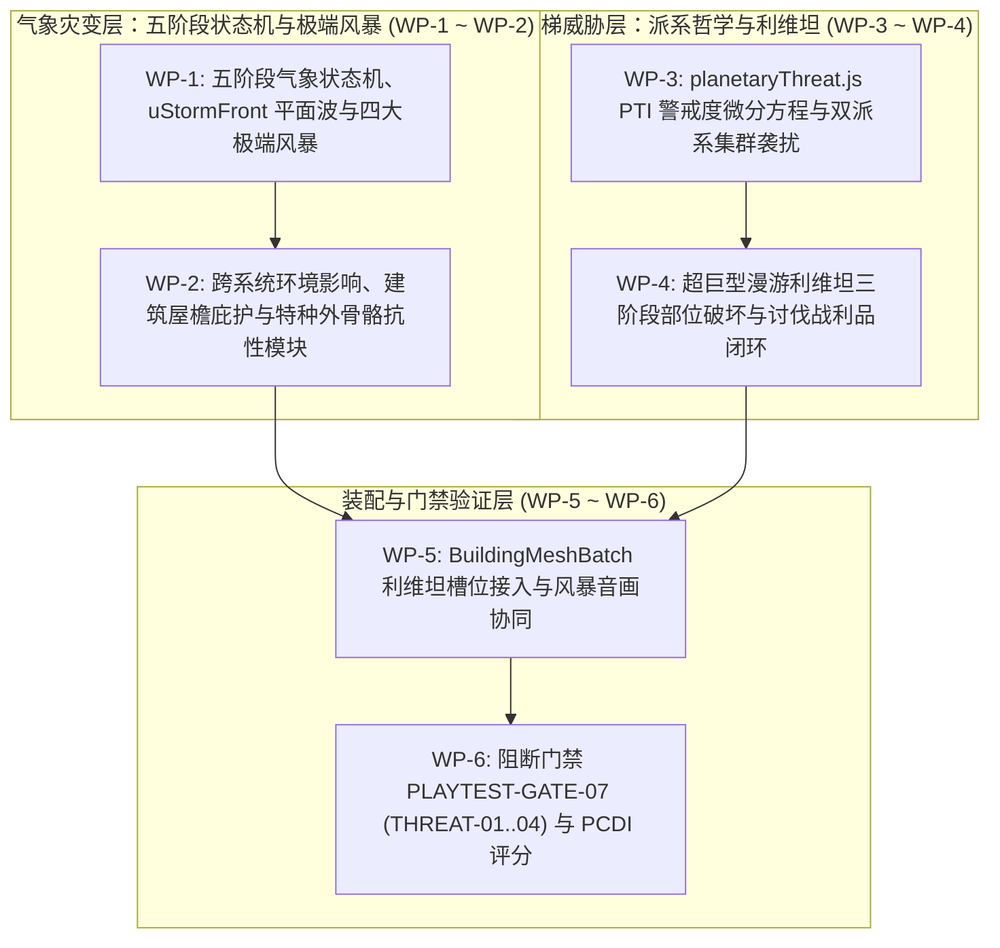

# 《无垠边疆：星之纪元》v0.6 动态气象灾变与阶梯威胁系统全套施工方案（工程实施任务书）

> **文档标识**：`docs/specs/20_v0.6动态气象灾变与阶梯威胁施工方案.md`  
> **最高总纲规范**：`docs/specs/16_超长线行星游戏性深化与世界演化总体方案.md`（最高设计总纲）  
> **底层架构规范**：`docs/specs/17_《无垠边疆》超长线演化架构方案.md`（技术架构白皮书）  
> **前序工程规范**：`docs/specs/19_v0.4行星深度工业与天地物流施工方案.md`  
> **责任人**：项目负责人（Project Lead）  
> **实施对象**：执行工程师团队（Execution Engineering Team）  
> **工程基准**：Git HEAD（Commit `84127db`）+ v0.4 基线代码  
> **目标版本**：v0.6.0（天灾与利维坦 · Cataclysm & Leviathan）  
> **门禁套件**：`tests/suites/playtest-gates.suite.js` 扩展 `PLAYTEST-GATE-07` (THREAT-01..04) 与 PCDI 深度闭环

---

## 零、 最高总纲约束与四大工程红线

1. **最高总纲设计定位（Doc 16 §4.14~§4.18 与 §11）**：
   - 彻底告别“天气只是天空贴图与全图无差别扣盾”的廉价设计，确立**五阶段气象状态机（Weather State Machine）**：
     $$\text{Clear Weather} \longrightarrow \text{Warning} \longrightarrow \text{Build-up} \longrightarrow \text{Peak Event} \longrightarrow \text{Recovery}$$
   - **跨系统连锁影响矩阵（Doc 16 §4.15）**：天气必须真实改变地表行动、工业管网、原生生态与殖民社会（如酸雨导致管线腐蚀、居民患病与地表扣血；沙尘暴导致光伏衰减、运力磨损；等离子磁暴干扰雷达并击穿蓄电池）。
   - **绝不能让世界永远惩罚玩家（Doc 16 §11）**：玩家必须能够通过研发特种外骨骼模块、架设避雷针与护盾穹顶、调整生产班次，将自然灾变转化为收集特殊伴生冷凝物（如硅晶沉积物、等离子结晶）的经营机遇。
   - **派系哲学鲜明差异（Doc 16 §4.17）**：
     - **远古哨卫（Sentinel Automata）**：关注高能反应堆、技术设施、电磁信号与古代遗迹侵入；
     - **原生异虫（Xeno-Swarm）**：关注生物质采掘、巢穴破坏与食物链扰动。
2. **环境灾变 GPU 程序化解析铁律（Doc 17 §3.4）**：
   - 严禁在 CPU 层面为风暴中的每粒沙尘或酸雨生成独立粒子对象！风暴推进必须抽象为连续平面波方程，以单个 `uniform vec4 uStormFront` 下发至 WebGL 着色器，地表浸没与雾效收窄 100% 在 GPU 顶点/片元着色器内求值。
3. **开采威胁因果闭环守恒（Doc 17 §3.3）**：
   - 地表开采警戒指数（PTI）必须严格与玩家采矿操作、工业能耗及弹射井发射形成物理耦合，且必须提供地貌修复（`RestoreTerrain`）、植被抚育与声波抑制塔（`bld_sonic_dampener`）等有效的可控平降手段，严禁数值失控。
4. **单星体持久化与单批次渲染门禁（Doc 17 §3.2/§3.4）**：
   - 活跃风暴与利维坦完整状态在 UTF-8 JSON 序列化下增量严格控制在 $\le 2\text{ KB}$，整星累计增量严守 $\le 20\text{ KB}$，`commandBus.deepClone(world)` 耗时严守 $\le 0.5\text{ ms}$。
   - 超巨型漫游利维坦（14 米级 Boss）必须合流至 `BuildingMeshBatch` 的专属图集槽位或 `PlanetSurface3D` 实例化组合通道，**严禁新建独立 Draw Call 循环**，确保全场峰值 Draw Call 稳守 $\le 40\text{ DC}$。

---

## 一、 施工包架构与工单依赖拓扑



---

## 二、 施工包详细施工指示

### 施工包 WP-1：五阶段气象状态机与 `uStormFront` 平面波着色器

#### 1. 目标文件
- `src/domain/ground/planetSeeds.js`
- `src/domain/ground/planetWeather.js` (新增模块)
- `src/render/gl/PlanetAtmosphere.js`
- `src/render/gl/PlanetTerrainMesh.js`

#### 2. 气象确定性生命周期状态机
每颗行星的气象循环由 `weatherCycleSeed(Math.floor(world.tick / 24))` 驱动，仅在 `planet.threat.storm` 中持久化 6 元组：
`[active, kindIdx, dirDeg, frontPosM, intensityPermille, remainTicks]`
风暴严格遵循 Doc 16 规定的五阶段生命周期：
1. **晴朗常态（Clear Weather）**：常规视距与环境基线；
2. **灾害预警（Warning，持续 45 秒）**：天际线红移变色、风向偏转、HUD 气压计报警，提示玩家撤回掩体或切换工厂防御模式；
3. **灾害发展（Build-up，持续 30 秒）**：风速倍增，气压剧降，环境粒子沉降速率开始增大；
4. **峰值过境（Peak Event，持续 90~150 秒）**：平面波锋面以速度 $v = 1.8\text{ m/s}$ 沿风向角 $\theta$ 从场域边缘横扫全图；
5. **恢复期（Recovery，持续 30 秒）**：能见度逐步恢复，遗留风暴特殊冷凝产物（如硅晶沉积物）供玩家采集。

#### 3. GLSL ES 3.0 平面波着色器注入
在 `PlanetTerrainMesh.js`（`TERRAIN_MESH_FS`）与 `PlanetAtmosphere.js`（`SKY_FS`）接入统一定义：
```glsl
// uStormFront: x = cos(dir), y = sin(dir), z = frontAdvanceMeters, w = intensity (0..1)
uniform vec4 uStormFront;

float stormStrength = uStormFront.w;
float localStorm = 0.0;
if (stormStrength > 0.01) {
  float proj = vWorldPos.x * uStormFront.x + vWorldPos.z * uStormFront.y;
  localStorm = smoothstep(-28.0, 28.0, uStormFront.z - proj) * stormStrength;
  
  float gust = noise3D(vec3(vWorldPos.xz * 0.25 - uStormFront.xy * uTime * 3.8, uTime * 0.9));
  vec3 stormTint = mix(uFogColor, uMatCol3, 0.35);
  lit = mix(lit, stormTint * (0.65 + 0.35 * gust), localStorm * 0.55);
}

vec2 effectiveFogRange = mix(uFogRange, uFogRange * vec2(0.18, 0.22), localStorm);
float fog = smoothstep(effectiveFogRange.x, effectiveFogRange.y, distance(vWorldPos, uCamPos));
vec3 finalCol = mix(lit, uFogColor, fog);
fragColor = vec4(finalCol * uHdr, 1.0);
```

#### 4. 四大旗舰极端风暴规则
- **超温热浪风暴（Super-Thermal Gale，熔岩/赤岩星）**：雾距压缩至 22%，外骨骼喷气冷却耗散翻倍，太阳能出力跌至 15%，风力出力暴涨至 250%；
- **腐蚀酸雹风暴（Corrosive Acid Hail，硫沼/真菌星）**：沉降粒子倾斜 35° 疾射，暴露单位每秒受到 $4.5\text{ HP/s}$ 酸蚀扣盾；
- **等离子磁暴（EM Plasma Super-Storm，极光/晶原星）**：极光亮度翻倍，每 8 秒触发一次地表落雷；小地图雷达杂波，蓄电池每小时损失 30% 电量；
- **极寒巨潮（Cryo-Whiteout & Mega-Tide，永冻/海洋星）**：热源塔融雪半径收缩 40%，海面巨潮水位上涨 $+8.5\text{m}$ 淹没低洼陆桥。

---

### 施工包 WP-2：跨系统环境影响、庇护与特种外骨骼抗性

#### 1. 目标文件
- `src/ui/screens/GroundView.js`
- `src/content/technologies.js`
- `src/domain/economy/powerNetwork.js`

#### 2. 三重庇护与技术防御
当风暴锋面过境时（`localStorm > 0.5`），在 `GroundView._tickEnvironmentDamage` 中执行判定：
1. **地基建筑屋檐庇护**：角色中心点距离任意带有 `TERRAIN_FLAGS.FOUNDATION` 标记的建筑中心 $\le 3.5\text{m}$，完全免受酸雹与沙暴伤害；
2. **热源/能量穹顶庇护**：角色位于 `uHeatZones` 保暖或护盾穹顶有效半径内，完全免除严寒与等离子辐射；
3. **外骨骼抗性插件**：已装配 `exo_mod_thermal_shield`（耐热盾）、`exo_mod_acid_carapace`（防酸甲壳）或基地修筑了 `bld_lightning_rod`（避雷针），免除扣血并抑制电网能量流失。

---

### 施工包 WP-3：`planetaryThreat.js` PTI 警戒度演化与双派系集群袭扰

#### 1. 目标文件
- `src/domain/ground/planetaryThreat.js` (新增模块)
- `src/simulation/HourlySystems.js`
- `src/domain/ground/GroundMission.js`

#### 2. 开采警戒指数（PTI）微分演化方程
在 `HourlySystems.js` 的 `production` 阶段后调用：
$$H_t = \operatorname{clamp}\left( H_{t-1} + \Delta_{\text{mine}} + \Delta_{\text{ind}} + \Delta_{\text{catapult}} - \Delta_{\text{restore}} - \Delta_{\text{dampener}} - \lambda H_{t-1}, 0, 1000 \right)$$
- 运行中矿井贡献：$+2.0 \times \text{count}$；
- 工业加工节点贡献：$+0.4 \times \text{nodes}$；
- 货运弹射井单次发射瞬间激发：$+25.0$；
- 地形平整修复（`kind === 'plant'` 或 `RestoreTerrain`）：$-1.5 \times \text{ops}$；
- 声波抑制塔（`bld_sonic_dampener`）：$-6.0 \times \text{count}$；
- 自然阻尼衰减系数：$\lambda = 1.5\% / \text{小时}$。

#### 3. 哨卫与异虫派系行为哲学差异
- **远古哨卫（Sentinel Automata）**：优先攻击高压变电站、工业核心与货运发射井，使用能量射线穿甲；
- **原生异虫（Xeno-Swarm）**：优先突袭水培农场、露天采矿钻机与居民区，具备近距离酸液腐蚀与自爆能力。

#### 4. 警戒阶梯响应
- **Tier 0（0~199，潜伏态）**：无主动进攻波次；
- **Tier 1（200~399，震动侦测）**：每 120 秒从外围刷出 2~3 只侦察单位试探逼近；
- **Tier 2（400~649，侧翼袭扰）**：每 90 秒从侧翼路线突袭，优先攻击输电塔与传送带；
- **Tier 3（650~849，全面围攻）**：每 75 秒刷出重装攻城体与远程迫击单位包抄能源核心；
- **Tier 4（850~1000，利维坦苏醒）**：全图地震相机震颤，唤醒超巨型漫游利维坦。

---

### 施工包 WP-4：超巨型漫游利维坦三阶段部位破坏与战利品闭环

#### 1. 目标文件
- `src/domain/ground/planetaryThreat.js`
- `src/domain/ground/GroundMission.js`

#### 2. 三大旗舰利维坦原型
根据行星天体类别确定性派生：
- 熔岩世界：**熔岩巨像（`lev_magma_colossus`）**；
- 碧渊海洋：**深渊海妖（`lev_abyssal_kraken`）**；
- 机械/晶原：**圣骸歼灭机甲（`lev_automata_dreadnought`）**。

#### 3. 三阶段战斗与部位破坏状态机
- 初始生命值 $3,600\text{ HP}$，体长 14 米；
- **部位破坏弱点**：背部散热晶核与双侧毒素腺囊拥有独立判定体积。被高伤武器或轨道打击命中击碎时，利维坦触发长达 6.0 秒的 `stagger` 瘫痪硬直，并永久关闭该部位的 AoE 技能；
- **战略后果与收益**：
  - 利维坦在场期间，该行星轨道货运发射井被强生物/电磁场锁死无法发射；
  - 讨伐成功后，PTI 瞬间归零，掉落传奇利维坦基因腺体与先驱者奇异物质（`exoticMatter × 5`）。

---

### 施工包 WP-5：`BuildingMeshBatch` 利维坦槽位与风暴音画协同

#### 1. 目标文件
- `src/ui/screens/GroundView.js`
- `src/render/AudioManager.js`

#### 2. 实施细节
1. 在 `BuildingMeshBatch` 中追加 `leviathan_body` 槽位，通过倒角原语拼接巨兽多段节肢骨骼，单 VAO 绘制（0 额外 Draw Call）；
2. 利维坦登场时，`AudioManager` 混合触发专属超低频（$45\text{ Hz}$）号角声景与次声波地表微震反馈。

---

### 施工包 WP-6：阻断门禁 `PLAYTEST-GATE-07` (THREAT-01..04) 与 PCDI 深度闭环

#### 1. 目标文件
- `tests/suites/playtest-gates.suite.js`

#### 2. 断言矩阵实现
在套件中追加 `PLAYTEST-GATE-07`，包含以下 5 项子断言：
1. **THREAT-01（风暴着色器参数与庇护零扣血）**：
   驱动风暴锋面过境，断言处于地基屋檐与热源穹顶内的角色扣血量恒等于 0，暴露在外的角色按 $4.5\text{ HP/s}$ 准确扣盾；
2. **THREAT-02（PTI 微分方程数值守恒）**：
   模拟连续采矿与弹射，断言 PTI 准确爬升并触发 Tier 1~3 增援波次；验证声波抑制塔与植被恢复能将 PTI 平稳拉回安全阈值；
3. **THREAT-03（侧翼包抄 AI 建筑目标锁定）**：
   验证 Tier 2 敌军绕过正面拒马精确打击输电塔，输电塔损毁后下游电网准确切断并触发警报；
4. **THREAT-04（利维坦部位破坏与弹射井解锁）**：
   模拟讨伐 Tier 4 利维坦，断言部位破坏瘫痪窗口持续 6 秒、击败后掉落奇异物质且货运发射井恢复正常发射；
5. **THREAT-05（气象与威胁世界 PCDI 深度评估 · Doc 16 §9）**：
   在典型极端气象行星上运行 PCDI 评估，系统相互作用与环境威胁响应维度得分必须 $\ge 85\text{ 分}$。

---

## 三、 执行工程师实施检查单 (Checklist)

- [ ] 在 `PlanetAtmosphere.js` 与 `PlanetTerrainMesh.js` 中接入 `uStormFront` 统一定义与五阶段状态机；
- [ ] 编写 `GroundView.js` 地基屋檐与热源穹顶环境庇护判定逻辑；
- [ ] 实现 `planetaryThreat.js`，打通 PTI 微分累积与自然阻尼衰减；
- [ ] 实装哨卫与异虫派系行为哲学与 Tier 4 利维坦三阶段部位破坏 Boss 战；
- [ ] 挂载利维坦图集槽位并实测全场同屏 Draw Call $\le 40\text{ DC}$；
- [ ] 运行 `node tests/suites/playtest-gates.suite.js`，确保 `PLAYTEST-GATE-07` 全绿通过。
