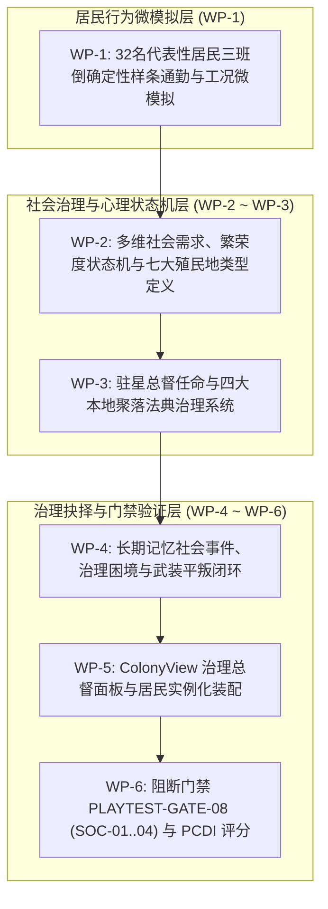

# 《无垠边疆：星之纪元》v0.8 殖民聚落自治生态与社会微模拟全套施工方案（工程实施任务书）

> **文档标识**：`docs/specs/21_v0.8殖民聚落自治生态与社会微模拟施工方案.md`  
> **最高总纲规范**：`docs/specs/16_超长线行星游戏性深化与世界演化总体方案.md`（最高设计总纲）  
> **底层架构规范**：`docs/specs/17_《无垠边疆》超长线演化架构方案.md`（技术架构白皮书）  
> **前序工程规范**：`docs/specs/20_v0.6动态气象灾变与阶梯威胁施工方案.md`  
> **责任人**：项目负责人（Project Lead）  
> **实施对象**：执行工程师团队（Execution Engineering Team）  
> **工程基准**：Git HEAD（Commit `84127db`）+ v0.6 基线代码  
> **目标版本**：v0.8.0（边疆总督 · Frontier Overseer）  
> **门禁套件**：`tests/suites/playtest-gates.suite.js` 扩展 `PLAYTEST-GATE-08` (SOC-01..04) 与 PCDI 深度闭环

---

## 零、 最高总纲约束与四大工程红线

1. **最高总纲设计定位（Doc 16 §4.19~§4.23）**：
   - 彻底告别“居民仅是生产函数的冰冷输入参数与原地踏步的装饰小人”，确立**三级社会模拟架构（Doc 16 §4.19）**：
     - **L1：人口群体统计（Population Aggregate）**：工人、工程师、科学家等人口需求、满意度与工作效率；
     - **L2：居民群组代理（Resident Groups）**：前台 32 名实体化代表代理的通勤、作业、消费与就医；
     - **L3：关键历史角色（Key Characters）**：驻星总督、首席科学家与防务军官。
   - **四层居民需求与多维社会状态（Doc 16 §4.20）**：
     - 需求层级：生存需求（食物/水/氧气） $\to$ 安全需求（医疗/防御） $\to$ 社会需求（公平/休闲/文化） $\to$ 发展需求（教育/职业通道）；
     - 社会指标：希望值（`hope`）、不满值（`discontent`）、士气（`morale`）、健康（`health`）、社会公平（`equity`）与政治信任（`politicalTrust`）。
   - **七大特化殖民地类型（Doc 16 §4.23）**：
     - `Scientific Outpost`（深空科考前哨）、`Mining Colony`（矿业基地）、`Industrial World`（重工核心）、`Agricultural World`（水培农业星）、`Military Fortress`（军事要塞）、`Trade Port`（贸易自由港）与 `Ecological Preserve`（生态自然保护区）。
   - **六大治理方向与有记忆的社会事件（Doc 16 §4.21~§4.22）**：决策具备前因后果与长期历史回响，暴力镇压罢工将在数年后诱发地下极端抵抗。
2. **三班倒确定性样条插值铁律（Doc 17 §3.3）**：
   - 聚落居民活动必须统一基于地面道路与建筑出入口预烘焙的 Catmull-Rom 样条轨迹，在 60 Hz 渲染层通过纯代数相位差值求得位置，单星 32 名居民的每帧 CPU 耗时严守 $< 0.02\text{ ms}$。
3. **单星体持久化体积门禁（Doc 17 §3.2）**：
   - 32 名代表性居民代理、驻星总督属性与四大法典状态在 UTF-8 JSON 序列化下增量严格控制在 $\le 2\text{ KB}$，整星累计增量严守 $\le 22\text{ KB}$，`commandBus.deepClone(world)` 耗时严守 $\le 0.5\text{ ms}$。
4. **WebGL 2.0 居民单通道批处理（Doc 17 §3.4）**：
   - 全场所有通勤、作业与休憩中的居民小人模型，必须 100% 合流至 `PlanetSurface3D.chars` 实例化渲染通道（恒定只消耗 **1 次 Draw Call**），零动态内存分配。

---

## 一、 施工包架构与工单依赖拓扑

---

## 二、 施工包详细施工指示

### 施工包 WP-1：32 名代表性居民三班倒确定性样条通勤与工况微模拟

#### 1. 目标文件
- `src/domain/planets/colony.js`
- `src/ui/screens/GroundView.js`
- `src/render/gl/PlanetSurface3D.js`

#### 2. 紧凑居民代理 9 元组数据契约
每颗拥有殖民地的行星在 `planet.soc.agents` 中维护最多 32 个具名代表实体（每人代表 1~5 个统计人口）：
`[idNum, stratumIdx, homeNodeIdx, workNodeIdx, svcNodeIdx, shiftPhase, morale, health, traitMask]`
- `stratumIdx`：阶层（0: 工人, 1: 工程师, 2: 科学家, 3: 驻军士兵）；
- `shiftPhase`：排班相位（0, 1, 2 分别对应早/中/晚三班倒，错峰值守）；
- `morale`：个人士气（0..100）；
- `health`：健康度（0..100）。

#### 3. 昼夜四时相年代数样条插值
微缩昼夜循环按 180 秒（或 24 战略 tick）演进，居民在归一化时间 $\tau \in [0, 1)$ 内的行为状态机为：
1. **通勤上岗期（$\tau \in [0.00, 0.12)$）**：从住宅区大门走出，沿预烘焙样条匀速行进至工作岗位；
2. **作业生产期（$\tau \in [0.12, 0.55)$）**：
   - 矿工操作钻机触发地表飞溅火花；
   - 工程师在脚手架旁发射纳米焊接光束；
   - 科学家在实验室全息台前作业；
   - 士兵沿外围掩体巡逻（遭遇虫群袭扰时自动切换为友军战术射击）；
3. **休闲医疗期（$\tau \in [0.55, 0.75)$）**：前往娱乐中心交谈或医疗中心恢复健康；
4. **归家休憩期（$\tau \in [0.75, 1.00)$）**：返回住宅区，住宅窗户自发光通道（`vE`）亮起暖黄色灯火。

---

### 施工包 WP-2：多维社会需求、繁荣度状态机与七大殖民地类型

#### 1. 目标文件
- `src/domain/planets/colony.js`
- `src/simulation/DailySystems.js`
- `src/domain/economy/colonyTrade.js`

#### 2. 双轨社会心理指标与聚落繁荣度方程
每日在 `DailySystems.js` 的 `population` 阶段结算：
$$\Phi = \operatorname{clamp}\left( 0.40 \cdot H + 0.30 \cdot (100 - D) + 0.15 \cdot S_{\text{svc}} + 0.15 \cdot \eta_{\text{power}}, 0, 100 \right)$$
- $H$（希望值）：由充足食物配给、医疗覆盖、科研突破驱动提升；
- $D$（不满值）：由危险作业、风暴摧毁设施、过度加班驱动增长；
- $S_{\text{svc}}$：医疗与娱乐服务设施人口覆盖率；
- $\eta_{\text{power}}$：所属子电网平均供电充足率。

#### 3. 七大特化殖民地类型与加成偏置
在 `colony.colonyType` 中明确定义特化方向：
- `Scientific Outpost`：科研产出 $+30\%$，但工业维护费 $+15\%$；
- `Mining Colony`：采矿产出 $+25\%$，但污染增长速率 $+20\%$；
- `Industrial World`：加工厂产出 $+20\%$，电力负荷需求较大；
- `Agricultural World`：食物与生物质产出 $+40\%$，希望值基础保底 $+10$；
- `Military Fortress`：驻军作战力 $+35\%$，对空离子炮命中率提升；
- `Trade Port`：跨星球商船吞吐量翻倍，信用点税基 $+30\%$；
- `Ecological Preserve`：采矿受限，但物种科研产出翻倍，且完全免疫开采警戒度反噬。

#### 4. 宏观 4X 战略收益转化
1. **帝国每日税收呈平方级增长**：
   $$\text{TaxBonus} = \text{baseTax} \times \left(1.0 + \left(\frac{\Phi}{100}\right)^2 \times 1.5\right)$$
2. **黄金繁荣态（$\Phi \ge 75$）**：激活行星主题专属的帝国全局被动特质，并每日向科研池注入特种科研进度；
3. **武装暴动临界（$D \ge 90$ 且 $H \le 15$ 持续 7 天）**：聚落陷入停摆，触发地面战术平叛任务。

---

### 施工包 WP-3：驻星总督任命与四大本地聚落法典治理系统

#### 1. 目标文件
- `src/domain/planets/colonyGovernance.js` (新增模块)
- `src/domain/politics/policy.js`

#### 2. 驻星总督（Planetary Overseer）机制
允许玩家派驻 1 名来自 `world.entities.characters` 的领袖担任总督，其性格特质直接修正聚落微模拟：
- `bookish`（学者型）：科研产出 $+20\%$，解锁疫情逆向制药选项；
- `iron_fisted`（铁腕型）：不满值自然衰减速度翻倍，但希望值上限降低 15 点；
- `mercantile`（重商型）：商业税基 $+25\%$，走私风险微增。

#### 3. 四大聚落法典（`planet.soc.edicts`）
- `edict_emergency_shift` **《应急双倍班次令》**：全殖民地采掘与制造产出 $+35\%$；代价为每日不满值 $+6$、健康度 $-2$；
- `edict_double_rations` **《双倍营养配给与津贴》**：每日食物消耗 $\times 1.8$；代价为农业仓储压力增大；换取希望值 $+5$、不满值 $-4$、人口增长率 $+25\%$；
- `edict_automata_shift` **《机偶混编作业法案》**：消耗 `conductor` 维护费，用自治机器人填补 $40\%$ 岗位空缺；代价为工人生存焦虑致使希望值上限降低 10 点；
- `edict_quarantine_martial` **《生物隔离与检疫戒严》**：阻断异星孢子疫情扩散并将黑市损耗清零；代价为每日商业税基暂时削减 $30\%$。

---

### 施工包 WP-4：长期记忆社会事件、治理困境与武装平叛闭环

#### 1. 目标文件
- `src/domain/planets/colonyGovernance.js`
- `src/domain/ground/GroundMission.js`

#### 2. 治理困境触发与长期历史记忆
系统记录 `planet.soc.history = []`，后续事件能够引用过去的选择：
- `dil_labor_strike`（高温采矿罢工）：提高安全津贴（消耗 credits）vs 铁腕复工（提升不满值，并在历史记录中埋下极端工人组织的种子）；
- `dil_xenophage_outbreak`（异星孢子感染住宅）：就地物理隔离 vs 调派科考队研发生物血清；
- `dil_smuggler_ring`（轨道港稀土走私）：严厉查抄并逮捕涉案人员 vs 默许地下交易抽取黑市分润。

#### 3. 暴动平叛战术行动咬合
若聚落极端不满触发武装暴乱，系统在地面生成 `gmt_suppress_rebellion` 任务，玩家需率领驻军夺回行政大楼与能源核心；平叛成功后重置不满值，若失败该行星宣布脱离帝国管辖并进入独立反叛态。

---

### 施工包 WP-5：`ColonyView.js` 治理总督面板与居民实例化装配

#### 1. 目标文件
- `src/ui/screens/ColonyView.js`
- `src/ui/screens/GroundView.js`

#### 2. 实施细节
1. 在 `ColonyView.js` 中新增「总督公署与法典」全息子面板，实时渲染希望/不满双轨进度条、七大特化类型标签与多维需求雷达图；
2. 在 `GroundView.js` 的 `_layoutColony` 初始化时，为每栋建筑门牌烘焙连接样条，并在每帧渲染循环中驱动 32 名居民沿样条平滑行进与作业动画。

---

### 施工包 WP-6：阻断门禁 `PLAYTEST-GATE-08` (SOC-01..04) 与 PCDI 深度闭环

#### 1. 目标文件
- `tests/suites/playtest-gates.suite.js`

#### 2. 断言矩阵实现
在套件中追加 `PLAYTEST-GATE-08`，包含以下 5 项子断言：
1. **SOC-01（居民样条通勤零穿地零悬空）**：
   驱动 32 名居民代理连续推进 24 小时微缩周期，断言三维坐标 100% 贴合 `sampleTerrain` 地表高程且速度严格有限；
2. **SOC-02（希望/不满双轨微积分方程）**：
   模拟分别签署《应急双倍班次令》与《双倍营养配给》，断言产出修正、希望值与不满值变化完全符合数学模型；
3. **SOC-03（繁荣度向 4X 税收与科研转化）**：
   将繁荣度拉升至 80，断言帝国账本每日结算税款达到平方级增幅且特化殖民地类型加成准确激活；
4. **SOC-04（暴动临界判定与平叛任务生成）**：
   故意恶化聚落环境致使不满值连续 7 天超过 90，断言准时生成 `gmt_suppress_rebellion` 地面任务且总督进入危机待命状态；
5. **SOC-05（定居点世界 PCDI 深度评估 · Doc 16 §9）**：
   在殖民旗舰星球执行 PCDI 评估，居民生活世界与社会演化维度得分必须 $\ge 85\text{ 分}$。

---

## 三、 执行工程师实施检查单 (Checklist)

- [ ] 实现居民三班倒确定性样条预烘焙算法与代数相位插值；
- [ ] 编写 `colonyGovernance.js`，实装希望/不满/繁荣度双轨微分状态机与七大特化类型；
- [ ] 扩展四大聚落法典与长期记忆治理困境裁决卡；
- [ ] 在 `ColonyView.js` 接入治理子面板并实现 4X 帝国税基与科研联动；
- [ ] 实测 32 名居民合流渲染下同屏总 Draw Call 无任何额外增量；
- [ ] 运行 `node tests/suites/playtest-gates.suite.js`，确保 `PLAYTEST-GATE-08` 全绿通过。
