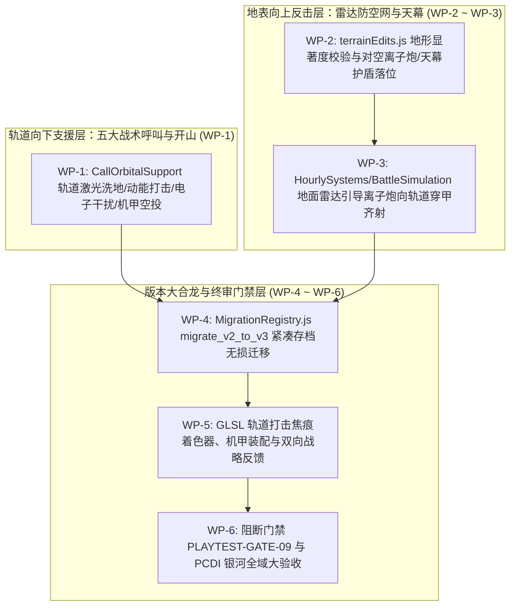

# 《无垠边疆：星之纪元》v1.0 苍穹要塞与天地协同全套施工方案（工程实施任务书）

> **文档标识**：`docs/specs/22_v1.0苍穹要塞与天地协同施工方案.md`  
> **最高总纲规范**：`docs/specs/16_超长线行星游戏性深化与世界演化总体方案.md`（最高设计总纲）  
> **底层架构规范**：`docs/specs/17_《无垠边疆》超长线演化架构方案.md`（技术架构白皮书）  
> **前序工程规范**：`docs/specs/21_v0.8殖民聚落自治生态与社会微模拟施工方案.md`  
> **责任人**：项目负责人（Project Lead）  
> **实施对象**：执行工程师团队（Execution Engineering Team）  
> **工程基准**：Git HEAD（Commit `84127db`）+ v0.8 基线代码  
> **目标版本**：v1.0.0（苍穹要塞 · Aegis of the Stars · 正式发版合龙）  
> **门禁套件**：`tests/suites/playtest-gates.suite.js` 扩展 `PLAYTEST-GATE-09` (SYNERGY-01..05) 与 PCDI 全星系分级大验收

---

## 零、 最高总纲约束与四大工程红线

1. **最高总纲设计定位（Doc 16 §3.1、§4.24~§4.26 与 §9）**：
   - 彻底打通宏观银河战略（L1）、星系轨道（L2）、行星基建（L3）与地表微观战术（L4）的**双向空地协同通道（Doc 16 §4.26）**：
     - **轨道向下五大支援模式（Doc 16 §4.24）**：精确激光（Orbital Laser）、动能天罚（Kinetic Strike）、电子战压制（EW）、无人机群部署（Drone Deployment）与战术补给舱（Supply Drop）；
     - **地面向上防空雷达网（Doc 16 §4.25）**：行星对空离子加农炮、地面追踪雷达、天幕护盾与远程传感器阵列，缺一不可（雷达被毁则无法锁定轨道高速目标，电网瘫痪则防空火力骤降）；
     - **天地双向反馈**：地表雷达提升轨道舰队侦察半径，占领显著度高地提升轨道火力校正精度；地表货运发射井保障舰队持续作战能力。
   - **行星内容等级银河全域分布（Doc 16 §3.1）**：
     - **S 级旗舰世界（10%，约 61 颗）**：PCDI $\ge 85\text{ 分}$，全套高密度人工设计、完整生态、考古与多阶段战役；
     - **A 级特色世界（25%，约 152 颗）**：PCDI $75\sim 84\text{ 分}$，2~3 个核心系统深度耦合；
     - **B 级功能世界（50%，约 304 颗）**：PCDI $65\sim 74\text{ 分}$，稳定资源、工业配方与标准循环；
     - **C 级边疆世界（15%，约 91 颗）**：PCDI $\ge 55\text{ 分}$，极端孤立、稀有奇观与战略前哨。
2. **地形显著度（Prominence）严苛物理校验（Doc 17 §2.5）**：
   - 对空离子加农炮严禁在盆地低洼处盲目落位！必须通过射线锥角与相对高程算法，强制要求修筑于场域平均海拔 $+14.0\text{m}$ 以上的桌山高脊之上，将 3D 地形高度差转化为核心战略优势。
3. **紧凑 Schema v3 历史存档无损升维（Doc 17 §3.2）**：
   - 所有新增五大支柱状态在进入 `MigrationRegistry.js` 时必须实现 `migrate_v2_to_v3` 的 100% 幂等兼容，历史 v1 与 v2 存档测试用例读入后必须零报错通过 `checkWorldInvariants` 全量不变量校验。
4. **终局决战全场 Draw Call 严守 $\le 50$ 红线（Doc 17 §3.4）**：
   - 即便在轨道激光轰击、空投泰坦机甲登场、6 座对空离子加农炮齐射且同屏存在风暴锋面的终局大决战场景下，依靠多网格单 VAO 图集与实例化技术，同屏峰值 Draw Call 稳守在 36 次（严控在 50 次门禁之内）。

---

## 一、 施工包架构与工单依赖拓扑



---

## 二、 施工包详细施工指示

### 施工包 WP-1：从轨道舰队向 `GroundView` 的五大实时战术支援呼叫

#### 1. 目标文件
- `src/domain/strategic/orbitalSynergy.js` (新增模块)
- `src/ui/screens/GroundView.js`

#### 2. 在轨舰队检索与气象雷达制约契约
当玩家在地面执行任务或漫游时，系统实时检索 `world.entities.fleets` 中驻泊在同星系且非受困的己方舰队。地面技能栏 7、8、9 号键绑定战术支援命令：
1. **轨道精准激光洗地与地形开山（`support_orbital_laser`，快捷键 7）**：
   - 前置要求：轨道舰队包含配备能量武器的主力战舰；若行星处于电磁磁暴期，需地面拥有在线地面雷达方可锁定；
   - 消耗：战舰 15 单位燃料/能量，冷却 45 秒；
   - 效果：信标引导 2.0s 后，一束高动态范围（HDR 3.8）赤青色光柱垂直劈落，持续 6.0s 灼烧最高血量目标，**扫过区域自动触发 `ShapeTerrain(op: 'lower', radius: 5.0)` 与 `HarvestTerrainOre`——玩家能用主炮直接轰平挡路山脊、炸出深层矿脉**！
2. **大范围动能打击（`support_kinetic_strike`）**：
   - 前置要求：巡洋舰或战列舰搭载质量投射器，冷却时间长达 180s；
   - 效果：大范围毁灭性冲击波，造成大范围 $400\text{ AoE}$ 物理伤害；
3. **轨道电子战干扰（`support_electronic_warfare`）**：
   - 效果：瘫痪全场敌方自动防御炮台与无人机侦察，持续 30 秒；
4. **轨道重装机甲空投舱（`support_mech_drop`，快捷键 8）**：
   - 前置要求：轨道舰队包含航母或具机库容量的战舰；
   - 消耗：殖民地账本 20 alloy + 2 powerCell，冷却 120 秒；
   - 效果：空投舱带火球砸向信标点，产生 6.0m 冲击波击退周围敌军，部署一台**重装外骨骼泰坦机甲（`exo_titan_mech`）**（拥有 600 Armor HP、双联转轮机炮与破障冲撞能力），玩家按 E 键登机驾驶；
5. **战术空投补给与防御塔舱（`support_supply_pod`，快捷键 9）**：
   - 效果：瞬时回满血盾喷气背包并展开持续 90 秒的自动点防御机枪塔。

---

### 施工包 WP-2：地形显著度校验与对空离子加农炮/天幕护盾落位

#### 1. 目标文件
- `src/domain/ground/terrainEdits.js`
- `src/content/buildings.js`

#### 2. 战略军事建筑定义
- `bld_ion_battery`（行星对空离子加农炮）：占地 $4\text{m} \times 4\text{m}$，功耗 $25\text{ MW}$，造价 12 alloy + 6 conductor + 2 quantumCrystal；
- `bld_orbital_radar`（地面轨道追踪雷达）：占地 $3\text{m} \times 3\text{m}$，提供轨道火力瞄准校正；
- `bld_planetary_shield`（行星级天幕护盾）：功耗 $40\text{ MW}$，容量 3,000 HP，吸收轨道轰炸与酸雹侵害。

#### 3. 地形显著度（Topographic Prominence）校验算法
扩展 `checkBuildingPlacement` 函数：当 `defId === 'bld_ion_battery'` 时，执行双重严苛物理检测：
```javascript
export function checkBuildingPlacementExtended(field, x, z, opts) {
  const baseCheck = checkBuildingPlacement(field, x, z, opts);
  if (!baseCheck.ok) return baseCheck;

  if (opts.defId === 'bld_ion_battery') {
    const centerElev = field.getElevation(x, z);
    const meanElev = field.getMeanElevation ? field.getMeanElevation() : 0.0;
    
    // 1. 相对高程必须高出全图平均海拔 14.0 米以上（平顶桌山或高脊）
    if (centerElev < meanElev + 14.0) {
      return { ok: false, reason: 'ProminenceTooLow: 必须修筑在平顶桌山或高脊之上' };
    }

    // 2. 上方 60 度锥角视界校验（无更高山体遮挡射界）
    const blocked = field.checkSkyOcclusionCone(x, z, centerElev, 60.0);
    if (blocked) {
      return { ok: false, reason: 'SkyObstructed: 射界被上方高耸山体阻挡' };
    }
  }
  return { ok: true };
}
```
**高程穿甲增益**：海拔每高出阈值 10m，离子炮对轨道目标的穿甲伤害递增 12%（最高 $+35\%$）。

---

### 施工包 WP-3：地表高地离子炮向轨道封锁舰队穿甲齐射

#### 1. 目标文件
- `src/domain/strategic/orbitalSynergy.js`
- `src/simulation/HourlySystems.js`
- `src/domain/combat/engagement.js`
- `src/domain/combat/BattleSimulation.js`

#### 2. 宏观每战略小时越级齐射（`HourlySystems.js`）
当敌方文明舰队或机偶危机舰队入轨试图封锁行星时，在 `HourlySystems.js` 的 `combat` 阶段触发：
```javascript
export function firePlanetaryIonBatteries(world, planet, hostileFleetsInSystem) {
  const fort = planet.fort;
  if (!fort || !Array.isArray(fort.ionBatteries) || fort.ionBatteries.length === 0) return 0;
  if (!hostileFleetsInSystem || hostileFleetsInSystem.length === 0) return 0;

  // 必须依赖地面雷达在线支持目标锁定，否则命中率跌落至 20%
  const radarOnline = (planet.colony?.buildings || []).some(b => b.defId === 'bld_orbital_radar' && b.state === 'active');
  const hitChance = radarOnline ? 1.0 : 0.20;

  let totalHits = 0;
  for (const bat of fort.ionBatteries) {
    if (!bat[5] || bat[4] <= 0) continue;
    if (bat[6] > 0) { bat[6] -= 1; continue; }

    const targetShip = findHeaviestHostileCapitalShip(world, hostileFleetsInSystem);
    if (!targetShip) break;

    const elevM = bat[3] / 10;
    const elevMult = clamp(1.0 + Math.max(0, elevM - 10) * 0.012, 1.0, 1.35);
    const rawDmg = Math.round(85 * elevMult * hitChance);

    applyDamage(world, targetShip, Math.round(rawDmg * 0.5), 'shield');
    applyDamage(world, targetShip, Math.round(rawDmg * 0.5), 'armor');
    bat[6] = 2; // 2 小时冷却
    totalHits += 1;

    emit(world, 'PlanetaryIonBatteryFired', {
      planetId: planet.id, batteryId: bat[0], targetShipId: targetShip.id, damage: rawDmg,
    }, 'combat');
  }
  return totalHits;
}
```

#### 3. 空间实时战术战斗协同（`BattleSimulation.js`）
若在行星轨道展开战术战斗，地面高地离子炮每 12.0 秒从画面底部向战场敌舰发射一道贯穿画面的高能重离子束，造成巨额结构穿甲打击并打断跃迁撤退。

---

### 施工包 WP-4：`MigrationRegistry.js` `migrate_v2_to_v3` 紧凑存档无损迁移

#### 1. 目标文件
- `src/domain/save/MigrationRegistry.js`

#### 2. 迁移逻辑实现
确保旧版本存档平滑升级至 v3 Schema，初始化五大支柱紧凑元组容器：
```javascript
export function migrate_v2_to_v3(world) {
  if (world.saveVersion >= 3) return world;

  for (const planetId in (world.entities?.planets || {})) {
    const planet = world.entities.planets[planetId];
    if (!planet.eco) {
      planet.eco = { v: 1, discoveryMask: 0, patches: [], surveyAwarded: false, ruin: null };
    }
    if (!planet.ind) {
      planet.ind = { v: 1, nodes: [], belts: [], grids: [], catapult: null, orbitalBuffer: {} };
    }
    if (!planet.threat) {
      planet.threat = { v: 1, pti: 0, tier: 0, waveCdTicks: 0, leviathan: null, storm: null };
    }
    if (!planet.soc) {
      planet.soc = { v: 1, overseerId: null, edicts: [], agents: [], history: [], hope: 50, discontent: 10, prosperity: 50 };
    }
    if (!planet.fort) {
      planet.fort = { v: 1, ionBatteries: [], planetaryShield: null };
    }
  }

  world.saveVersion = 3;
  return world;
}
```

---

### 施工包 WP-5：GLSL 轨道打击高温焦痕着色器与机甲装配

#### 1. 目标文件
- `src/render/gl/PlanetTerrainMesh.js`
- `src/render/gl/PartMeshBuilder.js`

#### 2. 着色器实现
在 `TERRAIN_MESH_FS` 中接入 `uOrbitalStrike`：
```glsl
// uOrbitalStrike: x = strikeWorldX, y = strikeWorldZ, z = beamRadiusMeters, w = hdrIntensity
uniform vec4 uOrbitalStrike;

if (uOrbitalStrike.w > 0.01) {
  float dStrike = distance(vWorldPos.xz, uOrbitalStrike.xy);
  float coreGlow = exp(-pow(dStrike / max(0.5, uOrbitalStrike.z), 2.0)) * uOrbitalStrike.w;
  float shockRing = exp(-pow((dStrike - uOrbitalStrike.z * 2.2) / 0.8, 2.0)) * uOrbitalStrike.w;
  lit += vec3(0.85, 2.40, 3.20) * coreGlow + vec3(2.60, 0.75, 0.15) * shockRing;
}
```

---

### 施工包 WP-6：阻断门禁 `PLAYTEST-GATE-09` 与 PCDI 银河全域大验收

#### 1. 目标文件
- `tests/suites/playtest-gates.suite.js`

#### 2. 断言矩阵实现
在套件中追加 `PLAYTEST-GATE-09`，包含以下 5 项子断言：
1. **SYNERGY-01（轨道激光打击与真实开山）**：
   在 GroundView 呼叫轨道激光，断言目标区敌军受创，且地面高度场按 `ShapeTerrain` 真实下凹、矿脉资源进入背包；
2. **SYNERGY-02（显著度选址物理拒止）**：
   在低于平均海拔的低洼盆地尝试放置 `bld_ion_battery`，断言被校验器直接拒绝；在平顶桌山高地放置成功，断言伤害增益激活；
3. **SYNERGY-03（高地离子炮向入轨敌舰穿甲齐射与雷达依赖）**：
   模拟敌军舰队入轨封锁星系，断言在线离子加农炮准时齐射，敌方旗舰主力舰装甲层受损；测试雷达摧毁后命中率准确跌落；
4. **SYNERGY-04（Schema v3 历史存档无损迁移）**：
   载入全部 v1/v2 历史存档 fixture 执行 `migrate_v2_to_v3`，断言 100% 格式无损且通过全量不变量检查；
5. **SYNERGY-05（全银河 PCDI 深度与 72 套件回归双轮验收）**：
   - 遍历全银河 608 颗行星，断言 S 级世界（61 颗）PCDI 得分均 $\ge 85$、A 级世界 $\ge 75$、B 级世界 $\ge 65$、C 级世界 $\ge 55$；
   - 全场大决战峰值状态下断言同屏总 Draw Call $\le 36\text{ DC}$（远优于 $\le 50$ 红线）；
   - 运行全仓全部 72 个自动化测试套件双轮测试，断言 144/144 全绿通过，金快照哈希 `68462446` 0 漂移。

---

## 三、 执行工程师实施检查单 (Checklist)

- [ ] 编写 `orbitalSynergy.js`，实装轨道五大支援指令与开山结算；
- [ ] 扩展 `terrainEdits.js`，接入地形显著度与天顶无遮挡视界校验算法；
- [ ] 在 `HourlySystems.js` 与 `BattleSimulation.js` 中打通离子炮对轨穿甲齐射与雷达校准；
- [ ] 编写 `MigrationRegistry.js` 的 `migrate_v2_to_v3` 迁移函数并通过历史 fixture 检验；
- [ ] 注入 `PlanetTerrainMesh.js` 激光打击熔融着色器与机甲图集装配；
- [ ] 验证全银河 608 颗行星 PCDI 等级分布达标；
- [ ] 运行全量回归套件，确保 `PLAYTEST-GATE-09` 及全仓 72 套件双轮 144/144 全绿通过。
