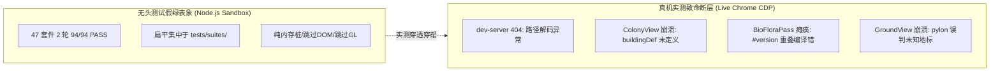
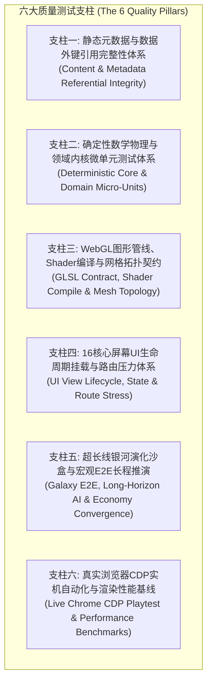

# 《VOID FRONTIER: AGE OF STARS — 全生命周期质量工程与大规模完全测试体系方案 任务委托书》

**任务编号**: `MANDATE-EXPERT-FULL-LIFECYCLE-QA-202611-05`  
**签发角色**: 项目负责人（Project Lead）  
**接收对象**: 游戏系统工程、确定性仿真验证与自动化测试领域专家组（Domain Experts in Game Systems, Deterministic Simulation & QA Engineering）  
**关联基石文档**:
- **总体方案总纲**: [docs/specs/16_超长线行星游戏性深化与世界演化总体方案.md](file:///c:/Users/zt/My%20Drive/work/void-frontier-age-of-stars/docs/specs/16_超长线行星游戏性深化与世界演化总体方案.md)
- **架构总纲白皮书**: [docs/specs/17_《无垠边疆》超长线演化架构方案.md](file:///c:/Users/zt/My%20Drive/work/void-frontier-age-of-stars/docs/specs/17_《无垠边疆》超长线演化架构方案.md)
- **长线施工方案系列**: [docs/specs/18_v0.2异星生态与深空考古施工方案.md](file:///c:/Users/zt/My%20Drive/work/void-frontier-age-of-stars/docs/specs/18_v0.2异星生态与深空考古施工方案.md) ~ [docs/specs/22_v1.0苍穹要塞与天地协同施工方案.md](file:///c:/Users/zt/My%20Drive/work/void-frontier-age-of-stars/docs/specs/22_v1.0苍穹要塞与天地协同施工方案.md)
- **项目负责人终审验收报告**: `docs/reports/report-ultra-longline.md`

---

## 一、 委托背景与核心矛盾诊断：虚假全绿与实测断层的深刻危机

在《无垠边疆：星海纪元》完成 v0.2 至 v1.0 超长线演化开发施工后，执行工程师汇报 47 套件（94 轮）全部 PASS。然而在项目负责人接入真实浏览器（Chrome CDP 9222 端口，搭载 RTX 5060 Laptop GPU）进行真机实测时，当场捕获并紧急排查了 **4 项导致游戏崩溃与渲染管线静默瘫痪的致命缺陷**：

项目负责人在现场对项目工程全貌进行了彻底摸排，查明当前质量工程存在三大制度性缺陷：

1. **测试架构骨架名存实亡（75% 空置率）**：
   在 `tests/` 根目录下，原本在项目初创（2026-11-01）规划的 12 个子目录中，多达 **9 个为空目录（0 个文件）**（`tests/ai/`、`tests/combat/`、`tests/core/`、`tests/diplomacy/`、`tests/economy/`、`tests/integration/`、`tests/persistence/`、`tests/ships/`、`tests/world/`），荒废至今。所有用例均扁平化杂糅在 `tests/suites/` 中，缺乏与 `src/` 各子领域的模块级对齐。
2. **前端与图形视图层“零测试覆盖”**：
   项目虽然拥有 16 个核心视图（`src/ui/screens/`）与 15 个渲染通道模块（`src/render/gl/`），但在现有的测试套件中，**UI 挂载测试覆盖率为 0%，Shader 真实语法编译覆盖率为 0%**。只要任何视图中存在拼写错误或着色器版本宏冲突，纯 Node 内存测试完全无法感知，导致“代码全绿但玩家一开就白屏崩溃”。
3. **数据引用完整性与外键校验真空**：
   `src/content/` 中定义了数百项科技树、建筑配方、舰船构件、探索事件与多语言词典，但从未进行过静态数据外键闭环校验（科技前置是否存在、配方消耗资源是否已在物品表声明、本地化 Key 是否双向对齐）。

**事实证明：目前该项目在工程测试维度完全是严重欠缺、畸形发展的。**  
为彻底扭转“靠运气交付、靠人工踩坑”的被动局面，项目决策层正式提请领域专家组，为本项目量身定制一套**《全生命周期大规模完全测试体系方案》**。

---

## 二、 委托核心目标（Core Mandate Objectives）

诚请领域专家组立足于硬核太空 4X + 地表建造模拟的复杂系统特性，输出具有最高行业水准的测试顶层设计方案，达成以下四大目标：

1. **全域覆盖（From Inception to Infinity）**：
   建立覆盖项目从设立之初的基础底层（PRNG、时钟、数学核）到最新 v1.0 苍穹要塞（生态网、工业流、气象微积分、聚落微模拟、轨道防御、多版本存档迁移）全部 **157 个源码模块** 的全量回归测试网络。
2. **重整测试目录骨架（Architectural Realignment）**：
   彻底盘活并重构 `tests/` 目录结构，消除所有空壳死目录，建立与 `src/` 各层 1:1 镜像对齐的严谨工程化测试体系。
3. **破除“无头假绿”（Anti-Fake-Green Pipeline）**：
   建立多层防御纵深，涵盖“数据静态引用门禁”、“Shader 编译静态检查”、“UI 视图生命周期挂载验证”、“超长线银河仿真收敛”与“Chrome CDP 真机自动化实测”。
4. **标准化回归流水线（Deterministic CI/CD Standards）**：
   提供一键式、可自动化执行的全量回归测试套件与执行规范，确保每次代码演化、重构或热修后，均能进行绝对确定、零状态泄漏、零时间漂移的终极质量复核。

---

## 三、 委托六大质量支柱命题（Six Strategic Pillars）

### 支柱一：全工程数据与静态元数据完整性校验体系（Tier 0）
- **核心命题**：对 `src/content/` 目录下的全部配置文件建立静态外键引用闭环校验。
- **专家规划要点**：
  1. **科技树 DAG 校验**：断言全部科技 `prerequisites` 引用的前置科技均合法存在，且不存在任何循环依赖环路。
  2. **工业物流与建筑配方闭环**：断言全部 `buildings.js` 中的消耗物料与产出物料均已在 `resources.js` 注册；建筑升级链路单调递增；能源产出/消耗数值合法。
  3. **双语本地化字典 100% 覆盖**：断言中文字典与英文字典中的 Key 集合严格双向对称，无残留占位符或未翻译缺失项。
  4. **地标与遗迹注册表对账**：断言任务与站点中声明的 `prefabId` 均在网格注册表中登记，杜绝未知预制运行时报错。

### 支柱二：高精度确定性数学与领域内核微单元测试体系（Tier 1）
- **核心命题**：激活并充实 `tests/core/`、`tests/economy/`、`tests/combat/`、`tests/ai/`、`tests/diplomacy/`、`tests/ships/`、`tests/world/`、`tests/persistence/`。
- **专家规划要点**：
  1. **确定性与纯度隔离**：严格断言 PRNG 种子流在跨系统推进时的零污染性；时钟子步进在任意倍速下的状态一致性。
  2. **工业守恒无死锁**：深入检验 FFF #176 物流输送线在满载、回流、分流器（3 种模式）条件下的物料守恒量，证明 10 万步进绝对零死锁、零虚空丢件。
  3. **微分与社会状态收敛**：检验 PTI 威胁度阻尼微分方程、殖民地总督 $\Phi$ 繁荣度与希望/不满状态机在极端开采、叛乱、灾变条件下的数值稳定性。

### 支柱三：图形管线、着色器编译与网格拓扑契约（Tier 2）
- **核心命题**：在构建门禁中建立纯静态/无头 Shader 编译与 3D 网格合规性测试。
- **专家规划要点**：
  1. **全量 Shader 静态语法与链接预编译**：
     - 建立自动化语法提取与校验工具，覆盖所有 VS/FS 常量。
     - 严格断言 GLSL ES 3.00 规范约束（`#version 300 es` 必须首行无冗余、精密修饰符、Attribute/Varying 命名配对）。
  2. **3D 网格拓扑水密性契约**：
     - 遍历九大类建筑、七大旗舰地标、工业预制网格，断言顶点、法线、顶点色数组整除且无 `NaN`/`Infinity`。
     - 校验三角形绕序（全场 CCW）与基座裙边贴地闭合性。

### 支柱四：全量 16 大 UI 核心屏幕生命周期与路由压力体系（Tier 3）
- **核心命题**：彻底消灭 UI 视图层“零测试覆盖”的严重盲区。
- **专家规划要点**：
  1. **16 大核心视图挂载/卸载冒烟**：
     - 覆盖 `ColonyView`、`GalaxyView`、`GroundView`、`FleetView`、`ShipDesignerView`、`TechTreeView`、`MarketView`、`DiplomacyView`、`GovernmentView`、`OperationsView`、`EventsView`、`ChronicleView`、`SettingsView`、`DiagnosticsView`、`BattleView`、`MainMenu`。
     - 断言在 DOM 容器中实例化、挂载、更新渲染、卸载的全流程中零未定义符号、零 `ReferenceError`。
  2. **事件监听器与内存无泄漏契约**：
     - 断言视图卸载（`unmount`）时，所有全局挂载的按键监听、窗口重绘、定时器均彻底注销，杜绝切页导致的内存驻留或多次触发。
  3. **高频路由切换压力测试**：
     - 模拟 Hash 路由在 16 个界面之间随机快速跳变 100 次，断言状态机不卡死、页面不报错。

### 支柱五：超长线银河演化沙盒与宏观 E2E 仿真体系（Tier 4）
- **核心命题**：确保全银河宏观 4X 战略与地表微观微操在长期演进中的绝对鲁棒。
- **专家规划要点**：
  1. **黄金快照强锁定**：保留并强化 `REG-01` 固定种子 `68462446` 黄金快照，保持哈希绝对零漂移。
  2. **全银河 3,648 场景零穿地物理仿真**（GATE-01 升级）：保证地形、水体、陡坡、凹坑、建筑贴合 100% 物理通过。
  3. **1~3 年超长周期无人沙盒推演**：
     - 持续推演游戏历 1,095 天，验证多派系 AI 造舰节奏、经济账本通缩/通胀收敛性、帝国税收二次曲线 hook 平衡性、殖民地叛乱与镇压生命周期无崩溃。
  4. **存档版本无损升维迁移（v1 -> v2 -> v3）**：验证老旧存档在跨代演化中的全字段无损恢复。

### 支柱六：真实硬件与浏览器 CDP 实机全功能闭环自动化体系（Tier 5）
- **核心命题**：将本次项目负责人使用的 Chrome 9222 CDP 实测技术固化为标准自动化工具。
- **专家规划要点**：
  1. **CDP 驱动端到端流水线**：
     - 编制 `run-cdp-playtest.mjs`，自动直连 `--remote-debugging-port=9222` 浏览器。
     - 自动执行：“清理缓存 -> 启动游戏 -> 自动启航 -> 16 视图全量轮巡巡检（断言 Console 零 Error/Warning）”。
  2. **地表交互与操控微操闭环**：
     - 自动进入地表任务，自动注入按键：
       - `KeyV`：分析面罩激活与动物追踪测距锁定时钟；
       - `Digit5`：工程建造模式开启与刷子平滑切换；
       - `KeyE`：资源交互拾取；
       - `Escape`：安全升空脱离。
  3. **真实 GPU 性能基线与快照留存**：
     - 抓取真实 GPU（如 RTX 5060）帧耗时（断言 < 16.6ms）、DrawCall 计数（断言地面场景 $\le$ 32 DC）、三角面开销，自动归档关键步骤截图存盘。

---

## 四、 期望交付物与规范标准（Expected Deliverables & Standards）

诚请领域专家组在接到本委托书后，依循系统总纲规范，输出以下权威技术成果：

1. **《无垠边疆：星海纪元 — 全生命周期大规模完全测试总体方案规范》**（作为项目最高测试指导宪法）。
2. **《测试目录重整与套件架构迁移工程方案》**（提供从当前扁平 `tests/suites/` 迁移至模块化目录的无缝切换指南，以及支持递归收集的 `run-suites.mjs` 升级规范）。
3. **《全域测试用例矩阵与门禁阈值对照表》**（涵盖 Tier 0 至 Tier 5 的全部断言标准、物理公差、执行耗时预算与阻断门限）。
4. **《防假绿工程审查与真机自动化部署准则》**（规范 Headless WebGL、JSDOM 与 Chrome CDP 的使用边界，彻底杜绝桩代码作弊）。

---

## 五、 实施纪律与不可逾越的红线（Iron Disciplines）

1. **绝对确定性红线**：所有新增纯逻辑测试套件必须遵循 Seeded PRNG 与时钟步进纪律，单套件连续运行 3 轮必须输出逐位一致结果，绝对禁止引入非受控 `Math.random()` 或系统真实时钟作为判定条件。
2. **零远程依赖红线**：所有测试套件必须保持 100% 纯本地单机离线运行，严禁引入任何外网 NPM 在线依赖、CDN 资源或云端服务。
3. **向下完全兼容红线**：测试体系升级与套件重整过程，不得破坏现存 47 个套件与 REG-01 黄金快照的连续可测性。
4. **真实环境穿透红线**：坚决摒弃“只跑无头桩、不看真渲染”的流弊；涉及着色器、网格拓扑与 UI 交互的核心用例，必须具备真实浏览器或真 WebGL 上下文环境的穿透验证力。

---

**签发人确认**：项目负责人（Project Lead）  
**时间**：星海纪元工程审计办公室 · 2026年11月
