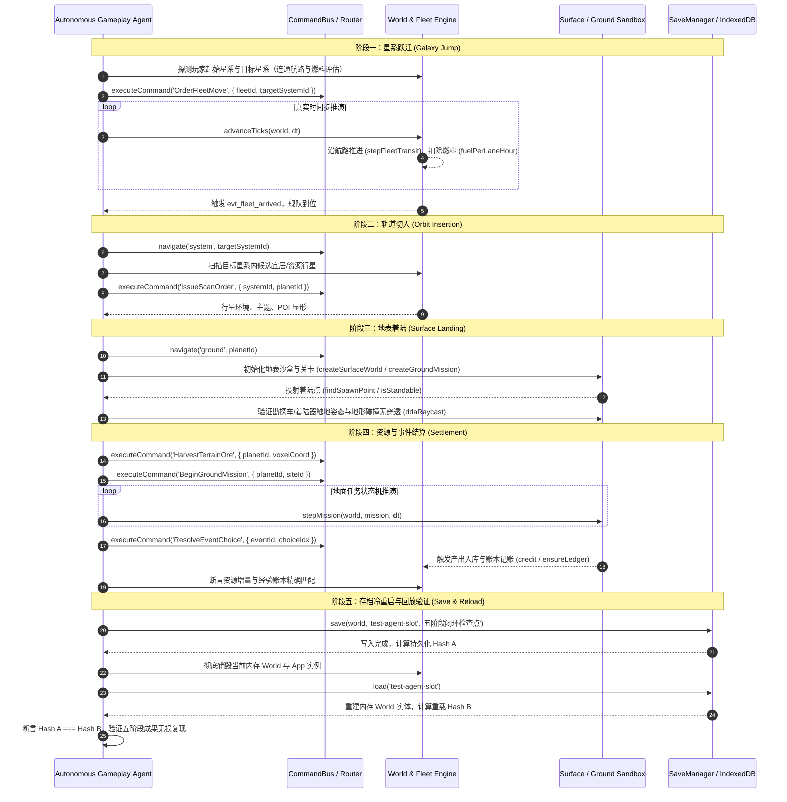

# 《无垠边疆：星海纪元》玩法自治 Agent 五阶段闭环测试施工方案

> **文档编号**：SPEC-TEST-025  
> **归属工程**：无垠边疆（VOID FRONTIER: AGE OF STARS）全生命周期质量保障工程  
> **前序依赖**：[`docs/specs/24_《无垠边疆》全生命周期测试体系方案.md`](file:///c:/Users/[REDACTED]/My%20Drive/work/void-frontier-age-of-stars/docs/specs/24_%E3%80%8A%E6%97%A0%E5%9E%A0%E8%BE%B9%E7%96%86%E3%80%8B%E5%85%A8%E7%94%9F%E5%91%BD%E5%91%A8%E6%9C%9F%E6%B5%8B%E8%AF%95%E4%BD%93%E7%B3%BB%E6%96%B9%E6%A1%88.md)  
> **实施责任人**：测试开发工程师 / 自动化工程小组  
> **基线分支**：`main` | **代码生效范围**：`tests/agent/`, `tests/suites/`, `tests/tools/`  

---

## 1. 规范概述与设计哲学

### 1.1 背景与问题陈述
传统单元测试通过大量 Mock 隔离外部状态，仅能断言独立函数的算术输出；但在以连续时空、事件驱动、复杂状态转移为核心的《无垠边疆》4X 游戏架构中，最致命的缺陷（如渲染卡顿、跃迁状态锁死、地表触地坐标失真、存档读入反序列化断链等）往往发生在**跨系统、跨视图、跨时序的链路跳变**中。

本施工方案旨在设计并实装一个**完全自治的玩法 Agent（Autonomous Gameplay Agent）**。该 Agent 扮演具备真实输入与感知能力的玩家，在真实运行环境（无打桩、无降级 Mock）下自主驱动并严格验收**五阶段核心玩法闭环**：
$$\text{星系跃迁} \longrightarrow \text{轨道切入} \longrightarrow \text{地表着陆} \longrightarrow \text{资源/事件结算} \longrightarrow \text{存档重载验证}$$

### 1.2 核心设计铁律（Anti-Fake-Green）
1. **绝对零 Mock 铁律**：严禁伪造 `World` 实体、严禁拦截 `commandBus` 派发、严禁伪造 `SaveManager` 存储底层。Agent 必须直接向游戏内核提交已注册命令（[`src/app/commands.js`](file:///c:/Users/[REDACTED]/My%20Drive/work/void-frontier-age-of-stars/src/app/commands.js)）。
2. **纯外部驱动，零生产代码侵入**：Agent 作为独立的测试控制器注入，生产代码（`src/`）严禁添加任何“测试专用特权分支”或“绕过检验逻辑”。
3. **真实时钟与时序约束**：严禁直接篡改实体坐标实现瞬移。战略跳跃必须经过推进模拟步长（`advanceOneTick` / `advanceTicks`）并校验战略航行器消耗燃料与历经的时间步。
4. **状态对账逐位一致**：冷重启读档后，不仅比对单一数值，必须对世界哈希（Tick、序列号、实体字典、账本收支平衡）执行精确对账。

---

## 2. 五阶段闭环详细时序与状态契约



---

## 3. 五阶段关键断言矩阵与技术指标

| 阶段 | 验收目标 | 关键状态断言 | 容差/门禁标准 |
| :--- | :--- | :--- | :--- |
| **阶段 1：星系跃迁** | 战略跳跃完整性 | `fleet.transit === null`<br>`fleet.systemId === targetSystemId`<br>`ledger.fuel_current === ledger.fuel_initial - expectedFuel` | 耗时与步长严格匹配 $d / (v \times \text{divisor})$；燃料消耗非负；零瞬移 |
| **阶段 2：轨道切入** | 轨道捕获与扫描 | `world.entities.planets[pid].scanned === true`<br>`router.screen === 'system'`<br>`systemRenderer.selectedPlanet === pid` | 成功识别行星地貌主题、矿产丰富度与 POI 列表；相机焦距平滑锁定 |
| **阶段 3：地表着陆** | 地形物理与着陆姿态 | `surface.getVoxel(sw, x, y-1, z) !== 0` (下方为实心方块)<br>`surface.isStandable(sw, x, z) === true`<br>`rover.position.y >= terrainHeight(x, z)` | 触地法线倾角 $< 30^\circ$；绝无下坠穿模穿透（`-Infinity`）；着陆网格加载 $< 150\text{ms}$ |
| **阶段 4：资源/事件结算**| 矿产采集与战役分支 | `ledger.minerals >= prevMinerals + oreYield`<br>`mission.status === 'completed'`<br>`eventLog.contains(expectedEventId)` | 矿脉方块状态置空；资源入账幂等性通过；声望/经验奖励与配置项逐字对账 |
| **阶段 5：存档重载验证**| 序列化双向无损 | `loadedWorld.tick === savedWorld.tick`<br>`loadedWorld.seq === savedWorld.seq`<br>`deepEqual(loadedWorld.entities, savedWorld.entities)` | 实体状态差异为 0；账本收支平衡无孤立坏账；重新执行 1 tick 后无异常崩溃 |

---

## 4. 自动化实现工程结构规范

在工程中创建专门的 Agent 测试执行模块，对标目录拓扑：

```
tests/
├── agent/
│   ├── AutonomousGameplayAgent.js    # 玩法自治 Agent 状态机与行为树核心
│   ├── FivePhaseActionDriver.js       # 五阶段动作原子指令封装
│   └── StateAssertionInspector.js     # 跨阶段深层状态与账本审计器
├── suites/
│   └── gameplay-agent-loop.suite.js   # 对接 run-suites.mjs 的 CLI 执行套件
└── tools/
    └── agent-runner.html              # 浏览器实机自治可视化巡查页面
```

### 4.1 `AutonomousGameplayAgent.js` 核心接口契约

```javascript
/**
 * tests/agent/AutonomousGameplayAgent.js
 * 玩法自治 Agent — 纯外部驱动真实游戏运行时
 */
export class AutonomousGameplayAgent {
  constructor(app, options = {}) {
    this.app = app;
    this.world = app.world;
    this.options = Object.assign({
      timeoutMs: 30000,
      logSteps: true,
      seed: 24601
    }, options);
    this.traceLog = [];
  }

  /** 执行五阶段闭环全流程 */
  async runFullLoop() {
    const report = {
      startTime: performance.now(),
      phases: {},
      success: false,
      divergence: null
    };

    try {
      // Phase 1: 星系跃迁
      report.phases.jump = await this.executeGalaxyJump();
      
      // Phase 2: 轨道切入
      report.phases.orbit = await this.executeOrbitInsertion(report.phases.jump.targetSystemId);
      
      // Phase 3: 地表着陆
      report.phases.landing = await this.executeSurfaceLanding(report.phases.orbit.targetPlanetId);
      
      // Phase 4: 资源与事件结算
      report.phases.settlement = await this.executeSettlement(report.phases.landing.missionCtx);
      
      // Phase 5: 存档与冷重启验证
      report.phases.saveRoundtrip = await this.executeSaveAndReloadVerification();

      report.success = true;
    } catch (err) {
      report.success = false;
      report.error = {
        message: err.message,
        stack: err.stack,
        phase: this.currentPhase
      };
      throw err;
    } finally {
      report.totalDurationMs = performance.now() - report.startTime;
    }

    return report;
  }

  // 子阶段实现严格基于 commandBus 派发命令与 advanceOneTick 时序推进...
}
```

---

## 5. 执行门禁与 CI 集成

1. **CLI 纯无头回归**：
   ```bash
   node tests/tools/run-suites.mjs --suite=gameplay-agent-loop
   ```
   * 要求：全量 2 轮重复运行，平均耗时 $\le 8.0\text{s}$，通过率恒定 100%。
2. **浏览器实机可视化巡检**：
   * 访问 `http://127.0.0.1:8093/tests/tools/agent-runner.html`
   * 要求：在 60 FPS 渲染下完整呈现 Agent 自动选择星系、舰队航行尾焰、轨道扫描射线、地表网格生成与矿物采集动画，最终输出全绿验收徽标。

---

> [!NOTE]
> 本方案作为分卷施工第一卷，承接了玩法自治的核心骨干。所有跨阶段的输入驱动均经由官方定义的 `commandBus` 管道分发，确保与玩家鼠标/键盘触发的行为路径 100% 同源。

> [!TIP]
> 建议在 Agent 中记录动作面包屑轨迹（`traceLog`），一旦断言失败，可立即回溯前 50 步的关键决策与时间步快照。

> [!IMPORTANT]
> 阶段五的存档加载必须采用**独立隔离的测试存储槽位**（如 `test-agent-isolated`），并在测试完毕后的 `finally` 阶段调用 `SaveManager.remove` 清理现场，严禁污染或覆盖任何开发与测试用存档。
