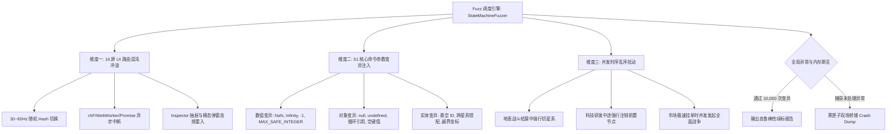

# 《无垠边疆：星海纪元》核心状态机模糊测试与异常 Dump 施工方案

> **文档编号**：SPEC-TEST-026  
> **归属工程**：无垠边疆（VOID FRONTIER: AGE OF STARS）全生命周期质量保障工程  
> **前序依赖**：[`docs/specs/24_《无垠边疆》全生命周期测试体系方案.md`](file:///c:/Users/[REDACTED]/My%20Drive/work/void-frontier-age-of-stars/docs/specs/24_%E3%80%8A%E6%97%A0%E5%9E%A0%E8%BE%B9%E7%96%86%E3%80%8B%E5%85%A8%E7%94%9F%E5%91%BD%E5%91%A8%E6%9C%9F%E6%B5%8B%E8%AF%95%E4%BD%93%E7%B3%BB%E6%96%B9%E6%A1%88.md)  
> **实施责任人**：测试开发工程师 / 自动化工程小组  
> **基线分支**：`main` | **代码生效范围**：`tests/fuzz/`, `tests/suites/`, `tests/tools/`  

---

## 1. 规范概述与模糊测试定位

### 1.1 核心问题与挑战
传统按部就班的用例只能覆盖“符合预期”的输入路径，但在复杂的单页游戏运行态中，用户往往会执行非预期的高频交互（如疯狂双击、光速切换导航、在动画尚未结束时强行跳出、断网重连、提交异常参数等）。此类行为极易导致：
1. **视图卸载不彻底**：残余的 `requestAnimationFrame` 或异步回调往已被注销的 DOM 写入内容，抛出 `TypeError: Cannot read properties of null`。
2. **状态机竞争与撕裂**：在舰队战略航行计算过程中强行解散舰队，导致跨系统指针悬空。
3. **脏数据与 NaN 污染扩散**：一个未校验的浮点数除以零产生 `NaN`，随每日结算蔓延至全银河账本，导致存档彻底损毁。

本施工方案制定了针对《无垠边疆》全量 16 大视图与 51 种核心命令的**高并发状态机模糊测试（Fuzzing）体系**，并配套**黑匣子现场快照转储器（Crash Dump & Replay）**，确保任意异常均能被毫秒级抓取并 100% 离线确定性重现。

---

## 2. 混沌突变与变异矩阵设计



### 2.1 维度一：16 屏 UI 路由混沌冲浪（Chaos Route Surfing）
* **全量视图池**：
  `MenuView`, `GalaxyView`, `SystemView`, `ColonyView`, `FleetView`, `DesignerView`, `CombatView`, `ResearchView`, `MarketView`, `DiplomacyView`, `GovernmentView`, `GroundView`, `EventsView`, `ChronicleView`, `SettingsView`, `DiagnosticsView`。
* **变异策略**：
  * **超高频突变**：以 16ms ~ 50ms 为随机间隔，随机选取下一个合法/半合法路由目标（如 `#/system/sys_01`、`#/ground/invalid_planet`、`#/unknown_route`）。
  * **未完成动作打断**：在 3D 星系相机飞向行星中途（Tween 动画第 3 帧）瞬间切换至 `colony` 或 `market` 视图。
* **断言防线**：
  * 每次 `activateView(id)` 触发前，前一视图的 `unmount()` 必须安全退出，无残余挂载定时器。
  * `document.querySelectorAll('.vf-view')` 数量恒等于 1（严禁 DOM 视图双重堆叠）。
  * 检查全局事件监听器泄露：`window` 监听器数量在 1,000 次切换后增量 $\le 2$。

### 2.2 维度二：51 项命令输入模糊变异（Command Fuzz Injection）
遍历 [`src/app/commands.js`](file:///c:/Users/[REDACTED]/My%20Drive/work/void-frontier-age-of-stars/src/app/commands.js) 中注册的 51 项命令，针对 payload 字段注入变异数据：
1. **数值型变异算子**：`[0, -1, -999999, 1e20, NaN, Infinity, -Infinity, 0.0000001, Number.MAX_VALUE]`。
2. **引用型变异算子**：`[null, undefined, '', '   ', 'INVALID_ENTITY_ID_9999', '__proto__', '<script>alert(1)</script>']`。
3. **结构型变异算子**：篡改对象键名、提供空对象 `{}`、提供循环引用对象。
* **断言防线**：命令管道执行必须满足**事务原子性（Transaction Atomicity）**。非法参数必须被前置校验安全拦截，抛出受控日志，**严禁使世界状态内部产生 NaN、未定义键或损坏已有合法实体**。

---

## 3. 黑匣子现场快照转储规范（BlackBox Crash Dump）

当测试运行器捕获到未处理异常、Promise Rejection 或状态完整性断言失败时，崩溃转储器（`BlackBoxCrashDumper`）将在 100ms 内冻结主线程并生成自包含的诊断快照。

### 3.1 Dump 文件结构（`crash-dump-<timestamp>.json`）

```json
{
  "timestamp": 1799283749102,
  "gameVersion": "0.1.0",
  "seed": 24601,
  "lastRoute": { "screen": "ground", "param": "planet_03" },
  "activeViewId": "ground",
  "error": {
    "name": "TypeError",
    "message": "Cannot read properties of undefined (reading 'position')",
    "stack": "TypeError: Cannot read properties of undefined...\n  at GroundRenderer.render (GroundRenderer.js:142:15)..."
  },
  "breadcrumbs": [
    { "step": 988, "type": "route", "target": "#/system/sys_01", "time": 12.43 },
    { "step": 989, "type": "command", "name": "OrderFleetMove", "payload": { "fleetId": "flt_0" }, "time": 12.51 },
    { "step": 990, "type": "route", "target": "#/ground/planet_03", "time": 12.58 }
  ],
  "systemProfile": {
    "jsHeapUsedMB": 42.15,
    "activeDOMNodes": 384,
    "webGLContextLost": false,
    "fps": 58.4
  },
  "worldSnapshot": {
    "tick": 4291,
    "seq": 1045,
    "playerFactionId": "frontier_compact"
  },
  "canvasFrame": "data:image/png;base64,iVBORw0KGgoAAAANSUhEUgAA..."
}
```

### 3.2 离线可复现重放器（Replay Harness）
重放器读取 Dump 文件中的 `seed` 与 `breadcrumbs`，从初始状态按记录的时钟节拍重新喂入操作序列，在 5 秒内精准抵达崩溃现场，供开发工程师断点调试。

---

## 4. 自动化工程落地与接口规范

```
tests/
├── fuzz/
│   ├── StateMachineFuzzer.js     # 模糊测试主调度器
│   ├── ChaosRouteSurfer.js       # 16 屏高频突变驱动
│   ├── CommandMutator.js         # 51 项命令参数变异器
│   └── BlackBoxCrashDumper.js    # 崩溃现场快照与截图生成
├── suites/
│   └── fuzz-stability.suite.js   # 10,000 步混沌压力回归套件
└── tools/
    ├── fuzz-runner.html          # 浏览器端实时混沌压力监控页面
    └── replay-crash.mjs          # 命令行离线 Dump 重放诊断脚本
```

### 4.1 核心驱动接口契约

```javascript
/**
 * tests/fuzz/StateMachineFuzzer.js
 */
export class StateMachineFuzzer {
  constructor(app, config = {}) {
    this.app = app;
    this.iterations = config.iterations || 10000;
    this.maxStepIntervalMs = config.maxStepIntervalMs || 30;
    this.breadcrumbs = [];
    this.dumper = new BlackBoxCrashDumper(app);
  }

  /** 启动混沌模糊风暴 */
  async startStorm() {
    this.dumper.installGlobalHook();
    console.log(`[FUZZ] 启动混沌压力测试，目标迭代步数: ${this.iterations}`);

    for (let step = 0; step < this.iterations; step++) {
      const actionType = this.chooseActionType();
      try {
        if (actionType === 'ROUTE') {
          await this.dispatchRandomRoute(step);
        } else if (actionType === 'COMMAND') {
          await this.dispatchMutatedCommand(step);
        } else if (actionType === 'SIM_ACCEL') {
          this.dispatchTimeWarp(step);
        }
        
        // 关键健康度巡检：确保世界状态未被 NaN 污染
        this.verifyWorldSanity();
      } catch (err) {
        const dumpPath = await this.dumper.captureAndSave(err, this.breadcrumbs);
        throw new Error(`[FUZZ CRASH] 步骤 ${step} 触发致命异常！Dump 已导出至 ${dumpPath}`);
      }
    }
    console.log(`[FUZZ] 10,000 步混沌突变测试圆满通过，无状态机撕裂！`);
  }
}
```

---

## 5. 验收门禁与阻断指标

1. **混沌通过性**：单次 Fuzzing 运行连续执行 **10,000 次** 随机路由与变异指令，不允许出现任何未捕获的 Uncaught Error。
2. **状态纯洁度**：在 10,000 步变异结束后，全量扫描 `world.entities` 与 `world.relations`，`JSON.stringify(world).indexOf('NaN') === -1` 必须严格成立。
3. **现场还原率**：任何失败用例产出的 Dump 文件，经 `replay-crash.mjs` 重放后必须 **100% 精确复现** 相同错误堆栈。

---

> [!NOTE]
> 模糊测试关注的是系统的弹性与容错边界。命令被防御性断言拦截并安全忽略属于预期表现，测试判负的唯一依据是系统抛出未捕获崩溃或内部状态被污染。

> [!TIP]
> 建议在持续集成（CI）阶段设置轻量级 Fuzz（1,000 步 / 30 秒预算），并在夜间浸泡构建时启动全量级 Fuzz（50,000 步 / 1 小时压力测试）。

> [!IMPORTANT]
> `BlackBoxCrashDumper` 在保存 Base64 画布快照时，必须兼容无头（Headless）环境与 WebGL 上下文丢失（Context Lost）场景，避免在捕获错误的过程中自身抛出次生异常。
