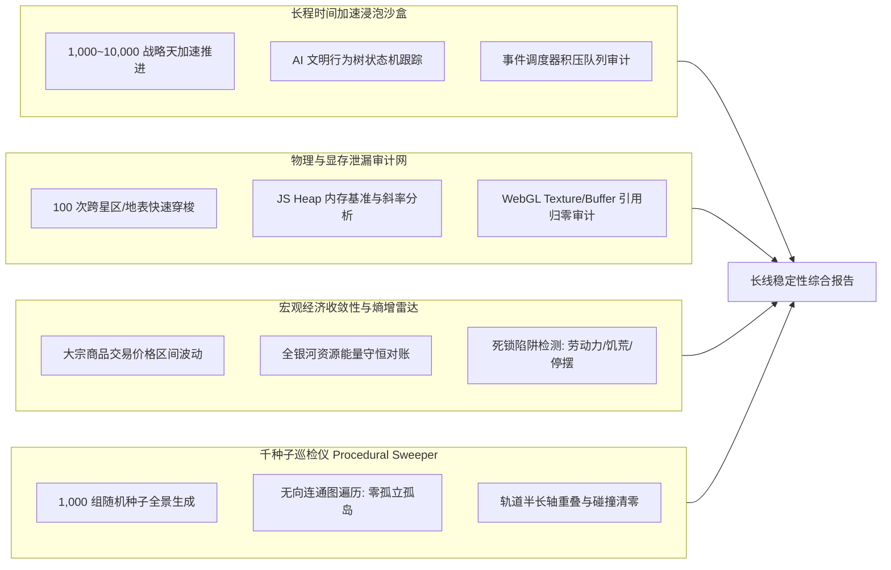

# 《无垠边疆：星海纪元》自动化长程浸泡推演与全银河巡检施工方案

> **文档编号**：SPEC-TEST-027  
> **归属工程**：无垠边疆（VOID FRONTIER: AGE OF STARS）全生命周期质量保障工程  
> **前序依赖**：[`docs/specs/24_《无垠边疆》全生命周期测试体系方案.md`](file:///c:/Users/[REDACTED]/My%20Drive/work/void-frontier-age-of-stars/docs/specs/24_%E3%80%8A%E6%97%A0%E5%9E%A0%E8%BE%B9%E7%96%86%E3%80%8B%E5%85%A8%E7%94%9F%E5%91%BD%E5%91%A8%E6%9C%9F%E6%B5%8B%E8%AF%95%E4%BD%93%E7%B3%BB%E6%96%B9%E6%A1%88.md)  
> **实施责任人**：测试开发工程师 / 自动化工程小组  
> **基线分支**：`main` | **代码生效范围**：`tests/soak/`, `tests/suites/`, `tests/tools/`  

---

## 1. 规范概述与长程质量定位

### 1.1 核心问题与挑战
大战略与沙盒模拟类游戏具备高度的**时间累积效应（Emergent Complexity）**。在运行几分钟或数个时间步的常规测试中，系统表现往往一切正常；但在进入 100 小时以上的真实长线游玩或跨越数千个游戏日后，系统常常暴露深层次系统性故障：
1. **经济与社会数值发散（数值熵增坍塌）**：市场物价呈指数级恶性通胀或跌停归零，AI 文明因彻底断粮陷入全局饿死死锁。
2. **渐进式内存与 WebGL 显存泄漏**：随着玩家在 100 个恒星系与地表之间频繁穿梭，旧的 Buffer、纹理或事件监听器未能释放，导致页面在游玩数小时后发生 OOM 崩溃或显卡驱动重置（WebGL Context Lost）。
3. **程序化生成的局部奇点**：在特定边缘种子下，银河生成器生成了互不连通的孤立星系，或行星与母恒星发生物理重叠，导致玩家战役永久卡死。

本施工方案制定了**1,000 ~ 10,000 天超长线浸泡推演**、**显存/堆内存泄漏严密追踪**、**宏观经济收敛性审计**以及**全银河千种子全覆盖巡检**的一整套工程化实施方案。

---

## 2. 长程浸泡推演与经济收敛性设计



### 2.1 1,000 ~ 10,000 天沙盒加速推进规范
* **推进机制**：直接调用游戏核心循环管道 [`advanceTicks(world, n)`](file:///c:/Users/[REDACTED]/My%20Drive/work/void-frontier-age-of-stars/src/simulation/WorldSimulation.js)，绕过渲染帧率限制，以微秒级步长进行纯逻辑长程演进。
* **健康度断言规则**：
  * **AI 决策不卡死**：AI 文明拥有的舰队不允许在两颗恒星之间产生超过连续 30 天的无意义反复折返（Ping-Pong Anti-Pattern）。
  * **定时器队列可控**：调度器 [`scheduler.js`](file:///c:/Users/[REDACTED]/My%20Drive/work/void-frontier-age-of-stars/src/core/scheduler.js) 的活动任务队列长度必须稳定在 $[0, 500]$ 区间，严禁因遗漏回调导致事件无限堆积。
  * **数值不破界**：全银河实体库中不允许出现任何 `NaN`、`Infinity` 或未定义字段。

### 2.2 宏观经济与市场收敛性断言
对全银河 10 种基础及高级大宗物资（矿石、合金、食物、消费品、燃料等）执行长期价格追踪：
$$\forall t \in [0, 10000], \quad P_{\min} \le \text{MarketPrice}(item, t) \le P_{\max}$$
* **反恶性通胀**：任意商品基础售价不得超过基准价的 5000%（防发散）。
* **反恶性通缩**：任意商品售价不得低于基准价的 1% 且不得为负（防流动性陷阱）。
* **全银河能量守恒**：每一笔矿物产出必须严格对账至文明账本或仓库，无凭空消失的“虚无蒸发”，无未结账的“凭空印钞”。

---

## 3. 内存与 WebGL 句柄泄漏追踪规范

### 3.1 100 次高频换景浸泡模型
在浏览器或无头 Chromium 环境中驱动页面执行连续 100 次跨场景跳转循环：
$$\text{GalaxyView} \longrightarrow \text{SystemView} \longrightarrow \text{GroundView} \longrightarrow \text{ColonyView} \longrightarrow \text{GalaxyView}$$

### 3.2 泄漏判定阈值与度量指标

| 资源类别 | 监测方式 | 允许残余增量 ($\Delta$) | 判定标准 |
| :--- | :--- | :--- | :--- |
| **JS Heap 内存** | `performance.memory.usedJSHeapSize` 在每次 GC 后采样 | 100 次循环后较初始值增量 $< 15\%$ | 线性回归斜率接近 0，严禁持续爬升 |
| **WebGL Buffers** | Hook `gl.createBuffer` 与 `gl.deleteBuffer` 引用计数 | $\Delta = 0$（退出场景后） | 场景卸载后，所有 VBO/IBO 必须完全注销 |
| **WebGL Textures** | Hook `gl.createTexture` 与 `gl.deleteTexture` 引用计数 | $\Delta = 0$（退出场景后） | 动态地表与行星贴图显存占用归零 |
| **DOM 孤立节点** | Chrome Heap Snapshot / `document.querySelectorAll('*').length` | DOM 树节点增量 $\le 5$ 个 | 旧视图元素完全被垃圾回收，无孤岛挂载 |

---

## 4. 全银河千种子程序化巡检仪（Galaxy Procedural Sweeper）

### 4.1 遍历矩阵
以确定性伪随机数种子 $S \in [1, 1000]$ 逐一生成完整银河系 [`generateGalaxy(world, config)`](file:///c:/Users/[REDACTED]/My%20Drive/work/void-frontier-age-of-stars/src/domain/world/galaxyGen.js)。

### 4.2 拓扑与物理刚性校验准则
1. **银河全图连通性（Zero Unreachable Islands）**：
   * 将全星系节点与超空间航路（Hyperlanes）构建为无向图 $G = (V, E)$。
   * 从母星系 $V_0$ 启动 BFS 遍历，连通分量必须覆盖 $100\%$ 的星系节点：
     $$\text{AccessibleCount}(V_0) = |V|$$
   * 严禁产生孤立星系或不可达孤岛。
2. **天体轨道零碰撞（Zero Orbital Collision）**：
   * 恒星系内任意两颗行星的轨道半长轴 $r_a, r_b$ 必须满足：
     $$|r_a - r_b| \ge R_{a,\text{soi}} + R_{b,\text{soi}} + \Delta_{\text{safe}}$$
   * 严禁行星轨道重叠或与中央恒星日冕层相撞。
3. **生态主题与着色器载荷兼容（100% Theme Integrity）**：
   * 11 种行星扩展主题（火山、冰封、剧毒、晶体、海洋、辐射等）必须完整携带有效的材质着色参数，无 `themePayload` 为空情况。

---

## 5. 工程实现与目录拓扑

```
tests/
├── soak/
│   ├── GalaxySoakSimulator.js      # 1,000 天时间加速沙盒
│   ├── MemoryLeakDetector.js       # WebGL / DOM / Heap 引用审计器
│   ├── EconomicEntropyAuditor.js   # 市场物价收敛与资源守恒审计
│   └── GalaxyProceduralSweeper.js  # 1,000 种子全连通拓扑巡检仪
├── suites/
│   └── soak-inspection.suite.js    # 自动化长程回归套件
└── tools/
    ├── soak-runner.html            # 长程浸泡实时遥测仪表盘
    └── sweep-galaxy-cli.mjs        # CLI 种子遍历巡检脚本
```

### 5.1 巡检仪核心断言代码规范

```javascript
/**
 * tests/soak/GalaxyProceduralSweeper.js
 */
export async function sweepGalaxySeeds(startSeed = 1, endSeed = 1000) {
  const anomalies = [];
  console.log(`[SWEEPER] 开始巡检银河种子区间: [${startSeed}, ${endSeed}]`);

  for (let seed = startSeed; seed <= endSeed; seed++) {
    const world = createMinimalWorld({ seed });
    const { systemIds, warnings } = generateGalaxy(world, { seed });

    // 1. 验证航路连通性（BFS）
    const visited = new Set();
    const queue = [systemIds[0]];
    visited.add(systemIds[0]);

    while (queue.length > 0) {
      const currId = queue.shift();
      const sys = world.entities.systems[currId];
      for (const lane of sys.lanes || []) {
        const neighborId = lane.to;
        if (!visited.has(neighborId)) {
          visited.add(neighborId);
          queue.push(neighborId);
        }
      }
    }

    if (visited.size !== systemIds.length) {
      anomalies.push({
        seed,
        issue: 'ISOLATED_SYSTEMS_FOUND',
        reachable: visited.size,
        total: systemIds.length
      });
    }

    // 2. 验证行星轨道无重叠...
  }

  return { totalSwept: endSeed - startSeed + 1, anomalies };
}
```

---

## 6. 门禁红线与自动化阻断

1. **推演无卡死**：1,000 天推演无中断完成，平均单日推进耗时 $\le 1.5\text{ms}$。
2. **零显存泄漏**：100 次场景交替切换后，WebGL 句柄泄露增量严格为 0。
3. **千种零孤岛**：1,000 个随机种子连通率 100%，无不可抵达死角。

---

> [!NOTE]
> 长程推演沙盒专注于宏观逻辑与数值演化，因此在纯无头（Headless Node）环境下推进效率极高，可在数秒内完成真实游戏中数百天的模拟运算。

> [!TIP]
> 针对内存泄漏检测，推荐使用 Chrome 原生 Performance API 与 DevTools Protocol 进行堆内存快照比对，并将结果绘制为内存占用趋势折线图，直观展现系统生命周期曲线。

> [!IMPORTANT]
> 种子巡检器发现的任何异常种子（如孤岛星系）必须立即归档至 `tests/regression/anomalous-seeds.json`，转化为永久防回退回归用例。
