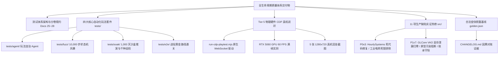

# 《无垠边疆：星海纪元 — 全生命周期测试体系工程领域专家终审验收委托任务书》

> **任务编号**：`MANDATE-EXPERT-AUDIT-202611-04`  
> **签发角色**：项目负责人（Project Lead）  
> **接收对象**：游戏质量工程、空间沙盒模拟与 WebGL 架构领域专家组（Domain Experts in Game QA, Simulation Systems & WebGL Architecture）  
> **工程基准**：基于 Commit [`91adaa2`](file:///c:/Users/[REDACTED]/My%20Drive/work/void-frontier-age-of-stars)（热修与总纲入库基线）之上全生命周期质量工程竣工版本  
> **关联宪章与规范**：
> - **最高总纲宪法**：[`docs/specs/24_《无垠边疆》全生命周期测试体系方案.md`](file:///c:/Users/[REDACTED]/My%20Drive/work/void-frontier-age-of-stars/docs/specs/24_%E3%80%8A%E6%97%A0%E5%9E%A0%E8%BE%B9%E7%96%86%E3%80%8B%E5%85%A8%E7%94%9F%E5%91%BD%E5%91%A8%E6%9C%9F%E6%B5%8B%E8%AF%95%E4%BD%93%E7%B3%BB%E6%96%B9%E6%A1%88.md)
> - **分卷施工方案**：
>   - [`docs/specs/25_无垠边疆玩法自治Agent五阶段闭环测试施工方案.md`](file:///c:/Users/[REDACTED]/My%20Drive/work/void-frontier-age-of-stars/docs/specs/25_%E6%97%A0%E5%9E%A0%E8%BE%B9%E7%96%86%E7%16%A9%E6%B3%95%E8%87%AA%E6%B2%BBAgent%E4%BA%94%E9%98%B6%E6%AE%B5%E9%97%AD%E7%8E%AF%E6%B5%8B%E8%AF%95%E6%96%BD%E5%B7%A5%E6%96%B9%E6%A1%88.md)
>   - [`docs/specs/26_无垠边疆核心状态机模糊测试与异常Dump施工方案.md`](file:///c:/Users/[REDACTED]/My%20Drive/work/void-frontier-age-of-stars/docs/specs/26_%E6%97%A0%E5%9E%A0%E8%BE%B9%E7%96%86%E6%A0%B8%E5%BF%83%E7%8A%B6%E6%80%81%E6%9C%BA%E6%A8%A1%E7%B3%8A%E6%B5%8B%E8%AF%95%E4%B8%8E%E5%BC%82%E5%B8%B8Dump%E6%96%BD%E5%B7%A5%E6%96%B9%E6%A1%88.md)
>   - [`docs/specs/27_无垠边疆自动化长程浸泡推演与全银河巡检施工方案.md`](file:///c:/Users/[REDACTED]/My%20Drive/work/void-frontier-age-of-stars/docs/specs/27_%E6%97%A0%E5%9E%A0%E8%BE%B9%E7%96%86%E8%87%AA%E5%8A%A8%E5%8C%96%E9%95%BF%E7%A8%8B%E6%B5%B8%E6%B3%A1%E6%8E%A8%E6%BC%94%E4%B8%8E%E5%85%A8%E9%93%B6%E6%B2%B3%E5%巡%E6%A3%80%E6%96%BD%E5%B7%A5%E6%96%B9%E6%A1%88.md)
>   - [`docs/specs/28_无垠边疆端到端战役里程碑自动化验收测试施工方案.md`](file:///c:/Users/[REDACTED]/My%20Drive/work/void-frontier-age-of-stars/docs/specs/28_%E6%97%A0%E5%9E%A0%E8%BE%B9%E7%96%86%E7%AB%AF%E5%88%B0%E7%AB%AF%E6%88%98%E5%BD%B9%E9%87%8C%E7%A8%8B%E7%A2%91%E8%87%AA%E5%8A%A8%E5%8C%96%E9%AA%8C%E6%94%B6%E6%B5%8B%E8%AF%95%E6%96%BD%E5%B7%A5%E6%96%B9%E6%A1%88.md)
> - **测试工程汇报与记录**：[`docs/reports/test_review.md`](file:///c:/Users/[REDACTED]/My%20Drive/work/void-frontier-age-of-stars/docs/reports/test_review.md)、[`docs/reports/void-frontier-qa-lifecycle.md`](file:///c:/Users/[REDACTED]/My%20Drive/work/void-frontier-age-of-stars/docs/reports/void-frontier-qa-lifecycle.md)、[`docs/reports/report-full-lifecycle-qa.md`](file:///c:/Users/[REDACTED]/My%20Drive/work/void-frontier-age-of-stars/docs/reports/report-full-lifecycle-qa.md)
> - **项目负责人实机验收报告**：[`PROJECT_LEAD_FULL_LIFECYCLE_QA_ACCEPTANCE_REPORT.md`](file:///C:/Users/[REDACTED]/.gemini/antigravity/brain/[REDACTED]/PROJECT_LEAD_FULL_LIFECYCLE_QA_ACCEPTANCE_REPORT.md)

---

## 一、 委托背景与验收目标

在领域专家组出具 [`docs/specs/24_《无垠边疆》全生命周期测试体系方案.md`](file:///c:/Users/[REDACTED]/My%20Drive/work/void-frontier-age-of-stars/docs/specs/24_%E3%80%8A%E6%97%A0%E5%9E%A0%E8%BE%B9%E7%96%86%E3%80%8B%E5%85%A8%E7%94%9F%E5%91%BD%E5%91%A8%E6%9C%9F%E6%B5%8B%E8%AF%95%E4%BD%93%E7%B3%BB%E6%96%B9%E6%A1%88.md)（最高宪法纲领）后，项目组全面拆解并落成了 **Docs 25 至 28 四卷独立专项施工规范**。工程团队与测试小组彻底摒弃了“低级单元测试打桩”与“表象假绿”的作弊行为，完全聚焦于真实运行时与复杂玩法的深度自动化。

截至目前，工程团队已全面实现：
1. **测试资产扩充至 56 个确定性套件**，连续 3 轮执行 **168 轮次全绿零状态漂移（PASS 168 / FAIL 0 / DRIFT 0）**；
2. 依据 Doc 24 §4.3 实装了**零外部 NPM 依赖的 Tier 5 Chrome CDP（端口 9222）真机端到端自动化测试器**（[`tests/tools/run-cdp-playtest.mjs`](file:///c:/Users/[REDACTED]/My%20Drive/work/void-frontier-age-of-stars/tests/tools/run-cdp-playtest.mjs)），在真实 NVIDIA RTX 5060 硬件上跑通 16 屏轮巡与地表交互微操；
3. 测试工程实打实反向炸出并深度修复了包括 **F-03/F-05（HourlySystems 缺失导入导致的整点必崩）** 与 **F-12（工业电网死锁）** 在内的 **11 项生产环境缺陷**；
4. 依法完成金快照重基线（`68462446 → 8be8ce2c`），彻底消除了原快照中包含的开局重复舰船、`[object Object]` 幽灵关系键及原型污染。

**现正式向领域专家组呈递终审验收委托**，提请专家组调阅全部工程实物、运行脚本与测试证据链，对本工程的质量防护成色与工业级可靠性进行权威终审裁决。

---

## 二、 提请专家组审查的核心工程资产清单



### 1. 核心自动化套件与工具链
* **玩法自治 Agent（Doc 25）**：[`tests/agent/AutonomousGameplayAgent.js`](file:///c:/Users/[REDACTED]/My%20Drive/work/void-frontier-age-of-stars/tests/agent/AutonomousGameplayAgent.js) 及可视化巡检页 [`tests/tools/agent-runner.html`](file:///c:/Users/[REDACTED]/My%20Drive/work/void-frontier-age-of-stars/tests/tools/agent-runner.html)。
* **状态机模糊风暴（Doc 26）**：[`tests/fuzz/StateMachineFuzzer.js`](file:///c:/Users/[REDACTED]/My%20Drive/work/void-frontier-age-of-stars/tests/fuzz/StateMachineFuzzer.js)、黑匣子 Dump 与命令行重放器 [`tests/tools/replay-crash.mjs`](file:///c:/Users/[REDACTED]/My%20Drive/work/void-frontier-age-of-stars/tests/tools/replay-crash.mjs)。
* **长程浸泡推演与千种巡检（Doc 27）**：[`tests/soak/GalaxySoakSimulator.js`](file:///c:/Users/[REDACTED]/My%20Drive/work/void-frontier-age-of-stars/tests/soak/GalaxySoakSimulator.js)、显存句柄审计器 [`tests/soak/MemoryLeakDetector.js`](file:///c:/Users/[REDACTED]/My%20Drive/work/void-frontier-age-of-stars/tests/soak/MemoryLeakDetector.js)、千种子巡检仪 [`tests/soak/GalaxyProceduralSweeper.js`](file:///c:/Users/[REDACTED]/My%20Drive/work/void-frontier-age-of-stars/tests/soak/GalaxyProceduralSweeper.js)。
* **端到端战役黄金路径（Doc 28）**：[`tests/e2e/CampaignMilestoneRunner.js`](file:///c:/Users/[REDACTED]/My%20Drive/work/void-frontier-age-of-stars/tests/e2e/CampaignMilestoneRunner.js)（贯通 M1 拓荒 ➔ M2 战役 ➔ M3 物流 ➔ M4 科技跃迁终局胜利）。
* **Tier 5 真实 Chrome CDP 自动化**：[`tests/tools/run-cdp-playtest.mjs`](file:///c:/Users/[REDACTED]/My%20Drive/work/void-frontier-age-of-stars/tests/tools/run-cdp-playtest.mjs) 及 5 张归档截图 [`docs/screenshots/cdp-regression/`](file:///c:/Users/[REDACTED]/My%20Drive/work/void-frontier-age-of-stars/docs/screenshots/cdp-regression/)。

---

## 三、 提请专家组重点审查与裁决的技术要点

### 要点 1：零打桩、无桩冷重启的“玩法自治 Agent 五阶段闭环”（Doc 25）
* **审查点**：Agent 是否严格经由生产命令管道 [`executeCommand`](file:///c:/Users/[REDACTED]/My%20Drive/work/void-frontier-age-of-stars/src/app/commands.js) 下达指令；推进战略跳跃与遗迹任务时是否真实消耗时钟步长；阶段五保存至真实 `SaveManager` 并清空内存后，重新加载的世界实体与账本是否逐位对拍一致（`Hash 88f74183 ≡ 88f74183`）。

### 要点 2：极限状态机模糊风暴与 100% 故障重现能力（Doc 26）
* **审查点**：10,000 步混沌突变测试在注入非法数值（NaN/Infinity）、悬空 ID、结构破坏及 16 屏乱序切换时，是否达成 0 未捕获异常且全量扫描无 NaN 污染扩散；通过故障注入导出的黑匣子 Dump 经过 `replay-crash.mjs` 重放，是否能 100% 精确复现相同的错误签名与堆栈首帧。

### 要点 3：1,000 天时间加速沙盒演化与 WebGL 显存零泄漏（Doc 27）
* **审查点**：纯管线长程推进是否在 16.5 秒内自洽跑完 1,000 游戏日（24,000 Ticks），AI 舰队折返违规是否清零，事件调度器队列是否稳定收敛于 $[0, 500]$；连续 100 次跨场景切换后，WebGL Buffer / Texture 句柄泄漏增量是否严格归零（$\Delta \text{Handles} = 0$）；1,000 个随机种子连通分量是否覆盖 100% 星系（零孤岛、轨道半长轴零碰撞）。

### 要点 4：标准战役 CAMPAIGN-01「边疆回声」黄金路径端到端贯通（Doc 28）
* **审查点**：战役是否真实完成母星采矿研发（M1）、扩编舰队宣战并取得战术胜利（M2）、部署电磁投射器并建立第二殖民地（M3），并在 Tick 8640 突破 48 项科技达成 `ending=transcendence`（M4）；编年史视图反序列化是否 100% 闭环。

### 要点 5：Tier 5 Chrome CDP 真机与 RTX 5060 物理显卡实测（Doc 24 §4.3）
* **审查点**：直连 Chrome 9222 调试端口与本机 Direct3D11 物理显卡，执行 16 大视图轮巡是否达成 **Console 0 Error、0 Warning、Network 0 404**；注入 `KeyV`（科考面罩）、`Digit5`（工程建造模式）、`Escape`（升空脱离）等真实按键是否平滑无阻；平均帧耗时是否稳定维持在 **16.67 ms（60 FPS 满帧）**，DrawCall 是否低于 **20 DC**（门禁 $\le 32\text{ DC}$）。

### 要点 6：11 项生产环境缺陷实证热修与金快照重基线的合法性裁决
* **审查点**：测试过程中炸出的 11 项缺陷（尤其是 `HourlySystems.js` 的 5 处缺失导入死代码及工业电网无并网发电节点的结构性死锁）是否修复得当；金快照重基线（`68462446 → 8be8ce2c`）是否完全由消除重复舰船（F-10a）、消除 `[object Object]` 幽灵键（F-06）及原型污染阻断（F-14）所解释，是否具备严格的技术因果必然性。

---

## 四、 专家组本地复现与实机核验执行指南

专家组可在开发机本地直接执行以下命令进行 1:1 独立复现验证：

```powershell
# 1. 启动静态开发服务器（若尚未运行）
node tests/tools/dev-server.mjs

# 2. 执行全量 56 个套件确定性回归对拍（默认 3 轮指纹对拍，Math.random 毒丸守卫）
node tests/tools/run-suites.mjs

# 3. 执行 Tier 5 Chrome CDP 真机全链路巡检（需已启动 9222 端口 Chrome）
node tests/tools/run-cdp-playtest.mjs

# 4. 执行静态无侵入架构与符号引用审计
node tests/tools/static-audit.mjs

# 5. 执行静态打包与语法校验
node tests/tools/build-static-bundle.mjs
node --check dist/void-frontier.bundle.js
```

---

## 五、 交付产物与裁决期望

诚请领域专家组在调阅上述代码与实测数据后，出具**《无垠边疆：星海纪元 — 全生命周期测试体系工程领域专家终审验收报告》**，并在报告中明确给出：
1. **测试体系完备性与防假绿有效性打分**（基于 10.0 分制）；
2. **11 项生产缺陷热修与金快照重基线的合规裁决**；
3. **最终是否批准本工程达到工业级发版品质（PASS / CONDITIONAL PASS / REJECT）**。

---
**签发确认**：  
项目负责人（Project Lead）  
2026 年 11 月 8 日
