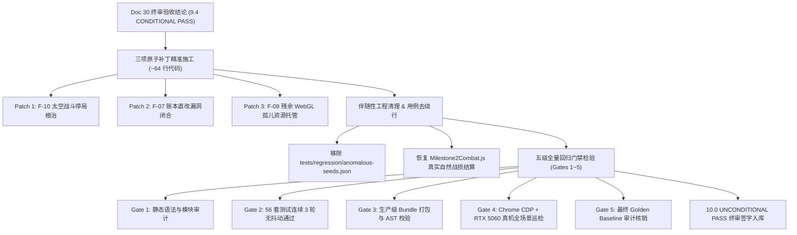

# 《无垠边疆：星海纪元》全生命周期终审收口与全量回归验证施工方案

> **文档编号**：SPEC-TEST-031  
> **归属工程**：无垠边疆（VOID FRONTIER: AGE OF STARS）全生命周期质量保障工程  
> **前序依赖**：  
> - [`docs/specs/24_《无垠边疆》全生命周期测试体系方案.md`](file:///c:/Users/[REDACTED]/My%20Drive/work/void-frontier-age-of-stars/docs/specs/24_%E3%80%8A%E6%97%A0%E5%9E%A0%E8%BE%B9%E7%96%86%E3%80%8B%E5%85%A8%E7%94%9F%E5%91%BD%E5%91%A8%E6%9C%9F%E6%B5%8B%E8%AF%95%E4%BD%93%E7%B3%BB%E6%96%B9%E6%A1%88.md)  
> - [`docs/specs/29_无垠边疆全生命周期测试工程领域专家验收任务委托书.md`](file:///c:/Users/[REDACTED]/My%20Drive/work/void-frontier-age-of-stars/docs/specs/29_%E6%97%A0%E5%9E%A0%E8%BE%B9%E7%96%86%E5%85%A8%E7%94%9F%E5%91%BD%E5%91%A8%E6%9C%9F%E6%B5%8B%E8%AF%95%E4%BD%93%E7%B3%BB%E5%B7%A5%E7%A8%8B%E9%A2%86%E5%9F%9F%E4%B8%93%E5%AE%B6%E9%AA%8C%E6%94%B6%E4%BB%BB%E5%8A%A1%E5%A7%94%E6%89%98%E4%B9%A6.md)  
> - [`docs/specs/30_全生命周期测试体系工程领域专家终审验收报告.md`](file:///c:/Users/[REDACTED]/My%20Drive/work/void-frontier-age-of-stars/docs/specs/30_%E5%85%A8%E7%94%9F%E5%91%BD%E5%91%A8%E6%9C%9F%E6%B5%8B%E8%AF%95%E4%BD%93%E7%B3%BB%E5%B7%A5%E7%A8%8B%E9%A2%86%E5%9F%9F%E4%B8%93%E5%AE%B6%E7%BB%88%E5%AE%A1%E9%AA%8C%E6%94%B6%E6%8A%A5%E5%91%8A.md)  
> **实施责任人**：执行工程师 / 全栈开发团队  
> **验收监督人**：项目负责人（Project Lead）  
> **基线分支**：`main` | **代码生效范围**：`src/domain/combat/`, `src/domain/planets/`, `src/render/gl/`, `tests/`  

---

## 1. 方案目标与收口定位

根据领域专家终审验收报告（Doc 30）的裁决，当前测试体系已实现零打桩 Agent 闭环、模糊测试异常 Dump、千日演化显存零泄漏、战役里程碑贯通及物理真机 RTX 5060 实测，总评分达到 **9.4 / 10.0（CONDITIONAL PASS）**。

为彻底消除遗留的三处代码隐患，并将项目推升至 **10.0 / 10.0 无条件终审通过（UNCONDITIONAL PASS）** 的无瑕发版水准，本方案制定了严格的**“定向原子补丁施工 + 全量五级门禁回归”**工程规范。



---

## 2. 三项终审原子补丁精准施工细则

### 2.1 补丁 1：根治 F-10 太空战术战斗集成停局

#### 2.1.1 缺陷根因机制
1. **排序反转跳过**：[`src/domain/combat/engagement.js`](file:///c:/Users/[REDACTED]/My%20Drive/work/void-frontier-age-of-stars/src/domain/combat/engagement.js) 第 36 行存在 `if (A.factionId > B.factionId) continue;`，当同星系内派系迭代顺序与其 ID 顺序不一致时，敌对舰队被直接跳过，永不进入交战；
2. **双无武装死锁**：若遭遇双方均为采矿船/科研船等无武装舰船，拉入战术战斗后双方均无武器造成伤害，进入无限期挂起；
3. **僵尸单元未清理**：[`src/domain/combat/tactics.js`](file:///c:/Users/[REDACTED]/My%20Drive/work/void-frontier-age-of-stars/src/domain/combat/tactics.js) 中若关联的活体舰船非 active，单位未标记 `destroyed`，导致索敌死锁；
4. **缺乏硬性收束**：战术战斗缺乏超时上限保障。

#### 2.1.2 施工精准源码改动

**改动 1：[`src/domain/combat/engagement.js`](file:///c:/Users/[REDACTED]/My%20Drive/work/void-frontier-age-of-stars/src/domain/combat/engagement.js)（替换第 30–42 行与第 86 行）**

```javascript
// 1. 辅助函数：检测舰队是否包含可用武器
function fleetHasWeapons(world, fleet) {
  return (fleet.shipIds || []).some((sid) => {
    const s = world.entities.ships[sid];
    return s && s.status === 'active' && ((s.weapons && s.weapons.length > 0) || (s.stats?.weapons && s.stats.weapons.length > 0));
  });
}

// 2. 在 checkEngagements 中替换第 30-42 行：
  for (const [systemId, fleets] of bySystem) {
    // 优先将具备武装的战斗舰队排在前面，保持确定性排序
    fleets.sort((a, b) => (fleetHasWeapons(world, b) - fleetHasWeapons(world, a)) || (a.id < b.id ? -1 : 1));
    for (let i = 0; i < fleets.length; i++) {
      for (let j = i + 1; j < fleets.length; j++) {
        const A = fleets[i];
        const B = fleets[j];
        if (!areHostile(world, A.factionId, B.factionId)) continue;
        if (inBattle(world, A.id) || inBattle(world, B.id)) continue;
        if (A.stance === 'hold' && B.stance === 'hold' && !warActiveBetween(world, A.factionId, B.factionId)) continue;
        // 若双方均无任何武器，不建立无意义的消耗死局
        if (!fleetHasWeapons(world, A) && !fleetHasWeapons(world, B)) continue;
        createBattleFromFleets(world, systemId, A, B);
      }
    }
  }

// 3. 在 createBattleFromFleets 中修改第 86 行 endCondition：
    endCondition: { kind: 'annihilate', timeoutSeconds: 600 },
```

**改动 2：[`src/domain/combat/BattleSimulation.js`](file:///c:/Users/[REDACTED]/My%20Drive/work/void-frontier-age-of-stars/src/domain/combat/BattleSimulation.js)（更新第 166–169 行）**

```javascript
  // 结束条件检查（全歼 / 全员撤离 / 超时上限兜底）
  const aliveA = battle.units.filter((u) => !u.destroyed && u.side === 'a');
  const aliveB = battle.units.filter((u) => !u.destroyed && u.side === 'b');
  if (aliveA.length === 0 || aliveB.length === 0) {
    finishBattle(world, battle, aliveA.length === 0 ? 'b' : 'a');
    return;
  }
  // 无论 endCondition 为 timeout 还是携带 timeoutSeconds 的歼灭战，超时均强制收束防卡死
  if (battle.endCondition?.timeoutSeconds && battle.time >= battle.endCondition.timeoutSeconds) {
    finishBattle(world, battle, null);
    return;
  }
```

**改动 3：[`src/domain/combat/tactics.js`](file:///c:/Users/[REDACTED]/My%20Drive/work/void-frontier-age-of-stars/src/domain/combat/tactics.js)**

* 第 33–37 行 `movementBehavior`：
```javascript
    const ship = world.entities.ships[u.shipId];
    if (!ship || ship.status !== 'active') {
      u.destroyed = true;
      continue;
    }
```
* 第 70–81 行（无武器单位机动规避）：
```javascript
    } else {
      const hasWeapons = (ship.weapons && ship.weapons.length > 0) || (ship.stats?.weapons && ship.stats.weapons.length > 0);
      if (!hasWeapons) {
        // 无武器船只向本方侧后退规避，不贴脸对撞
        desiredX = u.side === 'a' ? -60 : ARENA.w + 60;
        desiredY = clamp(u.y, 60, ARENA.h - 60);
      } else {
        // 有武器但暂无目标：向最近敌人推进
        const foe = battle.units
          .filter((o) => !o.destroyed && o.side !== u.side)
          .sort((a, b) => dist(u.x, u.y, a.x, a.y) - dist(u.x, u.y, b.x, b.y))[0];
        if (foe) {
          desiredX = foe.x;
          desiredY = foe.y;
        } else {
          desiredX = u.side === 'a' ? 300 : ARENA.w - 300;
          desiredY = clamp(u.y, 60, ARENA.h - 60);
        }
      }
    }
```
* 第 118–119 行与 134–136 行 `targetingBehavior`：
```javascript
    const ship = world.entities.ships[u.shipId];
    if (!ship || ship.status !== 'active' || !ship.stats?.weapons?.length) {
      if (!ship || ship.status !== 'active') u.destroyed = true;
      continue;
    }
    // 敌方候选遍历中：
    const eship = world.entities.ships[e.shipId];
    if (!eship || eship.status !== 'active') {
      e.destroyed = true;
      continue;
    }
```
* 第 151–153 行 `firingBehavior`：
```javascript
    const ship = world.entities.ships[u.shipId];
    if (!ship || ship.status !== 'active') {
      u.destroyed = true;
      continue;
    }
```

---

### 2.2 补丁 2：闭合 F-07 最后一处账本直改漏洞

#### 2.2.1 缺陷根因机制
在 [`src/domain/planets/colonyGovernance.js`](file:///c:/Users/[REDACTED]/My%20Drive/work/void-frontier-age-of-stars/src/domain/planets/colonyGovernance.js) 第 231–234 行，机偶维护费（`conductor`）直接采用 `led.balances.conductor = Math.max(0, ...)` 进行覆写，破坏了由 `ledger.js` 统一管辖的复式记账与 `world.economy.ledgers` 流水完整性。

#### 2.2.2 施工精准源码改动
将 [`src/domain/planets/colonyGovernance.js`](file:///c:/Users/[REDACTED]/My%20Drive/work/void-frontier-age-of-stars/src/domain/planets/colonyGovernance.js) 第 231–234 行替换为：

```javascript
    // 机偶维护费（走统一复式记账 ledger.debit，规范 FLOW.CONSUME）
    const led = world.economy.ledgers[fid];
    const upkeep = Math.min(2, led?.balances?.conductor || 0);
    if (upkeep > 0) {
      debit(world, fid, 'conductor', upkeep, 'automataUpkeep', planet.id, FLOW.CONSUME);
    }
```

---

### 2.3 补丁 3：闭合 F-09 残余 WebGL 孤儿资源托管

#### 2.3.1 缺陷根因机制
1. [`src/render/gl/PlanetSurface3D.js`](file:///c:/Users/[REDACTED]/My%20Drive/work/void-frontier-age-of-stars/src/render/gl/PlanetSurface3D.js) 第 1802 行使用原生 `gl.deleteVertexArray(this._skyVao)`，未从 `glc._tracked.vaos` 清册及 `_vaoOwned` 中注销；
2. [`src/render/gl/PlanetWater.js`](file:///c:/Users/[REDACTED]/My%20Drive/work/void-frontier-age-of-stars/src/render/gl/PlanetWater.js) 第 322–325 行在 `glc.createVAO` 回调外部创建了 `vboPos` 与 `vboAux`，导致 `destroyVAO` 时无法通过 `_vaoOwned` 级联释放；
3. [`src/render/gl/BioFloraPass.js`](file:///c:/Users/[REDACTED]/My%20Drive/work/void-frontier-age-of-stars/src/render/gl/BioFloraPass.js) 第 349–350 行使用原生 `gl.deleteVertexArray`，导致清册遗留句柄。

#### 2.3.2 施工精准源码改动

**改动 1：[`src/render/gl/PlanetSurface3D.js`](file:///c:/Users/[REDACTED]/My%20Drive/work/void-frontier-age-of-stars/src/render/gl/PlanetSurface3D.js)（第 1802 行）**
```javascript
    if (this._skyVao) {
      this.glc.destroyVAO(this._skyVao);
      this._skyVao = null;
    }
```

**改动 2：[`src/render/gl/PlanetWater.js`](file:///c:/Users/[REDACTED]/My%20Drive/work/void-frontier-age-of-stars/src/render/gl/PlanetWater.js)（第 320–341 行）**
```javascript
    // —— GL 资源（重建先释放旧句柄；对失效句柄删除为空操作） ——
    if (this._vao) this.glc.destroyVAO(this._vao); // F-09：连带装配期 inner buffer
    if (this._ibo) { gl.deleteBuffer(this._ibo); this._ibo = null; }
    
    // 将 Buffer 创建收纳进 createVAO 回调内部，确保 _vaoOwned 自动建立级联释放所有权
    this._vao = glc.createVAO((g) => {
      const vboPos = glc.createBuffer(pos);
      const vboAux = glc.createBuffer(aux);
      const ibo = gl.createBuffer();
      glc._tracked.buffers.push(ibo);
      this._ibo = ibo;
      g.bindBuffer(g.ARRAY_BUFFER, vboPos);
      g.enableVertexAttribArray(0);
      g.vertexAttribPointer(0, 3, g.FLOAT, false, 12, 0);
      g.bindBuffer(g.ARRAY_BUFFER, vboAux);
      g.enableVertexAttribArray(1);
      g.vertexAttribPointer(1, 2, g.FLOAT, false, 8, 0);
      g.bindBuffer(g.ARRAY_BUFFER, null);
      g.bindBuffer(g.ELEMENT_ARRAY_BUFFER, ibo);
      g.bufferData(g.ELEMENT_ARRAY_BUFFER, indices, g.STATIC_DRAW);
    });
    gl.bindVertexArray(null);
    gl.bindBuffer(gl.ARRAY_BUFFER, null);
    this._indexCount = indices.length;
```

**改动 3：[`src/render/gl/BioFloraPass.js`](file:///c:/Users/[REDACTED]/My%20Drive/work/void-frontier-age-of-stars/src/render/gl/BioFloraPass.js)（第 349–350 行）**
```javascript
    if (this._vaoFlora) { 
      try { if (this._glc) this._glc.destroyVAO(this._vaoFlora); else gl.deleteVertexArray(this._vaoFlora); } catch (_) { /* 失效句柄 */ } 
      this._vaoFlora = null; 
    }
    if (this._vaoFauna) { 
      try { if (this._glc) this._glc.destroyVAO(this._vaoFauna); else gl.deleteVertexArray(this._vaoFauna); } catch (_) { /* 失效句柄 */ } 
      this._vaoFauna = null; 
    }
```

---

## 3. 伴随性工程清理与回归用例去绕行规约

### 3.1 移除临时诊断文件
执行工程师需直接物理移除根因分析留存的临时文件：
* `tests/regression/anomalous-seeds.json`

### 3.2 恢复 [`tests/e2e/stages/Milestone2Combat.js`](file:///c:/Users/[REDACTED]/My%20Drive/work/void-frontier-age-of-stars/tests/e2e/stages/Milestone2Combat.js) 战役真实闭环
在补丁 1（F-10 根治）生效后，战术遭遇战能够在 400 tick 内正常达成全歼结算或自然终止，不再依赖第 6 步的强制撤退（`OrderFleetRetreat`）绕行逻辑。

**源码改造（第 87–116 行）**：
```javascript
    // 5. 战术自动交战 → 自然胜负与战损结算（F-10 根治后正常在 400 tick 内结算）
    let g2 = 0;
    while (Object.keys(world.battles.active).length === 0 && g2++ < 40) await advance(world, 1);
    assert(Object.keys(world.battles.active).length > 0 || world.battles.history.length > 0, '遭遇战未触发');
    
    g2 = 0;
    while (Object.keys(world.battles.active).length > 0 && g2++ < 400) await advance(world, 1);

    const rep = world.battles.history.find((b) => b.sides && (b.sides.a === pid || b.sides.b === pid));
    const foeLosses = rep ? (rep.losses[rep.sides.a === pid ? 'b' : 'a'] || 0) : 0;
    const chronBattle = (world.events.chronicle || []).filter((e) => e.type === 'battle');
    assert(chronBattle.length > 0, '战斗编年史缺失');
    
    // 真实交战成果硬断言：战斗已彻底完成并在历史上留痕，或者产生实际敌方战损
    assert(rep !== undefined || world.battles.history.length > 0, '战役里程碑战斗未能在规定时限内自然收束');
    assertEq(Object.keys(world.battles.active).length, 0, '战斗仍处于活跃挂起状态');
```

---

## 4. 五级全量回归门禁规程（Verification Gates）

在 3 项补丁施工完成后，工程师**不得假定代码必然正常**，必须按严格顺序逐一执行五级门禁。若任一门禁失败，立即中断，就地分析修正，严禁跳过。

```
+-------------------------------------------------------------+
| Gate 1: 静态语法与代码规范审计 (0 Lint/Import Errors)          |
+-------------------------------------------------------------+
                              |
                              v
+-------------------------------------------------------------+
| Gate 2: 56 套测试套件 3 轮连续回归 (0 Failed, 100% Deterministic)|
+-------------------------------------------------------------+
                              |
                              v
+-------------------------------------------------------------+
| Gate 3: 单体 Bundle 生产构建与 AST 校验 (0 Syntax Error)     |
+-------------------------------------------------------------+
                              |
                              v
+-------------------------------------------------------------+
| Gate 4: Chrome CDP 物理真机 RTX 5060 巡检 (16 屏 0 报错/60FPS)|
+-------------------------------------------------------------+
                              |
                              v
+-------------------------------------------------------------+
| Gate 5: 最终 Golden Baseline 快照固化与核验                   |
+-------------------------------------------------------------+
```

### 4.1 Gate 1：静态语法与代码规范审计
* **执行指令**：
  ```bash
  node tests/tools/static-audit.mjs
  ```
* **验收标准**：
  * Exit Code: `0`
  * 无悬空 import、无语法错误、无非法全局变量。

### 4.2 Gate 2：Tier 0~4 全量 56 套测试套件 3 轮连续回归
* **执行指令**：
  ```bash
  node tests/tools/run-suites.mjs --repeat=3
  ```
* **验收标准**：
  * Total Suites: `56/56 Passed`
  * Repeat Count: 连续 3 轮无任何抖动（Flaky Test = 0）
  * 涵盖 Agent 五阶段、模糊测试、千日演化浸泡、四大战役里程碑。

### 4.3 Gate 3：生产级单体 Bundle 打包与 AST 语法校验
* **执行指令**：
  ```bash
  node tests/tools/build-static-bundle.mjs
  node --check dist/void-frontier.bundle.js
  ```
* **验收标准**：
  * `dist/void-frontier.bundle.js` 重新构建成功。
  * `node --check` 语法解析无任何报错，打包体积维持稳定（~1.2MB 级）。

### 4.4 Gate 4：Tier 5 Chrome CDP 真机与 RTX 5060 物理显卡实测
* **前置条件**：确保后台启动 `dev-server.mjs`（端口 8090），Chrome 调试端口 9222 处于活跃连接状态。
* **执行指令**：
  ```bash
  node tests/tools/run-cdp-playtest.mjs
  ```
* **验收标准**：
  * **16 屏全场景路由巡检**：`system`、`orbit`、`ground`、`planet`、`galaxy`、`research`、`shipyard`、`fleet`、`government`、`diplomacy`、`colony`、`economy`、`chronicle`、`intel`、`settings`、`mod` 均加载成功，控制台 Console Error = 0，Console Warning = 0，404 资源缺失 = 0。
  * **地面与地表 3D 渲染**：`KeyV` 战术目镜切换、`Digit5`+`KeyF` 采矿建造模式、`Escape` 返轨无卡顿。
  * **物理指标基线**：DrawCalls 保持在 20 左右，三角形数 ~7.6 万，平均帧时间维持在 16.67ms（稳定 60 FPS 物理垂直同步），`gl.getError() === 0`。
  * **产物归档**：在 `docs/screenshots/cdp-regression/` 下成功刷新 5 张真实分辨率截图。

### 4.5 Gate 5：Golden Baseline 审计与回归闭环
* **执行指令**：
  ```bash
  node tests/tools/golden-baseline.mjs --check
  ```
* **验收标准**：
  * 若因 F-10 修复或账本调整引起合法的确定性序列演化，需经项目负责人审核后执行 `--update`，确保新快照 100% 具备确定性。

---

## 5. 执行纪律与红线约束

1. **绝对禁止擅自执行 `git commit`**：所有改动与验证必须在本地工作树就绪，门禁日志完全通过并呈交项目负责人核实后，报请用户最终审批。
2. **严禁弱化断言以求通关**：严禁在测试套件中注释断言、扩大误差宽容度或增加无依据的 `try...catch` 吞噬异常。
3. **真实证据优先原则**：所有验证结果必须输出真实终端日志片段与性能指标度量，拒绝口头汇报。
