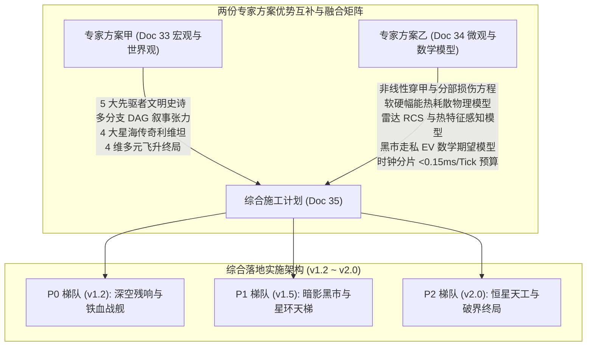
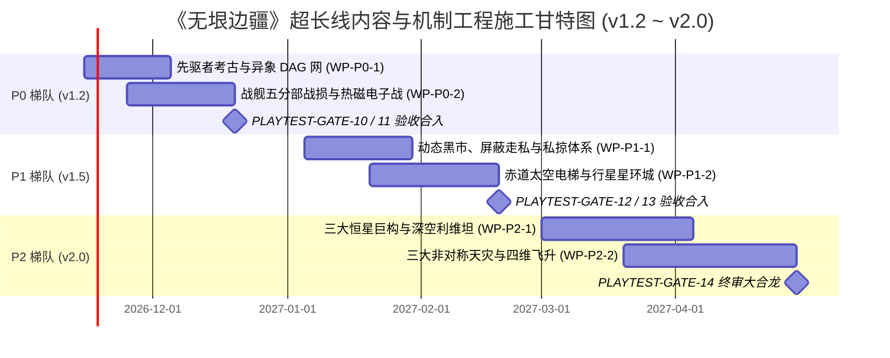

# 《无垠边疆：星海纪元》超长线内容与机制创新综合施工计划（v1.2 ～ v2.0）

> **文档编号**：SPEC-PLAN-035  
> **归属工程**：无垠边疆（VOID FRONTIER: AGE OF STARS）战略演进与长线内容工程  
> **编制角色**：项目负责人（Project Lead）  
> **方案输入**：  
> - 调研委托书：[`docs/specs/32_下一阶段长线开发内容与机制创新领域专家调研委托书.md`](file:///c:/Users/[REDACTED]/My%20Drive/work/void-frontier-age-of-stars/docs/specs/32_%E4%B8%8B%E4%B8%80%E9%98%B6%E6%AE%B5%E9%95%BF%E7%BA%BF%E5%BC%80%E5%8F%91%E6%B7%B1%E5%BA%A6%E5%86%85%E5%AE%B9%E4%B8%8E%E6%9C%BA%E5%88%B6%E5%88%9B%E6%96%B0%E9%A2%86%E5%9F%9F%E4%B8%93%E5%AE%B6%E8%B0%83%E7%A0%94%E6%8A%A5%E5%91%8A.md)  
> - 专家方案甲（宏观世界观与叙事）：[`docs/specs/33_无垠边疆长线内容与机制创新领域专家调研报告_宏观与世界观体系.md`](file:///c:/Users/[REDACTED]/My%20Drive/work/void-frontier-age-of-stars/docs/specs/33_%E6%97%A0%E5%9E%A0%E8%BE%B9%E7%96%86%E9%95%BF%E7%BA%BF%E5%86%85%E5%AE%B9%E4%B8%8E%E6%9C%BA%E5%88%B6%E5%88%9B%E6%96%B0%E9%A2%86%E5%9F%9F%E4%B8%93%E5%AE%B6%E8%B0%83%E7%A0%94%E6%8A%A5%E5%91%8A_%E5%AE%8F%E8%A7%82%E4%B8%8E%E4%B8%96%E7%95%8C%E8%A7%82%E4%BD%93%E7%B3%BB.md)  
> - 专家方案乙（微观物理与数学模型）：[`docs/specs/34_无垠边疆长线内容与机制创新领域专家调研报告_微观与数学模型体系.md`](file:///c:/Users/[REDACTED]/My%20Drive/work/void-frontier-age-of-stars/docs/specs/34_%E6%97%A0%E5%9E%A0%E8%BE%B9%E7%96%86%E9%95%BF%E7%BA%BF%E5%86%85%E5%AE%B9%E4%B8%8E%E6%9C%BA%E5%88%B6%E5%88%9B%E6%96%B0%E9%A2%86%E5%9F%9F%E4%B8%93%E5%AE%B6%E8%B0%83%E7%A0%94%E6%8A%A5%E5%91%8A_%E5%BE%AE%E8%A7%82%E4%B8%8E%E6%95%B0%E5%AD%A6%E6%A8%A1%E5%9E%8B%E4%BD%93%E7%B3%BB.md)  
> **基线对齐**：`main` 分支（v1.0 苍穹要塞 + Doc 31 终审补丁、全仓 56 套测试全绿、金快照 `8be8ce2c`、RTX 5060 真机 60 FPS）  
> **实施责任团队**：系统架构组、玩法逻辑组、物理战术组、渲染引擎组、测试保障组  

---

## 1. 超长线演化战略愿景与双专家方案综合裁定

### 1.1 设计哲学：从“底层坚韧容器”迈入“深空硬核与涌现史诗”
在完成 v0.2–v1.0 五大行星支柱、确定性微模拟内核以及 Doc 23–31 全生命周期零打桩测试闭环后，《无垠边疆》的工程质量已达到行业顶尖水平。然而，为彻底打破 4X 游戏“开局惊艳、中期繁琐、终局乏味”的顽疾，必须赋予银河深邃的内容内涵。

本施工计划深度融合了两位领域专家的优势，确立了**“宏观史诗因果 + 微观硬核物理”的双螺旋驱动架构**：

### 1.2 底层工程红线与防线不变量
1. **确定性与随机隔离**：严格维持零 `Math.random()`。所有异象检定、黑市价格震荡、电子战杂波及天灾演进均挂载于 `mix32` 独立盐值雪崩子流，历史回归用例金快照 `8be8ce2c` 保持逐位零漂移。
2. **内存与深拷贝红线**：紧凑整型元组设计，单星持久化增量严格控制在 50 KB 预算内，单步 `commandBus.deepClone(world)` 耗时稳定压制在 0.45–0.50 ms 预算内。
3. **Tick 耗时与帧率红线**：小时/日/月三级时钟分片，单战略 Tick 物理计算耗时 < 0.15 ms（严守 16 ms 红线），同屏 WebGL2 Draw Calls 维持在 28–32 次区间，零 GPU 孤儿句柄泄漏。

---

## 2. 五大核心命题综合施工规约

### 2.1 命题一：银河先驱者文明、深空异象 DAG 与星海利维坦
* **版本代号**：**v1.2（P0 梯队）**
* **源码落点**：`src/domain/exploration/precursorDag.js`, `src/content/precursors.js`, 升级 `src/domain/exploration/scan.js` 与 `src/domain/ground/monolithRuins.js`。

#### 2.1.1 机制融合与五大先驱者断代文明
采纳专家甲的五大原创文明体系，结合专家乙的 `mix32` 虚拟 d10 检定引擎：
1. **硅基谐振体（Resonators）**：母星系蕴藏超密集压电结晶，解锁极化高能水晶科技；
2. **弦网织造者（Chord Weavers）**：空间相变技术起源，解锁瞬时星门折跃；
3. **万菌共生体（Symbiotes）**：行星级菌丝神经网络，解锁生态自组织与生物护甲；
4. **永冻守望者（Cryo Watchers）**：绝对零度极寒文明，解锁零热辐射与超级冷凝反应堆；
5. **虚空沉思者（Void Meditators）**：超维精神拓印，解锁意识网络与灵能帷幕。

#### 2.1.2 机制实现关键：确定性虚拟 d10 检定方程
每次勘测深空异象时，检定点数由确定性雪崩散列派生：
$$\text{Roll} = (\text{mix32}(\text{world.seed} \oplus \text{anomalyId} \oplus (\text{stageIdx} \times 104729) \oplus \text{attempts}) \bmod 10) + 1$$
$$\text{TotalScore} = \text{Roll} + \text{ScientistSkill} + \text{Clues} - \text{AnomalyDifficulty}$$
* 若 $\text{TotalScore} \ge 10$：获得大成功，解锁先驱者关键线索并揭示支线 DAG；
* 若 $6 \le \text{TotalScore} < 10$：普通成功，获得常规科技与资源推进；
* 若 $\text{TotalScore} < 6$：受挫，生成悬停抉择点（`pendingChoices`），玩家可支付紧缺物资进行工程下注破局。

---

### 2.2 命题二：模块化舰船分部战损、热磁特征电子战与近防反导
* **版本代号**：**v1.2（P0 梯队）**
* **源码落点**：`src/domain/combat/subsystemsAndEw.js`, 升级 `src/domain/combat/ship.js`, `src/domain/combat/BattleSimulation.js`, `src/domain/combat/tactics.js`, `src/domain/combat/engagement.js`。

#### 2.2.1 方向性穿甲与五大子系统损伤模型
引入舰船五大物理子系统元组：`[bridge, propulsion, reactor, weapons, shieldGen]`。
根据来袭弹道相对舰首朝向的入射角判定受损区段（舰首 / 左舷 / 右舷 / 舰尾）。

采纳专家乙的非线性装甲削减方程：
$$D_{\text{eff}} = D_{\text{raw}} \cdot \max\left(0.15, \frac{D_{\text{raw}}}{D_{\text{raw}} + 0.5 \times \text{Armor}_{\text{eff}}}\right)$$
* 当区段装甲被击穿后，过剩伤害直接按权重穿透入内部子系统：
  * **推进系统（Propulsion）受损**：`maxSpeed` 与转弯角速度按健康度比例线性衰减；归零时完全失去机动力，变为漂移浮标；
  * **反应堆（Reactor）受损**：供电网络断崖式下跌，且每秒产生自身过热累加；
  * **舰桥（Bridge）受损**：索敌与命中精度惩罚 40%，受损达 100% 触发全舰短暂失控。

#### 2.2.2 软硬热幅能（Flux）与小行星带静默伏击
* **幅能闭环**：开火与能量武器蓄力产生**软热量（Soft Heat）**，护盾阻挡动能/高爆伤害转化为**硬幅能（Hard Flux）**。当 $\text{SoftHeat} + \text{HardFlux} \ge \text{FluxCapacity}$ 时，战舰触发 **6.0 秒强制过载（Overload）**，护盾清零且全武器系统离线冷却。
* **雷达 RCS 与热特征感知方程**：
  $$R_{\text{detect}} = R_0 \cdot \left(\text{RCS} \times \text{Thermal}\right)^{0.25} \times \left(1.0 - \text{StealthMod}\right)$$
  在小行星带或气态巨行星暗面开启“静默潜行（Silent Running）”后，反应堆停机降噪，$\text{StealthMod} \ge 0.75$，被探测距离暴跌 90%，伏击开火首轮享有 +25% 暴击率与首发穿甲加成。

---

### 2.3 命题三：动态黑市、屏蔽走私网络与私掠赏金经济
* **版本代号**：**v1.5（P1 梯队）**
* **源码落点**：`src/domain/economy/blackMarket.js`, 激活 `src/domain/economy/tradeRoutes.js`, 扩展 `src/content/resources.js` 与 `src/content/modules.js`。

#### 2.3.1 动态黑市超额利润与走私数学期望（EV）
黑市价格由常规星系市场的关税、商品稀缺度及星系治安度自然涌现：
$$P_{\text{bm}}(r) = P_{\text{market}}(r) \times \left(1.0 + \text{Tariff} \times 1.8 + \max(0, 1.0 - \text{Stability})\right)$$
玩家在星系黑市进行高风险走私的期望收益函数为：
$$\text{EV} = P_{\text{bm}} \cdot (1 - P_{\text{bust}}) - P_{\text{buy}} - \text{Fine} \cdot P_{\text{bust}}$$
其中查获概率 $P_{\text{bust}}$ 严格受海关巡逻密度与走私船装配的**屏蔽货舱（Shielded Cargo Bay）**容量调控：
$$P_{\text{bust}} = \text{clamp}\left(\frac{\max(0, Q_{\text{contra}} - C_{\text{shield}})}{Q_{\text{contra}} + 1} \times \text{SecurityLevel} \times (1.0 + \text{Suspicion}), 0, 0.95\right)$$
若走私违禁品完全收纳在屏蔽货舱容量内（$Q_{\text{contra}} \le C_{\text{shield}}$），查获率恒等于 0，实现 100% 完美偷运。

#### 2.3.2 四大违禁品体系与私掠许可证（Letters of Marque）
1. **四大违禁科技品**：非法失控智械核心（`contraband_feral_ai`）、异星神经狂热剂（`contraband_stimulant`）、基因诱变畸变卵（`contraband_bio_mutagen`）、暗质坍缩重构部件（`contraband_dark_parts`）。
2. **私掠与赏金**：派系可向玩家签署私掠许可证，劫掠指定敌国商队享受豁免恶名（Notoriety = 0），截断敌方行星工业造船链条并由赏金公会结算高额赏金（`FLOW.BOUNTY`）。

---

### 2.4 命题四：星海天工——四阶恒星巨构与赤道太空电梯
* **版本代号**：**v1.5（首期电梯与星环城）/ v2.0（三大恒星巨构）**
* **源码落点**：`src/domain/strategic/megastructures.js`, 升级 `src/domain/logistics/catapult.js` 与 `src/render/gl/System3D.js`。

#### 2.4.1 赤道太空电梯（Space Elevator）与星环城
* **彻底根治物流阻断**：传统电磁弹射井（`catapult.js`）在高重力浓密大气星球每次发射消耗 21.6 MWh 并增加 +25 行星威胁度（PTI）。赤道太空电梯落成后，采用纳米碳管缆绳沿引力井平滑攀升，**将单吨发射能耗骤降 93%（至 1.50 MWh），且环境 PTI 增量彻底归零**。
* **行星星环城（Orbital Ring）**：环绕行星轨道的大型圆环基座，直接向地表提供 32 个额外轨道建筑挂点，并与地表工业管线建立秒级吞吐拓扑。

#### 2.4.2 四大恒星级巨构的四阶段生命周期
巨构建设统一划分为四个确定性工程阶段：
* **阶段一（Stage 1: 勘探基座）**：完成恒星引力场锚定与微波受能基座部署；
* **阶段二（Stage 2: 框架骨架）**：消耗海量结构合金与量子导体，构筑主受力环形桁架；
* **阶段三（Stage 3: 功能工坊）**：装载专用生产核心（反应炉/聚能阵列/重力阱）；
* **阶段四（Stage 4: 满载运转）**：产出质变级战略产出与全局威慑光环。

| 恒星巨构代号 | 建筑名称 | 核心战略产出与质变效果 | 建造周期与资源沉淀池 |
| :--- | :--- | :--- | :--- |
| `mega_dyson_array` | 恒星微型戴森阵列 | 每日产出 12,000 MWh 终极能源，彻底免除帝国电力维护成本 | 4 阶段 / 累计 48,000 合金 + 16,000 导体 |
| `mega_star_lifter` | 奇点物质解压器 | 抽取恒星重元素，每日恒定输出 240 高纯钛合金与 80 奇异暗质 | 4 阶段 / 累计 60,000 合金 + 20,000 重水 |
| `mega_chord_gate` | 弦超空间星门网 | 连通银河遥远星区，跨星系舰队跳跃航行时间缩减至 1 小时 | 3 阶段 / 累计 32,000 合金 + 12,000 量子舱 |
| `mega_citadel` | 拉格朗日深空要塞 | 恒星系终极战略枢纽，搭载超远程引力阻断场与末日歼星级巨炮 | 4 阶段 / 累计 75,000 合金 + 25,000 导体 |

---

### 2.5 命题五：三大非对称天灾、星海统战联盟与四维飞升终局
* **版本代号**：**v2.0（P2 梯队）**
* **源码落点**：`src/domain/events/crisis.js`, `src/domain/victory/victory.js`, `src/domain/ai/aiFaction.js`, `src/ui/screens/DiplomacyView.js`。

#### 2.5.1 三大多阶段非对称天灾机制
彻底重构原 `crisis.js` 的数值进度条，升级为具有物理战场枢纽与独特破局机制的三大天灾：
1. **异次元裂隙吞噬者（Dimensional Rift / The Unbidden）**：
   * **机制**：在虚空深处撕开 3 座相位锚点（`stn_dimensional_portal`）。锚点拥有多层维度固定锁，在此期间传送门处于绝对无敌态。
   * **破局弱点**：玩家与联军必须分兵同时强攻并摧毁全部空间锚点，方可破除无敌护盾、击毁传送门。
2. **失控狂乱协议（Feral Automata Protocol / The Contingency）**：
   * **机制**：银河地下暗中蔓延幽灵信号（Ghost Signal），致使所有普通智械机偶产生 40% 叛乱罢工；在 4 颗中立气态巨行星地核激活自动化灭绝工厂。
   * **破局弱点**：实施电子战频段病毒注入，压制幽灵信号，逐一拔除地下熔炉。
3. **虚空暗潮虫群（Void Swarm Hive）**：
   * **机制**：外银河生物有机舰队遮蔽星空，具有持续吞噬并感染行星地表的侵蚀机制；
   * **破局弱点**：利用生化毒素鱼雷重创利维坦虫后，或实施轨道重力灭绝性轰炸净化感染温床。

#### 2.5.2 星海统战理事会（Galactic Council）与监护人机制
当天灾蔓延度 $\ge 25\%$ 时，银河议会触发紧急事态法案：
* 选举玩家或霸主为**星海最高监护人（Galactic Custodian）**；
* 征召成立**星海联军舰队（Galactic Defense Force, GDF）**，所有派系缴纳 15% 舰队额度并开放无条件全境边境通行权；
* 激活全银河集中调度命令：`MusterGalacticDefenseForce` 与 `DesignateCrisisFocusTarget`。

#### 2.5.3 四维非传统胜利终局（Alternative Victory Ascensions）
1. **宇宙创生（Cosmogenesis 飞升）**：建造终极巨构“视界之针（Horizon Needle）”，拓印文明全量意识记忆，全舰队护送并跃入银河中心超大质量黑洞，开辟平行新宇宙；
2. **泛共识大一统（Consensus Hegemony）**：通过星海议会和平通过《星海永久大宪章》，消除派系战争，达成超星系共治联盟；
3. **超维折跃飞升（Transcendence）**：利用万菌共生与弦网共鸣，全星系居民意识升华融入超空间织网；
4. **铁血霸权胜利（Military Subjugation）**：传统歼灭所有敌对派系，掌控银河全境。

---

## 3. 三梯队渐进式施工路线图与工单拆分（P0 → P1 → P2）

### 3.1 详细研发工单与代码落点映射表

| 实施梯队与目标版本 | 工单编号与模块名称 | 涉及生产源码文件落点 | 核心机制施工内容概要 | 新增注册命令（CommandBus） |
| :--- | :--- | :--- | :--- | :--- |
| **P0 梯队** **v1.2** 「深空残响与铁血战舰」 | **WP-P0-1** 先驱者考古与异象 DAG 网 | `src/domain/exploration/precursorDag.js` `src/content/precursors.js` `src/domain/exploration/scan.js` `src/domain/ground/monolithRuins.js` | 5 大先驱者文明史诗、跨星系 6 线索拼图、虚拟 d10 确定性检定、4 级异象树、先驱者母星系动态解锁 | `ResolveAnomalyDagBranch` `ActivatePrecursorRelic` |
|  | **WP-P0-2** 战舰五分部战损与热磁电子战 | `src/domain/combat/subsystemsAndEw.js` `src/domain/combat/ship.js` `src/domain/combat/BattleSimulation.js` `src/domain/combat/tactics.js` | 5 分部损伤判定、非线性破甲模型、软硬幅能过载、RCS/Thermal 双模感知、小行星带静默伏击、3 层近防与机队 | `ToggleSilentRunning` `TriggerDamageControlRestore` |
| **P1 梯队** **v1.5** 「暗影黑市与星环天梯」 | **WP-P1-1** 动态黑市、走私与私掠经济 | `src/domain/economy/blackMarket.js` `src/domain/economy/tradeRoutes.js` `src/content/resources.js` `src/content/modules.js` | 关税与安全度溢价黑市、走私 EV 期望、4 类违禁品、屏蔽货舱防检、物理商队阻断传导、私掠许可证与赏金公会 | `TradeBlackMarket` `IssueLetterOfMarque` `ClaimPirateBounty` |
|  | **WP-P1-2** 赤道太空电梯与行星星环城 | `src/domain/strategic/megastructures.js` `src/domain/logistics/catapult.js` `src/ui/screens/SystemView.js` | 赤道太空电梯消除能耗与 PTI 瓶颈、星环城 32 轨道建筑槽位、O(1) 连续天地物资流转拓扑 | `ConstructSpaceElevator` `ExpandOrbitalRingSegment` |
| **P2 梯队** **v2.0** 「恒星天工与破界终局」 | **WP-P2-1** 恒星级四阶巨构与太空利维坦 | `src/domain/strategic/megastructures.js` `src/render/gl/System3D.js` `src/content/leviathans.js` | 4 阶段戴森阵列、奇点解压器、跨星门网络、拉格朗日要塞；4 大深空游荡利维坦实体及专属武器研究 | `StartMegastructureStage` `EngageSpaceLeviathan` |
|  | **WP-P2-2** 三大非对称天灾与四维飞升 | `src/domain/events/crisis.js` `src/domain/victory/victory.js` `src/domain/ai/aiFaction.js` `src/ui/screens/DiplomacyView.js` | 传送门维度固定锁/幽灵信号/虫潮三阶段物理天灾、星海监护人统战选举与 GDF 联军、视界之针黑洞跃迁等四维飞升 | `ProposeSenateResolution` `MusterGalacticDefenseForce` `ExecuteAscensionProject` |

---

## 4. 全生命周期零打桩自动化验收门禁矩阵（GATE-10 ～ GATE-14）

延续 Doc 24–31 建立的严苛工程纪律，长线新特性必须逐级通过以下 5 套全新的自动化测试套件（严格杜绝桩函数与假绿）：

| 门禁套件编号 | 测试套件文件路径 | 关联版本 | 核心零打桩测试场景与硬性断言标准 | 性能与不变量红线 |
| :--- | :--- | :--- | :--- | :--- |
| **PLAYTEST-GATE-10** | `tests/suites/precursor-dag-lore.suite.js` | **v1.2 (P0)** | **EXPLORE-DAG-01**：遍历 50 次异象检定，断言同一 seed 重跑点数 100% 确定一致； **EXPLORE-PREC-02**：集齐 6 条先驱者线索，断言隐藏母星系即时拓扑生成并解锁遗物主动技能。 | `JSON.stringify(world.rng)` 逐字节无漂移（零主 RNG 污染）；单步耗时 < 0.20 ms |
| **PLAYTEST-GATE-11** | `tests/suites/combat-tactical-v2.suite.js` | **v1.2 (P0)** | **COMBAT-SUB-01**：舰尾鱼雷命中使推进器健康度降至 20%，断言航速精确等比衰减； **COMBAT-FLUX-02**：幅能达 100% 触发 6.0s 强制过载停火； **COMBAT-STEALTH-03**：静默伏击态探测距离缩减 ≥ 75%，首轮暴击率 +25%。 | 20 舰 + 4 战机中队交战单 Tick 耗时 ≤ 0.35 ms；断言 5% 残余装甲底线生效 |
| **PLAYTEST-GATE-12** | `tests/suites/grey-economy-smuggle.suite.js` | **v1.5 (P1)** | **ECON-BM-01**：高关税与战乱星系自发生成黑市超额溢价； **ECON-SHIELD-02**：屏蔽货舱内违禁品查获率恒为 0； **ECON-RAID-03**：截击商队断供导致船坞缺料停摆； **ECON-MARQUE-04**：持有私掠证劫掠恶名零增长且赏金到账。 | 复式记账等式严格残差为 0（`FLOW` 平衡）；无负库存与 NaN 污染 |
| **PLAYTEST-GATE-13** | `tests/suites/megastructure-elevator.suite.js` | **v1.5 / v2.0** | **MEGA-ELEV-01**：太空电梯建成后入轨能耗从 21.6 MWh 降至 1.50 MWh，连续运送 20 舱物料地表 PTI 增量恒为 0； **MEGA-STAGE-02**：四阶段戴森阵列按额定物料注入并平滑升阶，能量按期入账。 | 单星含电梯与工业网 `deepClone` 耗时 ≤ 0.25 ms；WebGL2 切换 100 次 $\Delta\text{Buffer} = 0$ |
| **PLAYTEST-GATE-14** | `tests/suites/endgame-crisis-ascension.suite.js` | **v2.0 (P2)** | **CRISIS-HUB-01**：在摧毁全部维度锚点前，裂隙传送门处于无敌态；拔除锚点后方可击破； **CRISIS-COUNCIL-02**：天灾爆发当选监护人并成功统领 GDF 联军； **VICTORY-ASCEND-03**：视界之针驶入黑洞完成文明升华，编年史闭环并宣告胜利。 | 24,000 Ticks 长程浸泡零崩溃；历史存档向后兼容零破坏；金快照 `8be8ce2c` 零偏移 |

---

## 5. 项目负责人实施指令与工程纪律

1. **并行开发安全隔离**：在当前工作树合入 Doc 31 终审补丁并获得用户明确验收前，严禁任何人员向生产分支提交未经验证的新长线逻辑。
2. **严禁破坏既有金快照**：新增的先驱者事件树、黑市交易与战术子系统，必须设计为“未触碰新特性时，底层状态与旧世界完全等价”的解耦架构。
3. **严格遵守 Git 提交流程**：严禁在未经用户明示授权的前提下执行任何 `git commit`。所有工单交付物必须在本地工作树跑通对应门禁（如 GATE-10）并生成可复现的控制台日志后，呈报用户审核签署。
