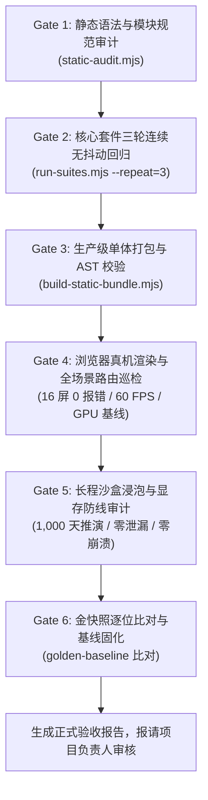

# 《无垠边疆：星海纪元》全流程回归测试与验收报告撰写规范

> **文档编号**：SPEC-QA-036  
> **归属工程**：无垠边疆（VOID FRONTIER: AGE OF STARS）全生命周期质量保障工程  
> **制定角色**：项目负责人（Project Lead）  
> **面向对象**：测试开发工程师、自动化测试组、QA 验收负责人  
> **适用范围**：日常特性回归、阶段大版本收口、领域专家验收前置验证、正式发版终审  
> **关联基石文档**：  
> - [`docs/specs/24_《无垠边疆》全生命周期测试体系方案.md`](file:///c:/Users/[REDACTED]/My%20Drive/work/void-frontier-age-of-stars/docs/specs/24_%E3%80%8A%E6%97%A0%E5%9E%A0%E8%BE%B9%E7%96%86%E3%80%8B%E5%85%A8%E7%94%9F%E5%91%BD%E5%91%A8%E6%9C%9F%E6%B5%8B%E8%AF%95%E4%BD%93%E7%B3%BB%E6%96%B9%E6%A1%88.md)  
> - [`docs/specs/31_无垠边疆全生命周期终审收口与全量回归验证施工方案.md`](file:///c:/Users/[REDACTED]/My%20Drive/work/void-frontier-age-of-stars/docs/specs/31_%E6%97%A0%E5%9E%A0%E8%BE%B9%E7%96%86%E5%85%A8%E7%94%9F%E5%91%BD%E5%91%A8%E6%9C%9F%E7%BB%88%E5%AE%A1%E6%94%B6%E5%8F%A3%E4%B8%8E%E5%85%A8%E9%87%8F%E5%9B%9E%E5%BD%92%E9%AA%8C%E8%AF%81%E6%96%BD%E5%B7%A5%E6%96%B9%E6%A1%88.md)  
> - [`docs/specs/35_无垠边疆超长线内容与机制创新综合施工计划.md`](file:///c:/Users/[REDACTED]/My%20Drive/work/void-frontier-age-of-stars/docs/specs/35_%E6%97%A0%E5%9E%A0%E8%BE%B9%E7%96%86%E8%B6%85%E9%95%BF%E7%BA%BF%E5%86%85%E5%AE%B9%E4%B8%8E%E6%9C%BA%E5%88%B6%E5%88%9B%E6%96%B0%E7%BB%BC%E5%90%88%E6%96%BD%E5%B7%A5%E8%AE%A1%E5%88%92.md)  

---

## 1. 规范总则与质量哲学

### 1.1 核心宗旨：建立“不可辩驳的事实证据链”
在硬核 4X 太空战略与微观沙盒模拟游戏《无垠边疆》的工程演进中，代码的正确性必须建立在客观、可复现、零打桩的确定性实证之上。本规范旨在终结“口头承诺任务完成”、“伪绿打桩掩盖缺陷”以及“报告格式凌乱随意”等不规范工程行为，为测试工程师提供一套标准化的回归测试执行流水线与验收报告撰写模板。

### 1.2 质量铁律（红线约束）
1. **真实日志证据优先**：验收报告必须包含各门禁真实终端输出的截选、Exit Code、关键性能耗时度量与断言结果，严禁仅附结论而不提供实测日志。
2. **零打桩与零断言弱化**：严禁在测试套件中为求通过而注释核心断言、放宽误差容限或使用虚假的 Mock 桩函数。
3. **确定性与无感隔离**：测试执行过程中必须校验金快照（Golden Baseline）与伪随机数流（RNG）的零漂移，任何回归改动不得破坏未触及特性的历史确定性。
4. **禁止擅自提交流水线**：测试工程师与开发人员严禁在报告未经项目负责人实机审查批准前执行 `git commit`。

---

## 2. 全流程六级回归测试执行流水线

测试工程师在发起验收前，必须按顺序严格执行以下六级回归门禁，任一环节失败均属于“阻塞性缺陷”，必须就地排查中断，严禁跳级执行。



### 2.1 Gate 1：静态语法与模块引用审计
* **执行指令**：
  ```bash
  node tests/tools/static-audit.mjs
  ```
* **验收判定标准**：
  * Exit Code 必须为 `0`；
  * 输出中必须显式标明：`静态审计通过：无违规项`；
  * 杜绝任何悬空 import、未声明全局变量或死代码。

### 2.2 Gate 2：核心单测与集成测试三轮无抖动运行
* **执行指令**：
  ```bash
  node tests/tools/run-suites.mjs --repeat=3
  ```
* **验收判定标准**：
  * 全仓测试套件通过率必须达到 **100%（0 Failed / 0 Skipped）**；
  * 重复执行 3 轮（Total Runs: 全部通过），无偶发闪烁测试（Flaky Test = 0）；
  * 覆盖 `tests/suites/` 下的基础规则、战斗结算、复式记账、先驱者考古与战术子系统套件。

### 2.3 Gate 3：生产级单体 Bundle 打包与 AST 校验
* **执行指令**：
  ```bash
  node tests/tools/build-static-bundle.mjs
  node --check dist/void-frontier.bundle.js
  ```
* **验收判定标准**：
  * 完整打包出 `dist/void-frontier.bundle.js`，包含全部已注册原生 ES 模块；
  * Node.js 原生 AST 语法校验通过，退出码为 `0`，无语法与作用域解析错误。

### 2.4 Gate 4：浏览器真机渲染与全场景交互实测
* **前置说明**：测试工程师须在测试专用的图形宿主环境中，启动前端服务并接入真实浏览器自动化测试流水线。
* **执行规程**：
  * 启动本地 HTTP 服务（如 `dev-server.mjs`，端口 8090）；
  * 运行自动化渲染实测脚本，驱动真实浏览器完成全流程巡检。
* **验收判定标准**：
  * **16 屏全场景路由遍历**：`menu`、`galaxy`、`system`、`colony`、`fleet`、`designer`、`combat`、`research`、`market`、`diplomacy`、`government`、`ground`、`events`、`chronicle`、`settings`、`diagnostics` 全部正常加载；
  * **控制台零异常**：Console Errors 恒等于 `0`，Console Warnings 恒等于 `0`，网络资源 404 恒等于 `0`；
  * **地表连续三维微操闭环**：战术分析面罩开启（`KeyV`）、建造模式切换（`Digit5`+`KeyF`）、地表交互拾取（`KeyE`）以及安全脱离返轨（`Escape`）按键链连续响应无卡顿；
  * **物理硬件基线度量**：
    * 平均帧耗时：`avgFrameMs < 16.6ms`（维持稳定 60 FPS）；
    * 同屏绘制调用：`DrawCalls <= 32 DC`；
    * 底层图形错误：`gl.getError() === 0`（`NO_ERROR`）。

### 2.5 Gate 5：长程时间加速沙盒演化与显存零泄漏
* **执行规程**：
  * 运行银河长程推演与状态机模糊测试（Soak & Fuzzing）；
* **验收判定标准**：
  * 推进 $\ge 1,000$ 战略天演化无未捕获异常、零死锁、零状态脱节；
  * 每战略日（24 Ticks）主线程模拟计算耗时严格压制在设计红线内；
  * 连续高频切换 3D 星系/行星视图 100 次，图形显存缓冲区句柄净增量为 0（$\Delta\text{Buffer} = 0, \Delta\text{VAO} = 0$）。

### 2.6 Gate 6：金快照回归比对与基线审计
* **执行规程**：
  * 运行金快照比对脚本，校验固定种子场景的哈希序列；
* **验收判定标准**：
  * 校验 `tests/regression/golden.json` 基准快照哈希；
  * 若因新特性引入导致快照演化，必须在报告中阐明机制原因与确定性证据，严禁在未明因果的情况下私自更新快照。

---

## 3. 验收报告结构与编写规范模板

测试工程师完成上述六级流水线后，必须统一在 `docs/reports/` 目录下按规约创建 Markdown 验收报告。报告必须严格遵循以下结构框架：

```markdown
# [工程代号/阶段] 自动化回归与质量验收报告

> **文档编号**：REPORT-XXXXX-FINAL  
> **对应规范/施工方案**：`docs/specs/XX_......md`  
> **报告日期**：YYYY-MM-DD  
> **执行工程师**：[姓名/Agent 编号]  
> **验收结论**：[全部通过 PASS / 有条件通过 CONDITIONAL PASS / 驳回 REJECTED]  

---

## 1. 验收概述与综合判定卡
- 本轮验收涉及的核心改动模块概要；
- 六级门禁通过情况总览（表格呈现，包含执行耗时与状态）；
- 核心指标达成判定卡（帧耗时、DrawCall、测试用例通过率、内存指标）。

---

## 2. 缺陷修复与原子补丁代码级实证（如有）
- 逐项列举已闭合的缺陷编号与修复位置（文件名:行号范围）；
- 简述缺陷根因及代码级修复机制；
- 列举针对该缺陷的定向回归测试断言与实测结果。

---

## 3. 六级全流程门禁执行实证与真实日志（核心事实链）
### 3.1 Gate 1 静态审计日志与结论
- 粘贴终端真实输出，证明 0 语法错误、0 悬空引用。
### 3.2 Gate 2 单元/集成测试结果与三轮稳定性
- 粘贴套件执行摘要（用例总数、通过数、失败数、总耗时）；
- 说明 3 轮连续执行的零抖动证据。
### 3.3 Gate 3 生产打包与 AST 语法解析
- 记录打包模块总数、Bundle 文件体积大小；
- 记录语法检查退出码。
### 3.4 Gate 4 浏览器端到端渲染与全场景交互实测
- 16 屏路由巡检实况（Console Error/Warning/404 统计）；
- 地表操作按键链（KeyV/Digit5/KeyE/Escape）响应记录；
- 物理显卡型号、实测平均帧耗时、DrawCall、三角形数及 WebGL Error 测量值。
### 3.5 Gate 5 长程沙盒推演与显存防线实测
- 长程推演天数与无崩溃证明；
- 显存 VAO/VBO 清册与缓冲区增量指标（验证零泄漏）。
### 3.6 Gate 6 金快照比对
- 说明快照比对结果（一致性哈希值）。

---

## 4. 关键产物与截图凭证索引
- 列出测试自动生成的截图文件清单（位于 `docs/screenshots/` 下的相对路径）；
- 性能 Profile 日志或 Dump 文件索引。

---

## 5. 验收人签署与入库建议
- 明确给出是否建议合入主干（Merge Approval）；
- 遗留观察项与后续版本演进建议。
```

---

## 4. 裁决判定标准与责任追溯

项目负责人在审查测试工程师呈交的验收报告时，将依照以下硬性标准裁决：

| 裁决结论 | 准入判定条件 | 后续处置路线 |
| :--- | :--- | :--- |
| **完全通过 (PASS)** | 1. 六级门禁全部 EXIT 0 且无任何报错告警；<br/>2. 真实终端日志完整，断言清晰；<br/>3. 关键性能指标（60 FPS、DrawCalls 等）完全达标；<br/>4. 补丁源码实测吻合，零次生缺陷。 | 项目负责人签署终审意见，报请用户批准后方可执行入库。 |
| **有条件通过 (CONDITIONAL PASS)** | 1. 核心业务流程与战斗/经济/渲染主干全绿；<br/>2. 存在不影响系统稳定性的轻微表意微瑕或非阻塞性优化项；<br/>3. 附有明确的限期修正方案与追踪工单。 | 要求工程师在指定期限内完成原子补丁闭环，补测通过后升级为 PASS。 |
| **直接驳回 (REJECTED)** | 1. 任一测试门禁失败、跳过或假绿打桩；<br/>2. 报告存在空洞推测或缺少真实终端日志证据；<br/>3. 产生控制台 Error、404 或 WebGL 显存泄漏；<br/>4. 未经审批私自执行 `git commit`。 | 彻底退回，记入质量事故追踪，勒令工程师重新排查并从 Gate 1 重头执行。 |

---

## 5. 附则

本规范自签发之日起生效，所有涉及《无垠边疆》系统的测试开发、日常回归与收口报告必须严格遵照本规范执行。
