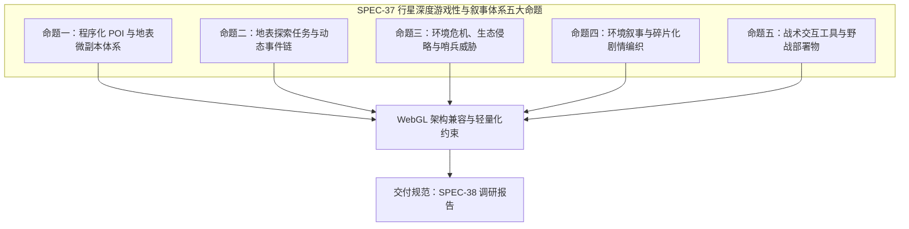

# 《无垠边疆：星海纪元》行星地表深度游戏性、动态探索与剧情叙事领域专家协查任务委托书

> **文档标识**：`SPEC-37-PLANETARY-GAMEPLAY-MANDATE`  
> **所属版本**：`v0.2 ~ v0.6 深度演化预研阶段`  
> **签发人**：项目负责人 (Project Lead)  
> **接收方**：行星玩法设计、剧情叙事与沉浸式环境交互领域专家组 (Domain Experts in Planetary Gameplay, Narrative & Procedural World Design)  
> **密级与时效**：项目最高战略优先级 / 即时生效  
> **前置依赖**：[`docs/specs/31_无垠边疆全生命周期终审收口与全量回归验证施工方案.md`](file:///c:/Users/[REDACTED]/My%20Drive/work/void-frontier-age-of-stars/docs/specs/31_%E6%97%A0%E5%9E%A0%E8%BE%B9%E7%96%86%E5%85%A8%E7%94%9F%E5%91%BD%E5%91%A8%E6%9C%9F%E7%BB%88%E5%AE%A1%E6%94%B6%E5%8F%A3%E4%B8%8E%E5%85%A8%E9%87%8F%E5%9B%9E%E5%BD%92%E9%AA%8C%E8%AF%81%E6%96%BD%E5%B7%A5%E6%96%B9%E6%A1%88.md)、[`docs/specs/35_无垠边疆超长线内容与机制创新综合施工计划.md`](file:///c:/Users/[REDACTED]/My%20Drive/work/void-frontier-age-of-stars/docs/specs/35_%E6%97%A0%E5%9E%A0%E8%BE%B9%E7%96%86%E8%B6%85%E9%95%BF%E7%BA%BF%E5%86%85%E5%AE%B9%E4%B8%8E%E6%9C%BA%E5%88%B6%E5%88%9B%E6%96%B0%E7%BB%BC%E5%90%88%E6%96%BD%E5%B7%A5%E8%AE%A1%E5%88%92.md)  
> **后续交付文件标号**：[`docs/specs/38_行星地表深度游戏性与剧情叙事领域专家调研报告.md`](file:///c:/Users/[REDACTED]/My%20Drive/work/void-frontier-age-of-stars/docs/specs/38_%E8%A1%8C%E6%98%9F%E5%9C%B0%E8%A1%A8%E6%B7%B1%E5%BA%A6%E6%B8%B8%E6%88%8F%E6%80%A7%E4%B8%8E%E5%89%A7%E6%83%85%E5%8F%99%E4%BA%8B%E9%A2%86%E5%9F%9F%E4%B8%93%E5%AE%B6%E8%B0%83%E7%A0%94%E6%8A%A5%E5%91%8A.md)

---

## 一、委托背景与核心痛点诊断

在项目组完成渲染管线收口、18 类行星审美视听体系建设及多轮 CDP / 真实浏览器端到端自动化验证后，底层架构稳定性与帧率性能（RTX 5060 实机稳定 60 FPS / 16.48ms，DrawCall 20 批）已达标。

然而，**经项目实机游玩与玩家深度体验反馈，当前游戏在玩法维度暴露出致命的“一英里宽、一英寸深 (A Mile Wide and an Inch Deep)”断层痛点**：

```
[星际宏观战略 / 舰队编组] (玩法完备)
         ↓ (降落飞船 / 建立首座哨站)
[行星地表 3D 视图] (痛点核心：空旷、无趣、无交互)
   ├── 仅有高度图起伏与静态着色，视线所及尽是单调的岩石散布
   ├── 缺乏可探索的兴趣点 (POI)、无废弃前哨、无坠毁残骸、无外星古代遗迹
   ├── 缺乏引人入胜的微观剧情、碎片化日志 (Data Slate) 或紧急求救信号 (SOS)
   ├── 缺乏生态互动：野生生物没有行为树 (无捕食/群落迁徙)，植物不可扫描互动
   └── 缺乏野外探险战术压力：无环境毒素/辐射/极温威胁，无野外防守与采掘事件
```

玩家在花费数分钟飞抵未知行星并着陆后，除了点击建造太阳能板或采矿厂外，**“整个星球也是空荡荡的，没有任何可以互动的情节与探险内容”**。这种“巨大空间感”与“内容极度匮乏”之间的强烈反差，严重挫伤了星际探索的核心乐趣。

为此，项目负责人特向领域专家组签发本协查任务委托书，**要求全面对标经典太空与科幻探索神作，为《无垠边疆》量身定制一套兼顾 WebGL 确定性轻量化架构与高密度玩法沉浸感的行星地表深度内容方案**。

---

## 二、经典太空与星球探险游戏对标矩阵

专家组应结合游戏工业界久经考验的代表性作品，对其地表循环与叙事机制进行深度解构与针对性借鉴：

| 对标作品 | 核心玩法与情节机制特征 | 适合《无垠边疆》借鉴的核心切入点 |
| :--- | :--- | :--- |
| **《No Man's Sky》(无人深空)** | 多光谱多功能分析目镜、程序化 POI（坠毁货舰、远古巨石遗迹破译语言、废弃科考站谜题）、哨兵巡逻与警戒星级上升梯次（1~5 星）。 | **分析目镜图鉴扫描**（测距/物种扫描/化学剖析）、**三类标准地表 POI 预制模型库**、**生态激怒警戒热度值 (Heat Level)**。 |
| **《Outer Wilds》(星际拓荒)** | 信号镜 (Signalscope) 远距频率追踪、失落文明 (Nomai) 遗迹石板破译、无数值成长的纯好奇心与信息驱动推进、灾难倒计时环境剧变。 | **定向无线电/异常频段探测仪**、**环境叙事与拼图式古代文明编年史**、**地表周期性天灾（离子风暴/地幔破裂）**。 |
| **《Mass Effect 1》(质量效应 1: 探险车)** | 探险车 (Mako) 登陆未知荒凉星球、雷达杂波与矿脉异象探测、废弃科研掩体与海盗前哨内部突入、碎片化遇难者日志与道德小抉择。 | **地表漫游雷达网格**、**紧凑型地下/室内轻副本（废弃掩体与科研舱室）**、**带微型道德分支的探险文本事件**。 |
| **《Starfield》(星空)** | 模块化地表 POI 生成算法、环境危害（极温冻伤、腐蚀气体、高能辐射对宇航服抗性的动态消耗）、地质/生态特质 (Traits) 勘探。 | **行星特征调查度 (Survey %)**、**环境抗性消耗与降落舱急救补给机制**。 |
| **《Subnautica》(深海迷航)** | 蓝图碎片扫描破译、遇难者 PDA 录音带与幸存者基地遗骸、由浅入深的未知恐惧感与生态威胁梯度。 | **科技残骸现场激光分析获取专属蓝图**、**黑匣子音频与多视角灾难日志链**。 |
| **《Helldivers 2》(绝地潜兵 2)** | 空投轨道舱、战术终端指令解密（箭头/频段对齐）、地表临时防御工事部署、坚守开采与紧急撤离倒计时张力。 | **战略部署物（临时探地雷达、野战自动炮塔）**、**高危采矿前哨的防守波次（虫群/机械逆袭）**。 |

---

## 三、五大核心协查命题与设计要求



### 命题一：程序化 POI (兴趣点) 与地表微型探索副本体系
专家组须设计一套适合 WebGL 轻量化渲染的 **地表程序化 POI 分布与生成范式**：
1. **三大基础 POI 架构**：
   - **太空残骸型 (Derelict Wrecks)**：坠毁的开拓者先锋舰、海盗侦察艇或无人货柜舱。玩家需消耗能量切割气密门、修复供电线路、搜索黑匣子。
   - **废弃科考/工业前哨 (Abandoned Outposts)**：受灾变废弃的先遣实验室、生化培养温室或自动化深井采矿站。内部包含待解密的科学终端与残留样本。
   - **远古异星巨石/先驱遗迹 (Xeno-Monoliths & Vaults)**：未知文明遗留的环形巨石、反重力能量柱或地下密室。涉及符号对齐、共鸣频率调整等微型益智机制。
2. **生成与分布拓扑**：
   - 规定单颗行星依据其半长轴、地表类型（熔岩/冻原/酸蚀/荒漠等）生成的 POI 数量区间（如 3~8 个）。
   - POI 必须与高度图地形平整度自动贴合，防止出现空中悬浮或嵌入山体瑕疵。

### 命题二：地表探索任务链与动态涌现事件 (Emergent Quests)
拒绝枯燥单一的“点击采集”，建立多层次地表动态事件链：
1. **紧急求救信号追踪 (SOS Triangulation)**：
   - 玩家着陆后接收到微弱加密求救信标，需通过方位测向仪（根据信号强度递增/杂音减弱）追踪源头。
   - 结局分支：可能发现受困的先遣幸存者、或是早已全灭留下的最后日记，甚至是由海盗设下的伏击陷阱。
2. **生物与地质大勘探 (Planetary Survey Loop)**：
   - 设计行星勘探完整度指标（Survey Completion %）。
   - 勘探要素：扫描 3 种原生动物、2 种奇异植物、1 处地质奇观。达成 100% 后可向星际联盟换取巨额科研点数或专属特质奖励。
3. **高危矿脉提取与防守倒计时 (Deep-Core Extraction & Defense)**：
   - 放置便携式采矿钻机开采稀有同位素，钻机噪音将触发地表生物或警戒无人机的骚动，玩家需在固定时间内坚守防线。

### 命题三：环境危机、异星生态与哨兵/敌意梯次 (Threat & Ecosystem)
让行星拥有生命力与危险感：
1. **生态感知与行为范式**：
   - 食草/温和生物：成群游荡，遇惊扰散开；
   - 掠食/敌对生物：夜间狂暴化，伏击靠近的侦察单位；
   - 领地守护者：守护珍稀先驱遗迹的巨型异星构造体。
2. **警觉度与热度机制 (Planetary Heat / Sentinel Response)**：
   - 类似 GTA 警星或无人深空哨兵机制：过度采伐地表、强行破解古代遗迹将激怒星球原生守护者，警戒级别从 1 级（侦察蜂群）升级至 5 级（重装步行要塞降临）。
3. **极端气象生存危机**：
   - 酸雨侵蚀、电磁离子风暴（干扰雷达与目镜）、极低温冰暴。在风暴来临时，玩家外骨骼能量加速消耗，需就近寻找洞穴或降落舱避险。

### 命题四：环境叙事与碎片化剧情编织 (Environmental Storytelling)
构建充满悬念、科幻史诗感与人性微光的叙事文本体系：
1. **数据日志与音频记录仪 (Data Slates / Voice Logs)**：
   - 专家组需构思 5~10 套具有连续悬疑感的微型剧本（如《先锋号最后的 72 小时》、《普罗米修斯生化泄露事件簿》、《失落的第七勘探队》）。
   - 文本需体现多视角反转（如队长的乐观日志 vs 医官逐渐精神失常的隐秘记录）。
2. **异星古代文字解密 (Ancient Lexicon Decryption)**：
   - 引入简单的先驱词汇破译系统。在不同星球参拜巨石可逐步解锁“能量”、“毁灭”、“净化”、“造物主”等关键词，最终拼凑出银河主线剧情的拼图。
3. **道德微抉择 (Moral Dilemmas)**：
   - 发现处于冷冻休眠的感染科研人员：是消耗珍贵抗毒素挽救并招募其为随从，还是封存舱室回收其科技资料？

### 命题五：地表战术交互工具与野战部署物 (Field Tools & Deployables)
丰富玩家在地表的微操自由度：
1. **多功能战术分析目镜 (Tactical Analysis Visor)**：
   - 切换分析视图（热成像、微波扫描、矿脉穿透），提供目标详细参数与弱点。
2. **便携式野战部署装备库**：
   - **便携式探地雷达 (Ground Penetrating Radar)**：探知地底隐藏洞穴与富矿脉络。
   - **临时充能桩 / 热能发生器**：在极端严寒或风暴中维持护盾能量。
   - **便携式防御哨兵机枪塔**：用于在野外勘探或被兽潮包围时建立临时防御阵线。
   - **信号诱饵弹 / 烟幕发生器**：用于摆脱高星级哨兵或巨兽追击。

---

## 四、确定性与 WebGL 架构轻量化硬性约束

专家组在提出所有机制与情节方案时，必须严格遵守《无垠边疆》现有的底层技术规范，杜绝不可落地的重度 3D 资产幻想：

```
[技术性能铁律]
1. 伪随机数种子确定性：
   - 所有 POI、地表事件、遭遇敌人与日志碎片必须由行星自身的 seed 通过 mix32 算法确定性生成。
   - 严禁非确定性 Math.random() 导致玩家读档后地图变动。

2. 几何与渲染预算：
   - 单颗行星的地表所有 POI 附加网格多边形总和 <= 15,000 面。
   - 必须复用现有的 InstancedMesh 与低多边形着色体系，全星地表 DrawCall 严控在 32 批次以内。
   - 保证 RTX 5060 实机基准 >= 60 FPS (帧生成时间 <= 16.6ms)。

3. 内存与存档序列化：
   - 纯数据驱动配置，单个行星的地表探索状态差分快照 (Delta State) <= 50 KB。
   - 仅记录发生变动的实体（如：`poi_ruin_03: { looted: true, solvedPuzzles: [1, 2] }`）。
```

---

## 五、交付成果与报告规范

专家组应在规定周期内完成互联网调研、优秀游戏案例解构与具体设计推演，形成正式调研报告：

1. **报告命名与存储路径**：
   - 路径：[`docs/specs/38_行星地表深度游戏性与剧情叙事领域专家调研报告.md`](file:///c:/Users/[REDACTED]/My%20Drive/work/void-frontier-age-of-stars/docs/specs/38_%E8%A1%8C%E6%98%9F%E5%9C%B0%E8%A1%A8%E6%B7%B1%E5%BA%A6%E6%B8%B8%E6%88%8F%E6%80%A7%E4%B8%8E%E5%89%A7%E6%83%85%E5%8F%99%E4%BA%8B%E9%A2%86%E5%9F%9F%E4%B8%93%E5%AE%B6%E8%B0%83%E7%A0%94%E6%8A%A5%E5%91%8A.md)
2. **报告必须包含的具体模块**：
   - **模块一：行业对标深入复盘**（提取 3 个最适合移植到 WebGL 体系的具体机制及改造成本分析）。
   - **模块二：12 个标准化地表 POI 设计蓝图**（包括几何外形意向、交互逻辑、奖励掉落表、状态机流转）。
   - **模块三：8 组碎片化环境叙事剧本与日志样张**（具备完整世界观纵深，文笔兼具科幻严谨与戏剧张力）。
   - **模块四：地表生存威胁与动态事件伪代码状态机**（清晰定义事件触发概率、半径、解决路径与热度增减公式）。
   - **模块五：工程实施切片建议**（提供清晰的阶段推进计划，确保与现有 `PlanetSurface3D.js`、`colonyGovernance.js` 无缝解耦挂接）。

---

> **批准人**：项目负责人 (Project Lead)  
> **日期**：2026年11月10日
