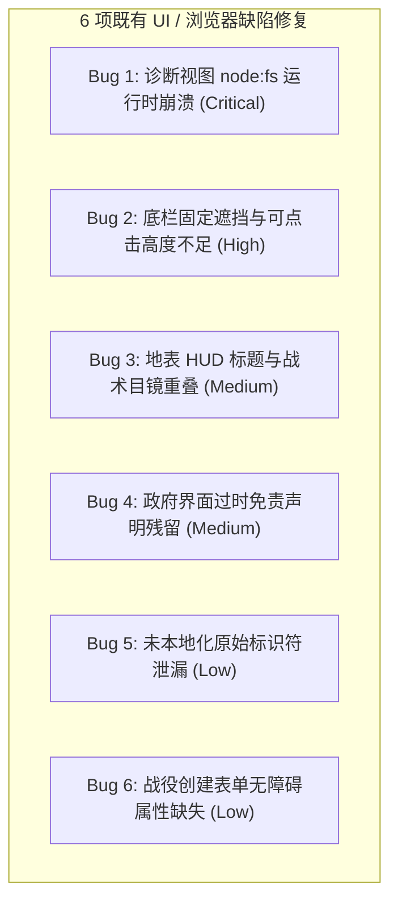
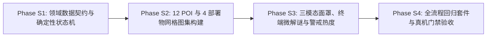

# 《无垠边疆：星海纪元》行星地表深度游戏性实施与 UI / 浏览器缺陷综合施工方案

> **文档标识**：`SPEC-39-PLANETARY-GAMEPLAY-AND-BUGFIX-CONSTRUCTION`  
> **所属版本**：`v0.2 ~ v0.6 深度演化落地与缺陷收口阶段`  
> **签发人**：项目负责人 (Project Lead)  
> **接收方**：核心执行工程师 (Core Execution Engineer)  
> **密级与时效**：项目最高工程优先级 / 即时生效  
> **前置依赖**：
> - [`docs/specs/37_行星地表深度游戏性与剧情叙事领域专家协查任务委托书.md`](file:///c:/Users/[REDACTED]/My%20Drive/work/void-frontier-age-of-stars/docs/specs/37_%E8%A1%8C%E6%98%9F%E5%9C%B0%E8%A1%A8%E6%B7%B1%E5%BA%A6%E6%B8%B8%E6%88%8F%E6%80%A7%E4%B8%8E%E5%89%A7%E6%83%85%E5%8F%99%E4%BA%8B%E9%A2%86%E5%9F%9F%E4%B8%93%E5%AE%B6%E8%B0%83%E7%A0%94%E6%8A%A5%E5%91%8A.md)
> - [`docs/specs/38_行星地表深度游戏性与剧情叙事领域专家调研报告.md`](file:///c:/Users/[REDACTED]/My%20Drive/work/void-frontier-age-of-stars/docs/specs/38_%E8%A1%8C%E6%98%9F%E5%9C%B0%E8%A1%A8%E6%B7%B1%E5%BA%A6%E6%B8%B8%E6%88%8F%E6%80%A7%E4%B8%8E%E5%89%A7%E6%83%85%E5%8F%99%E4%BA%8B%E9%A2%86%E5%9F%9F%E4%B8%93%E5%AE%B6%E8%B0%83%E7%A0%94%E6%8A%A5%E5%91%8A.md)  
> **后续验收规约**：[`docs/specs/40_行星地表深度机制与全流程全量回归测试规范.md`](file:///c:/Users/[REDACTED]/My%20Drive/work/void-frontier-age-of-stars/docs/specs/40_%E8%A1%8C%E6%98%9F%E5%9C%B0%E8%A1%A8%E6%B7%B1%E5%BA%A6%E6%9C%BA%E5%88%B6%E4%B8%8E%E5%85%A8%E6%B5%81%E7%A8%8B%E5%85%A8%E9%87%8F%E5%9B%9E%E5%BD%92%E6%B5%8B%E8%AF%95%E8%A7%84%E8%8C%83.md)

---

## 一、方案背景与综合施工目标

在项目组对领域专家组提交的 73KB 详实调研报告（[`docs/specs/38`](file:///c:/Users/[REDACTED]/My%20Drive/work/void-frontier-age-of-stars/docs/specs/38_%E8%A1%8C%E6%98%9F%E5%9C%B0%E8%A1%A8%E6%B7%B1%E5%BA%A6%E6%B8%B8%E6%88%8F%E6%80%A7%E4%B8%8E%E5%89%A7%E6%83%85%E5%8F%99%E4%BA%8B%E9%A2%86%E5%9F%9F%E4%B8%93%E5%AE%B6%E8%B0%83%E7%A0%94%E6%8A%A5%E5%91%8A.md)）完成深度审阅后，确认其提出的“12 类低模 POI + 3 大动态涌现事件链 + 1~5 星警戒热度 + 8 组叙事日志 + 4 类野战部署物”技术路线完全契合轻量级 WebGL 约束与确定性微模拟内核。

同时，在此前的真机浏览器探索性实测中，发现了 6 项影响用户体验与端到端运行的 UI / 浏览器缺陷。

**本施工方案将上述“6 大既有缺陷修复”与“行星地表深度游戏性四大工程切片”进行统筹合流，为执行工程师提供清晰、无二义性、精确到文件行与数据契约的施工指南。**

---

## 二、第一部分：6 项 UI 与浏览器缺陷精准修复施工指南



### 1. Bug 1 (Critical)：游戏内诊断视图执行测试时 `node:fs` 崩溃
* **缺陷现象**：在浏览器中打开 `#/diagnostics` 点击“运行全部测试”时，控制台抛出 `Access to script at 'node:fs' blocked by CORS policy / TypeError: Failed to resolve module specifier 'node:fs'`，导致自动化测试前端套件完全瘫痪。
* **根因定位**：`tests/suites/playtest-gates.suite.js` 头部存在静态导入：
  ```javascript
  import { readFileSync } from 'node:fs';
  ```
  该文件被 `tests/suites/index.js` 聚合导出并在浏览器中由 `DiagnosticsView.js` 动态引用。纯浏览器环境无法解析 `node:fs` 协议。
* **施工改造指令**：
  1. 改造 `tests/suites/playtest-gates.suite.js`：将 Node 内置模块解耦。使用运行时环境自省守卫：
     ```javascript
     const isNode = typeof process !== 'undefined' && process.versions?.node;
     ```
  2. 若在 Node 环境执行，使用动态 `import('node:fs')`；若在浏览器环境，跳过针对物理文件的审计，或通过 `fetch('/dist/void-frontier.bundle.js')` 读取文本。
  3. 确保在纯浏览器环境中引入 `tests/suites/index.js` 时零报错，`#/diagnostics` 界面套件可平稳跑通所有领域状态机与数学模型断言。

### 2. Bug 2 (High)：底部固定导航栏遮挡界面底部按钮与交互死区
* **缺陷现象**：在 `#/government`（法令政策）、`#/colony`（建筑队列与升级）、`#/research`（科技树）等视图中，最底部的操作按钮（如“颁布法令 (Enact Edict)”、“建造设施”）被固定定位的底栏 `.shell-bottom-bar` 遮挡，页面滚动触底时无法点击。
* **根因定位**：`.shell-bottom-bar` 的高度约为 56px~64px 且 `position: fixed; bottom: 0; z-index: 100`，而主内容滚动容器 `.screen-content` 或各视图外层容器未设置充足的 `padding-bottom`。
* **施工改造指令**：
  1. 在全局样式文件 `src/ui/styles/shell.css` 或各 screen 根样式中，确保所有可滚动的主体容器（`.gov-container`、`.colony-view`、`.research-view`、`.screen-scrollable`）统一追加：
     ```css
     padding-bottom: 84px !important;
     box-sizing: border-box;
     ```
  2. 保证页面滚动至最低端时，最后一个卡片或操作按钮与底部固定栏上边缘保持至少 20px 的视觉安全余量，保证 100% 可被点击。

### 3. Bug 3 (Medium)：地表视图左上角主标题与战术目镜 HUD 重叠
* **缺陷现象**：进入 `#/ground` 后，左上角显示的地表名称/状态标题与按下 `KeyV` 激活的战术面罩（Visor HUD）数据重叠，文字互相穿插无法辨识。
* **根因定位**：`GroundView.js` 中的 2D HUD 绘制逻辑与 HTML 标题容器的定位坐标未做动态避让。
* **施工改造指令**：
  1. 检查 `src/ui/screens/GroundView.js`：在战术分析面罩激活时（`this.visorActive === true`），将左上角常驻标题栏的透明度渐变降至 0.2 或添加 `display: none` 隐匿；
  2. 将战术目镜的状态读数（当前模式、杂波电平、信噪比）向下偏移至 `top: 72px; left: 24px`，与视口边框建立统一的安全栅格。

### 4. Bug 4 (Medium)：政府与法令界面残留过时“尚未实装”免责声明
* **缺陷现象**：`#/government` 界面顶部仍悬挂“法令与政策机制处于施工原型阶段，暂未完全实装”的早期提示，而实际上 `colonyGovernance.js` 的 12 项法令已具备完整的心理学双轨数值与经济影响闭环。
* **根因定位**：`src/ui/screens/GovernmentView.js` 中保留了遗留的静态警告 DOM 节点。
* **施工改造指令**：
  1. 移除 `GovernmentView.js` 中陈旧的 prototype disclaimer 提示横幅；
  2. 替换为真实的法令生效概览栏，动态显示当前行星激活法令数、日耗维护费与希望/不满净修正率。

### 5. Bug 5 (Low)：部分模块泄露原始代码 ID 与未本地化英文字符
* **缺陷现象**：
  - 殖民地建筑队列显示原始 ID：如 `bld_solar_array`；
  - 编年史事件日志显示枚举原名：如 `FleetFormed`、`ColonyFounded`；
  - 科技树属性增益直接显示代码字串：如 `stormResistAcid +1`、`tech_science_1`；
  - 舰船设计界面槽位显示 `capital`、`tech_kinetic_1`。
* **施工改造指令**：
  1. 在 `src/ui/localization/`（或各展示模块）中接入标准格式化映射器：
     - 调用 `getBuildingDefinition(id).nameZh` 替代原始 ID；
     - 在 `chronicle.js` / 事件渲染器中建立事件类型中文字典（如 `FleetFormed` -> “舰队组建完成”）；
     - 属性修正值建立可读标签映射表（`stormResistAcid` -> “酸雨风暴抗性”）。

### 6. Bug 6 (Low)：战役创建界面表单字段缺少无障碍属性与 ID
* **缺陷现象**：战役初始化界面中，部分输入框与单选组缺失 `id`、`name` 与 `for` 关联标签，引发浏览器控制台 Form 无障碍警告。
* **施工改造指令**：
  1. 检查 `src/ui/screens/CampaignCreationView.js`（或相关模态框），为所有 `<input>`、`<select>` 显式补齐语义化 `id` 与 `name`，并为每个 `<label>` 绑定正确的 `for="input-id"`。

---

## 三、第二部分：行星地表深度游戏性四阶段施工方案 (Phase S1 ~ S4)



### 切片一 (Phase S1)：确定性种子、12 类 POI 状态机与动态事件领域层
1. **种子派生子流扩展**：
   - 文件：[`src/domain/ground/planetSeeds.js`](file:///c:/Users/[REDACTED]/My%20Drive/work/void-frontier-age-of-stars/src/domain/ground/planetSeeds.js)
   - 在 `derivePlanetSeedsExtended(world, planetId)` 中扩展 `sosSeed`、`slateSeed(poiId)` 与 `heatWaveSeed(star, waveIdx)`，全数通过 `mix32` 算子派生，严禁消费主世界 `world.rng`。
2. **地表动态事件与状态机**：
   - 新建：[`src/domain/ground/surfaceEvents.js`](file:///c:/Users/[REDACTED]/My%20Drive/work/void-frontier-age-of-stars/src/domain/ground/surfaceEvents.js)
   - 实装 `ensureSurfaceDelta(world, planet)`：惰性挂载紧凑差分状态（`sos`、`extraction`、`heat`、`deployables`、`slatesMask`、`floraScannedMask`、`geoWonderScanned`）。
   - 实装 `evaluateSosSignalscope`（余弦定向聚焦 + 距离衰减模型）。
   - 实装 `triggerSosBeaconOutcome`（幸存者救援、黑匣子绝笔、海盗伏击三分支）。
   - 实装 `computePlanetarySurveyPercent`（50% 动物 + 30% 植物 + 20% 地质奇观）。
3. **内容文本与剧本库**：
   - 新建：[`src/content/surfaceNarratives.js`](file:///c:/Users/[REDACTED]/My%20Drive/work/void-frontier-age-of-stars/src/content/surfaceNarratives.js)
   - 收录 8 组共 24 则多视角硬核科幻数据板日志（三幕式反转结构）；
   - 收录三大地表探索道德微抉择卡配置（`dil_ground_cryo_infected`、`dil_ground_stranded_pirate`、`dil_ground_sentient_automata`）。
4. **先驱者 32 词根语素字典**：
   - 新建：[`src/content/lexicon.js`](file:///c:/Users/[REDACTED]/My%20Drive/work/void-frontier-age-of-stars/src/content/lexicon.js)
   - 实装四大语义域 32 词根字典与 `translateAncientText(text, lexiconMask)` 动态破译高亮纯函数。
5. **领域命令总线扩展**：
   - 文件：[`src/app/commands.js`](file:///c:/Users/[REDACTED]/My%20Drive/work/void-frontier-age-of-stars/src/app/commands.js)
   - 注册 4 个新命令：`InteractPoiStage`、`TriggerSosBeacon`、`DeployFieldTool`、`StartDeepCoreExtraction`。

### 切片二 (Phase S2)：12 座 POI 与 4 类部署物低模图集构建与地形贴合
1. **程序化网格原语扩充**：
   - 文件：`src/render/meshes/landmarkMeshes.js` 与 `src/render/meshes/GroundMeshes.js`
   - 使用 `PartMeshBuilder` 原语构建 12 个标准化 POI 预制件（单网格 248~428 三角形）与 4 类野战部署物网格（单网格 96~180 三角形）。
   - **硬性约束**：所有地表建筑底部全部自带向下延伸 1.8m 的 `skirt` 裙边；残骸类自带 8°~15° 埋入倾角。
2. **实例化批处理容量升级**：
   - 文件：[`src/ui/screens/GroundView.js`](file:///c:/Users/[REDACTED]/My%20Drive/work/void-frontier-age-of-stars/src/ui/screens/GroundView.js)
   - 将 `BuildingMeshBatch` 的上限容量由 384 扩充至 512，追加 12 个 POI 与 4 个野战部署物槽位，确保地表所有静态/动态地标在 1 次 DrawCall 内完成渲染。
3. **9 点坡度整平与 SDF 承台平滑**：
   - 在 POI 落位时向 `field.siteModifier` 注入内平 4.5m、外过渡 9.0m 的平滑承台算子，从数学上杜绝模型悬空与嵌山。

### 切片三 (Phase S3)：多光谱分析面罩、终端微解谜 HUD 与 1~5 星警戒热度合龙
1. **战术目镜三模态切换**：
   - 升级 `GroundView.js` 的 `KeyV` 面罩：支持按 `Tab` 在【生态光谱】、【电磁测向】与【地质穿透】之间无缝轮切。
   - 微波测向模式下，复用 2D Canvas 绘制实时信噪比正弦波，并调用 `AudioManager` 产生基于 $S_k$ 距离调制的脉冲提示音。
2. **2D 终端微解谜与道德抉择浮层**：
   - 在 3D 视口上方实现轻量级 2D 终端微解谜弹窗（4 位方向键序列 / 频段对齐），解密成功后推进 POI 状态并触发视觉辉光；
   - 终局触发时通过 `App._openNonIntrusiveEventModal` 弹出全息道德抉择卡，无缝回写殖民地希望/不满。
3. **1~5 星警戒热度动态微分与生态感知**：
   - 实装 `stepSurfaceThreatAndDeployables`：将开采/解密/噪音转化为实时热度 $H_{\text{local}} \in [0, 1000‰]$；
   - 1~5 星增援波次直接复用 `PlanetSurface3D.js` 的 `ACTOR_VS` 实例化通道（侦察机偶 -> 四足猎杀兽 -> 重装要塞），无需新增 Shader。
4. **4 类野战部署物交互**：
   - 快捷栏（或按键）放置探地雷达（穿透高亮）、充能桩（12m 避险回盾）、哨兵炮塔（24m 自动索敌）与诱饵弹（-220 热度并拉走仇恨）。

### 切片四 (Phase S4)：测试套件搭建与静态验证
1. **测试套件集成**：
   - 新建：`tests/suites/playtest-gate15-surface.suite.js`，包含门禁规约 `SURF-01` ~ `SURF-05` 的全部断言。
   - 挂载至 `tests/suites/index.js`。
2. **静态代码与打包审计**：
   - 执行 `node tests/tools/static-audit.mjs`，确保零规则违规；
   - 执行 `node tests/tools/build-static-bundle.mjs`，打包生成最终 bundle；
   - 执行 `node --check dist/void-frontier.bundle.js`，确保无语法与 AST 错误。

---

## 四、工程量清单与文件变动索引表

| 序号 | 施工文件路径 | 变动类型 | 核心施工内容与职责 |
| :--- | :--- | :--- | :--- |
| 1 | [`tests/suites/playtest-gates.suite.js`](file:///c:/Users/[REDACTED]/My%20Drive/work/void-frontier-age-of-stars/tests/suites/playtest-gates.suite.js) | 修改 | **[Bug 1]** 移除头部静态 `node:fs` 导入，改为环境检测防御，解除浏览器崩溃 |
| 2 | `src/ui/styles/shell.css` / 各 Screen 样式 | 修改 | **[Bug 2]** 主容器追加 `padding-bottom: 84px`，消除底栏遮挡与不可点击死区 |
| 3 | [`src/ui/screens/GroundView.js`](file:///c:/Users/[REDACTED]/My%20Drive/work/void-frontier-age-of-stars/src/ui/screens/GroundView.js) | 修改 | **[Bug 3/Phase S2/S3]** 修复 HUD 标题重叠；扩建 BuildingMeshBatch 容量至 512；实装 Tab 面罩与部署物快捷栏 |
| 4 | `src/ui/screens/GovernmentView.js` | 修改 | **[Bug 4]** 移除陈旧的未实装免责声明横幅，挂接真实生效法令概览 |
| 5 | `src/ui/screens/` 各相关视图与本地化字典 | 修改 | **[Bug 5]** 修复建筑队列、事件日志、科技树与舰船设计的未翻译原始 ID 泄漏 |
| 6 | `src/ui/screens/CampaignCreationView.js` | 修改 | **[Bug 6]** 补全战役创建表单控件的 `id`、`name` 与 `for` 无障碍属性 |
| 7 | [`src/domain/ground/planetSeeds.js`](file:///c:/Users/[REDACTED]/My%20Drive/work/void-frontier-age-of-stars/src/domain/ground/planetSeeds.js) | 修改 | **[Phase S1]** 派生 `sosSeed`、`slateSeed`、`heatWaveSeed`，保证主 RNG 零消费 |
| 8 | [`src/domain/ground/surfaceEvents.js`](file:///c:/Users/[REDACTED]/My%20Drive/work/void-frontier-age-of-stars/src/domain/ground/surfaceEvents.js) | 新建 | **[Phase S1]** 实装地表差分状态容器、SOS 测向、勘探度 100% 闭环、1~5 星热度微分状态机 |
| 9 | [`src/content/surfaceNarratives.js`](file:///c:/Users/[REDACTED]/My%20Drive/work/void-frontier-age-of-stars/src/content/surfaceNarratives.js) | 新建 | **[Phase S1]** 收录 12 POI 蓝图定义、8 组 24 则多视角硬科幻日志及道德微抉择卡 |
| 10 | [`src/content/lexicon.js`](file:///c:/Users/[REDACTED]/My%20Drive/work/void-frontier-age-of-stars/src/content/lexicon.js) | 新建 | **[Phase S1]** 32 先驱者词根字典及动态文本破译纯函数 |
| 11 | [`src/domain/ground/planetPOI.js`](file:///c:/Users/[REDACTED]/My%20Drive/work/void-frontier-age-of-stars/src/domain/ground/planetPOI.js) | 修改 | **[Phase S1]** 升级 3~8 个 POI 程序化生成算法与 3 步微副本状态机推进 |
| 12 | [`src/app/commands.js`](file:///c:/Users/[REDACTED]/My%20Drive/work/void-frontier-age-of-stars/src/app/commands.js) | 修改 | **[Phase S1]** 注册 4 项地表交互核心命令 |
| 13 | `src/render/meshes/landmarkMeshes.js` | 修改 | **[Phase S2]** 编写 12 个 POI 与 4 个野战部署物轻量低模几何体与 skirt 裙边 |
| 14 | `tests/suites/playtest-gate15-surface.suite.js` | 新建 | **[Phase S4]** 实装 SURF-01..05 零打桩门禁自动化断言套件 |

---

> **批准人**：项目负责人 (Project Lead)  
> **日期**：2026年11月10日
