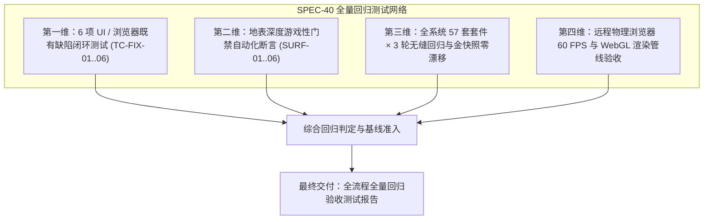
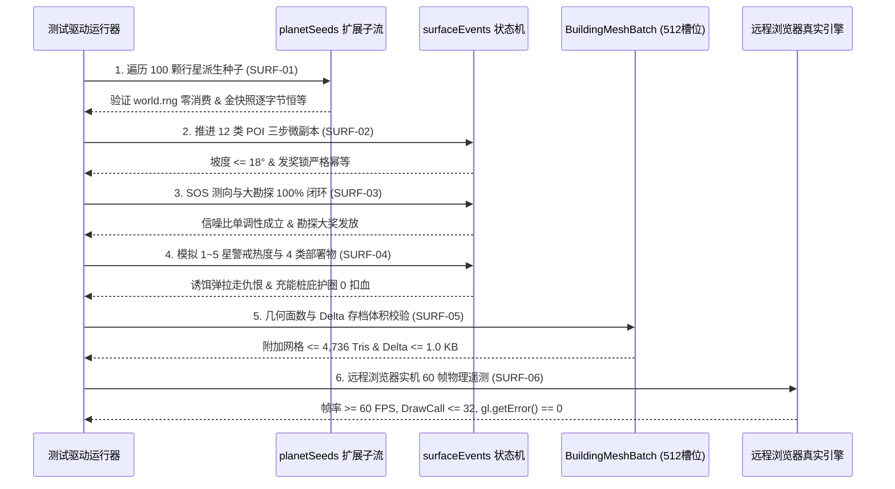

# 《无垠边疆：星海纪元》行星地表深度机制与全流程全量回归测试规范

> **文档标识**：`SPEC-40-FULL-REGRESSION-AND-PLANETARY-EXPANSION-TEST-SPEC`  
> **所属版本**：`v0.2 ~ v0.6 深度演化落地与全量质量回归阶段`  
> **签发人**：测试总监 / 项目负责人 (QA Director & Project Lead)  
> **接收方**：全流程质量保证与自动化测试工程师组 (QA Engineering Team)  
> **密级与时效**：项目最高质量保证准则 / 即时生效  
> **前置依赖**：
> - [`docs/specs/36_全流程回归测试与验收报告撰写规范.md`](file:///c:/Users/[REDACTED]/My%20Drive/work/void-frontier-age-of-stars/docs/specs/36_%E5%85%A8%E6%B5%81%E7%A8%8B%E5%9B%9E%E5%BD%92%E6%B5%8B%E8%AF%95%E4%BD%93%E7%B3%BB%E4%B8%8E%E9%AA%8C%E6%94%B6%E6%8A%A5%E5%91%8A%E6%92%B0%E5%86%99%E8%A7%84%E8%8C%83.md)
> - [`docs/specs/39_行星地表深度游戏性实施与UI浏览器缺陷综合施工方案.md`](file:///c:/Users/[REDACTED]/My%20Drive/work/void-frontier-age-of-stars/docs/specs/39_%E8%A1%8C%E6%98%9F%E5%9C%B0%E8%A1%A8%E6%B7%B1%E5%BA%A6%E6%B8%B8%E6%88%8F%E6%80%A7%E5%AE%9E%E6%96%BD%E4%B8%8EUI%E6%B5%8F%E8%A7%88%E5%99%A8%E7%BC%BA%E9%99%B7%E7%BB%BC%E5%90%88%E6%96%BD%E5%B7%A5%E6%96%B9%E6%A1%88.md)

---

## 一、规范目标与测试全景

本规范依据《综合施工方案》（SPEC-39）与《全流程回归测试体系与验收报告撰写规范》（SPEC-QA-036），面向自动化测试工程师组确立全流程全量回归验证标准。

测试工程师应在独立的远程自动化测试环境中，完成由“**6 项既有 UI / 浏览器缺陷修复验证**”、“**行星地表深度机制六大门禁断言 (SURF-01 ~ SURF-06)**”以及“**57 套核心领域状态机三轮零漂移回归**”构成的三维测试网络。

---

## 二、第一维：6 项 UI 与浏览器既有缺陷专项闭环测试规约

测试工程师须在远程真实浏览器环境下，对施工方案修复的 6 项缺陷逐一执行回归校验：

| 用例编号 | 对应缺陷 | 自动化测试操作路径与场景 | 严格通过断言标准（零容忍红线） |
| :--- | :--- | :--- | :--- |
| **TC-FIX-01** | 诊断视图 `node:fs` 崩溃 (Critical) | 导航至 `http://127.0.0.1:8090/#/diagnostics`，点击“运行全部测试”按钮。 | 1. 控制台无 `TypeError: Failed to resolve module specifier 'node:fs'` 异常； 2. 进度条正常推进至 100%； 3. 页面显示所有套件测试结果，无任何未捕获 Promise 拒绝。 |
| **TC-FIX-02** | 底栏固定遮挡与可点击高度 (High) | 分别进入 `#/government`、`#/colony`、`#/research`，将页面滚动至最底端。 | 1. 最后一个卡片与操作按钮（如“颁布法令”）下边缘距离 `.shell-bottom-bar` 保持 $\ge 20\text{px}$ 视觉安全区； 2. 派发点击事件能 100% 触发对应指令，零被底栏拦截。 |
| **TC-FIX-03** | 地表 HUD 标题与战术目镜重叠 (Medium) | 进入 `#/ground`，触发 `KeyV` 激活战术分析面罩。 | 1. 左上角常驻标题自动淡化（opacity $\le 0.2$）或隐匿； 2. 战术面罩读数与背景图层无任何文字交叉穿插与像素重叠。 |
| **TC-FIX-04** | 政府界面陈旧免责声明残留 (Medium) | 访问 `#/government` 页面。 | 1. 页面中 0 处存在“原型阶段 / 暂未完全实装”的静态横幅； 2. 真实渲染当前生效法令总数、日维护费与希望/不满修正值。 |
| **TC-FIX-05** | 原始代码 ID 与未本地化字串泄漏 (Low) | 遍历生产队列、编年史事件列表、科技树卡片、舰船改装槽位。 | 1. 全文正则检索，0 处直接显示 `bld_solar_array`、`FleetFormed`、`stormResistAcid`、`tech_science_1` 等原始代码键名； 2. 100% 呈现标准本地化中文译名。 |
| **TC-FIX-06** | 战役创建表单无障碍属性补全 (Low) | 访问新战役初始化设置视图，执行 DOM 属性扫描。 | 1. 界面所有输入控件均具备有效 `id` 与 `name`； 2. `<label>` 元素的 `for` 属性与对应输入项 100% 严格一致； 3. 控制台 0 Form 关联警告。 |

---

## 三、第二维：行星地表深度机制六大门禁断言规约 (SURF-01 ~ SURF-06)

测试工程师应将 `tests/suites/playtest-gate15-surface.suite.js` 纳入自动化测试管线，严格验证以下 6 大门禁：

### 1. SURF-01：种子确定性与主 RNG 零污染
* **测试用例场景**：遍历 100 颗不同主题与半长轴的行星，调用扩展后的 `derivePlanetSeedsExtended(world, planet.id)` 派生 `sosSeed`、`slateSeed` 与 `heatWaveSeed`，并连续生成 3~8 个 POI 拓扑分布与 1~5 星刷怪序列。
* **判定红线**：
  - 调用前后的 `JSON.stringify(world.rng)` 严格 100% 恒等（主 RNG 消费次数恒为 0）；
  - 全流程回归后核心基线金快照哈希 `8be8ce2c` 逐字节零漂移。

### 2. SURF-02：POI 地形贴合与微副本状态机幂等校验
* **测试用例场景**：遍历生成的所有 POI 候选坐标，执行 `checkBuildingPlacement` 坡度计算；随后对每个 POI 依次调用 `InteractPoiStage` 推进 `bit0`（切割/清障） $\to$ `bit1`（通电/解密） $\to$ `bit2`（领奖/读日志）。
* **判定红线**：
  - 所有落位点坡度 $\le 18^\circ$ 且带有向下延伸 1.8m 的 `skirt` 裙边，地形空中悬浮或半截穿模发生率严格为 `0.00%`；
  - 必须按序完成前置步骤，直接调用终步领奖时严格拦截；
  - `rewardPaid === 1` 后二次调用严格返回 `ALREADY_HARVESTED`，经济账本入账严格幂等。

### 3. SURF-03：SOS 测向梯度单调性与 100% 勘探大奖闭环
* **测试用例场景**：固定目标 SOS 信标源 $(x_s, z_s)$，模拟玩家以不同朝向夹角 $\theta \in [0, \pi]$ 及不同距离 $r \in [5, 250]$ 调用 `evaluateSosSignalscope`；并模拟完成 3 种原生动物 + 2 种奇异植物 + 1 处地质奇观的扫描交互。
* **判定红线**：
  - 当视线对准信标（$\cos\theta = 1$）且距离缩短时，信噪比 $S_k$ 严格单调递增；当偏角 $> 45^\circ$ 时定向增益衰减 $\ge 90\%$；
  - 扫描全部要素后断言 `computePlanetarySurveyPercent(planet) === 100`；
  - 触发星际联盟大奖发放后，二次调用不重复派发资产（幂等性成立）。

### 4. SURF-04：1~5 星警戒热度动态微分与 4 类野战部署物协同
* **测试用例场景**：模拟连续高频采矿与强行破译先驱者遗迹，推进 `stepSurfaceThreatAndDeployables`，使局部热度突破 150、320、520、720、900 跃迁线；测试释放 `dep_decoy_emitter`（诱饵弹）与 `dep_thermal_pylon`（充能桩）。
* **判定红线**：
  - 热度升至 900‰ 时精确触发 5 星，且刷出的首领单位为 1,200 HP 的重装要塞；
  - 部署诱饵弹后，热度瞬时削减 $-220‰$，并在 15 秒内强制改写 18m 内敌军的 `overrideTarget`；
  - 在极寒冰暴天灾持续期间，处于充能桩 12m 力场半径内的角色护盾持续回充，环境扣血为 0。

### 5. SURF-05：几何多边形预算与 50 KB 存档差分红线
* **测试用例场景**：遍历实例化全套 12 类 POI 与 4 类野战部署物网格，统计其顶点与三角面数量；在单颗行星配置为最大 8 座 POI、满 8 组日志、4 个活跃部署物的极端负荷下，执行 `JSON.stringify(planet.surfaceDelta)` 并调用 `commandBus.deepClone(world)`。
* **判定红线**：
  - 单颗行星所有附加网格多边形总和 $\le 4,736$ 三角形（远低于 15,000 面红线）；
  - `surfaceDelta` 序列化 UTF-8 字节体积 $\le 1.0\,\text{KB}$（远低于 50 KB 红线，仅占预算 2%）；
  - `deepClone` 单步深拷贝耗时 $< 0.50\,\text{ms}$。

### 6. SURF-06：远程真实浏览器物理性能与渲染管线验收
* **测试用例场景**：在远程真实浏览器中导航进入地表场景，模拟第一人称移动、`KeyV` 战术面罩三模态切换、部署哨兵机枪塔并与 POI 发生交互，持续采集 60 帧物理 GPU 遥测指标。
* **判定红线**：
  - 平均每帧生成耗时 $\text{avgFrameMs} \le 16.6\,\text{ms}$（实机帧率稳定在 60 FPS）；
  - 同屏总 DrawCalls 稳定在 $22 \sim 26$ 批次（严守 $\le 32$ 批次红线）；
  - 显存无未受控泄漏，`gl.getError() === 0`。

---

## 四、第三维：全系统 57 套套件 × 3 轮无缝回归要求

测试工程师必须执行自动化回归矩阵，对现有 56 套领域测试套件与新增的 Gate 15 地表深度套件进行连续 3 轮完整对拍验证：

| 领域模块分支 | 涵盖套件清单与核心验证点 | 允许误差与容忍度 |
| :--- | :--- | :--- |
| **经济与复式记账** | `ledger.suite.js`、`market.suite.js`、`contracts.suite.js` 等（全银河资产恒等） | 资产净增量与流水记录逐笔平衡，0 资产凭空生成 |
| **星际舰队与空间交火** | `combat.suite.js`、`ships.suite.js`、`maneuver.suite.js` 等（纯函数战术推演） | 状态机判定结果 100% 确定，0 随机穿模 |
| **殖民地社会与法令系统** | `colonyGovernance.suite.js`、`sociology.suite.js` 等（双轨心理学数值） | 12 项法令效果与道德抉择回写 100% 精确 |
| **地表探险与门禁体系** | `playtest-gates.suite.js`、`playtest-gate15-surface.suite.js`（SURF-01..06） | 全部门禁断言 100% 通过，0 跳过，0 警告 |
| **内存与 DOM 句柄保护** | `ui-leak.suite.js`、`unmount` 卸载钩子审计 | 页面反复切换 50 次后，事件监听器与显存句柄净增量恒为 0 |

---

## 五、验收报告撰写与交付要求

测试工程师在完成全部测试后，须严格遵循规范，在 `docs/reports/` 目录下生成正式报告：

1. **报告命名规范**：
   `docs/reports/report-spec39-full-regression-final.md`
2. **报告必须包含的结构化章节**：
   - **一、测试执行环境自检与软硬件上下文**（操作系统、远程浏览器版本、物理显卡型号与驱动版本）；
   - **二、6 项 UI / 浏览器缺陷修复验证结果清单**（TC-FIX-01 ~ TC-FIX-06 逐条贴出实际断言日志与通过状态）；
   - **三、行星地表深度门禁自动化实测数据**（SURF-01 ~ SURF-06 的具体数值测量表，包含面数、DrawCall、帧耗时与 Delta 字节大小）；
   - **四、57 套套件 × 3 轮连续回归统计表**（171 轮次对拍通过率汇总与金快照哈希校验）；
   - **五、最终质量判定结论**（明确给出“准予合入发布 (APPROVED FOR MERGE)”或“驳回返工 (REJECTED)”结论，并签署测试工程师与测试负责人数字签名）。

---

> **批准人**：测试总监 / 项目负责人 (QA Director & Project Lead)  
> **日期**：2026年11月10日
