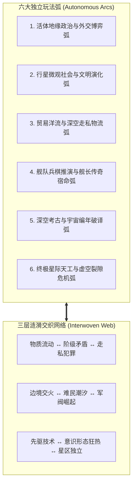
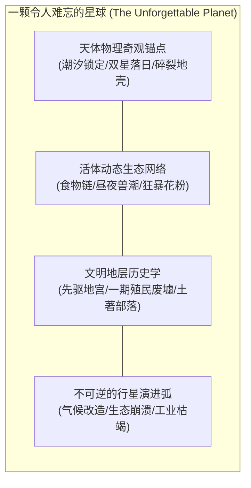
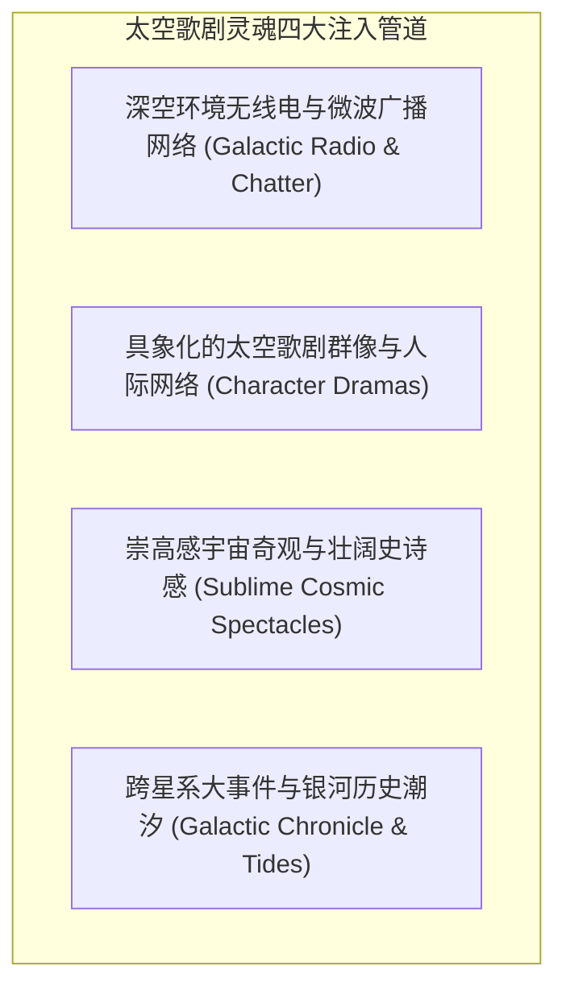

# 《无垠边疆：星海纪元》次世代宏伟太空歌剧与多系统交织演化领域专家任务委托书

> **文档标识**：`SPEC-41-NEXT-GEN-SPACE-OPERA-AND-INTERWOVEN-SYSTEMS-MANDATE`  
> **所属版本**：`v1.0+ 次世代商业级系统升维与宏大内容演化预研阶段`  
> **签发人**：项目负责人 (Project Lead)  
> **接收方**：系统策划、叙事世界观、太空歌剧与生态微模拟领域专家组 (Domain Experts in Gameplay Systems, Narrative, Space Opera & World Simulation)  
> **密级与时效**：项目核心演化战略最高优先级 / 即时生效  
> **前置依赖**：
> - [`docs/specs/35_无垠边疆超长线内容与机制创新综合施工计划.md`](file:///c:/Users/[REDACTED]/My%20Drive/work/void-frontier-age-of-stars/docs/specs/35_%E6%97%A0%E5%9E%A0%E8%BE%B9%E7%96%86%E8%B6%85%E9%95%BF%E7%BA%BF%E5%86%85%E5%AE%B9%E4%B8%8E%E6%9C%BA%E5%88%B6%E5%88%9B%E6%96%BD%E5%B7%A5%E7%BB%BC%E5%90%88%E6%96%BD%E5%B7%A5%E8%AE%A1%E5%88%92.md)
> - [`docs/specs/38_行星地表深度游戏性与剧情叙事领域专家调研报告.md`](file:///c:/Users/[REDACTED]/My%20Drive/work/void-frontier-age-of-stars/docs/specs/38_%E8%A1%8C%E6%98%9F%E5%9C%B0%E8%A1%A8%E6%B7%B1%E5%BA%A6%E6%B8%B8%E6%88%8F%E6%80%A7%E4%B8%8E%E5%89%A7%E6%83%85%E5%8F%99%E4%BA%8B%E9%A2%86%E5%9F%9F%E4%B8%93%E5%AE%B6%E8%B0%83%E7%A0%94%E6%8A%A5%E5%91%8A.md)
> - [`docs/specs/39_行星地表深度游戏性实施与UI浏览器缺陷综合施工方案.md`](file:///c:/Users/[REDACTED]/My%20Drive/work/void-frontier-age-of-stars/docs/specs/39_%E8%A1%8C%E6%98%9F%E5%9C%B0%E8%A1%A8%E6%B7%B1%E5%BA%A6%E6%B8%B8%E6%88%8F%E6%80%A7%E5%AE%9E%E6%96%BD%E4%B8%8EUI%E6%B5%8F%E8%A7%88%E5%99%A8%E7%BC%BA%E9%99%B7%E7%BB%BC%E5%90%88%E6%96%BD%E5%B7%A5%E6%96%B9%E6%A1%88.md)  
> **后续交付文件标号**：[`docs/specs/42_次世代宏伟太空歌剧与多系统交织演化领域专家调研与架构方案.md`](file:///c:/Users/[REDACTED]/My%20Drive/work/void-frontier-age-of-stars/docs/specs/42_%E6%AC%A1%E4%B8%96%E4%BB%A3%E5%AE%8F%E4%BC%9F%E5%A4%AA%E7%A9%BA%E6%AD%8C%E5%89%A7%E4%B8%8E%E5%A4%9A%E7%B3%BB%E7%BB%9F%E4%BA%A4%E7%BB%87%E6%BC%94%E5%84%BF%E9%A2%86%E5%9F%9F%E4%B8%93%E5%AE%B6%E8%B0%83%E7%A0%94%E4%B8%8E%E6%9E%B6%E6%9E%84%E6%96%B9%E6%A1%88.md)

---

## 一、破局宣言：从“技术原型 Demo”跨越至“商业级太空歌剧”

截至 SPEC-40 竣工收口，本项目已在底层筑牢了坚不可摧的工程地基：66 套自动化套件 100% 确定性全绿、金快照 `8be8ce2c` 逐字节零漂移、真机物理显卡稳定 60 FPS / 19 批 DrawCall，以及 16 个屏幕视图与行星地表三模态探索的基本串联。

**然而，我们必须直面残酷的客观现实：目前的《无垠边疆》在“游戏系统 (Gameplay System)”与“内容厚度”上，比起真正的商业级优秀作品——不用说 3A，连成熟的独立游戏（如《群星 / Stellaris》、《无尽空间 2 / Endless Space 2》、《星际拓荒 / Outer Wilds》、《大航海时代 / Starsector》、《沙丘：香料战争 / Dune: Spice Wars》、《环世界 / RimWorld》）——都相距甚远。当前的版本，本质上仍然只是一个技术骨架完备但血肉极度匮乏的“高阶 Demo”。**

核心体验断层集中表现在三大命门：
1. **系统孤岛与扁平数值 (Siloed Systems & Flat Numbers)**：现有的经济、战斗、政治、科研模块更像是彼此割裂的数值计算器，缺乏自身饱满的“玩法弧（Gameplay Arc）”，系统之间缺乏相互交织的涟漪与涌现效应。
2. **行星高度重复与探索疲态 (Planetary Homogeneity)**：即便拥有 18 类主题与随机种子，玩家在降落第 3 颗星球后依然会感到“数学算法上的不同，体验上的完全一致”。缺乏不可替代的行星灵魂与持续的内容演进，重复度正在成为扼杀探索欲望的致命毒药。
3. **深空死寂与情感孤独 (Cosmic Desolation vs. Space Opera)**：
   > **“星际是孤独的，但星际游戏不能让人感到孤独，那将是宏伟的太空歌剧。”**  
   当前的银河冰冷而沉默，缺乏万千文明喘息碰撞的喧嚣、缺乏有血有肉的人物命运抉择、缺乏深空电波的交头接耳、缺乏星际风云变幻的波澜壮阔。

为此，项目负责人正式向领域专家组签发本任务委托书，**要求全面对标世界级太空与策略经典，为《无垠边疆》彻底打破系统单薄、粉碎星球重复、注入太空歌剧灵魂，规划出一套次世代商业级演化与内容大爆发的蓝图方案**。

---

## 二、第一支柱：具有独立玩法弧 (Arc) 且相互交织交响的游戏系统体系

系统绝不能是单一的“点击即产生资源”的静态数值灌水，每个独立子系统都必须是一段完整的“英雄之旅 / 发展史诗”，并且通过“蝴蝶效应网络”交织锁死。



### 1. 独立玩法弧设计准则 (The Arc Doctrine)
专家组必须为游戏内的每一个核心玩法系统，设计从初露锋芒到终局超维的完整四幕发展弧：
* **第一幕：初遇与启动 (Initiation)**：低门槛、强反馈的微观切入点；
* **第二幕：抉择与分化 (Differentiation)**：不可兼得的分支路线，逼迫玩家确立战略流派；
* **第三幕：摩擦与危机 (Crisis & Friction)**：系统内生矛盾爆发（如经济过热引发通胀恶疾、军事扩张引发军阀干政、生态开发引发异星盖亚逆袭）；
* **第四幕：蜕变与终极奇迹 (Transcendence)**：突破系统极限，形成颠覆全局的终极战略杠杆。

### 2. 六大核心系统独立弧构想与交织矩阵
专家组须重点攻坚并推演以下六大系统的交互闭环：

| 游戏系统 | 自身的独立发展玩法弧 (Arc) | 与其它系统的交织渗透点 (Interweaving Web) | 对标作品 |
| :--- | :--- | :--- | :--- |
| **地缘政治与活体派系** | 从边境摩擦中立国，到组建星区互保同盟、操控银河高峰会议议案，直至发动全银河意识形态圣战。 | 政治禁运直接切断贸易物流洋流；政党政变直接改变行星法令与民意满意度；边境划界引发局部舰队交火。 | 《群星》(Stellaris)、《沙丘：香料战争》 |
| **行星微观社会与阶级** | 从几个破败的生铁开拓舱，到分化出资本寡头、学者行会、异星狂热信徒与地下工会，直至爆发全面社会大革命或飞升为乌托邦。 | 阶级不满度激增直接向走私黑市输送海盗雇佣兵；激进法令引发母星与殖民地之间的独立战争危机。 | 《极乐迪斯科》、《冰汽时代》(Frostpunk)、《维多利亚 3》 |
| **星际贸易与工业物流** | 从单船跑商套利，到构建跨星系自动化深空货船航线、操控母星大宗商品期货、垄断稀缺战略同位素。 | 贸易航线直接在 3D 空间生成实体运输船队，成为海盗与交战国掠夺的靶子；商品断供引发殖民地生产停摆。 | 《X4：基石》(X4: Foundations)、《自由枪骑兵》 |
| **舰队宿命与传奇舰长** | 舰长具备忠诚、野心、特质与人际关系网；舰船经历百战拥有专属荣誉舰名与战损伤痕；提督功高震主可自立为王。 | 战役残骸形成物理垃圾场吸引拾荒者；战死名将引发母星国葬与极端复仇民意；提督叛变直接拉走整支王牌舰队。 | 《星际动力 / Starsector》、《远行星号》 |
| **深空考古与因果律破译** | 循着微弱电波拼凑失落文明的 32 词根语素；逆向工程高维神殿；在时间闭环与因果悖论中选择文明起源。 | 考古出土的史前禁忌科技可能引发宗教派系联合绝交制裁；强行激活先驱者装置直接引来全银河公敌危机。 | 《星际拓荒》(Outer Wilds)、《Sunless Skies》 |
| **星际天工与虚空裂隙** | 从修建近地轨道太空电梯，到吞噬恒星的戴森云矩阵、物质折叠星门，直面高维虚空吞噬者的终局侵蚀。 | 巨构建设抽干数个星系的工业产能与稀土；人造奇观成为全银河旅游圣地与朝圣中枢，大幅提升外交发言权。 | 《群星：天工天灾》(Megastructures & Crisis) |

---

## 三、第二支柱：粉碎千篇一律——行星千星千面与持续内容演进工程

“宇宙是广袤的，但不能由枯燥的柏林噪声拼凑而成。”专家组须提出一套**兼顾程序化生成规模与手工定制叙事灵魂**的“活体星球体系”，让每一颗值得落地的行星都拥有独一无二的性格、历史与生态记忆。



### 1. 行星三维灵魂锚点 (Three-Dimensional Planetary Identity)
拒绝“高度图不同但玩起来全一样”的弊病，确立每颗行星的**独特性生成法则**：
* **维度一：极端天体物理奇观 (Astrophysical Wonders)**：
  - 例如：**潮汐锁定的暮光之星**（向阳面熔岩火海、背阳面绝对零度冰原，唯一文明聚落聚集在只有 8 公里宽的晨昏圈狭窄绿带）；
  - 例如：**被撕裂的碎环死月**（低重力、频繁流星暴击、地底隐藏着庞大的真空结晶溶洞）；
  - 例如：**双黑洞潮汐下的引力褶皱星**（时间流速微观畸变，科研产出翻倍但机械磨损极快）。
* **维度二：活体食物链与生态动态演进 (Living Ecosystem & Food Webs)**：
  - 生物不再是圆周漫游的假人，拥有捕食、筑巢、群落迁徙、季节冬眠等生态树；
  - 玩家的过度采伐或排污会打破生态平衡，导致原生超级捕食者异化反噬，或引发全球性生化枯萎病。
* **维度三：人类与先驱者历史地层学 (Historical Stratification)**：
  - 呈现多层时间沉淀：
    - 最底层：百万年前先驱者超维遗迹；
    - 中间层：三百年前人类第一次拓荒浪潮留下的生锈废弃反应堆与遇难者墓地；
    - 表层：当下各方势力私设的走私补给站、盗采矿坑与秘密生化实验室。

### 2. 行星的生命周期与动态演化 (Planetary Dynamic Lifecycle)
一颗行星不是静态的关卡，它随游戏进程时刻改变：
* **地貌改造 (Terraforming)**：玩家或 AI 可引爆极地冰盖、释放工程细菌，让红色荒原逐步染成苍翠湿地；
* **生态枯竭与废土化**：过度滥采将星球化为毒雾废土；
* **地表城市化与微观景观变迁**：随着殖民人口从数千人攀升至数亿，地表点状前哨演进为连绵的赛博朋克大都市与轨道环带，夜间灯火从太空清晰可见。

---

## 四、第三支柱：驱散深空孤独感——宏伟的太空歌剧与人文微光

“星际是孤独的，但星际游戏不能让人感到孤独，那将是宏伟的太空歌剧。”专家组须构想如何让玩家在冰冷的星海中，感受到银河万千生灵的呼吸、喜怒哀乐与史诗命运。



### 1. 全频段环境无线电与深空微波广播网络 (Galactic Radio & Ambient Chatter)
* **宇宙不应是死寂的静音房**：
  - 当飞船进入星系轨道或低空掠过地表时，车载电台与目镜可截获全频段的广播电波；
  - **银河全息新闻通讯社**：播报邻近星区的战争动向、领袖演讲、股市涨跌与奇异异象探索；
  - **民用频段生活杂谈**：长途货船水手的吉他弹唱、探险家的私人电台、黑市走私商的暗号接头、甚至是受困飞船断断续续的悲壮遗书；
  - **异星低语与先驱者宇宙背景辐射**：在未知星域深处，耳机里传来令人战栗又着迷的史前数学乐章。

### 2. 具象化的太空歌剧群像戏 (Living Characters & Human Drama)
* **告别毫无个性的冰冷 NPC 工具人**：
  - 设立 **领袖、总督、将军、传奇舰长、反抗军领袖与流放科学家** 的群像谱系；
  - 每个人物拥有性格（孤傲、理想主义、残忍、贪婪）、人际羁绊（师徒、仇敌、暗恋、家族世仇）与动态野心；
  - 产生经典太空歌剧式的戏剧性事件：老将为掩护舰队跃迁而战死孤舰、忠诚的总督为保护受感染民众而拒绝首都清洗令、野心勃勃的提督在边境拥兵自重发起军阀政变。

### 3. 崇高感宇宙奇观与文明悲歌 (Sublime Wonder & Melancholy)
* **唤醒玩家心中对浩瀚星空的敬畏与深情**：
  - 穿过绚烂夺目的超新星遗迹星云、凝视吸积盘翻滚着炽烈等离子体的巨型黑洞、见证环绕恒星运转的古老星环；
  - 挖掘那些湮灭在星尘中的伟大文明：他们的宏伟理想为何破灭？他们的后裔沦为了怎样的流浪星民？玩家在继承其遗志或掠夺其遗产时，承受直击心灵的哲学拷问。

---

## 五、底层架构护栏与 WebGL 确定性实现边界

太空歌剧的宏伟构想绝不意味着无节制的技术空想。专家组提出的所有系统与机制，必须严格根植于《无垠边疆》现有的技术基底之上：

```
[工程实施可行性铁律]
1. 确定性第一原理：
   - 所有的动态派系决策、阶级演变、气候推演与人物生成，必须由统一的战略时钟与伪随机种子确定性推进。
   - 保证多端重放、回放测试与存读档绝对无漂移。

2. 纯前端轻量化与 WebGL 渲染边界：
   - 宏大叙事与系统深度主要依托于“数据驱动的状态机、拓扑 DAG、文字事件图网、矢量化 UI 与程序化着色器”。
   - 严禁提出脱离轻量级 3D 渲染实际的超大规模高模动画幻想；充分利用 InstancedMesh、局部 SDF、2D 全息视窗与 Web Audio 营造电影级沉浸感。

3. 每帧性能与计算预算：
   - 单逻辑帧推演耗时 <= 4ms，单星地表渲染 DrawCall 严守 <= 32 批次，全星系模拟内存增量严格受控。
```

---

## 六、交付成果与评审规范

专家组应在深入解构国内外经典太空科幻作品与顶级独立游戏后，形成正式调研与方案成果：

1. **交付文档标号与路径**：
   [`docs/specs/42_次世代宏伟太空歌剧与多系统交织演化领域专家调研与架构方案.md`](file:///c:/Users/[REDACTED]/My%20Drive/work/void-frontier-age-of-stars/docs/specs/42_%E6%AC%A1%E4%B8%96%E4%BB%A3%E5%AE%8F%E4%BC%9F%E5%A4%AA%E7%A9%BA%E6%AD%8C%E5%89%A7%E4%B8%8E%E5%A4%9A%E7%B3%BB%E7%BB%9F%E4%BA%A4%E7%BB%87%E6%BC%94%E5%84%BF%E9%A2%86%E5%9F%9F%E4%B8%93%E5%AE%B6%E8%B0%83%E7%A0%94%E4%B8%8E%E6%9E%B6%E6%9E%84%E6%96%B9%E6%A1%88.md)
2. **报告必须包含的六大核心板块**：
   - **板块一：商业级太空标杆深度解构**（对比《群星》、《星际动力》、《星际拓荒》、《无尽空间 2》、《沙丘》等 5 部作品的系统深度与交织网络，提炼 10 条黄金设计法则）；
   - **板块二：六大独立系统玩法弧 (Arc) 规格书与三层交织涟漪数学模型**（包含伪代码状态机与跨模块调用契约）；
   - **板块三：行星“千星千面”反重复度生成范式与动态演化工程**（提供 18 类主题下的唯一定位奇观、生态演化模型与地层历史系统设计）；
   - **板块四：太空歌剧驱散孤独感体系**（包含深空全频段广播系统架构、群像戏关系网络模型、宇宙奇观呈现方案及 10 幕史诗叙事样本）；
   - **板块五：轻量级确定性工程落地与性能折算方案**（如何以最低的算力与渲染开销实现最高的情感与玩法杠杆）；
   - **板块六：演化阶段排期建议 (Milestone Roadmap)**（从 Demo 跃升至 Commercial Indie 的分步实施路线图）。

---

> **签发人**：项目负责人 (Project Lead)  
> **日期**：2026年11月11日
