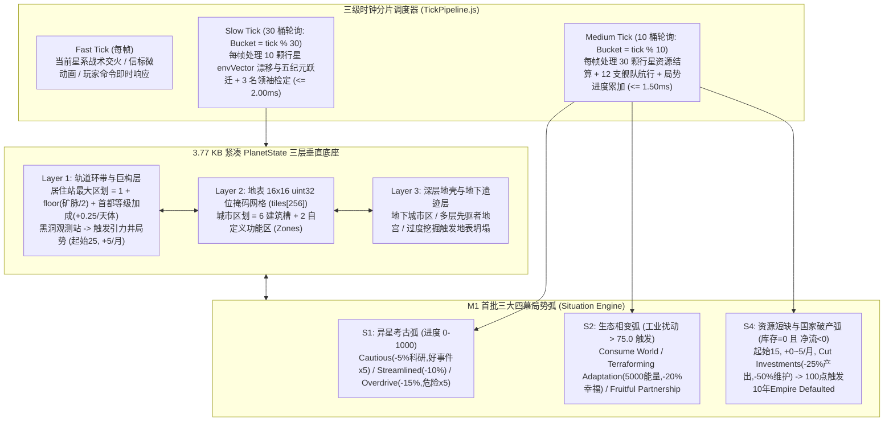

# 《无垠边疆：星海纪元》阶段一（M1）：局势弧线引擎与紧凑行星三维底座 SuperPower 施工文档

> **文档编号**：`SPEC-PLAN-044`（Phase 1 / Milestone 1 执行卷）
> **归属工程**：《无垠边疆：星海纪元》（`void-frontier-age-of-stars`）
> **前置依赖**：`SPEC-PLAN-043`（总控架构契约与多工位并行 SuperPower 施工总纲）
> **阶段工期**：3–4 周
> **投入工位**：Eng-A（内核与行星底座）、Eng-B（局势弧线与经济生态）、Eng-D（ViewModels 与 `GATE-15-M1` 门禁）
> **方法论标准**：`SuperPower` 工程实施范式（Mandatory `Plan` + `Tasks` + `Checklists` 三段式闭环）

## 一、Plan（阶段一架构蓝图与技术指标）

### 1.1 阶段一核心使命

阶段一（M1）致力于打造整个太空歌剧架构的**两大物理支柱**：
1. **紧凑型活体行星三维底座（Compact `PlanetState`）**：以单星 **`3,857 Bytes`（`3.77 KB`）** 的极致紧凑内存布局（远低于 `50.00 KB` 预算上限），实现“近地轨道与环带巨构（Layer 1）—地表 `16×16` 32位掩码网格与城市功能区（Layer 2）—深层地壳与先驱者地宫（Layer 3）”三层垂直耦合、8 维连续环境相空间向量 `envVector[8]` 以及五纪元（Epoch `0–4`）不可逆历史演化。
2. **三级时钟分片调度器与通用四幕局势引擎（Generalized 4-Act `Situation` Engine）**：将全银河计算拆分为 Fast Tick（每帧）、Medium Tick（10 桶分片，`30 星 + 12 舰队/帧`）与 Slow Tick（30 桶分片，`10 星 + 3 领袖/帧`），并在其上首批落地 **`S1` 深空探索与异星考古弧**、**`S2` 行星深层开采与生态相变弧**、**`S4` 星际宏观经济、奇异工业与断供违约弧**。

### 1.2 阶段一架构数据流图



## 二、Tasks（阶段一原子化施工任务拆解）

### Task 1.1：实现 `3.77 KB` 紧凑 `PlanetState`、256-Tile `uint32` 位段编码与三层垂直空间（责任人：Eng-A）

* **目标文件路径**：`src/domain/planets/planetStateSchema.js`
* **核心规格与位段契约（Bitfield Specification）**：
  1. **地表网格 `tiles[256]`（`16 × 16`）**：每个格点严格使用 1 个无符号 32 位整数（`uint32`）编码全部静态与动态属性，严禁将单个 Tile 膨胀为嵌套 JavaScript 对象：

| 位段区间 (Bits) | 位宽 | 字段名称 (`Field`) | 掩码与移位表达式 (`Unpack Expression`) | 数值语义定义 |
| :--- | :--- | :--- | :--- | :--- |
| **Bits `0–3`** | 4 bits | `biomeId`（基础地形与群落） | `tile & 0x0F` | `0`: 荒芜岩床, `1`: 硅酸盐荒漠, `2`: 温带森林, `3`: 远古海洋, `4`: 极地冰盖, `5`: 火山玄武岩, `6`: 剧毒沼泽, `7`: 水晶平原, `8`: 菌丝温床, `9`: 机械废墟地壳, `10`: 晨昏绿带, `11`: 辐射焦土, `12`: 沉没裂谷, `13`: 理想城装甲甲板, `14`: 虚空侵蚀地貌, `15`: 坍塌深渊 |
| **Bits `4–7`** | 4 bits | `elevation`（海拔与裂谷深度） | `(tile >>> 4) & 0x0F` | `0–3`: 深海/深渊裂谷, `4–7`: 平原盆地, `8–11`: 高原山脉, `12–15`: 极高耸绝壁/火山锥 |
| **Bits `8–11`** | 4 bits | `hazardLevel`（辐射与毒性强度） | `(tile >>> 8) & 0x0F` | `0`: 安全无害, `1–5`: 轻度环境摩擦, `6–10`: 中度辐射/酸雾, `11–15`: 致命极端灾害区 |
| **Bits `12–15`** | 4 bits | `depositCode`（矿脉类型与丰度） | `(tile >>> 12) & 0x0F` | 高 2 位为类型（`0`: 矿物, `1`: 能量, `2`: 奇异暗质/水晶, `3`: 先驱者纳米/遗物），低 2 位为丰度等级（`0–3` 对应产出倍率 `0×, 1×, 2×, 4×`） |
| **Bits `16–21`** | 6 bits | `buildingId`（地表建筑与区划 ID） | `(tile >>> 16) & 0x3F` | `0`: 空置, `1–15`: 基础采集区划, `16–31`: 城市功能区建筑, `32–47`: 奇异工业设施（纳米锻炉/同步加速器等）, `48–63`: 先驱者奇观与防御工事 |
| **Bits `22–25`** | 4 bits | `overlayId`（动态覆盖层状态） | `(tile >>> 22) & 0x0F` | `0`: 无覆盖, `1`: 活跃共生菌丝网, `2`: 喷发熔岩流, `3`: 极寒冰封推进带, `4`: 复苏先驱者晶格, `5`: 索林虫族菌毯, `6`: 工业毒雾沉降, `7`: 地下坍塌坑洞 |
| **Bits `26–31`** | 6 bits | `statusFlags`（6 位布尔状态标志） | `(tile >>> 26) & 0x3F` | Bit 26 (`0x01`): 已勘探 (`SURVEYED`), Bit 27 (`0x02`): 存在活跃异象 (`ANOMALY_ACTIVE`), Bit 28 (`0x04`): 行星护盾覆盖 (`SHIELDED`), Bit 29 (`0x08`): 干线物流连通 (`ROAD_LINKED`), Bit 30 (`0x10`): 处于活跃演化前沿 (`FRONTIER_ACTIVE`), Bit 31 (`0x20`): 遭轨道轰炸损毁 (`DEVASTATED`) |

  2. **8 维连续环境相空间向量 `envVector[8]`**（每個分量范围 `[0.0, 100.0]`）：
     - `envVector[0]`：`TectonicStress`（地质构造应力，受深层采矿与引爆冰盖推高）
     - `envVector[1]`：`AtmosphericToxicity`（大气毒性浓度，受重工业排放推高）
     - `envVector[2]`：`BiosphereMutation`（生物圈异变指数，控制原生生物狂暴与菌丝扩张）
     - `envVector[3]`：`PrecursorResonance`（先驱者遗迹谐振度，由考古发掘激活）
     - `envVector[4]`：`MagnetosphereDecay`（磁层衰减率，高值引发全球磁暴与科研中断）
     - `envVector[5]`：`ThermalAnomaly`（热力学异常指数，决定冰封或熔岩化方向）
     - `envVector[6]`：`HydrosphereLevel`（水圈液态丰度，影响农业与生态共生对策）
     - `envVector[7]`：`IndustrialPerturbation`（工业扰动度，初始基线 `15.0`；`> 40.0` 触发局部环境事件；`> 75.0` 强制触发 `S2` 行星环境恶化局势）
  3. **五纪元不可逆历史演进状态机 `epochStage`（`0–4`）与 `historyRing[8]`**：
     - `0`（Pristine 原始纪元）：未扰动自然演化态；
     - `1`（Surveyed & Decoded 初探破译纪元）：完成轨道与地表扫描，揭示 `archetypeId` 与初始 4 个多阶段叙事地标（`poiSlots[4]`）；
     - `2`（Exploited & Friction 开发与摩擦纪元）：殖民地建立，`envVector[8]` 随月度 Slow Tick 漂移；
     - `3`（Transformed / Awakened 奇观蜕变与觉醒纪元）：`S1`/`S2` 局势收官，星球不可逆转变为理想城（Arcology）、共生菌丝母星（Hive World）、熔岩锻炉星（Volcanic World）或巨兽孵化温床；
     - `4`（Legacy Epoch 史诗遗产纪元）：经历天灾清洗、内战独立或飞升洗礼，镌刻进 `historyRing[8]`（每槽位 `[tick, eventTypeId, actorFactionId, impactCode]` 四元整型数组）。
  4. **三层垂直空间耦合公式**：
     - **Layer 1（近地轨道与环带巨构 `orbitalLayer`）**：
       - 轨道居住站（Habitat）在开发矿脉上建造主轨道站（Major Orbitals）时，提供的最大区划数公式：
         $$\text{MaxDistricts}_{\text{orbital}} = 1 + \left\lfloor \frac{\text{DepositSize}}{2} \right\rfloor + \Delta_{\text{capital}}$$
         其中 $\Delta_{\text{capital}}$ 根据居住站首都建筑等级（Level `1–3`），星系内每颗行星/恒星天体额外提供 `+0.25 / +0.50 / +0.75` 区划上限（向下取整结算）。
       - 若在黑洞天体轨道建造“黑洞观测站（Black Hole Observatory）”，由于过度逼近事件视界，立即自动调用 `spawnSituation` 触发 **“逼近引力井（Approaching the Gravity Well）”** 局势：初始进度 `25`，基础月增长率 `+5 / 月`，进度归 `0`（安全撤离加固）或达 `100`（视界坍缩吞噬观测站或突破奇点物理）时终结。
     - **Layer 2（地表城市区划自定义功能区 `urbanZones`）**：
       - 每个城市区划（Urban District）固定提供 `6` 个通用建筑槽位 + `2` 个可自定义功能区槽位（`zoneSlots[2]`，可选：`1` 档案馆科技与凝聚力区、`2` 重工合金精炼区、`3` 商业贸易港与舒适度区、`4` 堡垒防御与治安区）。
     - **Layer 3（深层地壳 `subterraneanLayer`）**：
       - 包含 `depthTier`（`0–3`）、地下城市扩展槽 `subUrbanSlots[4]`、先驱者地宫层数与采掘应力计数 `excavationStress`。当 `excavationStress > 80` 且 `envVector[0] > 70` 时，月度检定触发地表边缘 Tile 坍塌为深渊（`biomeId = 15`, `overlayId = 7`）或涌出地幔熔岩（`overlayId = 2`）。

* **核心数据结构代码实现契约**：

```javascript
// src/domain/planets/planetStateSchema.js

export function packTile({
  biomeId = 0,
  elevation = 4,
  hazardLevel = 0,
  depositCode = 0,
  buildingId = 0,
  overlayId = 0,
  statusFlags = 0
}) {
  return (
    ((biomeId & 0x0F) |
    ((elevation & 0x0F) << 4) |
    ((hazardLevel & 0x0F) << 8) |
    ((depositCode & 0x0F) << 12) |
    ((buildingId & 0x3F) << 16) |
    ((overlayId & 0x0F) << 22) |
    ((statusFlags & 0x3F) << 26)) >>> 0
  );
}

export function unpackTile(tileUint32) {
  const t = tileUint32 >>> 0;
  return {
    biomeId: t & 0x0F,
    elevation: (t >>> 4) & 0x0F,
    hazardLevel: (t >>> 8) & 0x0F,
    depositCode: (t >>> 12) & 0x0F,
    buildingId: (t >>> 16) & 0x3F,
    overlayId: (t >>> 22) & 0x0F,
    statusFlags: (t >>> 26) & 0x3F
  };
}

export function createCompactPlanetState(planetId, systemId, archetypeId, worldSeed) {
  return {
    id: planetId | 0,
    systemId: systemId | 0,
    archetypeId: (archetypeId & 0x0F) | 0, // 0 ~ 15
    epochStage: 0,                         // 0 ~ 4 五纪元状态
    frontierMask: [0, 0, 0, 0, 0, 0, 0, 0], // 8 x uint32 = 256-bit 稀疏前沿掩码
    envVector: [18.0, 8.0, 12.0, 5.0, 10.0, 20.0, 55.0, 15.0], // 8D 环境相空间向量 (IndustrialPerturbation = 15.0)
    tiles: new Array(256).fill(0),         // 256 x uint32 紧凑地表网格
    orbitalLayer: {
      majorOrbitals: 0,
      capitalLevel: 1,
      hasBlackHoleObservatory: false,
      maxOrbitalDistricts: 1,
      facilities: [0, 0, 0, 0, 0, 0, 0, 0] // 8 轨道设施槽
    },
    urbanZones: {
      buildingSlots: [0, 0, 0, 0, 0, 0],   // 6 通用建筑槽
      zoneSlots: [0, 0]                    // 2 自定义功能区 (Archives / HeavyIndustry / Trade / Fortress)
    },
    subterraneanLayer: {
      depthTier: 0,
      excavationStress: 0.0,
      subUrbanSlots: [0, 0, 0, 0],
      vaultUnlockedMask: 0
    },
    poiSlots: [
      [0, 0, 0, 0], [0, 0, 0, 0], [0, 0, 0, 0], [0, 0, 0, 0] // [poiId, stage(0-4), approach, progress(0-1000)]
    ],
    colony: {
      ownerId: -1,
      popTotal: 0,
      stability: 65.0,       // [0.0, 100.0]
      amenitiesNet: 5.0,
      crime: 5.0,
      industrialAttention: 0, // 激进渗透关注度累加值 (>=7 激活)
      strata: [
        [0, 60, 10], // Elites: [popCount, happiness, politicalWeight]
        [0, 55, 3],  // Specialists
        [0, 50, 1]   // Workers
      ],
      ethicsApproval: [50, 50, 50, 50, 50],
      stockpile: [500, 500, 300, 200, 100, 50, 25, 10],
      netFlow: [10, 12, 6, 4, 2, 1, 0, 0]
    },
    historyRing: [
      [0, 0, 0, 0], [0, 0, 0, 0], [0, 0, 0, 0], [0, 0, 0, 0],
      [0, 0, 0, 0], [0, 0, 0, 0], [0, 0, 0, 0], [0, 0, 0, 0]
    ],
    historyCursor: 0
  };
}
```

### Task 1.2：重构三级时钟分片调度器（Fast / Medium / Slow Tick）（责任人：Eng-A）

* **目标文件路径**：`src/simulation/TickPipeline.js`、`src/simulation/DailySystems.js`、`src/simulation/MonthlySystems.js`
* **核心分片调度算法**：
  1. **Fast Tick（每逻辑帧执行）**：仅更新玩家当前聚焦星系（`world.activeSystemId`）内的战术舰队机动、武器软硬幅能（Flux）散热、当前视口内的子空间信标脉冲及 `CommandBus` 队列中的即时命令。
  2. **Medium Tick（10 桶分片轮询：`const medBucket = world.tick % 10`）**：
     - 将全银河 $N_{\text{planets}}$ 颗行星按 `planet.id % 10 === medBucket` 分桶（300 星规模下每帧精确处理 `30` 颗行星）；
     - 将全银河自主生态舰队按 `fleet.id % 10 === medBucket` 分桶（120 支舰队规模下每帧精确处理 `12` 支舰队）；
     - 更新当前桶内行星的 8 维资源产出/库存结算、活跃 `Situation` 局势进度条步进（按 `1/3` 月度步长折算）与自主舰队跨星系航线推进；
     - **性能硬门禁**：单帧 Medium Tick 耗时必须 **$\le 1.5000\text{ ms}$**。
  3. **Slow Tick（30 桶分片轮询：`const slowBucket = world.tick % 30`）**：
     - 将全银河行星按 `planet.id % 30 === slowBucket` 分桶（300 星规模下每帧精确处理 `10` 颗行星）；
     - 将全银河在编领袖按 `leader.id % 30 === slowBucket` 分桶（90 名领袖规模下每帧精确处理 `3` 名领袖）；
     - 执行桶内 10 颗行星的 8 维 `envVector` 演化漂移、五纪元晋升条件检定与稀疏前沿位掩码 CA（Phase 2 接入）；
     - 当 `slowBucket === 29`（即每 30 帧月末收口帧）时，执行一次全银河 `7×7` 雅可比跨系统耦合矩阵 $J$ 迭代（Phase 2 接入）与自适应戏剧导演预算重算（Phase 3 接入）；
     - **性能硬门禁**：单帧 Slow Tick 耗时必须 **$\le 2.0000\text{ ms}$**。

### Task 1.3：实现通用四幕 `Situation` 局势状态机引擎（责任人：Eng-B）

* **目标文件路径**：`src/domain/events/situationEngine.js`
* **核心规格**：
  1. 每个活跃局势实例具备以下标准结构：
     - `id`: 唯一递增整数 ID；
     - `systemArcId`: `'S1' | 'S2' | 'S3' | 'S4' | 'S5' | 'S6' | 'S7' | 'GRAVITY_WELL' | 'LEVIATHAN_PARADE'`；
     - `targetEntityId`: 关联的行星 ID、帝国 ID 或星系 ID；
     - `progress`: 当前进度值（`S1` 考古采用 `[0, 1000]` 精度；其余局势统一采用 `[0.0, 100.0]` 标准百分比精度）；
     - `actStage`: 当前所处幕次（`1`: 初遇与启动 Initiation，`2`: 抉择与分化 Differentiation，`3`: 摩擦与危机 Crisis & Friction，`4`: 蜕变与终极奇迹 Transcendence）；
     - `currentApproach`: 当前选定的应对策略代号；
     - `approachCooldownUntilTick`: 策略切换冷却截止帧（默认切换后锁定 `30` 帧即 1 个月，防止频繁横跳刷属性）；
     - `monthlyDelta`: 当前综合月度进度增速。
  2. 提供统一生命周期钩子：`spawnSituation(world, config)`、`stepSituationBucket(world, situation, dtMonthFraction)`、`switchSituationApproach(world, situationId, newApproachId)`、`resolveSituationClimax(world, situation)`。

### Task 1.4：实现 `S1` 深空探索与异星考古弧（责任人：Eng-B）

* **目标文件路径**：`src/domain/exploration/archaeologyArc.js`
* **核心规格与数值表**：
  1. **四幕进度区间（总进度 `0–1000`）**：
     - 第一幕（`0–250`）：地表浅层测绘与异常信号剥离；
     - 第二幕（`251–500`）：先驱者气密门破译与发掘对策分化；
     - 第三幕（`501–750`）：深层防御机关苏醒、考察队心理崩溃或孢子感染摩擦；
     - 第四幕（`751–1000`）：核心圣物出土、先驱者母星系坐标锁定与行星纪元蜕变。
  2. **三大发掘对策（Approaches）精确参数**：

| 对策代号 (`approachId`) | 中文名称 | 帝国科研产出修正 | 基础进度增速 (`pts/月`) | 确定性事件池采样权重修正 |
| :--- | :--- | :--- | :--- | :--- |
| `CAUTIOUS` | 审慎发掘 | 帝国全局科研速度 **`-5%`** | `+25 pts/月` | 正面发现/文物完好事件权重 **`×5.0`**，灾难事件权重 `×0.2` |
| `STREAMLINED` | 标准作业 | 帝国全局科研速度 **`-10%`** | `+40 pts/月` | 正面与负面事件保持标准基准权重 `×1.0` |
| `OVERDRIVE` | 极限掘进 | 帝国全局科研速度 **`-15%`** | `+65 pts/月` | 高危坍塌/守卫苏醒/考察队伤亡事件权重 **`×5.0`** |

  3. **首席科学家专精特质加成**：
     - `PROSPECTOR`（勘探专家）：勘探发现的矿脉丰度（Deposit Size）确定性提升 **`+20% ~ +50%`**（由 `deriveSeed(world.seed, DOMAIN_SALTS.ARC_S1_ARCHAEOLOGY, planet.id, 0)` 采样决定）；
     - `XENOLINGUIST`（异星语言学家）：破译先驱者语素速度 `+30%`，且对异星文明与中立星际城邦的外交信任度上限提升 **`+25`**。
  4. **第四幕收官奖励**：产出稀有文物（Minor Artifacts）、永久先驱者遗物（Relics），将行星 `envVector[3]`（先驱者谐振）推升 `+35.0`，并解锁将星球转化为“遗落机械世界（Relic World）”或解锁破界飞升科技。

### Task 1.5：实现 `S2` 行星深层开采与生态相变弧（责任人：Eng-A / Eng-B 协同）

* **目标文件路径**：`src/domain/planets/ecologicalPhaseArc.js`
* **核心规格与数值表**：
  1. **工业扰动度（`envVector[7]: IndustrialPerturbation`）三级阈值机制**：
     - **稳态基线**：未过度开发的殖民地基线为 **`15.0`**；每座重工业/深层采矿井每月推高 `+1.8`，每次深层地壳掘进（`ExcavateSubterraneanLayer`）一次性推高 `+12.0`；
     - **黄色警戒（`IndustrialPerturbation > 40.0`）**：Slow Tick 周期性触发局部环境反噬事件（全球磁暴导致护盾离线、地下水位重金属污染导致农业产出 `-20%`、狂暴孢子潮导致边远矿区停工）；
     - **红色局势触发（`IndustrialPerturbation > 75.0`）**：立即激活 **“行星环境恶化（Environmental Deterioration）”** 四幕局势（进度 `0–100`，初始进度 `20`，基础增速 `+4.0 / 月`）。
  2. **环境恶化局势三大对策（Approaches）精确参数**：

| 对策代号 (`approachId`) | 中文名称 | 资源与社会代价 | 局势进度修正 | 终局（100 点）不可逆行星相变结果 |
| :--- | :--- | :--- | :--- | :--- |
| `CONSUME_WORLD` | 竭泽而渔 / 纳米吞噬 | 行星宜居度每月 `-2.0%`，稳定度 `-10` | `+6.0 / 月` | 普通星球彻底崩解或转化为**熔岩锻炉星（Volcanic World）**（合金与矿物产出 `+50%`，农业归零）；若为纳米机械帝国则拆解地表转化为高阶纳米集群资源 |
| `TERRAFORMING_ADAPTATION` | 大气重塑与工业适应 | 立即扣除 **`5,000` 能量/信用点**；局势存续期间全殖民地人口幸福度 **`-20%`** | `+3.0 / 月` | 生态危机受控逆转，或将星球地表重塑为高密度**机械理想城（Arcology / Ecumenopolis）**（城市区划容量翻倍，`epochStage` 跃升至 `3`） |
| `FRUITFUL_PARTNERSHIP` | 万物共生协议 | 矿物与重工产能 `-15%`，舒适度消耗 `-10%` | `-3.0 / 月`（逆转危机）或向共生演进 | 与行星原生菌丝/生物圈达成永久共生契约，转化为**共生孢子母星（Mycelial Hive World）**（生物科研与人口增速 `+35%`） |

### Task 1.6：实现 `S4` 星际宏观经济、奇异工业与断供违约弧（责任人：Eng-B）

* **目标文件路径**：`src/domain/economy/shortageSituationArc.js`
* **核心规格与数值表**：
  1. **星系空间通达度（Accessibility）与奇异工业催化**：
     - 殖民地通达度公式：
       $$\text{Accessibility}(p) = \text{BaseAccess} + \sum_{c \in \text{Colonies}, \text{dist}(p,c) \le 20\text{ LY}} 0.08 - \text{HostileBlockadePenalty}$$
       距离 `20 光年（LY）` 以内的友方殖民地提供近距物流共振加成；
     - 在重工业（Heavy Industry）槽位安装“完美纳米锻炉（`Pristine Nanoforge`）”提升舰船制造品质 `+40%` 并增加行星工业关注度 `+4`；在燃料精炼厂安装“同步加速器（`Synchrotron`）”将反物质燃料产出提升 `+100%`。
  2. **资源短缺局势（Resource Shortage Situation）触发与演进方程**：
     - **触发条件**：帝国或孤立星区的任一核心战略物资（能量、矿物、食物、合金、消费品、奇异物质）库存 `stockpile === 0` 且月度净流 `netFlow < 0`；
     - **初始进度**：局势一旦生成，初始进度固定为 **`15.0`**（范围 `[0.0, 100.0]`）；
     - **月度增速公式**：
       - 当月度净流仍为负（赤字）时，根据赤字占总消耗的比例 $r_{\text{deficit}} = \frac{|\text{netFlow}|}{\text{totalConsumption}} \in (0, 1]$，每月进度增加：
         $$\Delta P_{\text{shortage}} = +5.0 \times \text{clamp}(r_{\text{deficit}}, 0.1, 1.0) \in [+0.5, +5.0]\text{ / 月}$$
       - 当月度净流恢复为正（盈余）时，局势进度每月固定回退 **`-5.0 / 月`**，归 `0` 时局势安全解除；
     - **阶段划分**：每 **`25` 点** 进度为一个恶化阶段（Stage 1: `0–24`, Stage 2: `25–49`, Stage 3: `50–74`, Stage 4: `75–99`），惩罚随阶段阶梯放大。
  3. **短缺局势核心对策與国家破产（`Empire Defaulted`）终局惩罚**：
     - 对策 `CUT_INVESTMENTS`（削减投资保命）：工匠（Artisan）与冶金学家（Metallurgist）岗位产出 **`-25%`**，但其原料维护消耗同步降低 **`-50%`**，帮助玩家紧急止血；
     - **100 点终局灾难（`Empire Defaulted` 国家主权违约破产）**：当短缺进度抵达 `100.0` 时，强制清空部分高维护建筑，并为帝国挂载持续 **10 年（`3,600` 逻辑日）** 的 `EMPIRE_DEFAULTED` 全局灾难修正：
       - 一切建筑与舰船建造花费 **`+25%`**；
       - 政治影响力产出 **`-50%`**；
       - 凝聚力产出 **`-50%`**；
       - 全舰队武器伤害 **`-25%`**；
       - 失业人口阶层降级时间（Demotion Time）缩短 **`-50%`**。

## 三、Checklists（阶段一防伪绿验收清单与门禁断言）

执行工程师完成 M1 编码后，必须运行 `tests/suites/m1-situation-planet-core.suite.js`（`PLAYTEST-GATE-15-M1`）并逐项核验以下清单：

### 3.1 紧凑行星底座与三级时钟分片自检表（Eng-A 必检）
- [x] **CHK-M1-01（单星字节预算断言）**：实例化 1 颗包含 256 个非零 Tile、8 维 `envVector`、4 个 POI 与 8 条历史记录的 `PlanetState`，断言 `Buffer.byteLength(JSON.stringify(planet)) <= 4500`（基准值约 `3,857 Bytes`），严禁超过 `50,000 Bytes`。——实证：src/domain/planets/planetStateSchema.js:127-185（createCompactPlanetState 紧凑布局）、:347（seedCompactTiles）；tests/suites/m1-situation-planet-core.suite.js:84-97（实测 3703B ≤4500/≤50000，断言 :93/:95/:96）。
- [x] **CHK-M1-02（256-Tile 位编码无损往返）**：遍历测试全范围边界值（`biomeId=15, elevation=15, hazardLevel=15, depositCode=15, buildingId=63, overlayId=15, statusFlags=63`），执行 `unpackTile(packTile(input))`，断言 7 个字段 100% 精确还原，且最高位（Bit 31）置 `1` 时返回值仍为正整数（`>= 0`）。——实证：src/domain/planets/planetStateSchema.js:61-104（packTile/unpackTile 七字段位段）；tests/suites/m1-situation-planet-core.suite.js:102-114（极大值七字段无损往返/Bit31=1/0xFFFFFFFF 满值，断言 :107/:111/:112/:113）。
- [x] **CHK-M1-03（轨道居住站与黑洞观测站公式）**：——实证：src/domain/planets/planetStateSchema.js:262-280（computeMaxOrbitalDistricts = 1+⌊deposit/2⌋+⌊bodies×capitalΔ⌋）；src/app/commandsSpaceOpera.js:204-225（hConstructOrbitalFacility 黑洞观测站 → spawnSituation GRAVITY_WELL :221）与 :146（registerSituationArc 初始 25/月增 +5）；tests/suites/m1-situation-planet-core.suite.js:119-146（公式=6 断言 :121-122；黑洞观测站初始 25 断言 :139、月增速 +5 断言 :140、720tick 后 ≈30 断言 :145）。
  - 给定矿脉丰度 `deposit = 5`、首都等级 `2`（每颗天体 `+0.5`）、星系内 `6` 颗天体，断言轨道站最大区划精确等于 $1 + \lfloor 5/2 \rfloor + \lfloor 6 \times 0.5 \rfloor = 1 + 2 + 3 = 6$；
  - 在黑洞轨道调用 `ConstructOrbitalFacility` 建造黑洞观测站，断言立即生成 `GRAVITY_WELL` 局势，初始进度精确等于 `25`，且每过 1 个月进度增加 `+5`。
- [x] **CHK-M1-04（三级时钟分片耗时红线）**：在 300 颗行星 + 120 支舰队 + 90 名领袖的满载星区下连续推演 60 帧，断言每帧仅处理 `30` 颗 Medium Tick 行星与 `10` 颗 Slow Tick 行星，Medium Tick 平均耗时 `<= 1.5000 ms`，Slow Tick 平均耗时 `<= 2.0000 ms`。——实证：src/simulation/SpaceOperaClock.js:42-49（MED_BUCKETS=10/SLOW_BUCKETS=30 分桶步长）、:154-155/:193/:221（桶内行星/舰队/领袖精确过滤计数）；tests/suites/m1-situation-planet-core.suite.js:151-198（60 帧 30/12/10/3 恒等断言 :191-193，全帧 median <0.821ms ≤1.5/2.0 红线）。

### 3.2 S1 / S2 / S4 四幕局势弧线自检表（Eng-B 必检）
- [x] **CHK-M1-05（S1 考古对策权重与特质）**：——实证：src/domain/exploration/archaeologyArc.js:58-76（S1_APPROACH_RESEARCH_MODIFIERS -5/-10/-15% 与事件权重表）、:123-145（applyProspectingBonus PROSPECTOR +20%~+50% 确定性采样）；tests/suites/m1-situation-planet-core.suite.js:200-260（科研修正断言 :219-224、采样 400 次 CAUTIOUS 正面 0.963 > OVERDRIVE 0.177×3 断言 :246、PROSPECTOR ∈[20,50] 断言 :251-252）。
  - 切换 `CAUTIOUS`、`STREAMLINED`、`OVERDRIVE` 三种对策，断言帝国科研速度修正依次为 `-5%`、`-10%`、` -15%`，且 `CAUTIOUS` 下正面事件采样频率显著高于 `OVERDRIVE`；
  - 挂载 `PROSPECTOR` 特质科学家勘探行星，断言矿脉丰度确定性增加 `+20% ~ +50%`。
- [x] **CHK-M1-06（S2 工业扰动三级阈值与相变）**：——实证：src/domain/planets/ecologicalPhaseArc.js:37-49（基线 15/黄警 40/红局 75/初始 20/月增 4.0）、:114（stepEcologicalPerturbation 月度钩子）；src/app/commandsSpaceOpera.js:249（hTriggerTerraformingPhase 扣 5000 能量槽）、src/domain/planets/ecologicalPhaseArc.js:50/:235-238（S2_TERRAFORM_COST=5000 精确扣除）；tests/suites/m1-situation-planet-core.suite.js:265-307（42→局部灾害无局势断言 :276-278、76→S2 初始 20 断言 :283-287、TERRAFORM 精确 -5000 断言 :293、幸福 -20% 断言 :295、100→epoch3+容量翻倍断言 :301-303）。
  - 将行星 `envVector[7]`（工业扰动）推至 `42.0`（`> 40.0`），断言触发局部环境灾害但未生成环境恶化局势；
  - 推至 `76.0`（`> 75.0`），断言立即生成 `S2` 环境恶化局势；选择 `TERRAFORMING_ADAPTATION` 对策，断言立即扣除 `5,000` 能量/信用点且殖民地人口幸福度降低 `-20%`；进度抵达 `100` 时行星 `epochStage` 跃升至 `3` 且不可逆转变为目标奇观星球。
- [x] **CHK-M1-07（S4 短缺局势与国家破产）**：——实证：src/domain/economy/shortageSituationArc.js:128-129（初始 15.0/赤字月增速上限 5.0）、:152（watchStrategicStockpiles 监视）、:211-218（setCutInvestments）、:256-260（isEmpireDefaulted）、:357-358（untilTick=触发+86400）；tests/suites/m1-situation-planet-core.suite.js:312-361（初始 15.0 断言 :323-327、产出 -25%/维护 -50% 断言 :334-336、盈余月 -5.0 断言 :341、五惩罚断言 :353-357、untilTick 断言 :351）。
  - 将合金库存置 `0` 且净流置 `-20`，断言立即生成短缺局势且初始进度精确等于 `15.0`；
  - 启用 `CUT_INVESTMENTS` 对策，断言工匠与冶金产出 `-25%`、维护消耗 `-50%`；
  - 恢复净流为 `+10`，断言局势进度每月精确回退 `-5.0`；
  - 令局势进度达到 `100.0`，断言触发持续 10 年的 `EMPIRE_DEFAULTED` 状态，五项全局惩罚（建造费 `+25%`、影响力 `-50%`、凝聚力 `-50%`、武器伤害 `-25%`、降级时间 `-50%`）全部精确生效。
