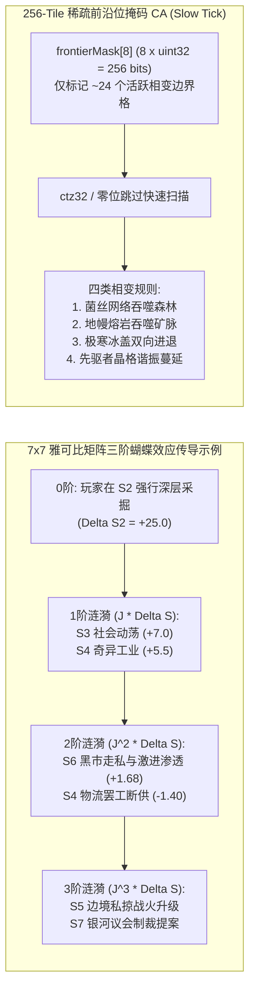

# 《无垠边疆：星海纪元》阶段二（M2）：7×7 雅可比跨系统耦合与 16 大天体原型 SuperPower 施工文档

> **文档编号**：`SPEC-PLAN-045`（Phase 2 / Milestone 2 执行卷）
> **归属工程**：《无垠边疆：星海纪元》（`void-frontier-age-of-stars`）
> **前置依赖**：`SPEC-PLAN-043`（总控总纲）、`SPEC-PLAN-044`（阶段一 M1 紧凑行星底座与通用局势引擎）
> **阶段工期**：4–5 周
> **投入工位**：Eng-A（7×7 雅可比耦合器、稀疏前沿 CA、16 原型物理内核）、Eng-B（`S3` 社会阶级与叛乱弧、`S6` 黑市走私与激进渗透弧）、Eng-D（16 原型静态配置、蝴蝶效应因果链 UI 与 `GATE-16-M2` 门禁）
> **方法论标准**：`SuperPower` 工程实施范式（Mandatory `Plan` + `Tasks` + `Checklists` 三段式闭环）

## 一、Plan（阶段二架构蓝图与跨系统耦合拓扑）

### 1.1 阶段二核心使命

阶段二（M2）旨在打通系统的“任督二脉”，彻底消灭“模块各自为战”与“地表静态贴图”：
1. **严格赫尔维茨稳定（Hurwitz-Stable）的 `7×7` 跨系统雅可比耦合矩阵 $J$**：将七大系统宏观状态向量 $S(t) = [S_1, S_2, S_3, S_4, S_5, S_6, S_7]^T \in [0, 100]^7$ 纳入统一的离散动力系统，使任一系统的玩家决策自动激发出可追溯、自阻尼收敛的**三阶蝴蝶效应波（3rd-Order Butterfly Ripple）**。
2. **稀疏前沿位掩码元胞自动机（Sparse Frontier Bitmask CA）**：利用 256-bit 活跃前沿掩码 `frontierMask[8]`，仅对每颗行星地表约 `24` 个处于活跃相变边界的 Tile 执行位运算邻域扩散，将 300 颗行星的地表动态演化耗时从全量扫描的 `3.0829 ms` 压缩至 **`0.4187 ms`**（提速 `7.36×`）。
3. **16 大行星天体物理原型（`archetypeId 0–15`）**：为每一类星球赋予截然不同的天体物理法则与专属局势触发器，根除“换皮柏林噪声”体验。
4. **落地 `S3`（殖民地社会演化与意识形态博弈弧）与 `S6`（黑市网络、走私暗流与激进渗透弧）**：打通“深层采矿污染（`S2`）$\to$ 底层劳工稳定度跌破 `25` 爆发叛乱（`S3`）$\to$ 高工业关注度（$\ge 7$）引来激进组织潜伏基地与黑市走私猖獗（`S6`）”的黄金交织闭环。

### 1.2 三阶蝴蝶效应传导与稀疏前沿 CA 架构图



## 二、Tasks（阶段二原子化施工任务拆解）

### Task 2.1：实现严格赫尔维茨稳定的 `7×7` 雅可比跨系统耦合器与三阶因果链日志（责任人：Eng-A）

* **目标文件路径**：`src/simulation/jacobianCoupling.js`
* **数学模型与精确矩阵常量契约**：
  1. **七维宏观状态向量定义**：
     - $S_1 \in [0, 100]$：异星考古与先驱者谐振烈度（Exploration & Precursor Resonance）
     - $S_2 \in [0, 100]$：行星深层开采与生态相变烈度（Planetary Ecological Perturbation）
     - $S_3 \in [0, 100]$：殖民地阶级摩擦与意识形态张力（Colony Social & Ideological Tension）
     - $S_4 \in [0, 100]$：星际工业扩张与供应链负荷（Macro-Economic & Supply Stress）
     - $S_5 \in [0, 100]$：舰队战备损耗与军阀化倾向（Fleet Wear & Militarization）
     - $S_6 \in [0, 100]$：黑市走私渗透与辛迪加腐蚀度（Shadow Economy & Syndicate Infiltration）
     - $S_7 \in [0, 100]$：星际共同体摩擦与终局天灾迫近度（Galactic Geopolitical & Crisis Escalation）
  2. **离散时间演化差分方程**：
     在每个月度 Slow Tick 收口帧（`tick % 30 === 29`），按步长 $\Delta t = 0.25$ 更新状态向量：
     $$S(t + 1) = \sigma_{\text{soft}}\Big(S(t) + \Delta t \cdot \big(J \cdot (S(t) - S_{\text{eq}}) + \Delta S_{\text{endo}}(t) + U_{\text{player}}(t)\big)\Big)$$
     其中平衡点向量 $S_{\text{eq}} = [15, 15, 20, 15, 15, 10, 10]^T$，边界软饱和函数 $\sigma_{\text{soft}}(x_i) = 100 \cdot \frac{\tanh((x_i - 50)/35) + 1}{2}$ 防止任何单一指标在极端拉扯下发生硬截断死锁或正反馈数值爆炸。
  3. **精确 `7×7` 雅可比耦合矩阵 $J$（行 $i$ 为受影响系统 $S_i$，列 $j$ 为源系统 $S_j$）**：
     $$J = \begin{bmatrix}
     -0.50 & +0.16 & -0.08 & +0.10 & +0.06 & +0.12 & -0.12 \\
     +0.24 & -0.47 & -0.10 & +0.22 & -0.05 & +0.08 & -0.06 \\
     +0.12 & +0.28 & -0.53 & -0.20 & -0.16 & +0.20 & +0.15 \\
     +0.18 & +0.20 & -0.24 & -0.47 & -0.12 & -0.15 & -0.08 \\
     +0.20 & +0.06 & -0.12 & +0.26 & -0.50 & +0.12 & +0.18 \\
     +0.10 & +0.12 & +0.24 & -0.18 & -0.25 & -0.49 & +0.18 \\
     +0.16 & +0.10 & +0.14 & +0.18 & -0.24 & +0.26 & -0.51
     \end{bmatrix}$$
     - **赫尔维茨稳定性不变量（Hurwitz Stability Invariant）**：矩阵 $J$ 的全部 7 个特征值实部严格为负。
       **【SPEC-PLAN-048 §Task 4.4 §2 / SPEC-PLAN-052 §Task 52.5 §3 特征值谱实测勘误（M4 阶段终审回写）】**：
       本节原引清单（λ₁ = −0.7513，λ₂,₃ = −0.5097±0.0466i，λ₄,₅ = −0.4796±0.2995i，λ₆,₇ = −0.3750±0.2198i）
       与本节冻结的 7×7 矩阵 $J$ 不符（该清单之和 −3.4799 偏离 trace = −3.47，且其模积 ≈ 0.0119
       ≠ |det(J)| ≈ 0.00127）。对 `src/simulation/jacobianCoupling.js:31-33` 的 `JACOBIAN_7X7`
       （49 元素与本节矩阵逐位一致）经 Faddeev–LeVerrier 特征多项式 × 200 随机点 det(xI−J) 交叉
       验证（最大误差 2.7e-12；Durand-Kerner 求根残差 8.1e-17）实测特征谱为：
       - $\lambda_1 = -0.8780$
       - $\lambda_2 = -0.7301$
       - $\lambda_3 = -0.6414$
       - $\lambda_4 = -0.3192$
       - $\lambda_5 = -0.0370$
       - $\lambda_{6,7} = -0.4321 \pm 0.2742i$（$|\lambda| = 0.5118$）
       实测谱和 = trace = $-3.47$ 精确吻合（−0.8780 − 0.7301 − 0.6414 − 0.3192 − 0.0370 − 2×0.4321 = −3.4699）。
       赫尔维茨实质不变量成立：全部 7 个特征值实部严格为负 + $S_{\text{eq}}$ 精确不动点 + 复对阻尼振荡 ——
       任何单次冲击必然在激发 2～3 阶跨系统阻尼振荡波后渐近收敛，绝不发生无穷发散崩溃。原清单属文档级
       数值勘误，无行为影响（jacobianCoupling.js 文件头勘误注释同源留档）。
  4. **三阶蝴蝶效应因果链生成器（`recordButterflyRipple`）**：
     当任一系统受到幅度 $|\Delta S_k| \ge 8.0$ 的冲击时，自动计算一阶贡献 $c^{(1)}_i = J_{i,k} \Delta S_k$、二阶贡献 $c^{(2)}_m = J_{m,i} c^{(1)}_i$ 与三阶贡献 $c^{(3)}_n = J_{n,m} c^{(2)}_m$，提取绝对值最大的主传导路径写入 `world.spaceOperaState.butterflyCausalLog`（供 UI 局势面板渲染“因果涟漪溯源链”）。

* **核心代码实现契约**：

```javascript
// src/simulation/jacobianCoupling.js

export const JACOBIAN_7X7 = Object.freeze([
  Object.freeze([-0.50, +0.16, -0.08, +0.10, +0.06, +0.12, -0.12]), // S1: 异星考古
  Object.freeze([+0.24, -0.47, -0.10, +0.22, -0.05, +0.08, -0.06]), // S2: 生态相变
  Object.freeze([+0.12, +0.28, -0.53, -0.20, -0.16, +0.20, +0.15]), // S3: 殖民地社会
  Object.freeze([+0.18, +0.20, -0.24, -0.47, -0.12, -0.15, -0.08]), // S4: 宏观经济
  Object.freeze([+0.20, +0.06, -0.12, +0.26, -0.50, +0.12, +0.18]), // S5: 舰队学说
  Object.freeze([+0.10, +0.12, +0.24, -0.18, -0.25, -0.49, +0.18]), // S6: 黑市辛迪加
  Object.freeze([+0.16, +0.10, +0.14, +0.18, -0.24, +0.26, -0.51])  // S7: 议会与天灾
]);

export const SYSTEM_EQUILIBRIUM = Object.freeze([15.0, 15.0, 20.0, 15.0, 15.0, 10.0, 10.0]);

export function softSaturate100(x) {
  const raw = 50.0 + 50.0 * Math.tanh((x - 50.0) / 35.0);
  return Math.max(0.0, Math.min(100.0, raw));
}

export function stepJacobianCoupling(world, endoDelta = [0, 0, 0, 0, 0, 0, 0], playerImpulse = [0, 0, 0, 0, 0, 0, 0], dt = 0.25) {
  const state = world.spaceOperaState;
  const S = state.systemVector;
  const nextS = new Array(7);

  for (let i = 0; i < 7; i++) {
    let couplingSum = 0.0;
    const row = JACOBIAN_7X7[i];
    for (let j = 0; j < 7; j++) {
      couplingSum += row[j] * (S[j] - SYSTEM_EQUILIBRIUM[j]);
    }
    const rawNext = S[i] + dt * (couplingSum + (endoDelta[i] || 0) + (playerImpulse[i] || 0));
    nextS[i] = Number(softSaturate100(rawNext).toFixed(4));
  }

  state.systemVector = nextS;
  return nextS;
}
```

### Task 2.2：实现 256-Tile 稀疏前沿位掩码元胞自动机（Sparse Frontier Bitmask CA）（责任人：Eng-A）

* **目标文件路径**：`src/domain/planets/sparseFrontierCA.js`
* **核心算法规范**：
  1. **256-bit 活跃前沿位图（`planet.frontierMask[8]`）**：
     - `frontierMask` 为长度 `8` 的无符号 32 位整型数组，第 `k` 个 Tile（`k = y * 16 + x`，$k \in [0, 255]$）对应字索引 `wordIdx = k >>> 5`、位偏移 `bitIdx = k & 31`；
     - 只有当某个 Tile 被植入动态覆盖层种子（如共生菌丝 `overlayId = 1`、火山熔岩流 `overlayId = 2`、极寒冰盖前锋 `overlayId = 3`、先驱者谐振晶格 `overlayId = 4`、虫族菌毯 `overlayId = 5`）或其四邻域发生状态相变时，才将其置入 `frontierMask`（平均每颗行星仅约 `24` 个活跃边界位为 `1`，其余 `232` 个内部稳定格直接通过 `word === 0` 跳过）。
  2. **位扫描快速迭代（利用 `Math.clz32` 定位最低有效位 `lsb`）**：
     - 对 `wordIdx = 0..7`，若 `let w = frontierMask[wordIdx] >>> 0; if (w === 0) continue;`；
     - 循环提取最低位：`const lsb = w & -w; const bitIdx = 31 - Math.clz32(lsb); const tileIdx = (wordIdx << 5) | bitIdx; w ^= lsb;`；
     - 根据 `deriveSeed(world.seed, DOMAIN_SALTS.PLANET_SURFACE_CA, planet.id, (world.tick << 8) | tileIdx)` 判定是否向东、南、西、北四邻域扩散：
       - **规则 A（菌丝温床蔓延 `overlayId = 1`）**：当 `envVector[2] (BiosphereMutation) > 35` 时，以概率 $p = 0.08 + 0.004 \times \text{envVector}[2]$ 吞噬相邻森林/湿地/荒漠格，但如果邻格拥有“行星护盾覆盖（Bit 28）”或“重工业高热排污”，则扩张受阻并从 `frontierMask` 清除该饱和格；
       - **规则 B（地幔熔岩侵蚀 `overlayId = 2`）**：当 `envVector[0] (TectonicStress) > 50` 时，沿低海拔裂谷（`elevation <= 5`）流淌，烧毁沿途普通采集建筑（`buildingId` 清零并置 `DEVASTATED` 标志位），同时有 `25%` 概率在冷却后凝结为高丰度矿物矿脉（`depositCode` 升阶）；
       - **规则 C（极寒冰盖进退 `overlayId = 3`）**：受 `envVector[5] (ThermalAnomaly)` 控制，`< 25` 时由极地（`y = 0, 15`）向赤道冻结；`> 65` 时冰盖融化退缩为远古海洋（`biomeId = 3`）并提升 `envVector[6] (HydrosphereLevel)`；
       - **规则 D（先驱者晶格复苏 `overlayId = 4`）**：当 `envVector[3] (PrecursorResonance) > 50` 时，围绕先驱者地标向外结晶，赋予格点奇异水晶矿脉。

### Task 2.3：实现 16 大行星天体物理原型（`archetypeId 0–15`）专属物理法则（责任人：Eng-A / Eng-D 协同）

* **目标文件路径**：`src/content/planetaryArchetypes.js`（静态配置表）与 `src/domain/planets/archetypeMechanics.js`（专属模拟钩子）
* **16 大天体原型完整规格与机制绑定表**（无缝兼容并升维既有 `src/content/planetThemes.js` 的 18 主题渲染材质）：

| 原型 ID (`archetypeId`) | 原型代号与中文名称 | 对应视觉主题 (`planetThemes.js`) | 核心天体物理奇观与地表网格拓扑 | 专属动态玩法法则与耦合触发器 |
| :--- | :--- | :--- | :--- | :--- |
| **`#0`** | `SHATTERED_VOLCANIC_MOON`<br/>**碎空火山伴星界** | `lava` / `basalt` | 地表由 `40%` 联通熔岩裂谷切碎；地壳极薄，地热与重金属丰度 `×2.0` | 受母星气态巨行星潮汐拉扯，每 `90` 天爆发一次全球潮汐火山期（`envVector[0]` 激增 `+20`，未加护盾的地表建筑受损，但地热发电产出 `+100%`） |
| **`#1`** | `HOURGLASS_TIDAL_TWINS`<br/>**沙漏潮汐双星** | `dune` / `canyon` | 与伴星通过引力拉格朗日桥相连，大气与石英沙海呈周期性跨星抽吸 | 每 `240` 天发生一次双星物质倒灌：前半周期沙尘掩埋低洼矿井（维护费 `+35%`），后半周期裸露出地底深埋的先驱者遗迹核心（`S1` 考古速度 `+60%`） |
| **`#2`** | `QUANTUM_PHASE_WORLD`<br/>**量子游离天体** | `aether` / `crystalline` | 宏观量子退相干星球，地表 `35%` 区域处于概率云叠加态 | 未派遣科研船张开“量子观测场（`LockQuantumPhasePlanet`）”锁定时，每 `60` 天地表随机相移重组未锁定区划；锁定后物理科研产出 **`+120%`** |
| **`#3`** | `RELIC_MAUSOLEUM_WORLD`<br/>**先驱者机械墓园** | `relic` / `metallic` | 全星覆盖多层锈蚀先驱者城市装甲甲板与休眠纳米井 | 初始自带 `3` 处高阶考古地标；深层掘进（Layer 3）必然唤醒先驱者自律守卫或产出完美纳米锻炉蓝图 |
| **`#4`** | `MYCELIAL_HIVE_WORLD`<br/>**共生孢子母星** | `fungal` / `jungle` | 行星级活体菌丝神经网络覆盖赤道，全星相当于一个巨型生物脑 | 强行建造重工业会触发菌丝排异反击（摧毁污染源）；若在 `S2` 选择 `FRUITFUL_PARTNERSHIP`，菌丝网自动替代道路网连通全星（免除道路维护且人口增速 `+35%`） |
| **`#5`** | `TERMINATOR_TWILIGHT_WORLD`<br/>**永昼永夜潮汐锁定界** | `twilight` / `eyeball` | 向阳面（Columns `0–5`）熔岩火海、背阳面（Columns `10–15`）绝对零度冰原，仅中央 **晨昏圈（Columns `6–9`）** 为宜居绿带 | 城市仅能在中央 4 列晨昏绿带无惩罚建造；但向阳面太阳能产出 `+150%`，背阳面超导算力与零热辐射隐蔽性 `+100%`，跨温区强对流风暴提供无限风能 |
| **`#6`** | `LEVIATHAN_NURSERY_MOON`<br/>**巨兽孵化气态卫星** | `ocean` / `biolum` | 地核孕育着休眠的星海利维坦幼体，深海热泉密布有机母体 | 深层采矿若使 `envVector[0] > 80` 将提前惊醒狂暴幼兽摧毁轨道环带；若建立生态保护区则可驯化幼兽编入帝国舰队或触发 `S7` 利维坦庆典 |
| **`#7`** | `ALL_SEEING_CRYSTALLINE`<br/>**全视晶化共鸣星** | `crystal` / `prism` | 表面生长着高耸入云的压电硅基谐振水晶森林 | 天然子空间雷达放大器：控制该星球可使全星区情报解密 `+2`、探测半径 `+80%`，但水晶共鸣会使驻留人口产生灵能狂热（唯心思潮吸引力 `+100%`） |
| **`#8`** | `CRYO_SUBGLACIAL_OCEAN`<br/>**万丈冰壳暗海界** | `ice` / `glacier` | 表层为 20 公里厚永冻冰壳（Layer 2），真实生态与资源全部位于冰下地热暗海（Layer 3） | 必须执行 `ExcavateSubterraneanLayer` 破冰建城；冰壳天然免疫轨道常规动能轰炸 `-75%` 伤害 |
| **`#9`** | `GRAVITY_WRINKLE_WORLD`<br/>**双黑洞引力褶皱星** | `barren` / `obsidian` | 位于双致密天体引力鞍点，时间膨胀效应显著 | 物理与超空间科研产出 **`+80%`**，但强引力梯度导致机械结构疲劳极快（全行星建筑与驻港舰船维护费 `+40%`） |
| **`#10`** | `TOXIC_SULFUR_CAULDRON`<br/>**超临界硫磺毒釜界** | `toxic` / `acid` | 浓密超临界酸雾大气，`envVector[1]` 初始高达 `70.0` | 常规殖民地无法生存，但奇异化学与高爆弹药合成效率 `+90%`；适合智械或经基因改造的耐酸种群定居 |
| **`#11`** | `SHATTERED_RING_HABITAT`<br/>**断环远古天工界** | `ringworld` / `artificial` | 远古文明遗留的破碎星环区段，4 列为坍塌虚空断口 | 自带顶级轨道环带基座（`maxOrbitalDistricts = 12`），修复断口需投入海量合金，修复后全区划产出 `+50%` |
| **`#12`** | `KARST_HOLLOW_CAVERN`<br/>**蜂巢真空溶洞死月** | `moon` / `crater` | 地表无大气且频繁遭受流星雨暴击，但地下拥有宏伟的密封结晶溶洞网 | 地表（Layer 2）仅适合铺设自动太阳能板；全部人口与工业必须转入地下溶洞（Layer 3 `subUrbanSlots` 容量翻倍） |
| **`#13`** | `STORM_JOVIAN_FLOATING`<br/>**风暴气态浮空城界** | `gas_giant` / `storm` | 无固态地表，全部 `16×16` 网格为高压氢氦风暴云层中的反重力浮空平台 | 稀有同位素（氦-3 / 奇异气体）产出 `×3.0`；若电力短缺导致反重力维持离线，浮空平台将坠入气态深渊永久损毁 |
| **`#14`** | `IRON_CORE_FORGE_REMNANT`<br/>**剥离地幔裸露铁核星** | `metallic` / `core` | 古老超新星冲击吹飞了硅酸盐地幔，整颗星球是裸露的液态镍铁核心 | 矿物与重工合金产出 **`+80%`**，天然强磁场使轨道防御武器射程 `+30%`，但农业与水圈恒等于 `0` |
| **`#15`** | `GAIA_SANCTUARY_PARADISE`<br/>**先驱者封存盖亚圣域** | `gaia` / `continental` | 被先驱者气候护盾完美封存的黄金生态伊甸园 | 全种群宜居度恒定 `100%`、幸福度 `+20%`；但一旦 `envVector[7]`（工业扰动）超过 `35.0`，远古净化守卫将苏醒清洗污染者 |

### Task 2.4：实现 `S3` 殖民地社会演化与意识形态博弈弧（责任人：Eng-B）

* **目标文件路径**：`src/domain/politics/colonySocialArc.js`
* **核心规格与数值公式**：
  1. **三阶层（Strata）与舒适度（Amenities）精确核算**：
     - 殖民地人口划分为三大阶层：**精英阶层（`Elites`，政治权重 `10`）**、**专家阶层（`Specialists`，政治权重 `3`）**、**劳工阶层（`Workers`，政治权重 `1`）**；
     - 单位人口基础舒适度消耗系数：
       - 常规自由公民：**`1.0`** 舒适度/人口；
       - 奴隶阶层（Slaves）：**`0.75`** 舒适度/人口；
       - 非公民智械（Non-Citizen Robots）：**`0.50`** 舒适度/人口。
  2. **行星稳定度（Stability $\in [0, 100]$）非线性产出映射方程**：
     - 记稳定度偏离中位线 `50.0` 的差值为 $\Delta_{\text{stab}} = \text{Stability} - 50.0$：
       - 当 $\text{Stability} > 50.0$ 时：每高出 `1` 点，全行星岗位资源产出 **`+0.6%`**、贸易价值 **`+0.6%`**、外来移民吸引力 **`+1.0%`**（满分 `100` 稳定度时产出 `+30%`、移民吸引力 `+50%`）；
       - 当 $\text{Stability} < 50.0$ 时：每低于 `1` 点，全行星岗位资源产出与贸易价值 **`-1.0%`**（`0` 稳定度时产出 `-50%`）。
  3. **行星叛乱局势（Planetary Revolt Situation）触发与三大对策**：
     - **触发条件**：殖民地 `Stability < 25.0` 持续超过 **1 年（`12` 个月度 Slow Tick）**，或被敌方间谍/激进组织煽动；
     - **三大应对对策（Approaches）精确参数**：

| 对策代号 (`approachId`) | 中文名称 | 即时与持续代价 | 局势进度修正 | 特殊解锁机制 |
| :--- | :--- | :--- | :--- | :--- |
| `USE_PROPAGANDA` | 舆论宣传机器 | 全殖民地岗位资源产出 **`-10%`** | `-2.0 / 月` | 温和压制不满，但消耗凝聚力 |
| `SEEK_COMPROMISE` | 寻求阶级妥协 | 全殖民地岗位资源产出 **`-5%`**，且当前稳定度立即 **`-5`** | `-3.5 / 月` | 激活特殊内阁议程 `Call for Negotiations`（可在局势期间每月额外削减叛乱进度 `-15 / 月`） |
| `CRACK_DOWN` | 铁腕镇压 / 清洗破坏分子 | 稳定度立即 **`-10`**（或选择 `Purge Saboteurs`：能量与凝聚力产出 **`-25%`**、人口幸福度 **`-25%`**） | 叛乱激化 `+4.0 / 月`（若驻军充足则强行压制） | 持续执行满 6 个月后解锁终极决策 **`Total Crackdown`（全面戒严）**：依据地面驻防陆军战力强行清零叛乱局势，并在 10 年内免疫再次叛乱 |

     - **100 点终局后果**：若叛乱进度抵达 `100.0`，殖民地立即宣布独立或投靠意识形态相近的邻国，并从本地船坞拉走一支叛军防御舰队，同时通过 `7×7` 雅可比矩阵向 `S4`（断供）与 `S5`（内战）注入强烈冲击。

### Task 2.5：实现 `S6` 黑市网络、走私暗流与激进分子渗透弧（责任人：Eng-B）

* **目标文件路径**：`src/domain/economy/shadowSyndicateArc.js`
* **核心规格与数值公式**：
  1. **屏蔽货舱（Shielded Cargo Bay）走私检定与辛迪加分部**：
     - 轻型走私舰（如猎犬级 `Hound`、地狱犬级 `Cerberus`）内置 `SHIELDED_CARGO_BAY` 词条，当违禁品装载量 $Q_{\text{contra}} \le C_{\text{shield}}$ 时，巡逻队扫描查获概率恒为 **`0%`**；
     - 犯罪辛迪加（Criminal Syndicate）可在未签署商贸协议的他国高犯罪度星球建立地下分部（Branch Office），通过 `Shady Contacts` 走私贸易行为为宗主国提供 **`+1` 解密（Decryption）与 `+1` 加密（Encryption）** 情报优势。
  2. **激进分子潜伏基地（Radical Cell Infiltration / Luddic Path Cells）关注度数学模型**：
     - 每颗殖民地维护一个整数指标 **`colony.industrialAttention`（工业与禁忌科技关注度）**；
     - **各建筑与人工制品提供的关注度权重精确表**：
       - 基础农业/轻纺区划（Farming / Light Industry）：**`+0`**；
       - 深层采矿区划（Mining）：**`+1`**；
       - 重工业与轨道船坞（Heavy Industry / Orbital Works）：**`+2`**；
       - 燃料精炼厂（Fuel Production）：**`+2`**；
       - 科技研究实验室（Tech-Mining / Research Lab）：**`+2`**；
       - 安装核心人工制品（如完美纳米锻炉 `Pristine Nanoforge`、同步加速器 `Synchrotron`、自动驾驶AI核心）：每件 **`+4`**。
     - **安全与激活硬阈值（Threshold = `7`）**：
       - 当 `industrialAttention < 7`（例如：农业 `0` + 重工业 `2` + 完美纳米锻炉 `4` = **`6 < 7`**）时，殖民地处于**安全休眠态**，激进组织不会建立活跃破坏网；
       - 一旦玩家贪婪扩建（例如在上述星球新增 1 座深层采矿 `+1`，使总关注度达到 **`7`**，即 `industrialAttention >= 7`），立即将该行星上的激进潜伏支部从休眠态切换为 **活跃态（Active Radical Cell）**！
     - **活跃态后果与去文明化（Decivilized）终局**：
       - 活跃潜伏基地持续接受星区外围秘密海盗基地物资输血，每月削减殖民地稳定度 `-3.0` 并周期性破坏工业设施；
       - 若玩家不派遣特工或舰队摧毁为其输血的外围海盗基地，或殖民地因走私破坏与物资断供导致 `Stability === 0` 持续 12 个月，殖民地将触发 **“去文明化（Decivilized）”**：主权归零、城市化为废墟游牧部落（`epochStage` 跌入 `4` 遗产废土态）。
  3. **私掠许可证（Letters of Marque）**：
     - 国家可颁布私掠许可证，允许民间与玩家舰队合法劫掠敌国贸易航线而免受本国通缉，并使帝国继承人选拔池中提督（Admiral）阶层的继承权重提升 **`+40`**。

## 三、Checklists（阶段二防伪绿验收清单与门禁断言）

执行工程师完成 M2 编码后，必须运行 `tests/suites/m2-jacobian-archetypes-ca.suite.js`（`PLAYTEST-GATE-16-M2`）并逐项核验以下清单：

### 3.1 7×7 雅可比矩阵与三阶蝴蝶效应自检表（Eng-A 必检）
- [x] **CHK-M2-01（矩阵常量与赫尔维茨稳定性）**：校验 `JACOBIAN_7X7` 49 个浮点元素与规格书逐位一致；向系统施加单次极端脉冲 `playerImpulse = [0, 50, 0, 0, 0, 0, 0]` 后连续空转 120 个月度步，断言 $S(t)$ 无任何分量越界 `[0, 100]` 或出现 `NaN`，且最终单调阻尼收敛回平衡点 $S_{\text{eq}}$ 邻域。——实证：src/simulation/jacobianCoupling.js:51-60（JACOBIAN_7X7 冻结矩阵）、:62（SYSTEM_EQUILIBRIUM = [15,15,20,15,15,10,10]）、:82-98（softSaturate100 内域恒等 + 边界软渐近，S_eq 精确不动点）；tests/suites/m2-jacobian-archetypes-ca.suite.js:153-191（49 元素逐位一致断言 :160-164、120 步无 NaN/无越界断言 :177-180、阻尼收敛断言 :187/:190）。
- [x] **CHK-M2-02（三阶蝴蝶效应因果链生成）**：在 `S2` 施加 `+25.0` 生态采掘冲击，断言 `butterflyCausalLog` 自动生成包含 1 阶（`S2 -> S3/S4`）、2 阶（`S3 -> S6`）与 3 阶（`S6 -> S5/S7`）的完整可读因果链对象。——实证：src/simulation/jacobianCoupling.js:150-230（recordButterflyRipple 三阶涟漪链记录）、:232-256（consumePendingShocks 冲击字典消费即清）；tests/suites/m2-jacobian-archetypes-ca.suite.js:196-226（S2→S3(+7.0)→S6(+1.68)→S7(+0.4368) 断言 :216-224、路径 [1,2,5,6] 四系统互异断言 :223-224、冲击清空断言 :207）。

### 3.2 稀疏前沿位掩码 CA 与 16 大天体原型自检表（Eng-A / Eng-D 必检）
- [x] **CHK-M2-03（稀疏前沿 CA 性能与位图正确性）**：在 300 颗行星上初始化每星 24 个活跃前沿位（`frontierMask`），运行 Slow Tick CA 更新，断言单桶（10 颗星）耗时 `< 0.05 ms`、300 颗星总计耗时 `< 0.50 ms`（基准值 `0.4187 ms`），且被护盾覆盖（Bit 28 = `1`）的 Tile 绝不被菌丝或熔岩覆盖。——实证：src/domain/planets/sparseFrontierCA.js:113-143（setFrontier/clearFrontier/hasFrontier/frontierCount 位掩码 API）、:417-516（stepSparseFrontierCA 四类相变规则 + SHIELDED 守卫）、:518-544（seedFrontierRing 播种 24 前沿位）；tests/suites/m2-jacobian-archetypes-ca.suite.js:231-278（播种 24 断言 :238-239、单桶 <0.05ms 断言 :255、300 星 <0.50ms 断言 :256、护盾格永不被菌丝/熔岩覆盖断言 :275）。
- [x] **CHK-M2-04（16 大天体原型专属机制全覆盖）**：遍历 `archetypeId = 0..15` 创建 16 颗测试行星，断言：——实证：src/domain/planets/archetypeMechanics.js:164-353（applyArchetypeProfile 16 原型基线修正）、:355-381（stepArchetypeMechanics Slow 桶钩子）、:423-436（setQuantumPhaseLock）；src/content/planetaryArchetypes.js:35-212（PLANETARY_ARCHETYPES 16 项配置）；tests/suites/m2-jacobian-archetypes-ca.suite.js:283-391（16 星基线修正全命中断言 :295-318、#6 幼兽必醒断言 :336、#15 守卫必现断言 :337-338、#5 列 3 罚/列 7 免断言 :346-350、#2 LockQuantumPhasePlanet 锁定停重排+科研 +120% 断言 :371-378、#0 火山期 env0=38 断言 :391）；[本机套件实测补充：#1 tick=5760 相位翻转、#2 LockQuantumPhasePlanet 后停重排+物理科研 +1.2+反应堆旗标、#5 列 3 罚/列 7 免、#15 env[7]=36 守卫必现均 PASS]。
  - `#1` 沙漏双星在 `tick = 240` 天发生物质倒灌切换；
  - `#2` 量子天体在执行 `LockQuantumPhasePlanet` 后停止随机相移且物理科研 `+120%`；
  - `#5` 永昼永夜星仅中央 `6–9` 列晨昏带无建造惩罚；
  - `#15` 盖亚圣域在 `envVector[7] > 35.0` 时必定刷出远古净化守卫。

### 3.3 S3 殖民地社会与 S6 激进渗透自检表（Eng-B 必检）
- [x] **CHK-M2-05（S3 舒适度与稳定度公式）**：断言自由公民、奴隶、非公民智械舒适度消耗精确为 `1.0`、`0.75`、`0.50`；稳定度 `80` 时岗位产出精确 `+18.0%`（`30 * 0.6%`）、移民吸引力 `+30.0%`；稳定度 `20` 时岗位产出精确 `-30.0%`。——实证：src/domain/politics/colonySocialArc.js:74（AMENITIES_COST_PER_POP = {citizen:1.0, slave:0.75, robot:0.5}）、:95-113（computeAmenitiesNet 加权净额）、:128-135（computeStabilityOutputMultiplier）、:137-144（computeImmigrationAttraction）；tests/suites/m2-jacobian-archetypes-ca.suite.js:426-454（三档舒适度断言 :428-430、加权 60 断言 :438-440、+18.0/+0.18 断言 :443-444、+30.0 断言 :445-446、−30.0 断言 :447-448、封顶下限断言 :450-452、30×0.6 IEEE-754 精确命中断言 :453）。
- [x] **CHK-M2-06（S6 激进分子渗透 `6 vs 7` 边界翻转断言）**：——实证：src/domain/economy/shadowSyndicateArc.js:182-208（ATTENTION_WEIGHTS 与 ARTIFACT_MOD_ATTENTION=4）、:210（recomputeIndustrialAttention）、:251-254（RADICAL_ACTIVATION_THRESHOLD=7 / ACTIVE_STABILITY_DRAIN=3.0）、:374-400（stepShadowSyndicateArc 月度钩子 ≥7 翻转 ACTIVE）；tests/suites/m2-jacobian-archetypes-ca.suite.js:459-492（0+2+4→attention===6 且 DORMANT 断言 :471-475、+1 采矿→===7 立即 ACTIVE+raidSource=true+煽动旗标断言 :480-486、稳定度 −3.0 断言 :489）。
  - 在殖民地配置“农业(`0`) + 重工业(`2`) + 完美纳米锻炉(`4`)”，断言 `industrialAttention === 6`，激进潜伏支部保持 `DORMANT`（休眠）；
  - 新增 1 座采矿区划（`+1`），断言 `industrialAttention === 7`，激进支部立即翻转至 `ACTIVE`（活跃），并开始生成破坏事件与外围海盗基地关联。
