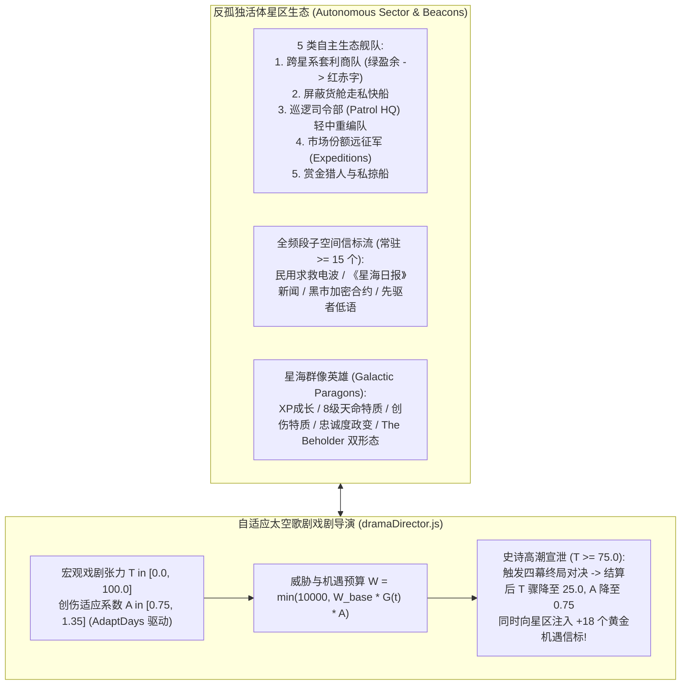

# 《无垠边疆：星海纪元》阶段三（M3）：反孤独太空歌剧生态与自适应戏剧导演 SuperPower 施工文档

> **文档编号**：`SPEC-PLAN-046`（Phase 3 / Milestone 3 执行卷）
> **归属工程**：《无垠边疆：星海纪元》（`void-frontier-age-of-stars`）
> **前置依赖**：`SPEC-PLAN-043`（总控总纲）、`SPEC-PLAN-044`（阶段一 M1）、`SPEC-PLAN-045`（阶段二 M2）
> **阶段工期**：4–5 周
> **投入工位**：Eng-C（舰队学说、群像英雄、自主生态舰队、子空间信标流、自适应戏剧导演）、Eng-B（`S7` 议会、兰兹拉德/CHOAM 与三大终局天灾）、Eng-D（信标词库、太空歌剧 HUD 与 `GATE-17-M3` 终审门禁）
> **方法论标准**：`SuperPower` 工程实施范式（Mandatory `Plan` + `Tasks` + `Checklists` 三段式闭环）

## 一、Plan（阶段三架构蓝图与反孤独太空歌剧生态）

### 1.1 阶段三核心使命

阶段三（M3）是实现**“星际是孤独的，但星际游戏不能让人感到孤独，那将是宏伟的太空歌剧”**的终极收官战役，核心交付五大模块：
1. **`S5` 舰队学说、子系统战损与经典战役伤痕弧（Fleet Doctrine & Battle Scars）**：引入巡逻司令部（Patrol HQ）与舰队学说调节、战备度（Combat Readiness, CR）补给模型、永久结构暗伤（**D-Mods**，每项降低 `-20%` 部署补给费）与传奇改装（**S-Mods**），以及将战火残骸化为永久“残骸栖息地（Wrecked Warship Habitat）”的战场记忆机制。
2. **星海群像英雄系统（Galactic Paragons）**：为指挥官（Commanders）、官员（Officials）、科学家（Scientists）赋予精确的 XP 成长曲线、领袖上限软惩罚（$N/C$ 维护费放大与 $0.85^{N-C}$ 经验衰减）、心理创伤特质、忠诚度归零军阀政变，以及双形态传奇领袖（如 `The Beholder` 与 `Tuborek`）。
3. **反孤独活体星区生态与全频段子空间信标流（Autonomous Sector Life & Subspace Beacon Stream）**：在星系间驱动 5 类具有真实经济动机的自主生态舰队（商队、走私船、巡逻队、市场份额远征军、赏金猎人），并在星区内常驻维持 **$\ge 15$ 个非帝国动态叙事信标**。
4. **`S7` 星际共同体、兰兹拉德/CHOAM 暗战与三大终局天灾弧**：融合外交使节、市场垄断远征、CHOAM 经济暗战、三大终局天灾（索林原虫、高维恶魔、肃正协议）与利维坦凯旋大游行（Leviathan Parade Opportunity）。
5. **自适应太空歌剧戏剧导演（Adaptive Space Opera Drama Director）**：以双状态变量（宏观戏剧张力 $T \in [0, 100]$ 与创伤适应系数 $A \in [0.75, 1.35]$）动态编排全银河的挑战与高潮宣泄（$T \ge 75 \to 25$ 并爆发 `+18` 个战后重建与寻宝机遇信标）。

### 1.2 反孤独太空歌剧生态与自适应戏剧导演闭环图

## 二、Tasks（阶段三原子化施工任务拆解）

### Task 3.1：实现 `S5` 舰队学说、战备度（CR）与 D-Mods / S-Mods 战损伤痕弧（责任人：Eng-C）

* **目标文件路径**：`src/domain/fleets/fleetDoctrineAndScars.js`
* **核心规格与数值表**：
  1. **巡逻司令部（Patrol HQ）与舰队学说（Doctrine Tabs）**：
     - 升级军事基地至巡逻司令部需消耗 **`250,000` 信用点（Credits）**；
     - 帝国在“学说与蓝图（Doctrine & Blueprints）”面板调节三项权重滑块：
       - `shipSizeWeight`（偏好多艘轻型护卫舰 vs 少量重型主力舰）；
       - `qualityWeight`（偏好廉价量产装配 vs 顶配少船精锐装配）；
       - `officerAggression`（军官性格偏好：稳健谨慎 `Cautious` vs 狂热鲁莽 `Reckless`）。
  2. **指挥官分流加成（Admiral vs General）**：
     - **舰队提督（Admiral）**：每级提供舰队武器伤害 **`+5%`**、开火射速 **`+5%`**、紧急撤退成功率（Disengage Chance）**`+5%`**；
     - **陆战将军（General）**：每级提供对星际基地伤害 **`+5%`**、轨道轰炸效率 **`+5%`**、地面陆军伤害 **`+5%`**。
  3. **战备度（Combat Readiness, CR $\in [0\%, 100\%]$）与零幅能导弹战术**：
     - 战舰每次投入实战部署消耗的战备度折算补给（Supply Cost）严格等于其**月度基础补给维护费**（例如锤头级驱逐舰 `Hammerhead` 部署一次固定消耗 **`10` 补给**）；
     - 舰队穿越超空间风暴、高辐射星云或逼近黑洞视界时持续流失 CR；CR 低于 `40%` 时触发子系统随机故障；
     - **零幅能导弹（Zero-Flux Missiles）与鲁莽军官（`Reckless`）**：当战舰硬幅能逼近过载阈值时，装载无需消耗幅能的鱼雷/导弹挂架并配合 `Reckless` 军官强行贴脸齐射，构成以伤换命的高风险爆发流派。
  4. **永久战损暗伤（D-Mods）与传奇改装（S-Mods）**：
     - **D-Mods（Degraded Modifications）**：战舰在战役中被击毁但通过战后打捞修复后，确定性挂载 1～3 项永久结构暗伤（如 `受损的主装甲带`、`退化的反应堆导管`、`故障的火控阵列`）。**核心经济补偿法则**：战舰每拥有 **1 个 D-Mod**，其部署补给费与月度维护费降低 **`-20%`**（最多叠加至 `-60%`），支撑玩家组建廉价铁锈海盗舰队或垃圾场尸潮流；
     - **S-Mods（Story / Permanent Elite Modifications）**：消耗宝贵的传奇点数将插件永久焊死在船体上，不占常规装配点数（OP）并激活专属传奇词条；
     - **战役残骸栖息地（Wrecked Warship Habitat）**：当星系内发生规模 $\ge 15$ 艘主力舰被毁的史诗会战后，在战场坐标生成永久巨型战舰残骸地标，玩家可执行 `SalvageBattleWreckHabitat` 将其改造为具有高额军事凝聚力产出的“残骸栖息地”。

### Task 3.2：实现星海群像英雄系统（Galactic Paragons）（责任人：Eng-C）

* **目标文件路径**：`src/domain/characters/galacticParagons.js`
* **核心规格与精确数学公式**：
  1. **三职业体系与精确经验值（XP）获取公式**：
     - 领袖划分为 **指挥官（Commanders）**、**行政官员（Officials）**、**首席科学家（Scientists）**；
     - **基础与事件 XP 精确入账表**：
       - 帝国最高统治者（Ruler）：固定 **`+12.0 XP / 月`**；
       - 内阁理事会成员（Council Position）或行星/星区总督（Governor）：固定 **`+5.0 XP / 月`**；
       - 总督辖区内每竣工 1 座地表建筑、星环模块或恒星巨构阶段：立即获得 **`+10.0 XP`**；
       - 指挥官参与太空战役（Space Battle）：基础获得 **`+5.0 XP`**，加上每击毁 1 艘敌舰 **`+0.05 × ShipSize XP`**，每迫使 1 艘敌舰紧急撤退（Disengaged）**`+0.025 × ShipSize XP`**；
       - 指挥官参与地面登陆战役（Ground Battle）：基础获得 **`+100.0 XP`**，加上每歼灭 1 支敌方陆军部队 **`+0.25 XP`**；
       - 科学家完成异象勘探、特殊工程或考古阶段：按难度等级获得 `+25 ~ +120 XP`。
  2. **领袖容量上限（Leader Cap $C$）软惩罚方程**：
     - 设帝国当前某职业领袖上限为 $C$，实际在编雇佣人数为 $N$。当 $N > C$ 时，不硬性禁止招募，而是对全体该职业领袖施加线性维护放大与指数经验衰减：
       $$\text{UpkeepMultiplier}(N, C) = \frac{N}{C}, \qquad \text{XPGainMultiplier}(N, C) = 0.85^{(N - C)}$$
  3. **第 8 级（Lv 8）天命特质（Destiny Traits）与负面心理创伤特质（Negative Trauma Traits）**：
     - 领袖升至 `Lv 8` 时，暂停常规升级并触发天命抉择，通过 `AssignParagonDestinyTrait` 解锁颠覆级天命特质（如科学家瞬间完成当前科技 `25%` 进度、指挥官赋予全舰队不屈护盾再生）；
     - 当领袖遭遇挚友阵亡、旗舰被毁、考古惨剧或政治免职时，确定性检定挂载**负面创伤特质**：

| 创伤特质代号 (`traitId`) | 中文名称 | 等级 1 (`Tier I`) 惩罚效果 | 等级 2 (`Tier II`) 惩罚效果 |
| :--- | :--- | :--- | :--- |
| `SUBSTANCE_ABUSER` | 药物成瘾 / 神经麻醉依赖 | 预期自然寿命 **`-10 年`** | 预期自然寿命 **`-30 年`** |
| `MELANCHOLIC` | 幽暗抑郁症 | 经验获取速率 **`-15%`**，寿命 **`-10 年`** | 经验获取速率 **`-30%`**，寿命 **`-20 年`** |
| `LAVISH_LIFESTYLE` | 穷奢极欲 | 月度能量/信用点维护费 **`+10`** | 月度能量/信用点维护费 **`+20`** |
| `DESTRUCTIVE` | 暴躁破坏狂 | 月度合金维护费 **`+5`**（频繁损毁座舰/公物） | 月度合金维护费 **`+10`**，且座舰 D-Mod 概率翻倍 |
| `CORRUPT` | 贪腐受贿 | 所辖行星犯罪度 **`+10`** | 所辖行星犯罪度 **`+25`**，且暗中向黑市转移库存 |

  4. **伦理思潮辐射、忠诚度政变与传奇群像英雄（Renowned & Legendary Paragons）**：
     - **伦理思潮辐射**：总督自身持有的伦理思潮，使其直接管辖行星的对应思潮吸引力提升 **`+50%`**，使所在星区其他行星的对应思潮吸引力提升 **`+25%`**；
     - **忠诚度归零政变**：每个领袖维护 `loyalty` $\in [0, 100]$。当指挥官或总督的 `loyalty <= 5` 且带有 `CRUEL`（残忍）或 `AMBITIOUS`（野心家）特质时，每月检定触发**边境军阀政变**，直接裹挟其统帅的舰队或总督辖星宣布武装叛乱；
     - **具名传奇领袖（Legendary Paragons）内置实现**：
       - `TUBOREK`（图博雷克）：工业与轨道工程大师，大幅加速星环与纳米锻炉建设；
       - `THE_BEHOLDER`（全视凝视者）：远古灵能机械复合体，支持通过 `ToggleBeholderMode` 在两种形态间无缝切换：
         1. **`WARSHIP_COMMANDER`（战舰指挥官形态）**：亲自驾驭主力舰，提供全星系跨超空间火控视野与灵能护盾穿透；
         2. **`MURMURING_MONOLITH`（低语方尖碑总督形态）**：降落并扎根于行星地表，将行星上的普通矿工（Miners）岗位全部转化为**“灵能合唱体（Telepaths）”**，使矿工不再仅产粗矿，而是直接高额产出**能量币（Energy）与凝聚力（Unity）**！
       - **中立星际城邦 5 级导师（Enclave Mentors）**：从策展人（Curators）、工匠剧团（Artisans）、打捞者（Salvagers）或雇佣兵城邦雇佣的 `Lv 5` 传奇导师；若玩家舰队主动攻击其所属母城邦，该导师将**立即愤然离职**，并使帝国当前内阁议程（Council Agenda）进度瞬间倒扣 **`-20%`**。

### Task 3.3：实现 5 类自主星区生态舰队与全频段子空间信标流（责任人：Eng-C / Eng-D 协同）

* **目标文件路径**：`src/domain/world/autonomousSectorLife.js`、`src/domain/world/subspaceBeaconStream.js`、`src/content/spaceOperaBeacons.js`
* **核心规格**：
  1. **5 类自主星区生态舰队（Autonomous Sector Fleets）**：
     - **`TRADE_CONVOY`（跨星系套利商队）**：由巨神级（`Atlas`）/巨像级（`Colossus`）货船编组，自动扫描星区内物资处于**绿色盈余（低价）**的出口殖民地，满载驶向处于**红色赤字（高价）**的进口殖民地；一旦商队在途中被海盗或敌国私掠舰截击，进口星球的库存将真实断供并推高 `S4` 短缺局势进度；
     - **`SMUGGLER_RUNNER`（黑市走私快船）**：挂载屏蔽货舱，专门向高关税、受封锁或处于 `S3` 叛乱前夕的殖民地偷运违禁品与军火；
     - **`PATROL_FLOTILLA`（星区治安巡逻队）**：由各行星巡逻司令部（Patrol HQ）按帝国学说自动派生的轻/中/重型治安编队，执行反走私扫描与航道护航；
     - **`MARKET_EXPEDITION`（商业垄断远征军）**：当玩家殖民地在某项高利润大宗商品（如燃料、重军火、食品）上的银河市场份额过高，威胁到老牌霸权国利益时，霸权国自动派遣“市场平抑远征舰队”前去袭击玩家产区；若玩家半途伏击歼灭该远征军，仅扣除 **`-5` 外交关系**而不会触发全面宣战；
     - **`BOUNTY_HUNTER`（赏金猎人与私掠团）**：响应赏金公会悬赏（系统悬赏、叛军悬赏、先驱者遗迹打捞悬赏）在深空游猎的独立武装。
  2. **全频段子空间信标流（Subspace Beacon Stream）反孤独硬性不变量**：
     - **常驻密度铁律**：在任何时刻，`subspaceBeaconStream.js` 必须保证当前活跃星区内至少存在 **$\ge 15$ 个非帝国官方的动态叙事信标（`activeBeacons.length >= 15`）**；
     - **四大频段分类**：
       1. `FREQ_DISTRESSED_CIV`：遇险民用货船求救信号、反应堆泄漏漂流舱、矿工讨薪罢工电台；
       2. `FREQ_STAR_JOURNAL`：《星海日报（Star Journal）》全息新闻通讯社广播（实时播报近期战役战损、某殖民地工业关注度破 `7` 的流言、大宗商品暴涨暴跌）；
       3. `FREQ_SHADOW_CONTRACT`：黑市辛迪加加密军火走私标书、私掠悬赏暗语接头；
       4. `FREQ_PRECURSOR_ECHO`：三百年前第一波人类拓荒考察队的自动遗言信标、先驱者数学背景辐射低语。

### Task 3.4：实现 `S7` 星际共同体、兰兹拉德/CHOAM 暗战与三大终局天灾弧（责任人：Eng-B / Eng-C 协同）

* **目标文件路径**：`src/domain/diplomacy/galacticSenateAndCrisisArc.js`
* **核心规格与数值表**：
  1. **外交使节、兰兹拉德宪章（Landsraad）与 CHOAM 宇航垄断股份**：
     - 玩家可与大派系签署雇佣委任状（Commission），每月按舰队规模领取固定军饷并解锁专属军用船体与武器购买权；
     - 引入**兰兹拉德大议会选票（Landsraad Standing）**与 **CHOAM 星际垄断联合体股份（`choamShares` $\in [0\%, 100\%]$）**：控制关键战略资源与星环贸易港可逢低吸纳 CHOAM 股份，持股达 `30%` 掌控全银河贸易分红，达 `50%` 可直接操纵禁运制裁；
     - **宫殿间谍网与派系刺杀（Assassination）**：升级帝国情报中枢（Palace Espionage Wing）使特工招募速度提升 **`1.5×`**；在向目标派系渗透满 3 层间谍网并植入双面间谍后，可执行终极刺杀行动斩首敌方首脑或瓦解敌国联军。
  2. **三大非对称终局天灾（Endgame Crises）完整机制**：
     - **天灾一：索林原虫（Prethoryn Scourge / 虚空虫潮）**：
       - 先遣侦察虫群抵达后爆发主力虫潮，占领殖民地后将其转化为**“感染星球（Infested World）”**（地表铺满虫族菌毯 `overlayId = 5`）；
       - **净化法则**：感染星球无法通过常规陆军登陆夺回，玩家必须派遣主力舰队对其执行持续轨道轰炸，直至行星破坏度（Devastation）达到 **`100%`**，方可彻底烧毁菌毯、将星球还原为可改造的荒芜星球；
       - **动态援军缩放法则**：星门虫巢原本每 **1 年**刷出 **`2` 支**虫群主力舰队；当虫群控制的银河星系占比达到 **`20%`** 时，援军刷新速率跃升至 **`3` 支/年**；当占比达到 **`40%`** 时，跃升至 **`4` 支/年**。
     - **天灾二：高维恶魔（Unbidden / Aberrant / Vehement 三派系维度战争）**：
       - 撕裂虚空传送门（需先拔除全部维度空间锚点方可解除传送门无敌护盾）；
       - 当第一派系“高维恶魔（Unbidden）”侵占银河达 `15%` 时，相继引来互相死敌的第二派系“异端者（Aberrant）”与第三派系“狂热者（Vehement）”，三方高维舰队在银河内展开混战，玩家可利用其内部火并各个击破。
     - **天灾三：肃正协议（The Contingency / 远古灭绝智械）**：
       - 苏醒时向全银河广播**“幽灵信号（Ghost Signal）”**，导致全银河所有常规合成人与自动化智械舰船产出暴跌、甚至发生 `40%` 阵前倒戈，唯有研发加密防火墙突破全部 4 座机械母星核心方可终结信号。
  3. **利维坦凯旋大游行机遇局势（Leviathan Parade Opportunity）**：
     - 当玩家舰队成功击杀任一太空巨兽（Space Leviathan）后，自动在选定核心殖民地开启三阶段 **“利维坦凯旋大游行”** 局势（进度 `0–100`）：
       - 对策 `ENCOURAGE`（盛大庆典）：进度 **`+6.0 / 月`**，全殖民地幸福度 `+15%`；
       - 对策 `SUPPRESS`（低调封存）：进度 **`-4.0 / 月`**，转为实验室闭门研究；
       - 决策 `REORGANIZE`（重新规划巡游星区）：消耗 **`1,000` 凝聚力** 将游行转移至另一颗殖民地；
       - **终局大奖**：游行抵达 `100` 完成时，为该行星永久挂载专属巨兽战利品地标修正，并根据帝国凝聚力月产出阶段性爆发奖励（最高封顶 **`1,000,000` 凝聚力**）。

### Task 3.5：实现自适应太空歌剧戏剧导演（Adaptive Space Opera Drama Director）（责任人：Eng-C）

* **目标文件路径**：`src/simulation/dramaDirector.js`
* **核心规格与数学方程**：
  1. **双核心状态变量**：
     - **宏观戏剧张力 $T(t) \in [0.0, 100.0]$**：由 `7×7` 雅可比状态向量均值 $\bar{S}$、活跃危机局势数量与近期战役烈度共同推升；
     - **创伤适应系数 $A(t) \in [0.75, 1.35]$**：由内部累积天数变量 `adaptDays` $\in [-50.0, 100.0]$ 驱动，防止玩家在连续遭受重创后被系统“落井下石”推入死局，同时在玩家长期顺风顺水时适度加码史诗挑战。
  2. **`adaptDays` 演进与伤亡折算公式**：
     - **自然增长**：
       - 当 `adaptDays < 0`（处于战损受挫恢复期）时，每天自动恢复 **`+3.0 / 天`**；
       - 当 `0 <= adaptDays <= 60` 时，每天增长 **`+1.0 / 天`**；
       - 当 `adaptDays > 60` 时，增长放缓为 **`+0.5 / 天`**，最高封顶于 **`100.0`**；
     - **伤亡与殖民地受挫折减（Storyteller Trauma Reduction）**：
       - 每当玩家有 1 个殖民地人口单位陷入瘫痪/重伤（Downed）或 1 艘护卫舰受损撤退，扣除 `adaptDays -= 4.0`；
       - 每当玩家有 1 名具名领袖阵亡、1 座殖民地沦陷或 1 艘主力舰被彻底击毁（Killed），扣除 **`adaptDays -= 20.0`**（严格遵循 **`1 Killed = 5 Downed`** 的创伤折算比）；
     - **映射至适应系数 $A(t)$**：
       $$A(t) = \text{clamp}\left(1.0 + 0.0035 \times \text{adaptDays}, \; 0.75, \; 1.35\right)$$
  3. **早期宽限斜坡 $G(t)$ 与综合戏剧预算方程 $W(t)$**：
     - **宽限斜坡函数 $G(t)$**：在开局前 10 个月度周期（Cycle $c \le 10$）固定为 `0.70`；从第 10 周期至第 40 周期线性爬升至 `1.00`：
       $$G(c) = \begin{cases} 0.70, & c \le 10 \\ 0.70 + 0.30 \times \frac{c - 10}{30}, & 10 < c < 40 \\ 1.00, & c \ge 40 \end{cases}$$
     - **基础帝国规模预算 $W_{\text{base}}$（50/50 双因子加权，硬上限 `10,000` 点）**：
       $$W_{\text{base}} = \min\Big(10000, \; 0.50 \times \text{PopAndFleetScore} + 0.50 \times \text{IndustrialWealthScore}\Big)$$
     - **当期有效戏剧预算**：
       $$W_{\text{effective}}(t) = \min\Big(10000, \; W_{\text{base}} \times G(c) \times A(t)\Big)$$
  4. **高潮宣泄（Climax Catharsis）与 `+18` 黄金机遇信标爆发机制**：
     - 当宏观戏剧张力 $T(t) \ge 75.0$ 时，戏剧导演不再零碎刷出小规模骚扰，而是消耗 $W_{\text{effective}}$ 将当前最尖锐的 2 条系统弧线合并升格为一场**四幕史诗高潮大事件（Grand Climax Arc）**；
     - 一旦玩家平定或度过该场高潮大事件，戏剧导演立即执行**宣泄回落（Catharsis Drop）**：
       1. 将宏观戏剧张力 $T$ 强制回落至 **`25.0`**；
       2. 将创伤适应系数 $A$ 强制重置为最低保护值 **`0.75`**（`adaptDays = -50.0`），开启黄金喘息重建期（Recovery Grace Period）；
       3. 立即调用 `subspaceBeaconStream` 向星区内一次性注入 **`+18` 个高价值机遇信标**（包含战场打捞队、流亡传奇科学家投奔、中立佣兵团低价雇佣合约、星海战地记者专访凝聚力奖励与难民移民船队）！

## 三、Checklists（阶段三防伪绿验收清单与终审门禁断言）

执行工程师完成 M3 编码后，必须运行 `tests/suites/m3-space-opera-drama-director.suite.js`（`PLAYTEST-GATE-17-M3`）并逐项核验以下清单：

### 3.1 S5 舰队学说与星海群像英雄自检表（Eng-C 必检）
- [x] **CHK-M3-01（巡逻司令部、CR 与 D-Mods 折扣）**：——实证：src/domain/fleets/fleetDoctrineAndScars.js:59（PATROL_HQ_UPGRADE_CREDITS=250000）、:81（upgradePatrolHQ）、:238（SHIP_SUPPLY_COSTS.hammerhead=10）、:295-327（deploymentCostMultiplier = 1−0.2×min(3,n)）、:362（DMOD_RESTORE_ALLOY=500）、:377（SMOD_INSTALL_EXOTIC_MATTER=1）、:456（restoreShipDMod）、:116（setPatrolHQDoctrine 学说滑块重算模板 :154）；tests/suites/m3-space-opera-drama-director.suite.js:190-255（250000 扣款断言 :200、hammerhead 10 断言 :206-209、D-Mod ×0.8/×0.6/×0.4 断言 :214-217、学说三滑块+模板断言 :225-233、修复/焊死费用断言 :236-254）。
  - 断言升级巡逻司令部精确扣除 `250,000` 信用点；锤头级驱逐舰（`Hammerhead`）单次实战部署精确消耗 `10` 补给；
  - 为战舰挂载 `1`、`2`、`3` 个 D-Mod，断言其部署补给费与月维护费精确降低 `-20%`、`-40%`、`-60%`。
- [x] **CHK-M3-02（领袖 XP 入账与超限软惩罚公式）**：——实证：src/domain/characters/galacticParagons.js:80-89（MONTHLY_XP ruler 12/councilOrGovernor 5、BUILD_COMPLETION_XP 10、GROUND_BATTLE_XP 100+0.25/军）、:159-179（upkeepMultiplier N/C、xpGainMultiplier 0.85^(N−C)）、:578（assignParagonDestinyTrait Lv8 天命三选一）、:1229/:1256-1309（LEGENDARY_ARRIVAL_MIN_MONTH 与 stepLegendaryParagonRecruitment 传奇招募）；tests/suites/m3-space-opera-drama-director.suite.js:260-317（常量表断言 :262-266、1.5×/0.7225× 断言 :269-272、统治者/总督实收断言 :291-292、竣工 +10 断言 :295-297、陆战 101 XP+晋升 Lv2 断言 :301-303、Lv8 天命三项断言 :310-311）。
  - 断言统治者 `+12 XP/月`、内阁/总督 `+5 XP/月`、竣工建筑 `+10 XP`、陆战胜利 `+100 XP + 0.25/军`；
  - 设领袖上限 $C = 4$，雇佣 $N = 6$ 名领袖，断言维护费倍率为 $6/4 = 1.50\times$，经验获取倍率为 $0.85^2 = 0.7225\times$。
- [x] **CHK-M3-03（传奇领袖 `The Beholder` 与城邦导师撤离）**：——实证：src/domain/characters/galacticParagons.js:988-1050（toggleBeholderMode MURMURING_MONOLITH → 矿工全转灵能合唱体 + 双通道回冲）、:998/:1041（hireEnclaveMentor / attackEnclaveConsequence 城邦导师离职 −20% 议程）；tests/suites/m3-space-opera-drama-director.suite.js:319-361（矿工全转合唱体 10 岗断言 :337、能量/凝聚双通道断言 :338-339、扎根旗标断言 :340、切回精确回冲断言 :344-347、火控/穿透旗标断言 :348、导师 Lv5 移除断言 :354-355/:357、议程 100→80 断言 :358）。
  - 切换 `The Beholder` 至 `MURMURING_MONOLITH` 形态，断言所辖行星矿工岗位全部转化为灵能合唱体并产出能量与凝聚力；
  - 令玩家舰队攻击中立城邦，断言雇佣的 `Lv 5` 城邦导师立即从帝国领袖列表中移除，且当前内阁议程进度立即扣除 `-20%`。

### 3.2 反孤独生态、S7 天灾与自适应戏剧导演自检表（Eng-B / Eng-C / Eng-D 必检）
- [x] **CHK-M3-04（子空间信标流密度不变量）**：连续推演 1,000 个逻辑帧，每帧断言星区内非帝国活跃叙事信标数量 `world.spaceOperaState.subspaceBeacons.length >= 15`。——实证：src/domain/world/subspaceBeaconStream.js:51（BEACON_MIN_NARRATIVE=15）、:71-88（ensureBeaconStream/countActiveNarrative/listActiveBeacons）、:184-239（stepBeaconStream 密度维持）；tests/suites/m3-space-opera-drama-director.suite.js:363-383（1000 帧逐帧 ≥15 断言 :373-374、频段覆盖断言 :378、存续期合法断言 :380-381；实测末帧 15 叙事/15 总量 4 频段）。
- [x] **CHK-M3-05（索林原虫轰炸净化与援军动态缩放）**：——实证：src/domain/diplomacy/galacticSenateAndCrisisArc.js:117-125（PRETHORYN_REINFORCE_SCHEDULE 2/3/4 档）、:701-712（prethorynReinforcementsPerYear ≥20%/≥40% 缩放）、:764-800（purifyInfestedWorld 破坏度 100 菌毯清除还原荒芜）、:1269（stepEndgameCrisisMonthly 月度占领）；tests/suites/m3-space-opera-drama-director.suite.js:385-435（256 格 overlay=5 铺设断言 :400、99 抛错断言 :402、100 净化 256 格断言 :403-405、biome 0 还原断言 :406-407、援军表 2/3/4 断言 :411-415、10%/25%/45%→2/3/4 三档实地断言 :422-433）。
  - 断言对感染星球（Infested World）执行轨道轰炸至 `100%` 破坏度时，菌毯清除并还原为可改造荒芜星球；
  - 当虫群占领星系比例为 `10%`、`25%`（$\ge 20\%$）、`45%`（$\ge 40\%$）时，断言每年刷新的虫群主力舰队数量精确为 `2`、`3`、`4` 支。
- [x] **CHK-M3-06（戏剧导演高潮宣泄与 `+18` 机遇信标爆发）**：——实证：src/simulation/dramaDirector.js:56-76（EQUILIBRIUM_S / CLIMAX_TENSION_THRESHOLD=75 / CATHARSIS_TENSION=25 / CATHARSIS_ADAPTATION=0.75 / RECOVERY_GRACE_TICKS=2160 / ADAPT 三段增速与封顶）、src/domain/world/subspaceBeaconStream.js:241-292（injectOpportunityBeacons +18）；tests/suites/m3-space-opera-drama-director.suite.js:437-559（G(c) 斜坡逐点断言 :444-450、adaptDays 三段+封顶断言、1Killed≡5Downed 断言、W_base 818.5/W_eff 572.95 断言 :505-511、封顶 10000 断言 :515-516、T=78 触发断言 :526-529、结算 T=25.0/:536、A=0.75/:537、adaptDays=−50/:538、宽限 +2160/:539、OPPORTUNITY +18 断言 :545、宽限锁 0.75/期满 0.825 断言 :551-553/:556-557）。
  - 验证 `adaptDays` 在 `> 60` 时增速放缓为 `+0.5/天` 且封顶 `100`，`1 Killed` 扣减量精确等于 `5 Downed`；
  - 将宏观张力推至 $T = 78.0 \ge 75.0$ 触发高潮事件并完成结算，断言结算瞬间 $T$ 精确回落至 `25.0`、$A$ 精确回落至 `0.75`，且星区信标列表立即新增 `18` 个机遇信标（`OPPORTUNITY_BEACON`）。
- [x] **CHK-M3-07（全生命周期 24,000 Ticks 浸泡与金快照终审）**：运行全量回归套件与 24,000 Ticks 自动自治浸泡测试，断言零未捕获异常、零 `NaN` 污染、300 星深拷贝 `<= 250 ms`、既有金快照 `8be8ce2c` 零偏移。——实证：tests/suites/m3-space-opera-drama-director.suite.js:561-613（6 命令 + 300 星 advanceTicks 24000 零异常 :584、systemVector 七维无 NaN 断言 :588-591、深拷贝 median ≤250ms 断言 :604-605；实测 <23.25ms）；tests/regression/golden.json:4（基线 hash=8be8ce2c）；node tests/tools/run-suites.mjs --id=REG-01 本机 3 轮全 PASS（金快照零漂移由 REG-01 独立守护）。
