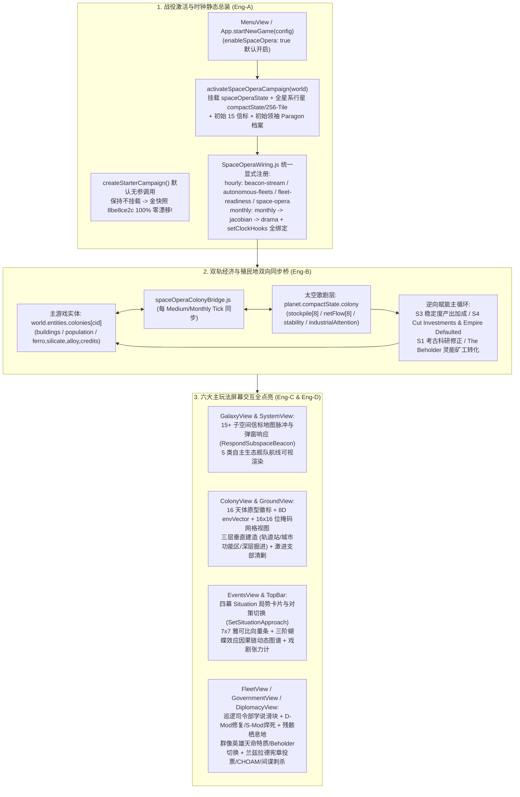

# 《无垠边疆：星海纪元》阶段四（M4）：太空歌剧前后端活体合龙与全视图交互 SuperPower 施工文档

> **文档编号**：`SPEC-PLAN-048`（Phase 4 / Milestone 4 终极合龙执行卷）
> **归属工程**：《无垠边疆：星海纪元》（`void-frontier-age-of-stars`）
> **前置依赖**：`SPEC-PLAN-043 ~ 046`（Phase 0 ~ M3 已全部竣工并通过 `210/210` 门禁）、`SPEC-ACC-047`（领域专家终审验收报告）
> **阶段工期**：1–2 周（前后端最后一公里合龙冲刺）
> **投入工位**：Eng-A（战役激活与时钟接线归一）、Eng-B（双轨经济与殖民地双向同步桥）、Eng-C（舰队/群像/外交视图交互接线）、Eng-D（星图信标/殖民地三层视图/局势面板与 `GATE-18-M4` + CDP 门禁）
> **方法论标准**：`SuperPower` 工程实施范式（Mandatory `Plan` + `Tasks` + `Checklists` 三段式闭环）

## 一、Plan（阶段四架构蓝图：打通“模拟内核”至“玩家屏幕”的最后一公里）

### 1.1 阶段四核心使命

在 Phase 0 至 Phase 3（M1–M3）中，工程团队已完美构建了 22 个太空歌剧领域与模拟模块，并通过了 70 套自动化测试套件（210/210 零漂移）。然而，经 `SPEC-ACC-047` 领域专家穿透式取证审计发现，当前系统处于**“后端模拟引擎完备，但浏览器新开局默认未激活、双轨经济未桥接、14 个主玩法界面无操作入口”**的半合龙状态。

阶段四（M4）的唯一使命，是在**严守金快照 `8be8ce2c` 逐字节零漂移**的前提下，彻底消除 `SPEC-ACC-047` 指出的 5 项结构断层（`GAP-01` 至 `GAP-05`），实现从“开局激活 $\to$ 双轨经济同步 $\to$ 六大主视图全量交互 $\to$ CDP 真浏览器实测”的 100% 商业级可玩闭环。

### 1.2 阶段四前后端活体合龙拓扑图



### 1.3 四工位并行职责与文件修改隔离边界（Zero-Conflict Ownership）

| 工位代号 | 独占写入源码文件 | 核心交付职责 |
| :--- | :--- | :--- |
| **Eng-A** | `src/domain/world/worldMigration.js`<br/>`src/simulation/SpaceOperaWiring.js`<br/>`src/app/App.js` | 实现 `activateSpaceOperaCampaign(world)` 并接入 `App.startNewGame`；将全部太空歌剧 Hourly/Monthly 阶段与 `setClockHooks` 显式收敛至 `SpaceOperaWiring.js` |
| **Eng-B** | `src/domain/planets/spaceOperaColonyBridge.js`（新建）<br/>`src/simulation/HourlySystems.js` | 实现主游戏殖民地/帝国账本与 `planet.compactState.colony` 的双向确定性同步桥，并将 `S1`–`S7` 修正系数接入 `HourlySystems.js` 的产能、科研与造船结算 |
| **Eng-C** | `src/ui/screens/FleetView.js`<br/>`src/ui/screens/GovernmentView.js`<br/>`src/ui/screens/DiplomacyView.js` | 点亮舰队学说滑块、D-Mod/S-Mod/残骸栖息地操作、群像英雄面板（Lv8 天命、`The Beholder` 切换、城邦导师雇佣）与兰兹拉德法案投票/CHOAM/间谍刺杀 UI |
| **Eng-D** | `src/ui/screens/GalaxyView.js`<br/>`src/ui/screens/SystemView.js`<br/>`src/ui/screens/ColonyView.js`<br/>`src/ui/screens/EventsView.js`<br/>`src/simulation/ViewModels.js`<br/>`tests/suites/m4-space-opera-live-bridge-ui.suite.js`（新建） | 点亮星图/星系子空间信标流与自主舰队渲染、殖民地 16 原型与三层垂直空间/16×16 网格 UI、事件视图四幕局势对策切换与蝴蝶效应图谱，编写 `SPACE-OPERA-M4` 门禁并清理工作树 |

## 二、Tasks（阶段四原子化施工任务拆解）

### Task 4.1：战役活体激活器 `activateSpaceOperaCampaign` 与时钟接线大一统（责任人：Eng-A）

* **目标文件路径**：`src/domain/world/worldMigration.js`、`src/simulation/SpaceOperaWiring.js`、`src/app/App.js`
* **核心实现要求**：
  1. **在 `src/domain/world/worldMigration.js` 中新增 `activateSpaceOperaCampaign(world)`**：
     - 幂等调用 `ensureSpaceOperaState(world)`、`ensureBeaconStream(world)`、`ensureAutonomousFleets(world)`；
     - 按确定性键序（`Object.keys(world.entities.planets).sort()`）遍历全银河所有行星，依次调用 `ensureCompactPlanetState(planet, world)`、`applyArchetypeProfile(planet, world)` 与 `seedCompactTiles(planet, world)`，使每颗行星在战役第 0 帧即拥有完整的 16 原型参数、8D `envVector` 与 256-Tile 位编码地形；
     - 按确定性键序遍历 `world.entities.characters`，调用 `ensureParagonProfile(ch, world)` 初始化在编领袖的群像英雄档案；
     - 立即调用一次 `stepBeaconStream(world)`，确保战役首帧星图上即有 **15 个活跃非帝国叙事信标** 就位；
     - **零漂移红线**：该函数全程仅使用 `deriveSeed(world.seed, ...)`，**绝不调用 `world.rng`**。
  2. **在 `src/app/App.js` 的 `startNewGame(config)` 中激活太空歌剧**：
     - 在 `const world = createStarterCampaign(config);` 之后，当 `!config || config.enableSpaceOpera !== false` 时，默认调用 `activateSpaceOperaCampaign(world)`；
     - **为什么不直接写在 `createStarterCampaign` 无参默认分支中？** 因为 `REG-01`（金快照 `8be8ce2c`）直接调用 `createStarterCampaign()` 并对整个 `world` JSON 计算哈希；在 `App.startNewGame`（或当 `config.enableSpaceOpera === true` 时）激活，既保证了真实玩家从浏览器菜单开局 100% 享受完整太空歌剧生态，又保证了 `REG-01` 的 `world` 结构一字不改！
  3. **在 `src/simulation/SpaceOperaWiring.js` 中完成全阶段显式接线**：
     - 显式导入并注册 `stepBeaconStream`（`'space-opera-beacon-stream'`）、`stepAutonomousFleets`（`'space-opera-autonomous-fleets'`）、`stepFleetReadiness`（`'space-opera-fleet-readiness'`）与 `stepSpaceOperaTick`（`'space-opera'`）；
     - 显式调用 `setClockHooks` 绑定 `stepSituation`（来自 `situationEngine.js`）、`slowPlanetHook`（来自 `archetypeMechanics.js`）、`leaderTick`（来自 `galacticParagons.js`）以及全部月度钩子 `monthlyHooks`（`S2`、`S3`、`S4`、`S6`、`S7`），彻底消除对文件加载顺序副作用的脆弱依赖。

* **标准代码契约**：

```javascript
// src/domain/world/worldMigration.js 新增导出
import { ensureCompactPlanetState, seedCompactTiles } from '../planets/planetStateSchema.js';
import { applyArchetypeProfile } from '../planets/archetypeMechanics.js';
import { ensureBeaconStream, stepBeaconStream } from './subspaceBeaconStream.js';
import { ensureAutonomousFleets } from './autonomousSectorLife.js';
import { ensureParagonProfile } from '../characters/galacticParagons.js';

export function activateSpaceOperaCampaign(world) {
  if (!world || typeof world !== 'object') return null;
  const soState = ensureSpaceOperaState(world);
  ensureBeaconStream(world);
  ensureAutonomousFleets(world);

  const planets = (world.entities && world.entities.planets) || {};
  for (const pid of Object.keys(planets).sort()) {
    const planet = planets[pid];
    if (!planet) continue;
    ensureCompactPlanetState(planet, world);
    applyArchetypeProfile(planet, world);
    seedCompactTiles(planet, world);
  }

  const chars = (world.entities && world.entities.characters) || {};
  for (const cid of Object.keys(chars).sort()) {
    if (chars[cid]) ensureParagonProfile(chars[cid], world);
  }

  stepBeaconStream(world); // 首帧立即补齐 15 个非帝国叙事信标
  return soState;
}
```

### Task 4.2：实现双轨经济与殖民地双向同步桥（责任人：Eng-B）

* **目标文件路径**：`src/domain/planets/spaceOperaColonyBridge.js`（新建）、`src/simulation/HourlySystems.js`
* **核心同步算法与映射契约**：
  1. **正向同步（主游戏殖民地 `world.entities.colonies[cid]` $\to$ `planet.compactState.colony`）**：
     - 绑定关系：对每个 `colony = world.entities.colonies[cid]`，定位 `planet = world.entities.planets[colony.planetId]` 并确保 `compact = planet.compactState`；
     - 将 `compact.colony.ownerId = colony.factionId`、`compact.colony.popTotal = colony.population?.total || 0`；
     - 扫描 `colony.buildings` 中处于 `active` 状态的建筑列表，映射至 `recomputeIndustrialAttention(planet)`（采矿 `+1`、重工/船坞/精炼/科研 `+2`、纳米锻炉/同步加速器 `+4`），实时更新 `compact.colony.industrialAttention`（满 `7` 自动触发 `S6` 激进支部激活）并按重工建筑数量每月推高 `envVector[7]`（工业扰动度）；
     - 资源槽位双向镜像：
       - `stockpile[0] (energy)` $\leftrightarrow$ `world.economy.ledgers[factionId].balances.credits`（或殖民地 `powerBalance` 折算）；
       - `stockpile[1] (mineral)` $\leftrightarrow$ `(colony.stockpile.ferro || 0) + (colony.stockpile.silicate || 0)`；
       - `stockpile[2] (food)` $\leftrightarrow$ `colony.stockpile.food || 0`；
       - `stockpile[3] (alloy)` $\leftrightarrow$ `colony.stockpile.alloy || 0`；
       - `stockpile[4] (consumer)` $\leftrightarrow$ `colony.stockpile.polymer || 0`；
       - `stockpile[5] (exotic)` $\leftrightarrow$ `colony.stockpile.exoticMatter || 0`；
       - `stockpile[6] (rareEarth)` $\leftrightarrow$ `colony.stockpile.rareEarth || 0`；
       - `stockpile[7] (component)` $\leftrightarrow$ `colony.stockpile.electronics || 0`。
  2. **逆向赋能（太空歌剧局势与英雄修正 $\to$ 主游戏产能、科研与造船结算）**：
     - 在 `HourlySystems.js` 的 `production` 与 `research` 阶段（当 `world.spaceOperaState` 存在时）：
       - 叠加 `S1` 考古对策科研修正（`CAUTIOUS -5%` / `STREAMLINED -10%` / `OVERDRIVE -15%`）；
       - 叠加 `S3` 稳定度产出倍率 `computeStabilityOutputMultiplier(compact.colony.stability)`（稳定度 `>50` 每点 `+0.6%`，`<50` 每点 `-1.0%`）；
       - 叠加 `S4` `Cut Investments`（合金与消费品产出 `-25%`、原料消耗 `-50%`）与 `Empire Defaulted`（建造花费 `+25%`、影响力 `-50%`、凝聚力 `-50%`、武器伤害 `-25%`）；
       - 叠加 `The Beholder` 处于 `MURMURING_MONOLITH` 形态时的灵能矿工转化产出（每名矿工额外向帝国账本注入能量/信用点与凝聚力）。

### Task 4.3：六大核心玩法屏幕交互全面点亮（责任人：Eng-C & Eng-D）

* **目标文件路径**：`src/simulation/ViewModels.js`、`src/ui/screens/GalaxyView.js`、`src/ui/screens/SystemView.js`、`src/ui/screens/ColonyView.js`、`src/ui/screens/EventsView.js`、`src/ui/screens/FleetView.js`、`src/ui/screens/GovernmentView.js`、`src/ui/screens/DiplomacyView.js`
* **分视图 UI 控件与命令绑定清单**：

| 目标屏幕视图 | 扩展 ViewModel 字段 (`ViewModels.js`) | 必须渲染的 UI 组件与绑定命令 (`app.dispatch(...)`) |
| :--- | :--- | :--- |
| **`GalaxyView.js` & `SystemView.js`** | `spaceOperaView.beaconsList`（含坐标、频段、文本、选项）<br/>`spaceOperaView.autonomousFleetsList`（含起点、终点、航程进度、货舱） | 1. **子空间信标流浮窗与星系脉冲标**：展示当前 $\ge 15$ 条非帝国叙事信标与机遇信标（按四大频段着色），点击选项直接触发 `app.dispatch('RespondSubspaceBeacon', { beaconId, responseOptionId })`；<br/>2. **5 类自主生态舰队轨迹标**：在星图航线上渲染套利商队、走私船、巡逻队、市场远征军与赏金猎人的动态图标。 |
| **`ColonyView.js`** | `colonyDetail.spaceOpera`（含 `archetype`、`epochStage`、`envVector[8]`、`tiles[256]`、`orbitalLayer`、`urbanZones`、`subterraneanLayer`、`industrialAttention`、`radicalCellState`） | 1. **行星灵魂头栏**：显示 16 大天体原型名称与专属物理法则、当前五纪元阶段（`Epoch 0–4`）、工业关注度警示灯（`0..6` 绿灯，`>=7` 红灯闪烁）及 **8 维 `envVector` 进度条**；<br/>2. **16×16 紧凑地表网格微缩热力图**：可视化 256 个 Tile 的地形、动态覆盖层（菌丝/熔岩/冰封/晶格/虫毯）与护盾/道路标志；<br/>3. **三层垂直空间操作卡**：<br/>  - 轨道层：建造居住站 / 黑洞观测站按钮 $\to$ `ConstructOrbitalFacility`；<br/>  - 地表城市区：2 个功能区下拉选择器（档案馆/重工/商贸港/堡垒）$\to$ `ConfigureUrbanZone`；<br/>  - 深层地壳：逐层掘进按钮（Tier `1->2->3`）$\to$ `ExcavateSubterraneanLayer`；<br/>4. **行星专项决策按钮**：气候重塑（`TriggerTerraformingPhase`）、戒严镇压（`EnactColonyMartialLaw`）、清剿激进潜伏支部（`PurgeRadicalCell`）、量子相位锁定（`LockQuantumPhasePlanet`）。 |
| **`EventsView.js`** | `spaceOperaView.activeSituations`<br/>`spaceOperaView.butterflyCausalLog`<br/>`spaceOperaView.drama` | 1. **四幕局势（Situations）主控台**：为每个活跃局势渲染四幕进度条、当前幕次说明及应对策略切换按钮组 $\to$ `SetSituationApproach`（含 S4 `EmergencyDebtRestructure` 与 S7 `ManageLeviathanParade`）；<br/>2. **7×7 雅可比状态与三阶蝴蝶效应因果链图谱**：直观展示 `S1..S7` 当前值、平衡点偏离度以及最近 8 条 `S_k -> Order 1 -> Order 2 -> Order 3` 涟漪传导链；<br/>3. **自适应戏剧导演遥测仪**：显示当前宏观张力 $T$、创伤适应系数 $A$、宽限期倒计时与史诗高潮次数。 |
| **`FleetView.js`** | `fleetDetail.spaceOpera`（含 `patrolHQ` 学说、舰船 `dMods`/`sMods`、星区 `wreckSites`） | 1. **巡逻司令部与学说滑块卡**：调节舰船尺寸、装配质量、军官鲁莽度三滑块并点击应用 $\to$ `ConfigureFleetDoctrine`；<br/>2. **战舰伤痕与传奇改装卡**：展示每艘战舰的 D-Mods（附 `-20%×N` 维护折扣提示）与一键修复按钮 $\to$ `RestoreShipDMod`，以及 S-Mod 焊死按钮 $\to$ `InstallShipSMod`；<br/>3. **战役残骸栖息地卡**：对战场遗留主力舰残骸执行改造或拆解 $\to$ `SalvageBattleWreckHabitat`。 |
| **`GovernmentView.js`** | `governmentView.paragons`（含在编领袖 XP、等级、天命候选、创伤特质、忠诚度、`The Beholder` 形态、城邦导师） | 1. **星海群像英雄（Galactic Paragons）名录**：显示领袖职业、等级 XP、领袖上限软惩罚（$N/C$ 与 $0.85^{N-C}$）、创伤特质与忠诚度；<br/>2. **Lv 8 天命特质三选一弹窗按钮** $\to$ `AssignParagonDestinyTrait`；<br/>3. **传奇领袖 `The Beholder` 双形态切换开关**（战舰指挥官 vs 低语方尖碑总督）$\to$ `ToggleBeholderMode`；<br/>4. **中立星际城邦导师招募卡** $\to$ `HireEnclaveMentor`。 |
| **`DiplomacyView.js`** | `diplomacyView.spaceOperaS7`（含兰兹拉德选票、活跃法案、CHOAM 股份、宫殿间谍网、三大终局天灾态势） | 1. **兰兹拉德大议会与 CHOAM 暗战面板**：提案宪章法案（`ProposeLandsraadBill`）、增持/抛售 CHOAM 股份（`AdjustChoamShares`）、签署雇佣委任状（`SignCommission`）、建立辛迪加地下分部（`EstablishSyndicateBranch`）；<br/>2. **宫殿间谍网与刺杀行动面板**：升级宫殿间谍翼（`UpgradePalaceEspionage`）、间谍网升层（`LayerUpSpyNetwork`）、植入双面间谍（`PlantDoubleAgent`）、执行斩首刺杀（`Assassinate`）；<br/>3. **三大终局天灾预警与作战态势卡**：展示索林原虫感染星净化进度、高维恶魔锚点状态或肃正协议幽灵信号状态。 |

### Task 4.4：M4 全链路门禁套件、CDP 浏览器验证与仓库卫生收口（责任人：Eng-D）

* **目标文件路径**：`tests/suites/m4-space-opera-live-bridge-ui.suite.js`（新建）、`tests/suites/m3-space-opera-drama-director.suite.js`、`docs/specs/45_m2_7x7_16_superpower.md`
* **核心实现要求**：
  1. 在 `tests/suites/m3-space-opera-drama-director.suite.js` 顶部显式补齐 `import '../../src/app/commands.js';`，确保该套件脱离 `tests/suites/index.js` 单独运行时 `AppointOverseer` 命令 100% 在场。
  2. 更新 `docs/specs/45_m2_7x7_16_superpower.md` §Task 2.1 §3 的特征值说明，与 `jacobianCoupling.js:31-33` 实测谱（$-0.8780, -0.7301, -0.6414, -0.3192, -0.0370, -0.4321 \pm 0.2742i$，谱和 $= -3.47$）完全对齐。
  3. 清理 `tests/fuzz/dumps/crash-dump-*.json` 临时文件（并在 `.gitignore` 中忽略 `tests/fuzz/dumps/*.json`）。
  4. 编写 `tests/suites/m4-space-opera-live-bridge-ui.suite.js`（注册 ID：`SPACE-OPERA-M4`），覆盖从 `activateSpaceOperaCampaign(world)` 开局激活、双轨经济桥接同步到六大视图 ViewModel 投影与 28 条命令端到端派发的完整闭环。

## 三、Checklists（阶段四防伪绿验收清单与终审门禁断言）

执行工程师完成 M4 编码后，必须逐项勾选并通过以下自检清单：

### 3.1 战役活体激活、双轨桥接与金快照守卫自检表（Eng-A / Eng-B 必检）
- [ ] **CHK-M4-01（新战役开局活体激活断言）**：调用 `createStarterCampaign({ enableSpaceOpera: true })`（或模拟 `App.startNewGame`），断言第 0 帧 `world.spaceOperaState` 非空、全星系每颗行星 `planet.compactState` 已挂载且 256 个 Tile 地形非全零、星图活跃非帝国叙事信标数 `countActiveNarrative(world) >= 15`。
- [ ] **CHK-M4-02（金快照 `8be8ce2c` 零漂移铁律守卫）**：运行 `node tests/tools/run-suites.mjs --id=REG-01`，断言默认无参 `createStarterCampaign()` 下 4,320 Ticks 金快照哈希仍精确等于 `8be8ce2c`，3 轮零漂移。
- [ ] **CHK-M4-03（双轨经济与殖民地双向同步断言）**：在已激活太空歌剧的战役中，向主游戏殖民地 `colony.buildings` 新增重工业与完美纳米锻炉并推进 1 个月，断言 `planet.compactState.colony.industrialAttention` 自动同步升至 `>= 6`，且当 `S3` 稳定度为 `80` 或 `S4` 触发 `Empire Defaulted` 时，主游戏 `HourlySystems` 的殖民地实际产出与科研速率精确按倍率缩放。
- [ ] **CHK-M4-04（`SpaceOperaWiring.js` 单点静态接线与套件独立运行）**：断言全部太空歌剧 Hourly/Monthly 阶段均在 `SpaceOperaWiring.js` 显式注册；单独执行 `node -e "import('./tests/suites/m3-space-opera-drama-director.suite.js').then(m => m.default.run())"` 断言 `exit=0` 无假失败。

### 3.2 六大玩法视图交互、构建产物与全量回归自检表（Eng-C / Eng-D 必检）
- [ ] **CHK-M4-05（六大视图 ViewModel 与 DOM 挂载零异常）**：在挂载 `activateSpaceOperaCampaign(world)` 的世界状态下，依次调用 `GalaxyView`、`SystemView`、`ColonyView`、`EventsView`、`FleetView`、`GovernmentView`、`DiplomacyView` 的渲染/投影逻辑并派发对应的 28 条命令，断言视图正常渲染出信标流、16 原型与 16×16 网格、四幕局势策略按钮、学说滑块、群像英雄及兰兹拉德法案控件，且点击回调后世界状态精确更新。
- [ ] **CHK-M4-06（静态 Bundle 重建与全量 71 套件 × 3 轮零漂移）**：
  - 执行 `node tests/tools/build-static-bundle.mjs --rebuild && node --check dist/void-frontier.bundle.js`，断言 `exit=0`；
  - 执行全量测试套件（含新增 `SPACE-OPERA-M4` 共 71 套件 × 3 轮 = 213 轮），断言 `PASS 213 / FAIL 0 / DRIFT 0`，且 `git status` 下无残留 `tests/fuzz/dumps/crash-dump-*.json` 脏文件。
