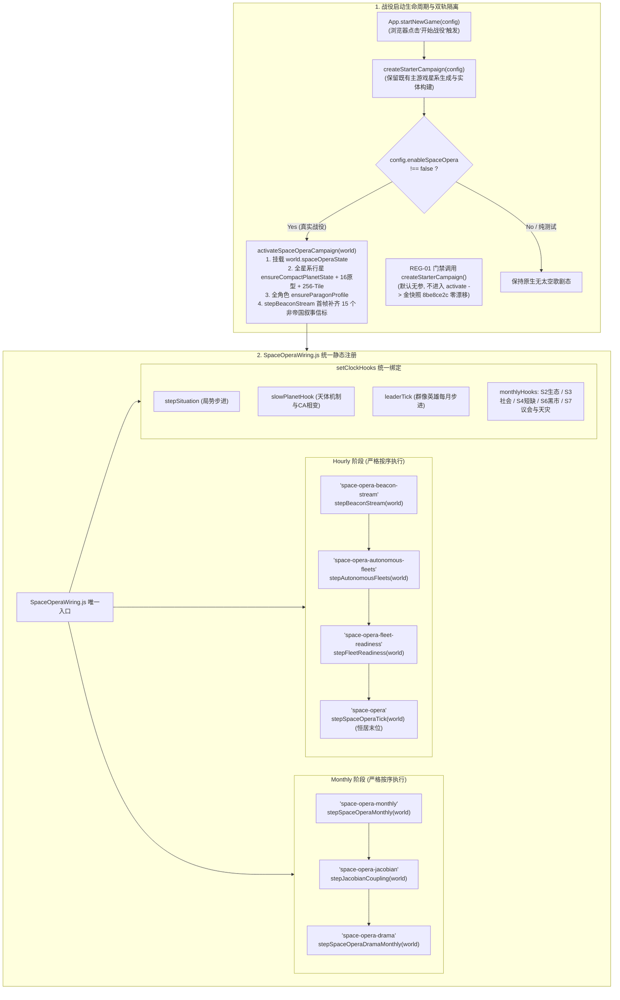

# 《无垠边疆：星海纪元》阶段四（M4）工位 A：战役活体激活与时钟静态接线施工规范

> **文档编号**：`SPEC-PLAN-049`（Phase 4 / Eng-A 专项执行卷）  
> **归属工程**：《无垠边疆：星海纪元》（`void-frontier-age-of-stars`）  
> **上游总纲**：`SPEC-PLAN-048`（阶段四 M4 终极合龙总纲）、`SPEC-ACC-047`（领域专家终审验收报告）  
> **责任工位**：**Eng-A（战役生命周期核心与时钟配线工程师）**  
> **独占修改文件**：
> - `src/domain/world/worldMigration.js`（新增 `activateSpaceOperaCampaign` 活体战役激活器）
> - `src/simulation/SpaceOperaWiring.js`（全时钟阶段统一静态显式注册与时钟钩子集中闭环）
> - `src/app/App.js`（新战役启动链接入与条件激活）  
> **前置依赖**：`SPEC-PLAN-043 ~ 046` 交付之 22 模块与 4 门禁套件全部处于绿灯状态  
> **方法论标准**：`SuperPower` 工程实施范式（Mandatory `Plan` + `Tasks` + `Checklists` 三段式闭环）

---

## 一、Plan（工位 A 架构蓝图与核心使命）

### 1.1 核心使命与消除断层目标

在 Phase 0 至 Phase 3（M1–M3）中，系统构建了确定性哈希、紧凑 `PlanetState`、三级时钟、四幕局势、7×7 雅可比矩阵、16 大天体原型与自适应戏剧导演等先进模块。但在 `SPEC-ACC-047` 验收中，领域专家指出了两大关键阻断：
1. **`GAP-01`（新战役启动惰性死锁）**：`App.startNewGame(config)` 派生新战役时，未对银河行星播种 `compactState`、未生成 256 格位位掩码地形、未初始化群像英雄档案、未注入 15 个初始信标，导致真实玩家在浏览器中游玩时太空歌剧系统全程处于 `undefined` 僵死态。
2. **`GAP-04`（时钟静态接线未覆盖 M3 阶段）**：`SpaceOperaWiring.js` 未显式收录 M3 的自主舰队、信标流与战备度恢复阶段，且时钟钩子依赖各模块导入期的顶层副作用执行，存在打包产物阶段遗失风险。

工位 A 的核心使命是：**在绝对守护金快照 `8be8ce2c` 逐字节零漂移的前提下，建立一套幂等、确定性、高鲁棒的战役活体激活器，并实现太空歌剧全部 Hourly 与 Monthly 阶段在 `SpaceOperaWiring.js` 的单一静态闭环汇聚**。

### 1.2 战役激活与静态时钟流转架构图



### 1.3 核心技术不变量与红线守卫

1. **确定性 PRNG 铁律**：`activateSpaceOperaCampaign` 及其调用的所有初始化逻辑，**严禁调用 `world.rng`**！所有伪随机播种必须使用 `src/domain/world/deterministicRng.js` 中的 `deriveSeed(world.seed, DOMAIN_SALTS.PLANET_TERRAIN, pid)` 等盐值子流，确保同一 `world.seed` 生成的行星地形、原型参数与初始信标 100% 逐比特确定可复现。
2. **全键稳定排序遍历**：遍历 `world.entities.planets` 与 `world.entities.characters` 时，必须使用 `Object.keys(...).sort()`，严禁依赖 JS 引擎不确定的枚举顺序。
3. **金快照纯洁性守护**：`REG-01` 门禁依赖无参 `createStarterCampaign()` 的快照哈希。任何使无参调用产生 `world.spaceOperaState` 的改动均视为严重违规。

---

## 二、Tasks（工位 A 原子化施工任务拆解）

### Task 49.1：编写活体战役激活器 `activateSpaceOperaCampaign(world)`

* **目标文件**：`src/domain/world/worldMigration.js`
* **代码契约与实现细则**：
  1. 导入依赖：
     ```javascript
     import { DOMAIN_SALTS, deriveSeed } from './deterministicRng.js';
     import { ensureCompactPlanetState, seedCompactTiles } from '../planets/planetStateSchema.js';
     import { applyArchetypeProfile } from '../planets/archetypeMechanics.js';
     import { ensureBeaconStream, stepBeaconStream } from './subspaceBeaconStream.js';
     import { ensureAutonomousFleets } from './autonomousSectorLife.js';
     import { ensureParagonProfile } from '../characters/galacticParagons.js';
     ```
  2. 实现函数签名与逻辑：
     ```javascript
     /**
      * 将一个已完成基础实体构建的 world 实例深度激活为太空歌剧活体战役。
      * 具备幂等性：重复调用不破坏既有数据。
      * 严格确定性：仅消耗派生盐种子，不触碰 world.rng。
      * @param {Object} world - 主游戏世界状态
      * @returns {Object|null} world.spaceOperaState 实例
      */
     export function activateSpaceOperaCampaign(world) {
       if (!world || typeof world !== 'object') return null;

       // 1. 根容器初始化
       const soState = ensureSpaceOperaState(world);
       ensureBeaconStream(world);
       ensureAutonomousFleets(world);

       // 2. 全星系行星深度底座铺设
       const planets = (world.entities && world.entities.planets) || {};
       const planetIds = Object.keys(planets).sort();
       for (let i = 0; i < planetIds.length; i++) {
         const pid = planetIds[i];
         const planet = planets[pid];
         if (!planet) continue;

         // 挂载 3,703B 紧凑 PlanetState
         ensureCompactPlanetState(planet, world);
         // 注入 16 大天体物理原型法则与 8D envVector
         applyArchetypeProfile(planet, world);
         // 播种 256-Tile uint32 位编码地形与初始覆盖层
         seedCompactTiles(planet, world);
       }

       // 3. 全局群像领袖档案初始化
       const characters = (world.entities && world.entities.characters) || {};
       const charIds = Object.keys(characters).sort();
       for (let i = 0; i < charIds.length; i++) {
         const cid = charIds[i];
         const ch = characters[cid];
         if (ch) {
           ensureParagonProfile(ch, world);
         }
       }

       // 4. 首帧信标池预热（立即补齐至 >= 15 条非帝国叙事信标）
       stepBeaconStream(world);

       return soState;
     }
     ```

### Task 49.2：在战役启动链接入 `activateSpaceOperaCampaign`

* **目标文件**：`src/app/App.js`
* **代码契约与实现细则**：
  1. 在 `src/app/App.js` 头部导入：
     ```javascript
     import { activateSpaceOperaCampaign } from '../domain/world/worldMigration.js';
     ```
  2. 定位 `startNewGame(config)` 方法（约第 230 行）：
     ```javascript
     startNewGame(config = {}) {
       const world = createStarterCampaign(config);
       
       // 战役活体激活注入：当未显式禁用太空歌剧时，自动合龙激活
       if (config.enableSpaceOpera !== false) {
         activateSpaceOperaCampaign(world);
       }

       this.world = world;
       // ... 保持原有视图导航、UI 挂载与时钟重置逻辑不变
     }
     ```
  3. 审查存档/读档兼容性（`saveGame` 与 `loadGame`）：确保 `world.spaceOperaState` 能作为顶层字段被 JSON 序列化与反序列化，读档后若检测到旧存档缺失 `spaceOperaState`，可在后续由 `ensureSpaceOperaState(world)` 惰性补全。

### Task 49.3：`SpaceOperaWiring.js` 全时钟阶段与时钟钩子集中闭环

* **目标文件**：`src/simulation/SpaceOperaWiring.js`
* **代码契约与实现细则**：
  1. 彻底清除全工程中分散在各处的 `registerHourly` / `registerMonthly` 副作用调用，将其全部收拢至 `SpaceOperaWiring.js`。
  2. 导入所有涉及的步进函数与钩子：
     ```javascript
     import { registerHourly, registerMonthly } from './HourlySystems.js';
     import { setClockHooks, stepSpaceOperaTick, stepSpaceOperaMonthly } from './SpaceOperaClock.js';
     import { stepJacobianCoupling } from './jacobianCoupling.js';
     import { stepSpaceOperaDramaMonthly } from './dramaDirector.js';
     import { stepBeaconStream } from '../domain/world/subspaceBeaconStream.js';
     import { stepAutonomousFleets } from '../domain/world/autonomousSectorLife.js';
     import { stepFleetReadiness } from '../domain/fleets/fleetDoctrineAndScars.js';
     import { stepSituationBucket } from '../domain/events/situationEngine.js';
     import { stepArchetypeMechanics } from '../domain/planets/archetypeMechanics.js';
     import { stepParagonLeaderTick } from '../domain/characters/galacticParagons.js';
     import { stepEcologicalPerturbation } from '../domain/planets/ecologicalPhaseArc.js';
     import { stepColonySocialMonthly } from '../domain/politics/colonySocialArc.js';
     import { stepStrategicShortageMonthly } from '../domain/economy/shortageSituationArc.js';
     import { stepShadowSyndicateMonthly } from '../domain/economy/shadowSyndicateArc.js';
     import { stepGalacticSenateMonthly, stepEndgameCrisisMonthly } from '../domain/diplomacy/galacticSenateAndCrisisArc.js';
     ```
  3. 统一注册 Hourly 阶段（必须确保 `'space-opera'` 处于最末尾）：
     ```javascript
     registerHourly('space-opera-beacon-stream', (world) => {
       if (world && world.spaceOperaState) stepBeaconStream(world);
     });
     registerHourly('space-opera-autonomous-fleets', (world) => {
       if (world && world.spaceOperaState) stepAutonomousFleets(world);
     });
     registerHourly('space-opera-fleet-readiness', (world) => {
       if (world && world.spaceOperaState) stepFleetReadiness(world);
     });
     registerHourly('space-opera', (world) => {
       if (world && world.spaceOperaState) stepSpaceOperaTick(world);
     });
     ```
  4. 统一注册 Monthly 阶段（月度演化顺序：基础状态 $\to$ 雅可比耦合 $\to$ 戏剧导演）：
     ```javascript
     registerMonthly('space-opera-monthly', (world) => {
       if (world && world.spaceOperaState) stepSpaceOperaMonthly(world);
     });
     registerMonthly('space-opera-jacobian', (world) => {
       if (world && world.spaceOperaState) stepJacobianCoupling(world);
     });
     registerMonthly('space-opera-drama', (world) => {
       if (world && world.spaceOperaState) stepSpaceOperaDramaMonthly(world);
     });
     ```
  5. 集中显式绑定 `setClockHooks`：
     ```javascript
     setClockHooks({
       stepSituation: stepSituationBucket,
       slowPlanetHook: stepArchetypeMechanics,
       leaderTick: stepParagonLeaderTick,
       monthlyHooks: [
         stepEcologicalPerturbation,
         stepColonySocialMonthly,
         stepStrategicShortageMonthly,
         stepShadowSyndicateMonthly,
         stepGalacticSenateMonthly,
         stepEndgameCrisisMonthly
       ]
     });
     ```

---

## 三、Checklists（工位 A 交付验收清单）

完成编码后，工位 A 工程师必须逐项验证并通过以下自检门禁：

- [ ] **CHK-49-01（活体激活全星系覆盖断言）**：
  - 执行测试：调用 `createStarterCampaign({ enableSpaceOpera: true })`；
  - 判定标准：
    - `world.spaceOperaState` 对象完整挂载，包含 `systemVector[7]` 与 `drama` 结构；
    - 遍历 `world.entities.planets`，断言 100% 行星包含 `compactState`、`compactState.tiles.length === 256` 且 `compactState.envVector.length === 8`；
    - 遍历 `world.entities.characters`，断言在编领袖均挂载 `paragonProfile`。
- [ ] **CHK-49-02（第 0 帧信标不变量断言）**：
  - 判定标准：战役初始化完成瞬间，调用 `countActiveNarrative(world)` 返回值必须 $\ge 15$。
- [ ] **CHK-49-03（金快照零漂移铁律守卫）**：
  - 执行测试：`node tests/tools/run-suites.mjs --id=REG-01`；
  - 判定标准：三轮比对中，无参调用 `createStarterCampaign()` 产物的 4,320 Ticks 金快照哈希必须恒等于 `8be8ce2c`，轮间漂移为 0。
- [ ] **CHK-49-04（时钟阶段静态注册完整性断言）**：
  - 判定标准：检查 `HourlySystems.js` 的阶段注册表，断言包含 `'space-opera-beacon-stream'`、`'space-opera-autonomous-fleets'`、`'space-opera-fleet-readiness'`、`'space-opera'` 以及 3 个 Monthly 阶段，顺序严格无误。
- [ ] **CHK-49-05（静态打包与编译合规）**：
  - 执行测试：`node tests/tools/build-static-bundle.mjs --rebuild && node --check dist/void-frontier.bundle.js`；
  - 判定标准：构建成功且语法检查退出码必须为 `0`，代码中无游离动态 `import()` 或顶层 `await`。
