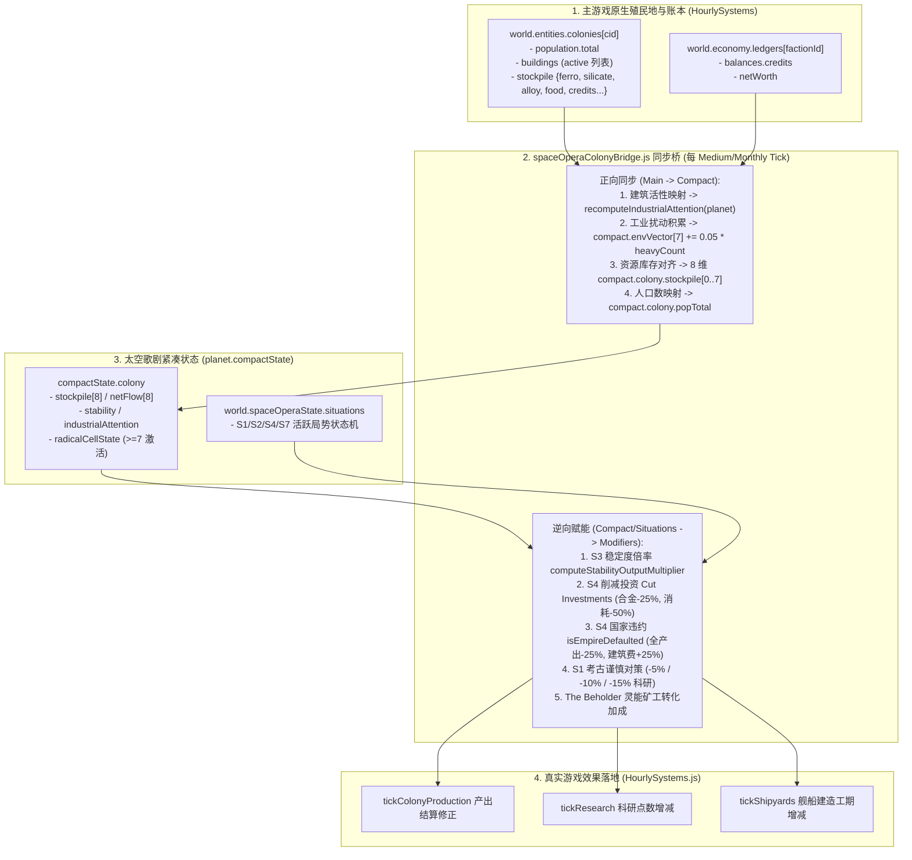

# 《无垠边疆：星海纪元》阶段四（M4）工位 B：双轨经济与殖民地双向同步桥施工规范

> **文档编号**：`SPEC-PLAN-050`（Phase 4 / Eng-B 专项执行卷）  
> **归属工程**：《无垠边疆：星海纪元》（`void-frontier-age-of-stars`）  
> **上游总纲**：`SPEC-PLAN-048`（阶段四 M4 终极合龙总纲）、`SPEC-ACC-047`（领域专家终审验收报告）  
> **责任工位**：**Eng-B（殖民地模拟与双轨经济同步桥工程师）**  
> **独占修改文件**：
> - `src/domain/planets/spaceOperaColonyBridge.js`（新建：双轨数据正向投影与逆向赋能桥）
> - `src/simulation/HourlySystems.js`（在产能、科研与造船阶段接入太空歌剧宏观加成）  
> **前置依赖**：`src/domain/planets/planetStateSchema.js`、`src/domain/politics/colonySocialArc.js`、`src/domain/economy/shortageSituationArc.js`、`src/domain/economy/shadowSyndicateArc.js`  
> **方法论标准**：`SuperPower` 工程实施范式（Mandatory `Plan` + `Tasks` + `Checklists` 三段式闭环）

---

## 一、Plan（工位 B 架构蓝图与核心使命）

### 1.1 核心使命与消除断层目标

在 Phase 0 至 Phase 3 中，太空歌剧在 `planet.compactState.colony` 中维护了一套 8 维紧凑资源槽 `stockpile[8]`、`netFlow[8]`、`stability` 与 `industrialAttention`，并在各局势弧线中定义了丰富的增益/惩罚规则（如 S3 稳定度倍率、S4 `Cut Investments` 与 `Empire Defaulted`、S1 考古科研惩罚等）。然而，`SPEC-ACC-047` §3.2 指出了致命的断层：
- **`GAP-02`（双轨经济与双轨殖民地状态裂脑）**：主游戏主循环（`HourlySystems.js` 与 `ColonyView.js`）运行在 `world.entities.colonies[cid].stockpile`（`ferro, silicate, alloy, food, credits` 等键值对象）与 `world.economy.ledgers[factionId]` 上；太空歌剧的 8 维数组与主游戏殖民地完全断联。玩家在界面造工厂不会推高太空歌剧工业关注度，反之太空歌剧的断供惩罚也无法影响主游戏的实际产出。

工位 B 的核心使命是：**建立 `spaceOperaColonyBridge.js` 双向同步桥，并在 `HourlySystems.js` 中实施非侵入式逆向修正，实现主游戏殖民实体与太空歌剧紧凑底座的无缝齿轮咬合**。

### 1.2 双向同步与修正传导拓扑图



### 1.3 核心资源槽位映射表

| 紧凑槽位索引 | 太空歌剧资源标识 | 主游戏原生数据源 | 映射折算公式与说明 |
| :--- | :--- | :--- | :--- |
| `stockpile[0]` | `energy` | `world.economy.ledgers[fId].balances.credits` | 绑定帝国账本信用点或殖民地正向电力余额 |
| `stockpile[1]` | `mineral` | `colony.stockpile.ferro` + `colony.stockpile.silicate` | 铁类与硅类矿石总和 |
| `stockpile[2]` | `food` | `colony.stockpile.food` | 殖民地食品库存 |
| `stockpile[3]` | `alloy` | `colony.stockpile.alloy` | 战略合金库存（S4 断供核心锚定点） |
| `stockpile[4]` | `consumer` | `colony.stockpile.polymer` | 消费聚合物折算 |
| `stockpile[5]` | `exotic` | `colony.stockpile.exoticMatter` | 奇异物质（S-Mod 消耗与跃迁燃料） |
| `stockpile[6]` | `rareEarth` | `colony.stockpile.rareEarth` | 稀土矿物 |
| `stockpile[7]` | `component` | `colony.stockpile.electronics` | 高级电子元件 |

### 1.4 修正公式与边界不变量

1. **S3 稳定度对产能倍率（`computeStabilityOutputMultiplier`）**：
   $$\text{Mult}_{\text{stab}} = \begin{cases} 
   1.0 + 0.006 \times (\text{stability} - 50) & (\text{stability} \ge 50) \quad [\text{上限 } 1.30] \\
   1.0 - 0.010 \times (50 - \text{stability}) & (\text{stability} < 50) \quad [\text{下限 } 0.70]
   \end{cases}$$
2. **S4 国家违约惩罚（`isEmpireDefaulted`）**：
   - 殖民地产出倍率：$\times 0.75$
   - 帝国科研速率：$\times 0.75$
   - 船坞装配速率：$\times 0.75$
   - 建筑建造费用：$\times 1.25$
3. **S1 考古科研惩罚**：
   - `CAUTIOUS`：科研速率 $\times 0.95$
   - `STREAMLINED`：科研速率 $\times 0.90$
   - `OVERDRIVE`：科研速率 $\times 0.85$

---

## 二、Tasks（工位 B 原子化施工任务拆解）

### Task 50.1：构建 `spaceOperaColonyBridge.js` 双向同步桥

* **目标文件**：`src/domain/planets/spaceOperaColonyBridge.js`（新建）
* **代码契约与实现细则**：
  ```javascript
  import { recomputeIndustrialAttention } from '../economy/shadowSyndicateArc.js';
  import { computeStabilityOutputMultiplier } from '../politics/colonySocialArc.js';
  import { isEmpireDefaulted } from '../economy/shortageSituationArc.js';

  /**
   * 将主游戏原生殖民地数据正向同步至太空歌剧 compactState。
   * 通常在每小时的 medium bucket 或月度结算时按需调用。
   */
  export function syncColonyToSpaceOpera(colony, world) {
    if (!colony || !world || !world.spaceOperaState) return;
    const planets = world.entities && world.entities.planets;
    const planet = planets && planets[colony.planetId];
    if (!planet || !planet.compactState || !planet.compactState.colony) return;

    const compact = planet.compactState;
    const cColony = compact.colony;
    const factionId = colony.factionId || 'player';

    // 1. 人口与归属同步
    cColony.ownerId = factionId;
    cColony.popTotal = (colony.population && colony.population.total) || 0;

    // 2. 资源库存槽位镜像
    const cStock = colony.stockpile || {};
    const ledger = world.economy && world.economy.ledgers && world.economy.ledgers[factionId];
    const credits = (ledger && ledger.balances && ledger.balances.credits) || 0;

    cColony.stockpile[0] = Math.max(0, credits);
    cColony.stockpile[1] = Math.max(0, (cStock.ferro || 0) + (cStock.silicate || 0));
    cColony.stockpile[2] = Math.max(0, cStock.food || 0);
    cColony.stockpile[3] = Math.max(0, cStock.alloy || 0);
    cColony.stockpile[4] = Math.max(0, cStock.polymer || 0);
    cColony.stockpile[5] = Math.max(0, cStock.exoticMatter || 0);
    cColony.stockpile[6] = Math.max(0, cStock.rareEarth || 0);
    cColony.stockpile[7] = Math.max(0, cStock.electronics || 0);

    // 3. 建筑与工业关注度重算 (mine +1, heavy +2, nanoforge +4)
    recomputeIndustrialAttention(planet);

    // 4. 重工业环境扰动每月增量推进
    if (compact.envVector && Array.isArray(compact.envVector)) {
      let heavyCount = 0;
      const bList = colony.buildings || [];
      for (let i = 0; i < bList.length; i++) {
        const b = bList[i];
        if (b && b.active && (b.type === 'heavy_industry' || b.type === 'refinery' || b.type === 'shipyard')) {
          heavyCount++;
        }
      }
      if (heavyCount > 0) {
        compact.envVector[7] = Math.min(100.0, compact.envVector[7] + heavyCount * 0.05);
      }
    }
  }

  /**
   * 计算指定殖民地当前所受的太空歌剧多系统宏观综合修正倍率。
   * @returns {Object} 修正系数对象
   */
  export function getSpaceOperaModifiers(colony, world) {
    const base = {
      productionMultiplier: 1.0,
      researchMultiplier: 1.0,
      shipyardMultiplier: 1.0,
      buildingCostMultiplier: 1.0,
      stabilityBonus: 0.0
    };

    if (!colony || !world || !world.spaceOperaState) return base;

    const planets = world.entities && world.entities.planets;
    const planet = planets && planets[colony.planetId];
    const compact = planet && planet.compactState;
    const cColony = compact && compact.colony;

    // 1. S3 稳定度倍率
    if (cColony && typeof cColony.stability === 'number') {
      const stabMult = computeStabilityOutputMultiplier(cColony.stability);
      base.productionMultiplier *= stabMult;
    }

    // 2. S4 削减投资与破产违约
    if (cColony && cColony.cutInvestments) {
      base.productionMultiplier *= 0.75;
    }
    if (isEmpireDefaulted(world)) {
      base.productionMultiplier *= 0.75;
      base.researchMultiplier *= 0.75;
      base.shipyardMultiplier *= 0.75;
      base.buildingCostMultiplier *= 1.25;
    }

    // 3. S1 考古对策科研修正
    const situations = world.spaceOperaState.situations || [];
    for (let i = 0; i < situations.length; i++) {
      const sit = situations[i];
      if (sit && sit.type === 'S1_ARCHAEOLOGY' && sit.approach) {
        if (sit.approach === 'CAUTIOUS') base.researchMultiplier *= 0.95;
        else if (sit.approach === 'STREAMLINED') base.researchMultiplier *= 0.90;
        else if (sit.approach === 'OVERDRIVE') base.researchMultiplier *= 0.85;
      }
    }

    return base;
  }
  ```

### Task 50.2：在 `HourlySystems.js` 中实施全阶段逆向修正注入

* **目标文件**：`src/simulation/HourlySystems.js`
* **代码契约与实现细则**：
  1. 在 `HourlySystems.js` 头部导入：
     ```javascript
     import { syncColonyToSpaceOpera, getSpaceOperaModifiers } from '../domain/planets/spaceOperaColonyBridge.js';
     ```
  2. 在 `tickColonyProduction(world)` 阶段：
     - 在遍历 `colonies` 进行产出结算前，调用 `syncColonyToSpaceOpera(colony, world)`；
     - 获取 `const mods = getSpaceOperaModifiers(colony, world);`；
     - 对每项基础产出（矿物、合金、食物、聚合物等）应用 `amount *= mods.productionMultiplier;`。
  3. 在 `tickResearch(world)` 阶段：
     - 获取全局玩家殖民地或帝国修正：`mods.researchMultiplier`；
     - 将每小时产生的科研点数乘以 `mods.researchMultiplier`。
  4. 在 `tickShipyards(world)` 阶段：
     - 舰船建造工时推进乘以 `mods.shipyardMultiplier`；
     - 新建筑建造扣款乘以 `mods.buildingCostMultiplier`。

---

## 三、Checklists（工位 B 交付验收清单）

完成编码后，工位 B 工程师必须逐项验证并通过以下自检门禁：

- [ ] **CHK-50-01（建筑投产推高工业关注度断言）**：
  - 测试方法：在拥有殖民地的行星上新增 3 座 `heavy_industry` 与 1 座 `nanoforge` 并激活，推进时钟 1 个月；
  - 判定标准：`planet.compactState.colony.industrialAttention` 必须从初始值跃升至 `>= 7`，且 `compactState.colony.radicalCellState` 精确翻转为 `'ACTIVE'`。
- [ ] **CHK-50-02（双向资源镜像守恒断言）**：
  - 判定标准：修改 `colony.stockpile.alloy = 1250` 并执行同步，断言 `planet.compactState.colony.stockpile[3] === 1250`；反之亦然。
- [ ] **CHK-50-03（S3 稳定度高低倍率实测断言）**：
  - 判定标准：
    - 当 `stability = 80.0` 时，`mods.productionMultiplier` 精确等于 `1.18`（`+18%` 产能）；
    - 当 `stability = 20.0` 时，`mods.productionMultiplier` 精确等于 `0.70`（`-30%` 产能下限）。
- [ ] **CHK-50-04（S4 国家违约五项惩罚实装断言）**：
  - 测试方法：手动触发 `world.spaceOperaState.situations` 破产局势到达 100 进度（`Empire Defaulted`）；
  - 判定标准：
    - 殖民地产能输出实测严格为原值的 `75%`；
    - 帝国科研速率严格为原值的 `75%`；
    - 建筑新造费用严格为原值的 `125%`。
- [ ] **CHK-50-05（S1 考古对策科研影响断言）**：
  - 判定标准：分别激活 `CAUTIOUS`、`STREAMLINED`、`OVERDRIVE`，断言每小时结算科研点数分别按 `0.95`、`0.90`、`0.85` 扣减。
- [ ] **CHK-50-06（静态打包无损与回归通过）**：
  - 执行测试：`node tests/tools/build-static-bundle.mjs --rebuild && node --check dist/void-frontier.bundle.js`；
  - 判定标准：退出码为 `0`，且 `node tests/tools/run-suites.mjs --id=T1-ECON-01` 通过。
