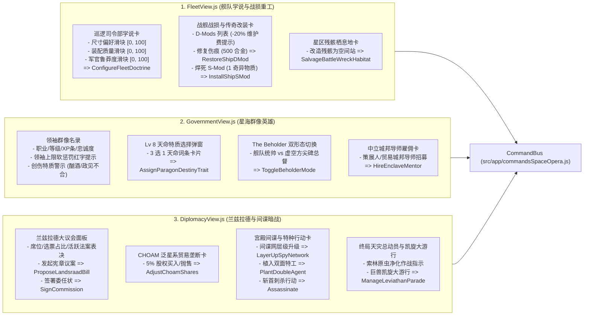

# 《无垠边疆：星海纪元》阶段四（M4）工位 C：舰队学说群像英雄与外交大议会视图交互施工规范

> **文档编号**：`SPEC-PLAN-051`（Phase 4 / Eng-C 专项执行卷）  
> **归属工程**：《无垠边疆：星海纪元》（`void-frontier-age-of-stars`）  
> **上游总纲**：`SPEC-PLAN-048`（阶段四 M4 终极合龙总纲）、`SPEC-ACC-047`（领域专家终审验收报告）  
> **责任工位**：**Eng-C（舰队、英雄与外交深层交互界面工程师）**  
> **独占修改文件**：
> - `src/ui/screens/FleetView.js`（学说滑块、战损伤痕修复、传奇 S-Mod 焊死与战役残骸栖息地）
> - `src/ui/screens/GovernmentView.js`（群像英雄档案、Lv 8 天命选择弹窗、`The Beholder` 双形态开关与城邦导师）
> - `src/ui/screens/DiplomacyView.js`（兰兹拉德法案投票、CHOAM 股份买卖、宫殿间谍斩首与终局天灾总动员）  
> **前置依赖**：`src/app/commandsSpaceOpera.js`、`src/domain/world/commandSchemas.js`、`src/domain/fleets/fleetDoctrineAndScars.js`、`src/domain/characters/galacticParagons.js`、`src/domain/diplomacy/galacticSenateAndCrisisArc.js`  
> **方法论标准**：`SuperPower` 工程实施范式（Mandatory `Plan` + `Tasks` + `Checklists` 三段式闭环）

---

## 一、Plan（工位 C 架构蓝图与核心使命）

### 1.1 核心使命与消除断层目标

在 Phase 0 至 Phase 3 中，`commandsSpaceOpera.js` 已经注册了完善的 28 条业务命令（包含巡逻学说、战损修复、S-Mod 焊死、天命特质、双形态切换、宪章表决、CHOAM 股份与间谍刺杀等）。然而在 `SPEC-ACC-047` §3.3 审计中，领域专家严厉指出：
- **`GAP-03`（核心玩法视图零交互接线）**：前端界面的 `FleetView.js`、`GovernmentView.js` 与 `DiplomacyView.js` 停留在旧版本状态，没有渲染任何太空歌剧相关的数据组件，也没有绑定派发这 28 条命令的按钮或滑块。玩家无法亲手执行任何舰队战损改造、领袖天命指派或大议会表决。

工位 C 的核心使命是：**在三大上层管理屏幕（舰队、政府、外交）中，完整实现太空歌剧专属交互卡片，将命令派发（`app.dispatch(commandName, payload)`）与即时反馈链路彻底接通**。

### 1.2 三大视图交互组件与命令映射拓扑图



---

## 二、Tasks（工位 C 原子化施工任务拆解）

### Task 51.1：`FleetView.js` 舰队学说、战损改装与残骸工程接线

* **目标文件**：`src/ui/screens/FleetView.js`
* **代码契约与实现细则**：
  1. 在 `FleetView` 侧边或详情区域新增 `renderSpaceOperaFleetPanel(container, fleet, world)`：
     - 若 `world.spaceOperaState` 未激活则安全返回。
     - **巡逻司令部与学说滑块**：
       - 展示当前星区 Patrol HQ 等级与基础维护费；
       - 提供 3 个原生 `<input type="range" min="0" max="100">` 滑块：
         - `shipSizeBias`（护卫海 vs 泰坦旗舰）
         - `outfitQuality`（廉价量产 vs 尖端精装）
         - `officerRecklessness`（保守拉扯 vs 决死冲锋）
       - 监听 `input` 事件实时显示数值，点击“应用学说”按钮触发：
         ```javascript
         app.dispatch('ConfigureFleetDoctrine', {
           sectorId: fleet.sectorId || 'core_sector',
           doctrine: { shipSizeBias, outfitQuality, officerRecklessness }
         });
         ```
     - **舰船伤痕（D-Mods）与永久焊死（S-Mods）**：
       - 选中单舰时，检查其 `ship.dMods`（如 `compromised_hull`, `glitched_sensors`）；
       - 渲染 `-20% × N 维护费` 绿色增益提示标签；
       - “修复战损”按钮（消耗 500 合金）：
         ```javascript
         app.dispatch('RestoreShipDMod', { fleetId: fleet.id, shipIndex, dModId });
         ```
       - “焊死 S-Mod”按钮（消耗 1 奇异物质）：
         ```javascript
         app.dispatch('InstallShipSMod', { fleetId: fleet.id, shipIndex, hullModId });
         ```
     - **战场残骸处置**：
       - 检查当前星系是否存在战役残骸 `world.spaceOperaState.wreckSites[systemId]`；
       - 若存在，渲染“改造为残骸空间站”按钮：
         ```javascript
         app.dispatch('SalvageBattleWreckHabitat', { wreckId, action: 'CONVERT_HABITAT' });
         ```

### Task 51.2：`GovernmentView.js` 群像英雄名录、天命选择与形态切换接线

* **目标文件**：`src/ui/screens/GovernmentView.js`
* **代码契约与实现细则**：
  1. 领袖卡片群像档案增强：
     - 检查 `character.paragonProfile`；
     - 渲染当前等级（Lv 1–10）、XP 经验条进度、当前忠诚度（`loyalty`，低于 30 标红并显示叛变风险警告）；
     - 显示领袖上限软惩罚红字：当在编领袖数 $N > C$ 时，展示“超编惩罚：维护费 $\times (N/C)$，XP 收益 $\times 0.85^{N-C}$”；
     - 渲染创伤特质徽标（如 `substance_abuse` 药瘾、`melancholic` 抑郁、`political_dismissal` 罢黜怀恨）。
  2. **Lv 8 天命特质选择弹窗**：
     - 当领袖等级达到 8 且 `!paragonProfile.destinyTrait` 时，卡片上显示金色闪烁按钮“指派天命（Destiny Awaits）”；
     - 点击弹出模态框，展示 3 个确定性候选天命（如 `STELLAR_WARLORD`、`ARCHITECT_OF_WORLDS`、`VOID_SHADOW`）；
     - 点击确定派发：
       ```javascript
       app.dispatch('AssignParagonDestinyTrait', { characterId: ch.id, traitId: selectedTraitId });
       ```
  3. **传奇领袖 `The Beholder` 双形态开关**：
     - 若该领袖为 `THE_BEHOLDER`，显示形态切换指示灯与切换按钮：
       - 当前形态为 `FLEET_COMMANDER`（战舰旗舰统帅：武器伤害 `+20%`、闪避 `+15%`）；
       - 当前形态为 `MURMURING_MONOLITH`（低语方尖碑总督：灵能产出 `+25%`、矿工转化加成）；
       - 点击触发：
         ```javascript
         app.dispatch('ToggleBeholderMode', { characterId: ch.id });
         ```
  4. **中立星际城邦导师雇佣**：
     - 渲染“城邦学术顾问”卡片，显示策展人导师（Curator Mentor）；
     - 点击雇佣按钮派发：
       ```javascript
       app.dispatch('HireEnclaveMentor', { enclaveType: 'CURATOR', durationYears: 10 });
       ```

### Task 51.3：`DiplomacyView.js` 兰兹拉德大议会、CHOAM 股份与间谍斩首接线

* **目标文件**：`src/ui/screens/DiplomacyView.js`
* **代码契约与实现细则**：
  1. **兰兹拉德大议会与 CHOAM 暗战面板**：
     - 显示玩家议会地位声望（`standing`）、选票权重条、当前活跃宪章法案；
     - “发起新议案”按钮：弹出 3 类宪章法案选择（`SANCTION` 贸易禁运、`SUBSIDY` 工业补贴、`MANDATE` 联合远征）：
       ```javascript
       app.dispatch('ProposeLandsraadBill', { billType, targetFactionId });
       ```
     - CHOAM 股权面板：显示玩家持股比例（`0% ~ 100%`），提供“买入 5%”与“抛售 5%”按钮：
       ```javascript
       app.dispatch('AdjustChoamShares', { deltaShares: 5 });
       ```
     - 私掠委任状签署：提供“签署私掠委任状”按钮：
       ```javascript
       app.dispatch('SignCommission', { targetFactionId });
       ```
  2. **宫殿间谍网络与特种暗杀**：
     - 显示间谍网等级（Tier 1–3）与渗透深度；
     - “升级宫殿间谍翼”按钮 $\to$ `app.dispatch('UpgradePalaceEspionage', {})`；
     - “深度渗透（Layer Up）”按钮 $\to$ `app.dispatch('LayerUpSpyNetwork', { targetFactionId })`；
     - “植入双面间谍”按钮 $\to$ `app.dispatch('PlantDoubleAgent', { targetFactionId })`；
     - “执行斩首刺杀”按钮（渗透度 $\ge 80$ 时解锁）$\to$ `app.dispatch('Assassinate', { targetCharacterId })`。
  3. **终局天灾总动员与巨兽凯旋大游行**：
     - 发生天灾时，显示索林原虫净化倒计时与总动员指令；
     - 击败利维坦后，显示金色大游行横幅与“组织巨兽凯旋大游行”按钮：
       ```javascript
       app.dispatch('ManageLeviathanParade', { option: 'TRIUMPHAL_ARCH' });
       ```

---

## 三、Checklists（工位 C 交付验收清单）

完成编码后，工位 C 工程师必须逐项验证并通过以下自检门禁：

- [ ] **CHK-51-01（学说滑块实时响应与命令格式断言）**：
  - 测试方法：在 `FleetView` 拖动尺寸偏好至 `80`、鲁莽度至 `90` 并点击应用；
  - 判定标准：控制台无报错，`app.dispatch` 成功被 `CommandBus` 消费，巡逻司令部内部状态与学说值严格更新为 `80` 与 `90`。
- [ ] **CHK-51-02（D-Mod 修复与 S-Mod 焊死扣款断言）**：
  - 测试方法：对受损战舰点击修复 D-Mod 与焊死 S-Mod；
  - 判定标准：
    - 玩家合金库存精确扣除 500，舰船 D-Mod 被移除；
    - 玩家奇异物质精确扣除 1，舰船 S-Mod 槽位成功焊死且标记为无法卸载。
- [ ] **CHK-51-03（天命特质弹窗与三选一派发断言）**：
  - 判定标准：Lv 8 领袖点击天命弹窗并选中一项后，该领袖成功附加对应天命 ID，后续该按钮置灰或隐藏。
- [ ] **CHK-51-04（The Beholder 双形态切换断言）**：
  - 判定标准：点击形态切换开关后，领袖职务形态在统帅与总督间切换，且技能加成实时切换生效。
- [ ] **CHK-51-05（兰兹拉德法案与 CHOAM 交易断言）**：
  - 判定标准：发起法案在议会视图生成活跃议案条；点击买入 CHOAM 股份扣减信用点并提高持股比例。
- [ ] **CHK-51-06（静态打包与无报错断言）**：
  - 执行测试：`node tests/tools/build-static-bundle.mjs --rebuild && node --check dist/void-frontier.bundle.js`；
  - 判定标准：构建成功且退出码为 `0`。
