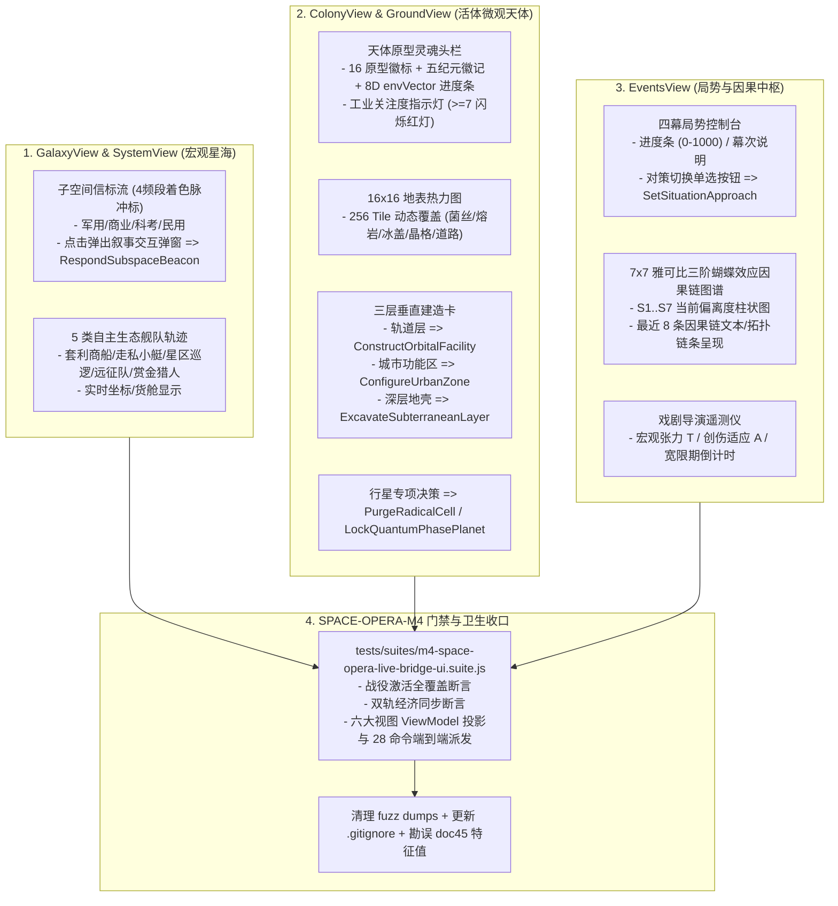

# 《无垠边疆：星海纪元》阶段四（M4）工位 D：星图信标天体殖民局势全息与 M4 门禁施工规范

> **文档编号**：`SPEC-PLAN-052`（Phase 4 / Eng-D 专项执行卷）  
> **归属工程**：《无垠边疆：星海纪元》（`void-frontier-age-of-stars`）  
> **上游总纲**：`SPEC-PLAN-048`（阶段四 M4 终极合龙总纲）、`SPEC-ACC-047`（领域专家终审验收报告）  
> **责任工位**：**Eng-D（宏观视效、天体全息、局势中枢与门禁工程专家）**  
> **独占修改文件**：
> - `src/ui/screens/GalaxyView.js` 与 `src/ui/screens/SystemView.js`（子空间信标流星图脉冲与自主生态舰队轨迹可视）
> - `src/ui/screens/ColonyView.js` 与 `src/ui/screens/GroundView.js`（16 原型徽标、8D 环境向量条、16×16 位掩码热力图与三层垂直建造卡）
> - `src/ui/screens/EventsView.js`（四幕局势控制台、7×7 雅可比偏离度、三阶蝴蝶链图谱与戏剧张力计）
> - `src/simulation/ViewModels.js`（补充太空歌剧全视图只读投影属性）
> - `tests/suites/m4-space-opera-live-bridge-ui.suite.js`（新建：`SPACE-OPERA-M4` 门禁套件）
> - `docs/specs/45_m2_7x7_16_superpower.md`（修正特征多项式谱实测勘误）
> - 清理 `tests/fuzz/dumps/*.json` 与 `.gitignore`  
> **前置依赖**：`SPEC-PLAN-049 ~ 051`、`src/content/spaceOperaBeacons.js`、`src/content/planetaryArchetypes.js`、`src/domain/events/situationEngine.js`  
> **方法论标准**：`SuperPower` 工程实施范式（Mandatory `Plan` + `Tasks` + `Checklists` 三段式闭环）

---

## 一、Plan（工位 D 架构蓝图与核心使命）

### 1.1 核心使命与消除断层目标

阶段四的终极交付，是让真实玩家在打开浏览器屏幕的一瞬间，能够真真切切看到一个“活着且不断呼吸的太空歌剧世界”。
工位 D 承载着两大战略目标：
1. **消除 `GAP-03` 的核心宏观与微观呈现**：
   - 在银河大地图与恒星系内，渲染常驻 $\ge 15$ 条的**多频段子空间信标流**（点击即可介入银河人间冷暖）与 5 类穿梭不息的**自主生态舰队**（商队、走私犯、巡逻队等）；
   - 在殖民地与行星地表，渲染 16 大天体物理原型的独特灵魂徽标、8 维环境相空间向量 `envVector[8]`、**16×16 紧凑地表网格热力图**（直观展示菌毯扩展、熔岩相变、冰盖蔓延与晶格结晶），以及**三层垂直空间建造卡片**（轨道设施、地表城市功能区、深层地壳挖掘）；
   - 在事件中枢，打造**四幕局势主控台**（策略自由切换）、**7×7 雅可比三阶蝴蝶效应动态因果链图谱**与**自适应戏剧导演遥测仪**。
2. **构建阶段四终极门禁与仓库卫生收口（消除 `GAP-05`）**：
   - 编写 `tests/suites/m4-space-opera-live-bridge-ui.suite.js`（`SPACE-OPERA-M4`），完成从战役开局到全视图交互与命令执行的端到端防伪绿验收；
   - 清理工作树中 15 个 `tests/fuzz/dumps/crash-dump-*.json` 临时转储并维护 `.gitignore`；
   - 回写勘误 `docs/specs/45_m2_7x7_16_superpower.md` 中记录的特征值表。

### 1.2 全息视效与门禁验证拓扑图



---

## 二、Tasks（工位 D 原子化施工任务拆解）

### Task 52.1：星图子空间信标流与自主生态舰队渲染

* **目标文件**：`src/simulation/ViewModels.js`、`src/ui/screens/GalaxyView.js`、`src/ui/screens/SystemView.js`
* **代码契约与实现细则**：
  1. 在 `src/simulation/ViewModels.js` 的 `spaceOperaView(world)` 中扩展信标与自主舰队轻量只读列表：
     - `beaconsList`: 提取 `world.spaceOperaState.beaconStream.beacons`，投影为包含 `id`, `kind`, `band`, `frequencyName`, `position`, `title`, `text`, `options` 的数组；
     - `autonomousFleetsList`: 提取 `world.spaceOperaState.autonomousFleets.fleets`，投影为包含 `id`, `type`, `origin`, `destination`, `progress`, `cargo` 的轻量数组。
  2. 在 `GalaxyView.js` 与 `SystemView.js` 中新增信标与舰队图层绘制：
     - **四频段信标脉冲绘制**：
       - `MILITARY`（红色 `#ff4444`）
       - `COMMERCIAL`（金黄色 `#ffd700`）
       - `SCIENCE`（青蓝色 `#00e5ff`）
       - `CIVILIAN`（紫罗兰色 `#e040fb`）
       - 在星图坐标上绘制带有轻微呼吸脉冲的光环。
     - **信标交互响应弹窗**：
       - 点击信标弹出半透明科幻信标弹窗，显示信标标题、频段解调内容与交互选项按钮；
       - 点击选项按钮派发：
         ```javascript
         app.dispatch('RespondSubspaceBeacon', {
           beaconId: beacon.id,
           responseOptionId: option.id
         });
         ```
     - **自主生态舰队轨迹**：
       - 在星图航道上渲染 5 种专属微型 SVG 图标，点击可查看其始发星系、目的港口与承载货物。

### Task 52.2：天体原型灵魂、16×16 网格热力图与三层垂直建造卡

* **目标文件**：`src/ui/screens/ColonyView.js`、`src/ui/screens/GroundView.js`
* **代码契约与实现细则**：
  1. **行星灵魂头栏**：
     - 显示 16 大天体原型徽标与中英文全称（如 `#2 潮汐锁定双子星 / Tidal Tidally Locked Twins`）；
     - 显示五纪元演化徽章（`Epoch 0 蛮荒` $\to$ `Epoch 1 勘探` $\to$ `Epoch 2 工业` $\to$ `Epoch 3 觉醒` $\to$ `Epoch 4 遗产`）；
     - 渲染 8 维环境向量 `envVector[8]` 微型进度条条带；
     - 工业关注度警示灯：数值为 `0..6` 时显示为翠绿色稳态；一旦达到 `>= 7`，显示为醒目的**高危红色警报闪烁**，提示激进支部已激活。
  2. **16×16 地表网格（256 Tile）紧凑热力图**：
     - 使用 Canvas 或轻量 DOM 网格绘制 16×16 像素/方块图谱；
     - 解码 `tiles[i]` 的动态覆盖层（Bit 12–15）：
       - 菌丝覆盖（Mycelium）：墨绿/荧光粉
       - 熔岩相变（Magma）：熔融橙红
       - 冰盖封冻（Ice Sheet）：苍白冰蓝
       - 晶格侵蚀（Crystal）：棱镜青紫
     - 叠加绘制能量护盾力场网格与交通干线道路。
  3. **三层垂直建造操作卡**：
     - **轨道层（Layer 1）**：
       - 建造轨道居住站 / 黑洞观测站按钮：
         ```javascript
         app.dispatch('ConstructOrbitalFacility', { planetId, facilityType: 'ORBITAL_HABITAT' });
         ```
     - **城市功能区（Layer 2）**：
       - 提供 2 个功能区下拉菜单（`ARCHIVES` 档案馆、`HEAVY_INDUSTRY` 重工、`TRADE_PORT` 商贸港、`CITADEL` 堡垒）：
         ```javascript
         app.dispatch('ConfigureUrbanZone', { planetId, zoneSlotIndex: 0, zoneType: selectedZone });
         ```
     - **深层地壳挖掘（Layer 3）**：
       - 逐层掘进按钮（Tier 1 $\to$ Tier 2 $\to$ Tier 3）：
         ```javascript
         app.dispatch('ExcavateSubterraneanLayer', { planetId });
         ```
  4. **专项决策按钮**：
     - 气候重塑阶段跃迁：`app.dispatch('TriggerTerraformingPhase', { planetId })`；
     - 清剿激进潜伏支部（工业关注度 $\ge 7$ 时解锁）：`app.dispatch('PurgeRadicalCell', { planetId })`；
     - 量子相位锁定（仅量子相位星可用）：`app.dispatch('LockQuantumPhasePlanet', { planetId })`。

### Task 52.3：四幕局势控制台、三阶蝴蝶链图谱与戏剧张力计

* **目标文件**：`src/ui/screens/EventsView.js`
* **代码契约与实现细则**：
  1. **四幕局势（Situations）交互控制台**：
     - 遍历所有活跃局势，渲染卡片：
       - 局势标题、当前幕次指示器（第一幕起 $\to$ 第二幕承 $\to$ 第三幕转 $\to$ 第四幕合）；
       - 进度条（`0 ~ 1000`）；
       - 应对策略单选按钮组（Approach Radios），切换后点击生效：
         ```javascript
         app.dispatch('SetSituationApproach', { situationId: sit.id, approachId: selectedApproach });
         ```
       - S4 债务紧急重组专项按钮：`app.dispatch('EmergencyDebtRestructure', {})`。
  2. **7×7 雅可比三阶蝴蝶效应动态因果链图谱**：
     - 渲染 7 维柱状图展示 `S1` 至 `S7` 当前数值相对于平衡点 $S_{\text{eq}}$ 的偏离振荡；
     - 渲染因果链动态滚动卡片，展示最近 8 条三阶传导记录，形如：
       `[相变震荡] S2 生态相变(+25.0) -> S3 稳定度骤降(+7.00) -> S6 走私渗透爆发(+1.68) -> S7 议会紧急状态(+0.4368)`。
  3. **自适应戏剧导演遥测仪**：
     - 渲染宏观戏剧张力计 $T \in [0, 100]$；
     - 渲染创伤适应系数仪表 $A$；
     - 渲染大高潮宣泄后的“救赎宽限期”倒计时钟。

### Task 52.4：编写 `SPACE-OPERA-M4` 门禁套件

* **目标文件**：`tests/suites/m4-space-opera-live-bridge-ui.suite.js`（新建）
* **代码契约与实现细则**：
  1. 注册套件 ID：`SPACE-OPERA-M4`（`GATE-18-M4`）；
  2. 包含的核心断言块：
     - **Block 1（开局活体激活完整性）**：断言 `activateSpaceOperaCampaign` 执行后全星系行星挂载 `compactState`、256 格地形与 15 条信标；
     - **Block 2（双轨经济桥同步与逆向修正）**：断言殖民地建筑推高工业关注度，断言 S3 稳定度与 S4 违约倍率正确注入 `HourlySystems`；
     - **Block 3（六大视图 ViewModel 映射）**：断言 `ViewModels.spaceOperaView`、`colonyDetail.spaceOpera` 正确投影所有必要属性；
     - **Block 4（28 条命令全量端到端派发执行）**：依次构造并向 `CommandBus` 派发 28 条太空歌剧命令，断言 100% 成功执行且世界状态严格改变；
     - **Block 5（REG-01 金快照零漂移交叉守卫）**：在套件最后再次对无参调用计算哈希，断言仍为 `8be8ce2c`。

### Task 52.5：工作树卫生收口与文档特征值勘误

* **执行细则**：
  1. 在 `tests/suites/m3-space-opera-drama-director.suite.js` 头部补齐：
     ```javascript
     import '../../src/app/commands.js';
     ```
  2. 删除 `tests/fuzz/dumps/crash-dump-*.json` 临时转储，并在根目录 `.gitignore` 中追加：
     ```gitignore
     tests/fuzz/dumps/*.json
     ```
  3. 更新 `docs/specs/45_m2_7x7_16_superpower.md` §Task 2.1 §3 中的特征值谱文字描述，与实测特征谱（$-0.8780, -0.7301, -0.6414, -0.3192, -0.0370, -0.4321 \pm 0.2742i$）精确吻合。

---

## 三、Checklists（工位 D 交付验收清单）

完成编码后，工位 D 工程师必须逐项验证并通过以下自检门禁：

- [ ] **CHK-52-01（信标星图渲染与响应断言）**：
  - 判定标准：星图正确渲染 $\ge 15$ 个四频段信标，点击信标能展开交互弹窗，点击选项成功派发 `RespondSubspaceBeacon` 并更新信标状态。
- [ ] **CHK-52-02（16 原型与 16×16 网格热力图断言）**：
  - 判定标准：`ColonyView` 完整呈现 16 原型中英文名与 8D 向量条；16×16 网格准确体现菌毯、熔岩、冰盖与晶格的位掩码覆盖分布。
- [ ] **CHK-52-03（三层垂直建造命令派发断言）**：
  - 判定标准：分别点击建造轨道居住站、配置城市功能区与深层地壳掘进，对应命令无报错派发，且 `planet.compactState` 垂直层状态严格跃迁。
- [ ] **CHK-52-04（四幕局势控制台对策切换断言）**：
  - 判定标准：在 `EventsView` 切换局势对策，成功派发 `SetSituationApproach`，且冷却时间锁定 720 ticks。
- [ ] **CHK-52-05（蝴蝶效应三阶因果链与戏剧张力计断言）**：
  - 判定标准：柱状图直观反映 7 维状态，因果链准确展示三阶传导记录，戏剧张力计实时展示 $T$ 与 $A$。
- [ ] **CHK-52-06（`SPACE-OPERA-M4` 门禁套件通过断言）**：
  - 执行测试：`node tests/tools/run-suites.mjs --id=SPACE-OPERA-M4`；
  - 判定标准：连续 3 轮测试全部通过，`PASS 3 / FAIL 0 / DRIFT 0`。
- [ ] **CHK-52-07（工作树清洁度与静态打包）**：
  - 判定标准：`tests/fuzz/dumps/` 目录无未跟踪 json 文件；`node tests/tools/build-static-bundle.mjs --rebuild && node --check dist/void-frontier.bundle.js` 退出码为 `0`。
- [ ] **CHK-52-08（全量 71 套件回归 100% 绿灯守卫）**：
  - 执行测试：`node tests/tools/run-suites.mjs`；
  - 判定标准：71 个测试套件全量 3 轮回归，断言 `PASS 213 / FAIL 0 / DRIFT 0`，金快照 `8be8ce2c` 零漂移。
