# 《无垠边疆：星海纪元》阶段五（M5）工位 A：P0/P1 核心阻断修复与单文件秒开施工规范

> **文档编号**：`SPEC-PLAN-057`（Phase 5 / Eng-A 专项执行卷）  
> **归属工程**：《无垠边疆：星海纪元》（`void-frontier-age-of-stars`）  
> **上游准绳**：`docs/specs/56_无垠边疆外网实测深度复盘与M5热修复及共创实装SuperPower施工文档.md`（总纲）  
> **责任工位**：**Eng-A（3D 核心运行时、加载器与命令架构工程师）**  
> **独占修改文件**：
> - `src/ui/screens/GroundView.js`（修复 `BUG-01` 挂载崩溃、`BUG-07` HP 残留、`BUG-11` 任务部署限制与弹窗暂停、`BUG-12` 初始护盾提升）
> - `src/app/App.js`（升级路由警告为致命失败判定，消除静默失败）
> - `src/domain/world/commandSchemas.js`（支持 `number | string` 双模 ID 校验兼容，消除 `BUG-04`）
> - `src/app/commandsSpaceOpera.js`（实体 ID 归一化解析，确保字符串与整数 ID 双向兼容）
> - `index.html`（切换为单文件 Bundle 优先极速秒开模式，消除 `BUG-05` 瀑布请求）  
> **方法论标准**：`SuperPower` 工程实施范式（Mandatory `Plan` + `Tasks` + `Checklists` 三段式闭环）

---

## 一、Plan（工位 A 架构蓝图与核心使命）

### 1.1 核心使命与缺陷消除目标

经三份外网实测报告与领域专家（`SPEC-PLAN-056`）深度复盘，系统暴露了两项最严重的阻断性体验问题与底层加载瓶颈：
1. **`BUG-01`（P0 阻断：3D 地表模式闪回崩溃）**：玩家点击【🌍 3D 地表模式】或【派遣先遣队登陆】时，因 `GroundView.js:363` 调用 `this._refreshOperaChip()` 而该方法未在 `GroundView` 实例上定义，导致抛出 `TypeError: this._refreshOperaChip is not a function`，`App.js` 捕获后仅打印 `console.warn('路由失败')` 并闪退回菜单。
2. **`BUG-04`（P1 高危：命令实体 ID 格式强类型拒绝）**：`commandSchemas.js` 将 `planetId` / `empireId` 限制为 `type: 'number'`，当外部探针或脚本以 `'plt_101'`、`'fac_553'` 等字符串格式派发命令时被严厉拒收。
3. **`BUG-05`（P1 高危：跨洋 188 模块瀑布流导致加载卡死）**：`index.html` 默认加载 `src/main.js`，弱网环境下请求 188 个独立 JS 经常导致深层模块超时挂起，必须改为单文件 Bundle 优先直载。
4. **`BUG-07 / 11 / 12`（3D 地表生存体验缺陷）**：任务阵亡后进入自由模式残留 0 HP；任务模式限制部署充能桩；外骨骼护盾初值偏低；阅读弹窗时未暂停地表时钟。

工位 A 的核心使命是：**彻底根除上述阻断，打通 3D 地表入口，实现秒开加载与双模 ID 容错**。

### 1.2 架构时序与数据流修正图

```mermaid
flowchart TD
  subgraph BootLoader["1. 极速秒开加载器 (index.html)"]
    HTML["index.html 页面打开"]
    CheckESM{"URL 含 ?esm=1 ?"}
    BundleLoad["加载 ./dist/void-frontier.bundle.js (单文件 < 1.5s)"]
    ESMLoad["加载 ./src/main.js (开发调试模式)"]
    FallbackTimeout{"加载失败或 >8s 超时 ?"}
    ShowRetry["展示友好重试按钮"]
    
    HTML --> CheckESM
    CheckESM -- "No (默认生产)" --> BundleLoad
    CheckESM -- "Yes (调试)" --> ESMLoad
    BundleLoad --> FallbackTimeout
    FallbackTimeout -- "超时/失败" --> ESMLoad
    FallbackTimeout -- "二次失败" --> ShowRetry
  end

  subgraph GroundFix["2. GroundView 挂载与方法闭环"]
    Route["App.navigate('ground', { planetId })"]
    Mount["GroundView.mount() -> _setHead()"]
    FixCall["调用 refreshGroundOperaChip(this)<br/>& 实例定义 _refreshOperaChip()"]
    SafeMount["100% 成功渲染行星灵魂徽标与 3D 地表"]
    Route --> Mount --> FixCall --> SafeMount
  end

  subgraph DualSchema["3. commandSchemas 双模 ID 归一化"]
    InCmd["app.dispatch(name, { planetId: 'plt_101' })"]
    Validate["validateSpaceOperaCommandPayload<br/>识别以 'Id' 结尾且可解析为整数的字符串"]
    Execute["commandsSpaceOpera.js 归一化为统一数字键"]
    StateUpdate["世界状态精确变更"]
    InCmd --> Validate --> Execute --> StateUpdate
  end
```



---

## 二、Tasks（工位 A 原子化施工任务拆解）

### Task 57.1：`GroundView.js` 挂载崩溃修复与全套生存体验平衡

* **目标文件**：`src/ui/screens/GroundView.js`
* **代码契约与实现细则**：
  1. **修复 `_refreshOperaChip` 缺失错误（`BUG-01`）**：
     - 在 `GroundView.js:363` 的 `_setHead()` 方法中，将 `this._refreshOperaChip();` 改为：
       ```javascript
       refreshGroundOperaChip(this);
       ```
     - 在 `GroundView` 类定义或对象字面量原型上，显式增加实例方法：
       ```javascript
       _refreshOperaChip() {
         refreshGroundOperaChip(this);
       }
       ```
     - 确保无论通过内部原型链还是外部调用，均能安全执行行星灵魂芯片刷新。
  2. **状态重置与护盾强化（`BUG-07` & `BUG-12`）**：
     - 定位 `GroundView.js:1049-1055` 的 `_setupScene` 方法：
       ```javascript
       // 显式重置角色满血满盾，彻底解决上一场阵亡导致 0/100 残留
       c.hpMax = 100;
       c.hp = 100;
       c.shieldMax = 60; // 初始外骨骼护盾由 30 提升至 60，增强恶劣气候容错
       c.shield = 60;
       c.staminaMax = 100;
       c.stamina = 100;
       c.fuel = 100;
       c.flash = 0;
       ```
  3. **开放任务模式野战工事部署（`BUG-11`）**：
     - 定位 `GroundView.js:1455` 键盘按键 `Digit7..Digit0` 与 `KeyX` 分支：
       - 将原硬编码 `if (this.mode === 'free')` 改为：
         ```javascript
         if ((this.mode === 'free' || this.mode === 'mission') && this.planet)
         ```
       - 允许玩家在任务模式中按 `8` 键部署热能充能桩，抵御熔岩风暴侵袭并持续恢复护盾。
  4. **科考面罩切换反馈与弹窗暂停守护**：
     - 按 `KeyV` 切换分析面罩时，调用：
       ```javascript
       toast(this._visorOn ? '已开启三模态科考面罩（Tab 切换模式）' : '已关闭科考分析面罩', { kind: 'info' });
       ```
     - 在 `_missionFrame(dt)` 循环首行增加活跃弹窗检测：
       ```javascript
       if (document.querySelector('.vf-modal-backdrop') || this._isPaused) {
         return; // 当有信标或对话弹窗打开时，暂停推进地面战斗时钟，防止被怪或环境偷袭团灭
       }
       ```

### Task 57.2：`App.js` 路由安全门禁升级

* **目标文件**：`src/app/App.js`
* **代码契约与实现细则**：
  1. 定位 `navigate(screenId, param)` 方法：
     - 当捕获到视图挂载或渲染异常时，严禁静默回退，必须向控制台抛出显式 `console.error`：
       ```javascript
       try {
         // 挂载目标视图
         targetView.mount({ root: this.viewRoot, app: this, param });
       } catch (err) {
         console.error(`[CRITICAL] 视图挂载致命异常 (${screenId}):`, err);
         this._lastRouteError = err;
         // 展示可见错误横幅而非静默闪回
         this.showFatalError(`视图 ${screenId} 加载失败: ${err.message}`);
         throw err;
       }
       ```
     - 使得自动化测试套件能即刻捕获任何视图的挂载错误。

### Task 57.3：`commandSchemas.js` 与 `commandsSpaceOpera.js` 实体 ID 双模归一化

* **目标文件**：`src/domain/world/commandSchemas.js`、`src/app/commandsSpaceOpera.js`
* **代码契约与实现细则**：
  1. 在 `commandSchemas.js` 的 `validateSpaceOperaCommandPayload(cmd)` 中：
     - 增加字符串数字 ID 校验宽容度：
       ```javascript
       function isCoercibleEntityId(val) {
         if (typeof val === 'number') return Number.isInteger(val) && val >= 0;
         if (typeof val === 'string') {
           // 匹配形如 'plt_101', 'fac_553', 'flt_563', '101' 等格式
           const num = parseInt(val.replace(/^[a-z]+_/, ''), 10);
           return Number.isInteger(num) && num >= 0;
         }
         return false;
       }
       ```
     - 对字段名以 `'Id'` 结尾的数值字段，允许传入符合上述规则的字符串 ID。
  2. 在 `commandsSpaceOpera.js` 的命令派发前置处理函数中：
     - 将所有传入的 `payload[idKey]` 执行整数提取归一化：
       ```javascript
       function normalizeId(idVal) {
         if (typeof idVal === 'number') return idVal;
         if (typeof idVal === 'string') return parseInt(idVal.replace(/^[a-z]+_/, ''), 10);
         return idVal;
       }
       ```
     - 确保传递给底层模拟引擎的始终是纯净的确定性数字键。

### Task 57.4：`index.html` 极速单文件 Bundle 优先加载器

* **目标文件**：`index.html`
* **代码契约与实现细则**：
  1. 修改 `index.html:38-58` 的脚本启动段落：
     ```html
     <script>
       (function() {
         const urlParams = new URLSearchParams(window.location.search);
         const useESM = urlParams.get('esm') === '1';
         const script = document.createElement('script');
         
         if (useESM) {
           console.log('[BOOT] 开发者模式：直接加载 ESM 源码');
           script.type = 'module';
           script.src = './src/main.js';
         } else {
           console.log('[BOOT] 生产模式：加载单文件 Bundle 极速启动');
           script.src = './dist/void-frontier.bundle.js';
           script.onerror = function() {
             console.warn('[BOOT] Bundle 加载异常，降级回退至 ESM 源码');
             const fallback = document.createElement('script');
             fallback.type = 'module';
             fallback.src = './src/main.js';
             document.body.appendChild(fallback);
           };
         }
         document.body.appendChild(script);
       })();
     </script>
     ```

---

## 三、Checklists（工位 A 交付验收清单）

完成编码后，工位 A 工程师必须逐项验证并通过以下自检门禁：

- [ ] **CHK-57-01（3D 地表模式挂载零警告通过）**：
  - 测试方法：在战役中调用 `app.navigate('ground', { planetId: 'plt_101' })`；
  - 判定标准：不抛出任何异常，成功挂载 3D 地表画布与头部灵魂芯片，控制台零 `TypeError` 与零 `路由失败` 警告。
- [ ] **CHK-57-02（地表满血满盾与任务模式工事部署断言）**：
  - 判定标准：
    - `GroundView` 初始化后，角色 `hp === 100`、`shield === 60`；
    - 在 `mission` 任务模式下按下 `Digit8` 键，成功在地面放置热能充能桩；
    - 弹窗打开时，地面战斗计时器自动处于暂停状态。
- [ ] **CHK-57-03（字符串实体 ID 双模派发断言）**：
  - 测试方法：向 `CommandBus` 派发 `{ type: 'ExcavateSubterraneanLayer', planetId: 'plt_101', depthTier: 1 }` 与 `{ type: 'ConfigureFleetDoctrine', empireId: 'fac_553', doctrineSize: 50, qualityWeight: 50, officerAggression: 50 }`；
  - 判定标准：契约校验通过，命令返回 `{ ok: true }` 且世界状态精准改变。
- [ ] **CHK-57-04（Bundle 优先秒开与降级机制生效）**：
  - 判定标准：默认打开 `index.html` 直接请求 `void-frontier.bundle.js`；携带 `?esm=1` 时请求 `src/main.js`。
- [ ] **CHK-57-05（静态打包与金快照守卫）**：
  - 执行测试：`node tests/tools/build-static-bundle.mjs --rebuild && node --check dist/void-frontier.bundle.js` 退出码 0，且 `REG-01` 哈希恒为 `8be8ce2c`。
