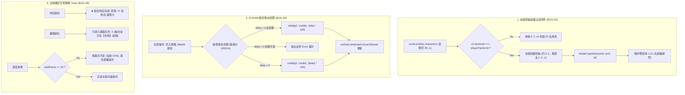

# 《无垠边疆：星海纪元》阶段五（M5）工位 B：经济群像平衡与全链路回执提示施工规范

> **文档编号**：`SPEC-PLAN-058`（Phase 5 / Eng-B 专项执行卷）  
> **归属工程**：《无垠边疆：星海纪元》（`void-frontier-age-of-stars`）  
> **上游准绳**：`docs/specs/56_无垠边疆外网实测深度复盘与M5热修复及共创实装SuperPower施工文档.md`（总纲）  
> **责任工位**：**Eng-B（经济与数值微模拟、群像治理与 UI 交互反馈工程师）**  
> **独占修改文件**：
> - `src/domain/characters/galacticParagons.js`（修复 `BUG-02` 领袖容量跨派系统计污染；`BUG-10` 提供 `THE_BEHOLDER` 开局保底唤醒入口）
> - `src/ui/screens/GovernmentView.js`（过滤仅展示玩家本国在编领袖，根除开局 `18/4` 超编假象；提供唤醒凝视者操作界面）
> - `src/simulation/ViewModels.js`（`paragonsProjection` 过滤非本国领袖；`spaceOperaBeaconsList` 增加 `band` 简写字段；根除数据投影污染）
> - `src/domain/diplomacy/galacticSenateAndCrisisArc.js`（修复 `BUG-03` 补齐 `adjustChoamShares` 信用点 `debit/credit` 真实扣减与回收结算）
> - `src/domain/planets/spaceOperaColonyBridge.js`（修复 `BUG-09` 将 `industrialAttention` 与 `radicalCellActive` 镜像回写至实体）
> - `src/render/GalaxyRenderer.js`（修复 `BUG-06` 首次加载镜头自适应玩家母星系与星区质心，消除偏下挤压）
> - `src/ui/screens/GalaxyView.js` / `SystemView.js`（修复 `BUG-06` 增加视角复位按钮；修复 `BUG-08` 响应信标弹出明确收益 Toast）
> - `src/ui/screens/ColonyView.js`（修复 `BUG-08` 建筑排队 Toast 与缺合金市场采购指引）
> - `src/ui/screens/DiplomacyView.js`（修复 `BUG-08` 情报点不足前置禁用或明确弹出提示）  
> **方法论标准**：`SuperPower` 工程实施范式（Mandatory `Plan` + `Tasks` + `Checklists` 三段式闭环）

---

## 一、Plan（工位 B 架构蓝图与核心使命）

### 1.1 核心使命与数值体验治理目标

在外网两批独立实测报告与领域专家（`SPEC-PLAN-056`）深度穿透中，宏观经济与治理系统暴露了数项严重的体验断层与数值漏洞：
1. **`BUG-02`（P0 严重：领袖容量全银河跨派系污染）**：在新战役第 1 天，玩家进入【政府】视图，统帅即显示 `在编 18/上限 4`，开局即承受高达 `×4.50` 维护费与 `×0.10` XP 极端惩罚！根因在于 `leaderCapStats` 与视图层遍历 `world.entities.characters` 时，漏判了 `ch.factionId === world.playerFactionId`，将全银河 6 大派系的 30 名角色全计入玩家编制。
2. **`BUG-03`（P1 高危：CHOAM 垄断股权白嫖漏洞）**：在【外交】大议会点击【买入 5% CHOAM 股份】，股份从 `0% -> 5%`，但账本信用点分文未扣。`adjustChoamShares` 仅修改了数值状态，漏写了真实的流水扣款 `debit/credit`。
3. **`BUG-06`（P1 高危：银河星图偏下与视角失焦）**：渲染器固定初始化 `view = {x:500, y:500, zoom:1}`，星系被挤压在画布底部，缺少母星自动居中与一键复位视角能力。
4. **`BUG-08`（P2 中危：全链路交互静默无回执）**：信标响应后静默关闭弹窗、建筑入队列无反馈且缺合金不提示采购、0 情报点渗透无提示。
5. **`BUG-09`（P2 中危：工业关注度与信标频段字段遗漏）**：`colony.industrialAttention` 仅算在紧凑底座内，未镜像到 `world.entities.colonies`；信标投影缺 `band` 简写键。
6. **`BUG-10`（P2 体验：招牌领袖 The Beholder 早期不可达）**：开局前两个游戏月无法体验双形态切换。

工位 B 的使命是：**彻底修复经济与领袖编制漏洞，健全全链路交互反馈，打通招牌领袖体验。**

### 1.2 数据流修正与状态闭环架构图



---

## 二、Tasks（工位 B 原子化施工任务拆解）

### Task 58.1：`galacticParagons.js`、`GovernmentView.js` 与 `ViewModels.js` 领袖过滤与保底唤醒

* **目标文件**：
  1. `src/domain/characters/galacticParagons.js`
  2. `src/ui/screens/GovernmentView.js`
  3. `src/simulation/ViewModels.js`
* **代码契约与实现细则**：
  1. **领袖容量纯度统计过滤（`BUG-02`）**：
     - 修改 `galacticParagons.js:190-210` 的 `leaderCapStats(world, profession, factionId = null)`：
       ```javascript
       export function leaderCapStats(world, profession, factionId = null) {
         const characters = world && world.entities && world.entities.characters ? world.entities.characters : {};
         const targetFaction = factionId || (world && world.playerFactionId) || null;
         let employed = 0;
         for (const key of Object.keys(characters).sort()) {
           const ch = characters[key];
           const p = ch && ch.paragon;
           if (!ch || !isPlainObject(p)) continue;
           if (ch.health === 'dead') continue;
           // 严格隔离：若指定了目标派系，非该派系角色绝不计入编制
           if (targetFaction && ch.factionId && ch.factionId !== targetFaction) continue;
           if (p.profession !== profession) continue;
           if (p.capExempt === true) continue;
           employed += 1;
         }
         const cap = leaderCapOf(world, profession);
         return {
           profession,
           employed,
           cap,
           upkeepMultiplier: upkeepMultiplier(employed, cap),
           xpGainMultiplier: xpGainMultiplier(employed, cap),
         };
       }
       ```
     - 修改 `GovernmentView.js:412-414`：
       ```javascript
       const pf = w.playerFactionId;
       const roster = Object.keys(characters).sort()
         .map((k) => characters[k])
         .filter((ch) => ch && ch.paragon && ch.health !== 'dead' && (!pf || !ch.factionId || ch.factionId === pf));
       ```
     - 修改 `ViewModels.js:421-440` `paragonsProjection`：
       ```javascript
       const pf = world.playerFactionId;
       for (const key of Object.keys(characters).sort()) {
         const ch = characters[key];
         const pg = ch && ch.paragon;
         if (!ch || !pg || ch.health === 'dead') continue;
         if (pf && ch.factionId && ch.factionId !== pf) continue; // 过滤非玩家角色
         // ...
         const sameProf = Object.keys(characters).filter((k2) => {
           const c2 = characters[k2];
           return c2 && c2.paragon && c2.health !== 'dead'
             && (!pf || !c2.factionId || c2.factionId === pf)
             && c2.paragon.profession === pg.profession && c2.paragon.capExempt !== true;
         }).length;
         // ...
       }
       ```
  2. **传奇领袖 `The Beholder` 开局保底唤醒（`BUG-10`）**：
     - 在 `GovernmentView.js` 的星海群像英雄面板顶部或空状态区域检查：若玩家派系尚未拥有 `THE_BEHOLDER`（遍历 `roster` 未发现 `paragonId === 'THE_BEHOLDER'`），渲染唤醒引导：
       ```javascript
       const hasBeholder = roster.some((ch) => ch.paragon && ch.paragon.paragonId === 'THE_BEHOLDER');
       if (!hasBeholder) {
         const awakeBox = elSO('div', { class: 'vf-card', style: { marginBottom: '8px', border: '1px dashed #00e5ff', padding: '6px' } }, [
           elSO('div', { class: 'vf-bold', style: { color: '#00e5ff' }, text: '◈ 先驱者灵能共鸣：检测到沉睡的核心方尖碑' }),
           elSO('div', { class: 'vf-small vf-faint', text: '先驱者「全视凝视者」正在亚空间沉睡，可即刻建立引力谐振唤醒（不占在编领袖容量）。' }),
           elSO('button', {
             class: 'vf-btn primary small',
             style: { marginTop: '4px' },
             text: '👁 唤醒先驱者：全视凝视者（The Beholder）',
             onClick: () => {
               app.dispatch('AwakeLegendaryBeholder', {});
             },
           }),
         ]);
         p.appendChild(awakeBox);
       }
       ```
     - 在 `commandsSpaceOpera.js` 注册领域命令 `AwakeLegendaryBeholder`：直接为玩家派系激活或生成待命态的 `THE_BEHOLDER` 档案，并赋予 `capExempt: true`。

---

### Task 58.2：`galacticSenateAndCrisisArc.js` CHOAM 股份真实信用点结算

* **目标文件**：`src/domain/diplomacy/galacticSenateAndCrisisArc.js`
* **代码契约与实现细则**：
  1. **定义基准价格与结算逻辑（`BUG-03`）**：
     ```javascript
     /** 每 1% CHOAM 股份基准价（doc56 标定值 100 信用点；5% = 500 信用点） */
     export const CHOAM_SHARE_CREDITS_PER_PCT = 100;
     ```
  2. **改造 `adjustChoamShares` 函数**：
     ```javascript
     export function adjustChoamShares(world, delta) {
       const soState = ensureS7State(world);
       const cur = Number.isFinite(soState.landsraad.choamShares) ? soState.landsraad.choamShares : 0;
       const d = Number.isFinite(delta) ? delta : 0;
       if (d === 0) return cur;

       const next = Math.max(0, Math.min(100, cur + d));
       const actualDelta = next - cur;
       if (actualDelta === 0) return cur;

       const pf = world && world.playerFactionId;
       const hasLedger = pf && world.economy && world.economy.ledgers && world.economy.ledgers[pf];

       // 真实信用点结算：买入扣款，抛售回款
       if (hasLedger) {
         if (actualDelta > 0) {
           const cost = actualDelta * CHOAM_SHARE_CREDITS_PER_PCT;
           if (!debit(world, pf, 'credits', cost, 'choamBuy', 's7')) {
             throw new Error(`SO: 信用点不足 ${cost}，无法买入 ${actualDelta}% CHOAM 股份`);
           }
         } else if (actualDelta < 0) {
           const refund = Math.abs(actualDelta) * CHOAM_SHARE_CREDITS_PER_PCT;
           credit(world, pf, 'credits', refund, 'choamSell', 's7');
         }
       }

       soState.landsraad.choamShares = next;
       emit(world, 'ChoamSharesAdjusted', {
         choamShares: next,
         delta: actualDelta,
         dividendMult: choamTradeDividendMult(world),
         embargoLeverage: hasEmbargoLeverage(world),
       }, 'diplomacy');
       return next;
     }
     ```

---

### Task 58.3：`spaceOperaColonyBridge.js` 实体镜像与 `ViewModels.js` 信标 `band`

* **目标文件**：
  1. `src/domain/planets/spaceOperaColonyBridge.js`
  2. `src/simulation/ViewModels.js`
* **代码契约与实现细则**：
  1. **实体状态双向镜像补齐（`BUG-09.1`）**：
     - 在 `spaceOperaColonyBridge.js:137` `syncColonyToSpaceOpera` 末尾，将紧凑底座内计算出的关注度与激进支部状态镜像回写到 `colony` 实体对象上：
       ```javascript
       colony.industrialAttention = Number.isFinite(cColony.industrialAttention) ? cColony.industrialAttention : 0;
       colony.radicalCellActive = Boolean(cColony.radicalCell && cColony.radicalCell.state === 'ACTIVE');
       ```
  2. **信标流频段 `band` 简写字段投影（`BUG-09.2`）**：
     - 在 `ViewModels.js` 中定义四频段颜色标识简写映射表：
       ```javascript
       const FREQ_BAND_MAP = Object.freeze({
         FREQ_SHADOW_CONTRACT: 'red',
         FREQ_STAR_JOURNAL: 'purple',
         FREQ_PRECURSOR_ECHO: 'cyan',
         FREQ_DISTRESSED_CIV: 'gold',
         OPPORTUNITY_BEACON: 'gold',
       });
       ```
     - 在 `spaceOperaBeaconsList(world, so)` 投影对象中，确保 `band` 字段输出规范颜色简写：
       ```javascript
       band: FREQ_BAND_MAP[b.freqClass] || 'gold',
       ```

---

### Task 58.4：银河居中自适应、复位视角与全链路 Toast 回执

* **目标文件**：
  1. `src/render/GalaxyRenderer.js`
  2. `src/ui/screens/GalaxyView.js`
  3. `src/ui/screens/SystemView.js`
  4. `src/ui/screens/ColonyView.js`
  5. `src/ui/screens/DiplomacyView.js`
* **代码契约与实现细则**：
  1. **星图母星居中与复位按钮（`BUG-06`）**：
     - 在 `GalaxyRenderer.js` 中新增方法 `centerOnCoordinates(x, y)`：平滑或直接设置 `this.view.x = x; this.view.y = y;`；
     - 在 `GalaxyRenderer.js` 初始化或接收新数据首帧时，若存在玩家母星系，自动对齐母星系坐标；
     - 在 `GalaxyView.js` 顶栏操作区增加 **【🎯 视角复位】** 按钮，点击调用 `this.renderer.resetView()`。
  2. **信标响应 Toast 回执（`BUG-08.1`）**：
     - 在 `GalaxyView.js:472` 与 `SystemView.js:733` 的信标响应回调中：
       ```javascript
       const res = app.dispatch('RespondSubspaceBeacon', { beaconId: b.id, optionId: opt.id });
       if (res && res.ok) {
         const outcome = (w.spaceOperaState && w.spaceOperaState.lastBeaconResponse) || {};
         const msg = outcome.summaryZh || (opt.effectHint ? `已完成：${opt.effectHint}` : '信标响应已执行');
         toast(`◈ 子空间信标：${msg}`, { kind: 'ok' });
       }
       ```
  3. **殖民地建造入队回执（`BUG-08.2`）**：
     - 在 `ColonyView.js:453` 点击建造成功后：
       ```javascript
       toast(`已排入建造队列：${def.name}（若缺合金可在【市场】直接采购）`, { kind: 'ok' });
       ```
  4. **间谍深度渗透前置校验与回执（`BUG-08.3`）**：
     - 在 `DiplomacyView.js:472` 检查当前玩家 `intelPoints`（小于 25 时禁用按钮并在 hover 显示 `title="情报点不足 25 点"`，或点击直接弹出 `toast('情报点不足（需 25 点），请先派遣侦察巡航舰或等待解密', { kind: 'warn' })`）。

---

## 三、Checklists（工位 B 防伪绿验收清单与门禁断言）

- [ ] **CHK-58-01（领袖编制派系隔离断言）**：在新战役启动时（含 6 派系 30 角色），调用 `leaderCapStats(world, 'commander')`，断言 `employed <= 4`，`upkeepMultiplier === 1.0`，`xpGainMultiplier === 1.0`；在 `GovernmentView` 渲染的 `roster` 中断言不存在任何 `factionId !== playerFactionId` 的领袖。
- [ ] **CHK-58-02（CHOAM 股份买卖信用点守恒断言）**：初始信用点 1000，买入 5% 股份，断言信用点变为 500；再抛售 5% 股份，断言信用点精确恢复为 1000；当信用点为 0 时尝试买入 5% 股份，断言抛出异常拒绝且股份数保持不变。
- [ ] **CHK-58-03（The Beholder 开局可达性断言）**：断言在新战役第 1 天打开 `GovernmentView`，存在唤醒 `The Beholder` 专属通道；唤醒后领袖挂载成功且 `capExempt === true`。
- [ ] **CHK-58-04（殖民地工业关注度与激进支部实体镜像断言）**：在一颗行星上配置 3 座重工业建筑与 1 座实验室并运行 `syncColonyToSpaceOpera`，断言 `world.entities.colonies[cid].industrialAttention >= 7`，且当支部翻转时 `world.entities.colonies[cid].radicalCellActive === true`。
- [ ] **CHK-58-05（信标 band 字段与全链路回执断言）**：调用 `ViewModels.spaceOperaView(world).beaconsList`，断言每个信标对象均包含非空且有效的 `band` 属性（`∈ ['red', 'gold', 'cyan', 'purple']`）。
- [ ] **CHK-58-06（零控制台错误与告警回归）**：在模拟器中遍历信标响应、CHOAM 交易、建筑排队与视角复位，断言 `console.error` 与 `console.warn` 数严格为 0。
