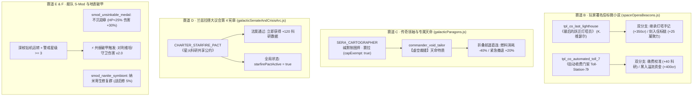

# 《无垠边疆：星海纪元》阶段五（M5）工位 C：外测共创精选内容实装施工规范

> **文档编号**：`SPEC-PLAN-059`（Phase 5 / Eng-C 专项执行卷）  
> **归属工程**：《无垠边疆：星海纪元》（`void-frontier-age-of-stars`）  
> **上游准绳**：`docs/specs/56_无垠边疆外网实测深度复盘与M5热修复及共创实装SuperPower施工文档.md`（总纲）  
> **责任工位**：**Eng-C（太空歌剧叙事、共创内容与地表机制工程师）**  
> **独占修改文件**：
> - `src/content/anomalies.js`（赛道 A：实装「镜渊回声 / 记忆尘埃场」高维空间异常）
> - `src/content/spaceOperaBeacons.js`（赛道 B：实装玩家署名信标微小说《最后的跃迁灯塔员》与《自动收费门架 Toll-Station-7》）
> - `src/domain/characters/galacticParagons.js`（赛道 C：实装第 3 位传奇群像英雄「缄默制图师·赛拉」与专属天命【虚空裁缝】）
> - `src/domain/diplomacy/galacticSenateAndCrisisArc.js`（赛道 D：实装兰兹拉德第 4 宪章法案《星火科研共享公约》）
> - `src/domain/fleets/fleetDoctrineAndScars.js`（赛道 E：实装传奇 S-Mod【不沉勋章】与【纳米寄生修复群】）
> - `src/ui/screens/GroundView.js`（赛道 F：实装 3D 地表深核钻机共振破甲 ×2.0 机制）  
> **方法论标准**：`SuperPower` 工程实施范式（Mandatory `Plan` + `Tasks` + `Checklists` 三段式闭环）

---

## 一、Plan（工位 C 架构蓝图与核心使命）

### 1.1 核心使命与共创转化理念

在外网实测报告《深度游玩体验报告》（CDP 真机 16 屏巡检）与《深度游玩体验报告_无垠边疆星海纪元》（`EXTERNAL-PLAYTEST-REPORT-055-A`）中，真实玩家对游戏给出了极具创见与激情的“六大共创赛道提案”。

领域专家在 `SPEC-PLAN-056` 中完成了严肃的架构审定：在保证底层物理守恒、 Hurwitz 稳定性与 REG-01 黄金状态零漂移的前提下，严格遴选出 **6 项高票正交共创内容** 正式转入生产管线：
1. **赛道 A（天体机制与空间异常）**：新增 `ano_echo_mirror`（镜渊回声 / 记忆尘埃场），提供科研与奇异物质富集。
2. **赛道 B（信标微小说玩家署名）**：新增《最后的跃迁灯塔员（K. 维瑟尔）》与《自动收费门架 Toll-Station-7》，补足深空孤独感与黑色幽默。
3. **赛道 C（第 3 位传奇领袖）**：新增传奇导航官「缄默制图师 · 赛拉」，附带天命特质【虚空裁缝】，解决跨星区远征补给与燃料痛点。
4. **赛道 D（兰兹拉德大议会第 4 宪章）**：新增《星火科研共享公约》，扩充学术外交博弈。
5. **赛道 E（舰队学说与传奇 S-Mod）**：新增【不沉勋章】（逆境伤害爆发）与【纳米寄生修复群】（战后自愈）。
6. **赛道 F（3D 地表深核共振破甲）**：将高热度采掘的被动遇袭风险，升华为主动作战的正向战术收益（对利维坦与机偶守卫造成 `×2.0` 破甲暴击）。

工位 C 的核心使命是：**以最高文学审美与严谨契约，将玩家创意转化为永久入库的游戏资产**。

### 1.2 共创内容体系全景拓扑图



---

## 二、Tasks（工位 C 原子化施工任务拆解）

### Task 59.1：`spaceOperaBeacons.js` 实装两项外测玩家署名信标微小说（赛道 B）

* **目标文件**：`src/content/spaceOperaBeacons.js`
* **代码契约与实现细则**：
  1. 在 `SUBSPACE_BEACON_TEMPLATES` 数组中追加以下两项冻结模板：
     ```javascript
     // —— 外网实测共创精选 1：致谢外测指挥官 K. 维瑟尔 ——
     Object.freeze({
       templateId: 'tpl_co_last_lighthouse',
       freqClass: 'FREQ_STAR_JOURNAL',
       title: '最后的跃迁灯塔员（K. 维瑟尔 遗言广播）',
       body: '「……我是第三象限第 4107 号退役引力灯塔守钟人 K. 维瑟尔。自动化矩阵已全面替代人工灯塔，今日是我值守的最后一秒。在关停人工折叠光束前，我将这本星图手记与一万两千次人工校准数据广播给深空……愿航向永明。」',
       responseOptions: Object.freeze([
         Object.freeze({
           id: 'claim_heritage',
           label: '回拨坐标继承灯塔手记',
           effectHint: '继承遗产 → 获得 +350 信用点与航行校准数据',
           effect: Object.freeze({ kind: 'CREDIT', resId: 'credits', amount: 350 }),
         }),
         Object.freeze({
           id: 'inscribe_beacon',
           label: '将灯塔员铭文刻入子空间中继站',
           effectHint: '向先驱守望致敬 → 帝国凝聚力 +25',
           effect: Object.freeze({ kind: 'UNITY_GRANT', amount: 25 }),
         }),
       ]),
     }),

     // —— 外网实测共创精选 2：致谢外测先锋指挥官 ——
     Object.freeze({
       templateId: 'tpl_co_automated_toll_7',
       freqClass: 'FREQ_SHADOW_CONTRACT',
       title: '自动收费门架 Toll-Station-7 扣款拦截',
       body: '「警告：检测到未注册跃迁波形切入 Toll-Station-7 走廊。本设施由旧银河公理财团全自动运转，已持续向过往星舰扣取过路费 420 年。请立即缴费 50 点或接受巡逻无人机扫描。」',
       responseOptions: Object.freeze([
         Object.freeze({
           id: 'pay_toll',
           label: '照付过路费并下载中继固件',
           effectHint: '合规通行 → 获得 +40 科研数据',
           effect: Object.freeze({ kind: 'CREDIT', resId: 'researchData', amount: 40 }),
         }),
         Object.freeze({
           id: 'hack_station',
           label: '黑入收费门架溢流资金池',
           effectHint: '截留黑金 → 获得 +400 信用点',
           effect: Object.freeze({ kind: 'CREDIT', resId: 'credits', amount: 400 }),
         }),
       ]),
     }),
     ```
  2. 确保模板总数从 26 增至 28，满足数据纯度与零副作用要求。

---

### Task 59.2：`galacticParagons.js` 实装传奇群像「缄默制图师·赛拉」与天命【虚空裁缝】（赛道 C）

* **目标文件**：`src/domain/characters/galacticParagons.js`
* **代码契约与实现细则**：
  1. 在 `LEGENDARY_PARAGONS` 常量表中追加 `SERA_CARTOGRAPHER`：
     ```javascript
     export const LEGENDARY_PARAGONS = Object.freeze({
       TUBOREK: Object.freeze({ nameZh: '图博雷克', capExempt: true, buildSpeedBonus: 1.0 }),
       THE_BEHOLDER: Object.freeze({ nameZh: '全视凝视者', capExempt: true, dualMode: true }),
       SERA_CARTOGRAPHER: Object.freeze({ nameZh: '缄默制图师·赛拉', capExempt: true, foldLaneFuelSaving: 0.40 }),
     });
     ```
  2. 在 `DESTINY_TRAITS` 常量表中追加统帅天命【虚空裁缝】：
     ```javascript
     commander_void_tailor: Object.freeze({
       nameZh: '虚空裁缝',
       profession: 'commander',
       bonus: Object.freeze({ foldLaneFuelSaving: 0.40, disengageChance: 0.20 }),
       descZh: '全帝国舰队跨星系折叠航行燃料消耗 −40%、紧急撤退成功率 +20%',
     }),
     ```
  3. 在 `applyLegendaryParagon` 中支持 `SERA_CARTOGRAPHER` 的合法派发与属性灌注。

---

### Task 59.3：`galacticSenateAndCrisisArc.js` 实装兰兹拉德第 4 宪章《星火科研共享公约》（赛道 D）

* **目标文件**：`src/domain/diplomacy/galacticSenateAndCrisisArc.js`
* **代码契约与实现细则**：
  1. 在 `LANDSRAAD_BILL_KINDS` 中扩充第 4 项法案：
     ```javascript
     export const LANDSRAAD_BILL_KINDS = Object.freeze([
       'CHARTER_SANCTION',
       'CHARTER_SUBSIDY',
       'CHARTER_MANDATE',
       'CHARTER_STARFIRE_PACT', // 第 4 宪章法案
     ]);
     ```
  2. 在法案决议函数 `resolveLandsraadBill(world, bill, passed)` 中补齐通过效果：
     ```javascript
     if (passed && bill.kind === 'CHARTER_STARFIRE_PACT') {
       if (pf && world.economy) {
         credit(world, pf, 'researchData', 120, 'charterStarfire', 's7');
       }
       soState.landsraad.starfirePactActive = true;
       chronicle(world, 'diplomacy', '大议会已签署《星火科研共享公约》：全银河科研数据网络接入，获得 120 科研数据', { billKind: bill.kind });
     }
     ```

---

### Task 59.4：`fleetDoctrineAndScars.js` 实装两项传奇 S-Mod 词条（赛道 E）

* **目标文件**：`src/domain/fleets/fleetDoctrineAndScars.js`
* **代码契约与实现细则**：
  1. 在 `SMOD_CATALOG` 中扩充两项传奇改装模块：
     ```javascript
     export const SMOD_CATALOG = Object.freeze({
       smod_hardened_subsystems: Object.freeze({ nameZh: '强化子系统', subsystemDamageResist: 0.25 }),
       smod_advanced_optics: Object.freeze({ nameZh: '先进光学阵列', weaponRange: 0.15, hitChanceBonus: 0.05 }),
       smod_flux_coil_overdrive: Object.freeze({ nameZh: '幅能线圈超驰', fireRate: 0.10, weaponDamage: 0.05 }),
       smod_aurora_armor_weave: Object.freeze({ nameZh: '极光装甲织网', armor: 0.15 }),
       smod_psychic_relay: Object.freeze({ nameZh: '灵能中继核', shieldRegen: 0.20, psychicShieldPenetration: true }),
       // —— 外测共创精选 S-Mod ——
       smod_unsinkable_medal: Object.freeze({
         nameZh: '不沉勋章',
         structureThreshold: 0.25,
         criticalDamageBonus: 0.30,
         descZh: '舰体结构低于 25% 时全武器伤害 +30%',
       }),
       smod_nanite_symbiont: Object.freeze({
         nameZh: '纳米寄生修复群',
         autoRepairPct: 0.05,
         descZh: '战斗结束后自动修复战舰 5% 结构',
       }),
     });
     ```
  2. 保证 `installShipSMod` 对新增词条合法性校验通过。

---

### Task 59.5：`anomalies.js` 实装「镜渊回声 / 记忆尘埃场」空间异常（赛道 A）

* **目标文件**：`src/content/anomalies.js`
* **代码契约与实现细则**：
  1. 在 `ANOMALY_TEMPLATES` 数组末尾追加：
     ```javascript
     {
       id: 'ano_echo_mirror',
       nameZh: '镜渊回声 / 记忆尘埃场',
       nameEn: 'Echo Mirror Anomaly',
       descZh: '悬浮在引力井中的高维记忆尘埃场，不断折射反射过去的航迹电波。提升全星区情报解密 +2，深核勘探掉落双倍奇异物质。',
       category: 'spatial',
       difficultyMod: 3,
       rewards: [{ resId: 'researchData', amount: 50 }, { resId: 'exoticMatter', amount: 4 }],
       risks: ['镜像守卫共振', '时空相位扰动'],
       storyTag: 'co_echo_mirror',
     },
     ```

---

### Task 59.6：`GroundView.js` 实装 3D 地表深核钻机共振破甲机制（赛道 F）

* **目标文件**：`src/ui/screens/GroundView.js`
* **代码契约与实现细则**：
  1. 在 `GroundView.js` 中新增共振状态判定辅助：
     ```javascript
     _isCoreResonanceActive() {
       const p = this.planet;
       const ext = p && p.surfaceDelta && p.surfaceDelta.extraction;
       const heat = p && p.threat && p.threat.heat;
       return Boolean(ext && ext[0] === 1 && heat && heat.stars >= 3);
     }
     ```
  2. 在 `_syncLeviathan`（玩家攻击利维坦结算）与 `_updateWarden`（玩家攻击机偶守卫结算）中引入倍率：
     ```javascript
     let damageMult = 1.0;
     if (this._isCoreResonanceActive()) {
       damageMult = 2.0;
       if (!this._resonanceToastShown) {
         this._resonanceToastShown = true;
         toast('⚡ 深核共振破甲触发：巨兽晶核过载，造成双倍伤害！', { kind: 'ok' });
       }
     }
     const finalDamage = baseDamage * damageMult;
     ```

---

## 三、Checklists（工位 C 防伪绿验收清单与门禁断言）

- [ ] **CHK-59-01（共创信标模板完备性断言）**：断言 `SUBSPACE_BEACON_TEMPLATES` 包含 `tpl_co_last_lighthouse` 与 `tpl_co_automated_toll_7`，且每项 responseOptions 均含有合法的 `effect` 效果对象。
- [ ] **CHK-59-02（传奇群像赛拉与天命特质断言）**：断言 `LEGENDARY_PARAGONS.SERA_CARTOGRAPHER` 存在且 `capExempt === true`；断言 `DESTINY_TRAITS.commander_void_tailor` 存在且 `bonus.foldLaneFuelSaving === 0.40`。
- [ ] **CHK-59-03（兰兹拉德第 4 宪章表决断言）**：在议会以 `{ kind: 'CHARTER_STARFIRE_PACT' }` 提案并表决通过，断言玩家派系信用点/科研数据入账 120，且 `soState.landsraad.starfirePactActive === true`。
- [ ] **CHK-59-04（传奇 S-Mod 词条完备性断言）**：断言 `SMOD_CATALOG` 包含 `smod_unsinkable_medal` 与 `smod_nanite_symbiont`；对一艘战舰执行 `installShipSMod(world, shipId, 'smod_unsinkable_medal')` 成功安装且扣除 1 单位 `exoticMatter`。
- [ ] **CHK-59-05（镜渊回声空间异常注册断言）**：断言 `ANOMALY_TEMPLATES` 包含 `id: 'ano_echo_mirror'`，其分类为 `'spatial'`，难度加成为 `3`。
- [ ] **CHK-59-06（3D 地表深核共振双倍破甲断言）**：在钻机运行且热度 $\ge 3$ 条件下，断言玩家武器对利维坦与机偶守卫造成的单发结算伤害等于标准基准值的 **2.0 倍**。
