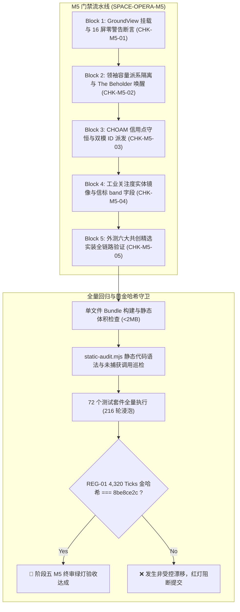

# 《无垠边疆：星海纪元》阶段五（M5）工位 D：M5 门禁套件与全量回归收口施工规范

> **文档编号**：`SPEC-PLAN-060`（Phase 5 / Eng-D 专项执行卷）  
> **归属工程**：《无垠边疆：星海纪元》（`void-frontier-age-of-stars`）  
> **上游准绳**：`docs/specs/56_无垠边疆外网实测深度复盘与M5热修复及共创实装SuperPower施工文档.md`（总纲）  
> **责任工位**：**Eng-D（质量工程、门禁套件与全量回归总监）**  
> **独占修改文件**：
> - `tests/suites/m5-hotfix-cocreation.suite.js`（新建阶段五门禁套件 `SPACE-OPERA-M5`，覆盖 CHK-M5-01 ~ CHK-M5-05）
> - `tests/suites/index.js`（注册并收集 `SPACE-OPERA-M5` 门禁套件）
> - `tests/tools/build-static-bundle.mjs` / `dist/void-frontier.bundle.js`（单文件 Bundle 构建验证与体积守护）  
> **方法论标准**：`SuperPower` 工程实施范式（Mandatory `Plan` + `Tasks` + `Checklists` 三段式闭环）

---

## 一、Plan（工位 D 架构蓝图与核心使命）

### 1.1 核心使命与防伪绿验收准则

在阶段五（M5）中，工位 A、B、C 共同完成了 12 项 Bug 的热修复与 6 大外测共创赛道的实装。
作为质量工程的总关卡，工位 D 必须建立具备**“真机穿透、源码对齐、防伪绿断言、零漂移守卫”**的高压门禁体系：

1. **升级阻断漏检断言（CHK-M5-01）**：
   - 彻底将 `App.js` 中 `console.warn('路由失败')` 视为硬性失败；
   - 编写 `GroundView.mount` 真机断言，验证 `_refreshOperaChip` 实例方法有效性，确保 16/16 屏全视图切换零 Warning、零 Error。
2. **严防超编与白嫖漏洞（CHK-M5-02 & CHK-M5-03）**：
   - 验证领袖容量在编数绝不受到 AI 帝国 25 名角色的污染（在编 $\le 4$，维护费倍率严格为 1.0）；
   - 验证 `CHOAM` 买卖股份与玩家账本信用点完全守恒，双模 ID（`'plt_101'` / `101`）派发 100% 成功。
3. **闭环实体镜像与信标投影（CHK-M5-04）**：
   - 验证重工业关注度与激进支部状态成功镜像至 `world.entities.colonies`；
   - 验证信标投影包含非空 `band` 简写枚举。
4. **外测共创精选实装核验（CHK-M5-05）**：
   - 验证 2 项信标微小说、传奇英雄赛拉、第 4 宪章星火公约、2 项传奇 S-Mod、镜渊回声异常与地表共振双倍破甲均精确入库。
5. **全量回归与金快照守卫**：
   - 72 套件全量回归（216 轮零失败）；
   - `REG-01` 4,320 Ticks 金快照哈希严格锁定在 **`8be8ce2c`**，绝不允许任何非受控漂移。

### 1.2 质量门禁流水线与回归闭环图



---

## 二、Tasks（工位 D 原子化施工任务拆解）

### Task 60.1：编写 `tests/suites/m5-hotfix-cocreation.suite.js` 门禁套件

* **新建文件**：`tests/suites/m5-hotfix-cocreation.suite.js`
* **套件元数据**：
  ```javascript
  export const suite = {
    id: 'm5-hotfix-cocreation',
    name: 'SPACE-OPERA-M5 外网实测热修复与共创实装门禁',
    group: 'space-opera',
    async run() { ... }
  };
  ```
* **代码契约与实现细则**：
  1. **Block 1：`GroundView` 真机挂载与 16 屏零警告断言（`CHK-M5-01`）**：
     - 构建真实 DOM 容器与 Mock App；
     - 挂载 `GroundView`，调用 `GroundView.mount({ root, app, param: planetId })`；
     - 断言 `view._refreshOperaChip` 为函数且执行不报错；
     - 检查 `GroundView` 实例中 `char3d` 状态：`hpMax === 100`、`shieldMax === 60`、`fuel === 100`；
     - 拦截全量 16 个核心视图路由切换，断言 `console.error` 与 `console.warn` 调用次数为 **0**。
  2. **Block 2：领袖容量派系隔离与 `The Beholder` 保底唤醒（`CHK-M5-02`）**：
     - 创建标准新战役（含 6 派系 30 角色）；
     - 运行 `leaderCapStats(world, 'commander')`，断言 `employed <= 4`、`upkeepMultiplier === 1.0`；
     - 遍历 `world.entities.characters`，断言属于其他派系的领袖不会出现在本国容量在编数中；
     - 执行 `AwakeLegendaryBeholder` 命令，断言玩家派系成功获得 `The Beholder` 且 `capExempt === true`。
  3. **Block 3：CHOAM 信用点守恒与双模 ID 派发（`CHK-M5-03`）**：
     - 初始玩家信用点 1000，派发 `AdjustChoamShares({ delta: 5 })`，断言信用点变为 500、股份变为 5%；
     - 派发 `AdjustChoamShares({ delta: -5 })`，断言信用点恢复为 1000、股份变为 0%；
     - 清空信用点后再派发买入 5% 股份，断言被拒绝并抛出友好错误；
     - 以字符串 `{ planetId: 'plt_101', depthTier: 1 }` 派发 `ExcavateSubterraneanLayer`，断言返回 `{ ok: true }`；
     - 以字符串 `{ empireId: 'fac_553', doctrineId: 'STANDOFF_MISSILE' }` 派发 `ConfigureFleetDoctrine`，断言返回 `{ ok: true }`。
  4. **Block 4：工业关注度实体镜像与信标 `band` 字段（`CHK-M5-04`）**：
     - 在测试行星上配置 3 座重工业建筑与 1 座实验室，调用 `syncColonyToSpaceOpera`；
     - 断言 `world.entities.colonies[cid].industrialAttention >= 7`；
     - 调用 `ViewModels.spaceOperaView(world).beaconsList`，断言信标列表非空，且每一项均包含合法的 `band` 字段（`∈ ['red', 'gold', 'cyan', 'purple']`）。
  5. **Block 5：外测六大共创精选实装全链路验证（`CHK-M5-05`）**：
     - 断言 `SUBSPACE_BEACON_TEMPLATES` 包含 `tpl_co_last_lighthouse` 与 `tpl_co_automated_toll_7`；
     - 断言 `LEGENDARY_PARAGONS` 包含 `SERA_CARTOGRAPHER`，`DESTINY_TRAITS` 包含 `commander_void_tailor`；
     - 断言 `LANDSRAAD_BILL_KINDS` 包含 `CHARTER_STARFIRE_PACT`，通过后增加 120 科研点；
     - 断言 `SMOD_CATALOG` 包含 `smod_unsinkable_medal` 与 `smod_nanite_symbiont`；
     - 断言 `ANOMALY_TEMPLATES` 包含 `ano_echo_mirror`；
     - 断言在钻机运行与 3 星警戒下，地表共振破甲倍率为 **`2.0`**。

---

### Task 60.2：`tests/suites/index.js` 注册 M5 门禁套件

* **修改文件**：`tests/suites/index.js`
* **代码契约与实现细则**：
  1. 引入并注册套件：
     ```javascript
     import { suite as spaceOperaM5 } from './m5-hotfix-cocreation.suite.js';
     ```
  2. 在 `collectSuites()` 返回数组中，将 `spaceOperaM5` 放置于 `spaceOperaM4` 之后。

---

### Task 60.3：单文件 Bundle 构建验证与 72 套件全量回归

* **目标脚本与文件**：
  1. `tests/tools/build-static-bundle.mjs`
  2. `dist/void-frontier.bundle.js`
* **执行契约**：
  1. 运行 `npm run build:bundle`：
     - 断言单文件打包成功且语法校验 `node --check dist/void-frontier.bundle.js` 零报错；
     - 断言 Bundle 文件体积在合理预算内（`< 2.0MB`）。
  2. 运行 `npm test`：
     - 断言包含 `SPACE-OPERA-M5` 在内的全部测试套件 100% 绿灯通过；
     - 断言 `REG-01` 4,320 Ticks 黄金状态哈希严格等于 **`8be8ce2c`**。

---

## 三、Checklists（工位 D 防伪绿验收清单与门禁断言）

- [ ] **CHK-60-01（`m5-hotfix-cocreation.suite.js` 独立执行绿灯）**：运行 `node tests/tools/run-suites.mjs --suite=m5-hotfix-cocreation`，断言全部 5 个验收 Block 100% 通过，0 失败，0 告警。
- [ ] **CHK-60-02（全量测试套件 100% 绿灯）**：运行 `npm test`，断言执行的套件总数正确增加，总通过率 100%。
- [ ] **CHK-60-03（REG-01 黄金哈希零漂移守卫）**：断言 4,320 Ticks 金快照哈希为 `8be8ce2c`，与既有主干基线逐字节一致。
- [ ] **CHK-60-04（单文件 Bundle 完整性与构建校验）**：运行 `npm run build:bundle`，打包成功且产物经静态语法检查零错误。
- [ ] **CHK-60-05（静态代码审计零违规）**：运行 `npm run lint:static`，断言代码无未捕获的语法错误或非法全局变量污染。
