# 《无垠边疆：星海纪元》阶段五（M5）外测热修复与共创实装领域专家独立终审验收报告兼下一阶段（M6 / V1.0）行动计划

> **文档编号**：`SPEC-ACC-062`（Phase 5 Independent Final Acceptance & Phase 6 / V1.0 Gold Master Action Plan）  
> **归属工程**：[`Google Drive\work\void-frontier-age-of-stars`](https://drive.google.com/drive/folders/[REDACTED])  
> **文档落盘路径**：[`docs/specs/62_无垠边疆阶段五(M5)_外测热修复与共创实装领域专家独立终审验收报告兼下一阶段行动计划.md`](https://drive.google.com/drive/folders/[REDACTED])  
> **审计与规划角色**：游戏系统架构、太空歌剧叙事与微模拟领域专家（Domain Expert）  
> **独立受检对象**：  
> - **执行工程师完工报告**：[`docs/reports/56-60_M5_验收报告.md`](https://drive.google.com/file/d/[REDACTED]/view?usp=drivesdk)  
> - **项目负责人验收报告**：[`docs/specs/61_无垠边疆阶段五(M5)_项目负责人终审验收报告.md`](https://drive.google.com/file/d/[REDACTED]/view?usp=drivesdk)（`SPEC-PLAN-061`）  
> - **M5 施工规范卷集**：[`56_无垠边疆外网实测深度复盘与M5热修复及共创实装SuperPower施工文档.md`](https://drive.google.com/file/d/[REDACTED]/view?usp=drivesdk)（总纲）、[`57_工位A`](https://drive.google.com/file/d/[REDACTED]/view?usp=drivesdk)、[`58_工位B`](https://drive.google.com/file/d/[REDACTED]/view?usp=drivesdk)、[`59_工位C`](https://drive.google.com/file/d/[REDACTED]/view?usp=drivesdk)、[`60_工位D`](https://drive.google.com/file/d/[REDACTED]/view?usp=drivesdk)  
> - **外网真实玩家实测基线**：[`深度游玩体验报告.md`](https://drive.google.com/file/d/[REDACTED]/view?usp=drivesdk)、[`游玩实记.md`](https://drive.google.com/file/d/[REDACTED]/view?usp=drivesdk)、[`深度游玩体验报告_无垠边疆星海纪元.md`](https://drive.google.com/file/d/[REDACTED]/view?usp=drivesdk)  
> - **M5 运行时门禁与真机日志**：[`tests/suites/m5-hotfix-cocreation.suite.js`](https://drive.google.com/file/d/[REDACTED]/view?usp=drivesdk)、[`M5_full_regression.log`](https://drive.google.com/file/d/[REDACTED]/view?usp=drivesdk)、[`M5_cdp_playtest.log`](https://drive.google.com/file/d/[REDACTED]/view?usp=drivesdk)、[`M5_bootloader_verify.log`](https://drive.google.com/file/d/[REDACTED]/view?usp=drivesdk)、[`M5_perf_sensitive_suites.log`](https://drive.google.com/file/d/[REDACTED]/view?usp=drivesdk)  
> **独立终审裁决**：**终审通过（PASS WITH 6 MICRO-POLISH ITEMS FOR M6 · 核心设计预期 100% 达成，附加穿透审计发现的 6 项跨模块边界微瑕纳入 M6 / V1.0 黄金母盘收口行动计划）**

---

## 一、领域专家独立终审总评与裁决结论

作为领域专家，本轮审计严格遵循**“不盲信完工自述、不轻信负责人背书、一切以源码逐行对账与运行时日志证据为准”**的穿透式取证准则，对 M5 阶段修改的 **23 个核心源码与测试文件** 进行了全量逐行核查。

### 1.1 独立裁决结论

1. **核心使命达成度（12 项外测缺陷 + 6 大共创赛道 + 3 项底层潜伏暗疾）**：**100% 真实落地**。
   - [`SPEC-PLAN-056`](https://drive.google.com/file/d/[REDACTED]/view?usp=drivesdk) 确诊的 **12 项外网实测缺陷（`BUG-01` ~ `BUG-12`）** 均已在源码层彻底修复，无一例采用“注释屏蔽断言”或“空函数伪绿”手段；
   - **6 大玩家共创赛道（赛道 A ~ F）** 不仅完成了字典入库，而且**全部打通了底层模拟、舰队航行、太空战术、行星产出与 3D 地表伤害结算管线**，完全符合设计预期；
   - 执行工程师在将 [`index.html`](https://drive.google.com/file/d/[REDACTED]/view?usp=drivesdk) 切换为默认加载单文件 Bundle 时，主动揪出并根治了 **3 项潜伏的既有生产环境致命缺陷**（[`build-static-bundle.mjs:151`](https://drive.google.com/file/d/[REDACTED]/view?usp=drivesdk) 中 `export { a as b }` 键值反转导致生产环境抛 `ReferenceError: stepParagonLeaderTick is not defined`、`Galaxy3D.js` 动态探测 `/dist/` 子模块触发 404、以及 `worldMigration.js` 的 7 处反向循环依赖），展现了极高的工程自治水准；
   - 全量 **72 个测试套件 × 连续 3 轮对拍（216/216 PASS，0 FAIL，0 DRIFT）** 全部绿灯（见 [`M5_full_regression.log`](https://drive.google.com/file/d/[REDACTED]/view?usp=drivesdk)），`REG-01` 4,320 Ticks 黄金状态哈希严格锁定为 **`8be8ce2c`**；Chrome 158 CDP 真机 16 屏轮巡与地表微操实测 `avgFrameMs = 16.64ms`、`DrawCalls = 19 (<= 32)`、全程 `0 Error / 0 Warning / 0 404`（见 [`M5_cdp_playtest.log`](https://drive.google.com/file/d/[REDACTED]/view?usp=drivesdk)）。
2. **对项目负责人验收报告（[`SPEC-PLAN-061`](https://drive.google.com/file/d/[REDACTED]/view?usp=drivesdk)）的独立纠偏**：
   - 项目负责人在 [`61_无垠边疆阶段五(M5)_项目负责人终审验收报告.md`](https://drive.google.com/file/d/[REDACTED]/view?usp=drivesdk) 中给出“无任何残余瑕疵”的评定过于乐观，且第一、二节表格将 Bundle 体积沿用旧值写为 `2852 KB`（实际重建后为 `3,389,493 bytes / 3310 KB`）。
   - 经领域专家逐行穿透源码，我们独立发现了 **6 项项目负责人与测试套件均未察觉的跨模块边界微瑕（`FINDING-M5-01` ~ `FINDING-M5-06`）**——例如 [`DiplomacyView.js:371-375`](https://drive.google.com/file/d/[REDACTED]/view?usp=drivesdk) 漏配第 4 宪章中文名导致外交按钮显示裸英文枚举 `提案：CHARTER_STARFIRE_PACT`、[`ColonyView.js:377-379`](https://drive.google.com/file/d/[REDACTED]/view?usp=drivesdk) 点击【🌍 3D 地表模式】未传 `groundPlanetId` 路由参数导致简报页丢失目标行星与灵魂徽标、[`navigation.js:78, 231`](https://drive.google.com/file/d/[REDACTED]/view?usp=drivesdk) 航前燃料预检未乘算赛拉 `-40%` 燃料折扣等。
   - 鉴于这 6 项发现均属**局部 UI 映射/前置校验边界微瑕**，不推翻 M5 的核心架构与 216 轮确定性绿灯，**领域专家正式裁定 M5 阶段通过验收（PASS），并将上述 6 项穿透发现直接转化为阶段六（M6 / V1.0 黄金母盘收口与二轮公测）的强制施工任务**。

---

## 二、M5 核心交付成果源码级穿透对账单

### 2.1 12 项外网实测缺陷（`BUG-01` ~ `BUG-12`）逐行核验表

| 缺陷编号 | 严重度 | 设计预期（`SPEC-PLAN-056`） | 源码实际落点（`File:Line`）与穿透核验事实 | 独立裁决 |
| :---: | :---: | :--- | :--- | :---: |
| **`BUG-01`** | **P0 阻断** | 修复 `GroundView._setHead` 调用未定义 `this._refreshOperaChip()` 导致的挂载崩溃；废除 `App.js` 静默路由吞错。 | 1. [`src/ui/screens/GroundView.js:749-755`](https://drive.google.com/file/d/[REDACTED]/view?usp=drivesdk) 显式挂载实例方法 `_refreshOperaChip()` 并在 `_setHead` 中直调 `refreshGroundOperaChip(this)`；<br/>2. [`src/app/App.js:567-573`](https://drive.google.com/file/d/[REDACTED]/view?usp=drivesdk) 将 `catch` 块升级为 `console.error` + `this._lastRouteError = e` + `this.showFatalError(...)` + `throw e`。 | **PASS** |
| **`BUG-02`** | **P0 严重** | 根除开局全银河 30 名角色混入玩家编制导致 `18/4` 超编（维护费 `×4.50`、XP `×0.10`）的跨派系污染。 | 1. [`src/domain/characters/galacticParagons.js:202-211`](https://drive.google.com/file/d/[REDACTED]/view?usp=drivesdk) 在 `leaderCapStats` 中严格校验 `if (targetFaction && ch.factionId && ch.factionId !== targetFaction) continue;`；<br/>2. [`src/ui/screens/GovernmentView.js:417-420`](https://drive.google.com/file/d/[REDACTED]/view?usp=drivesdk) 与 [`src/simulation/ViewModels.js:432-442`](https://drive.google.com/file/d/[REDACTED]/view?usp=drivesdk) 同步隔离非玩家派系角色，实测开局统帅在编 `3/4`，倍率严格为 `1.0`。 | **PASS** |
| **`BUG-03`** | **P1 高危** | 修复买入/抛售 CHOAM 股份不扣减/不回收信用点的白嫖漏洞（基准价 `100 信用点 / 1%`）。 | [`src/domain/diplomacy/galacticSenateAndCrisisArc.js:100, 272-305`](https://drive.google.com/file/d/[REDACTED]/view?usp=drivesdk) 导出 `CHOAM_SHARE_CREDITS_PER_PCT = 100`，`adjustChoamShares` 买入时执行 `debit(world, pf, 'credits', cost, 'choamBuy', 's7')`（不足抛 `SO: 信用点不足` 触发事务回滚），抛售时执行 `credit` 回款。 | **PASS** |
| **`BUG-04`** | **P1 高危** | 兼容 `'plt_101'`、`'fac_553'`、`'flt_563'` 等字符串实体 ID 与整数 ID 双模派发，同时保持非 ID 字段强类型契约。 | 1. [`src/domain/world/commandSchemas.js:233-277`](https://drive.google.com/file/d/[REDACTED]/view?usp=drivesdk) 实现 `isEntityIdField`、`isCoercibleEntityId` 与 `normalizeEntityIdValue`，对以 `Id` 结尾字段放行合法前缀数字串并拒收脏字符串；<br/>2. [`src/app/commandsSpaceOpera.js:126-148`](https://drive.google.com/file/d/[REDACTED]/view?usp=drivesdk) 在 `executeSpaceOpera` 入口调用 `normalizeSpaceOperaEntityIds` 原地归一化为整数。 | **PASS** |
| **`BUG-05`** | **P1 高危** | 消除 GitHub Pages 跨洋加载 188 个独立 ESM 文件的瀑布卡死，改为单文件 Bundle 优先直载 + 8 秒超时重试守护。 | [`index.html:40-87`](https://drive.google.com/file/d/[REDACTED]/view?usp=drivesdk) 默认直载 `./dist/void-frontier.bundle.js`，保留 `?esm=1` 开发者模式、`onerror` 自动回退 ESM 以及 8 秒 `armWatchdog` 超时展示 `↻ 重新加载` 按钮；[`M5_bootloader_verify.log`](https://drive.google.com/file/d/[REDACTED]/view?usp=drivesdk) 6 项分支测试全绿。 | **PASS** |
| **`BUG-06`** | **P1 高危** | 消除星图初始偏下挤压，提供母星系自动居中与顶栏一键【🎯 复位视角】按钮。 | [`src/render/GalaxyRenderer.js:280-342`](https://drive.google.com/file/d/[REDACTED]/view?usp=drivesdk) 实现 `centerOnCoordinates`、`centerOnHomeSystem` 与 `resetView`；[`src/ui/screens/GalaxyView.js:80-100`](https://drive.google.com/file/d/[REDACTED]/view?usp=drivesdk) 首帧对准玩家母星系并在顶栏挂载【🎯 复位视角】按钮。 | **PASS** |
| **`BUG-07`** | **P2 中危** | 修复任务模式阵亡后进入自由探索模式残留 `0/100` HP 的状态污染。 | [`src/ui/screens/GroundView.js:52-55, 650, 1162`](https://drive.google.com/file/d/[REDACTED]/view?usp=drivesdk) 提取冻结常量 `GROUND_CHAR_FULL_STATE`（`hp:100, shield:60, stamina:100, fuel:100, flash:0`），在 `_setupScene` 中执行 `Object.assign(c, GROUND_CHAR_FULL_STATE)` 整组复位。 | **PASS** |
| **`BUG-08`** | **P2 中危** | 根除信标响应、建筑入队、0 情报点渗透与地表部署的静默无反馈体验。 | 1. [`src/simulation/ViewModels.js:799-815`](https://drive.google.com/file/d/[REDACTED]/view?usp=drivesdk) 导出 `beaconOutcomeSummaryZh`，在 [`GalaxyView.js:560`](https://drive.google.com/file/d/[REDACTED]/view?usp=drivesdk) 与 [`SystemView.js:814, 859`](https://drive.google.com/file/d/[REDACTED]/view?usp=drivesdk) 弹出收益明细 Toast；<br/>2. [`ColonyView.js:634`](https://drive.google.com/file/d/[REDACTED]/view?usp=drivesdk) 弹出入队成功与缺合金市场采购指引 Toast；<br/>3. [`DiplomacyView.js:503-526`](https://drive.google.com/file/d/[REDACTED]/view?usp=drivesdk) 落地 10 点禁用与 25 点低储备提示；<br/>4. [`GroundView.js:1513, 1527`](https://drive.google.com/file/d/[REDACTED]/view?usp=drivesdk) 补齐 `Digit7..0` 与 `KeyX` 部署即时 Toast。 | **PASS** |
| **`BUG-09`** | **P2 中危** | 将 `industrialAttention` 与 `radicalCellActive` 镜像回写至殖民地实体；信标投影补齐四色 `band` 简写。 | 1. [`src/domain/planets/spaceOperaColonyBridge.js:140-145`](https://drive.google.com/file/d/[REDACTED]/view?usp=drivesdk) 将 `industrialAttention` 与 `radicalCellActive` 镜像写入 `colony` 实体；<br/>2. [`src/content/spaceOperaBeacons.js:47-57`](https://drive.google.com/file/d/[REDACTED]/view?usp=drivesdk) 按 56 号总纲权威语义定义 `BEACON_FREQ_BAND`（求援 `red` / 黑市 `gold` / 先驱 `cyan` / 日报 `purple`），[`subspaceBeaconStream.js:134, 165`](https://drive.google.com/file/d/[REDACTED]/view?usp=drivesdk) 与 [`ViewModels.js:770`](https://drive.google.com/file/d/[REDACTED]/view?usp=drivesdk) 完整输出 `band`。 | **PASS** |
| **`BUG-10`** | **P2 体验** | 解决招牌传奇领袖 `The Beholder` 前 120 个月不可达痛点，支持开局第 1 天体验双形态切换。 | [`src/domain/characters/galacticParagons.js:776-839`](https://drive.google.com/file/d/[REDACTED]/view?usp=drivesdk) 实现幂等函数 `awakeLegendaryBeholder(world)`，预置锚定玩家首颗殖民星并同步 `cColony.ownerId`，由 [`worldMigration.js:142`](https://drive.google.com/file/d/[REDACTED]/view?usp=drivesdk) 在新战役激活时自动唤醒，且在 [`GovernmentView.js:422-450`](https://drive.google.com/file/d/[REDACTED]/view?usp=drivesdk) 提供常驻状态卡与保底唤醒按钮。 | **PASS** |
| **`BUG-11`** | **P2 体验** | 开放任务模式（`mission`）下 `Digit7..0` 与 `KeyX` 野战部署；模态弹窗打开时暂停地面任务时钟。 | 1. [`src/ui/screens/GroundView.js:1505, 1520`](https://drive.google.com/file/d/[REDACTED]/view?usp=drivesdk) 将条件放宽为 `(this.mode === 'free' || this.mode === 'mission') && this.planet`；<br/>2. [`src/ui/screens/GroundView.js:1472-1474`](https://drive.google.com/file/d/[REDACTED]/view?usp=drivesdk) 按 `KeyV` 弹出完整三模态面罩提示；<br/>3. [`src/ui/screens/GroundView.js:1871-1875`](https://drive.google.com/file/d/[REDACTED]/view?usp=drivesdk) 在 `_missionFrame` 首行检测 `.vf-modal-backdrop` 或 `this._isPaused` 即冻结步进。 | **PASS** |
| **`BUG-12`** | **P3 平衡** | 强化恶劣行星地表初期生存容错，防止 30 点护盾过快被高温/酸雨击穿。 | [`src/ui/screens/GroundView.js:53`](https://drive.google.com/file/d/[REDACTED]/view?usp=drivesdk) 将 `GROUND_CHAR_FULL_STATE` 的 `shieldMax` 与 `shield` 从 `30` 提升至 `60`，配合任务模式开放 `Digit8` 热能充能桩（12m 力场内免疫环境伤害并 `+6/s` 回充护盾），生存容错翻倍。 | **PASS** |

---

### 2.2 外网玩家六大共创赛道（Track A ~ Track F）全链路实装核验表

| 共创赛道 | 共创条目名称与标识符 | 静态字典落点（`File:Line`） | 活体模拟 / 渲染消费落点（`File:Line`） | 黄金哈希保护与实测结论 |
| :---: | :--- | :--- | :--- | :---: |
| **赛道 A**<br/>高维空间异常 | **镜渊回声 / 记忆尘埃场**<br/>（`ano_echo_mirror`） | [`src/content/anomalies.js:184-193`](https://drive.google.com/file/d/[REDACTED]/view?usp=drivesdk)<br/>（`spatial` / `difficultyMod: 3` / `+50 researchData, +4 exoticMatter`） | [`src/domain/world/worldMigration.js:39-68, 143`](https://drive.google.com/file/d/[REDACTED]/view?usp=drivesdk) `seedEchoMirrorAnomaly(world)` 在活体战役开局确定性挑选首个空闲异常槽星系生成实体。 | [`src/domain/exploration/scan.js:20, 128`](https://drive.google.com/file/d/[REDACTED]/view?usp=drivesdk) 锁定 `BASELINE_ANOMALY_TEMPLATES = ANOMALY_TEMPLATES.slice(0, 20)`，**既实装可达又保持 `8be8ce2c` 零漂移**。<br/>**PASS** |
| **赛道 B**<br/>玩家署名信标 | 1. **《最后的跃迁灯塔员（K. 维瑟尔 遗言广播）》**（`tpl_co_last_lighthouse`）<br/>2. **《自动收费门架 Toll-Station-7 扣款拦截》**（`tpl_co_automated_toll_7`） | [`src/content/spaceOperaBeacons.js:332-370`](https://drive.google.com/file/d/[REDACTED]/view?usp=drivesdk)<br/>（叙事信标模板由 26 扩充至 28 条，双分支 `effect` 冻结） | [`src/domain/world/subspaceBeaconStream.js:116-143, 270-346`](https://drive.google.com/file/d/[REDACTED]/view?usp=drivesdk) 纳入 `SUBSPACE_BEACON_TEMPLATES` 采样池并经 `respondSubspaceBeacon` 真实结算 `+350/+400 credits`、`+25 unity`、`+40 researchData`。 | 仅在激活 `spaceOperaState` 时步进，不影响 `REG-01`。<br/>**PASS** |
| **赛道 C**<br/>第 3 位传奇群像 | **缄默制图师 · 赛拉**<br/>（`SERA_CARTOGRAPHER`）+ 专属天命 **【虚空裁缝】**（`commander_void_tailor`） | [`src/domain/characters/galacticParagons.js:368-373, 723-729, 845-871`](https://drive.google.com/file/d/[REDACTED]/view?usp=drivesdk) | 1. [`src/app/commandsSpaceOpera.js:659`](https://drive.google.com/file/d/[REDACTED]/view?usp=drivesdk) 注册 `RecruitSeraCartographer`；<br/>2. [`src/ui/screens/GovernmentView.js:453-462`](https://drive.google.com/file/d/[REDACTED]/view?usp=drivesdk) 渲染招募按钮；<br/>3. [`src/domain/fleets/navigation.js:32-59, 198`](https://drive.google.com/file/d/[REDACTED]/view?usp=drivesdk) `seraFleetModifiers` 真实接入 `fleetSpeed`（`×1.25`）与 `fleetFuelMult`（`×0.60`）。 | 未招募时恒返回 `{fuelMultiplier:1, speedMultiplier:1}`，零漂移。<br/>**PASS** |
| **赛道 D**<br/>兰兹拉德第 4 宪章 | **《星火科研共享公约》**<br/>（`CHARTER_STARFIRE_PACT`） | [`src/domain/diplomacy/galacticSenateAndCrisisArc.js:342-350, 520-530`](https://drive.google.com/file/d/[REDACTED]/view?usp=drivesdk) | 1. 表决通过即入账 `+120 researchData` 并置 `landsraad.starfirePactActive = true`；<br/>2. [`src/domain/planets/spaceOperaColonyBridge.js:347-349`](https://drive.google.com/file/d/[REDACTED]/view?usp=drivesdk) 与 [`src/simulation/HourlySystems.js:187-195`](https://drive.google.com/file/d/[REDACTED]/view?usp=drivesdk) 将全银河每小时科研产出乘以 `1.20`（`+20%`）；<br/>3. [`src/domain/economy/market.js:17-28, 79, 93`](https://drive.google.com/file/d/[REDACTED]/view?usp=drivesdk) `starfirePactTradeTaxMult` 对向玩家宣战的违约方加征 `+25%` 市场交易税。 | 完整贯通议会表决、小时科研结算与市场违约惩罚。<br/>**PASS** |
| **赛道 E**<br/>传奇 S-Mod 词条 | 1. **【不沉勋章】**（`smod_unsinkable_medal`：结构 `<25%` 时武器伤害 `+30%`）<br/>2. **【纳米寄生修复群】**（`smod_nanite_symbiont`：战后自动修复 `5%` 结构） | [`src/domain/fleets/fleetDoctrineAndScars.js:374-386, 483-509`](https://drive.google.com/file/d/[REDACTED]/view?usp=drivesdk) | 1. [`src/domain/combat/tactics.js:353-358`](https://drive.google.com/file/d/[REDACTED]/view?usp=drivesdk) 在 `applyHit` 中调用 `unsinkableDamageMultiplier(aShip)` 放大实弹与导弹伤害；<br/>2. [`src/domain/combat/BattleSimulation.js:243-248`](https://drive.google.com/file/d/[REDACTED]/view?usp=drivesdk) 在 `finishBattle` 中遍历存活战舰调用 `naniteSymbiontRepair(ship)`。 | 真实接入战术伤害与战后结算，非静态词条。<br/>**PASS** |
| **赛道 F**<br/>3D 地表共振破甲 | **深核钻机共振破甲**<br/>（钻机运行 + 警戒 `>= ★3` → 对巨兽/守卫伤害 `×2.0`） | [`src/ui/screens/GroundView.js:2415-2433`](https://drive.google.com/file/d/[REDACTED]/view?usp=drivesdk) `CORE_RESONANCE_DAMAGE_MULT = 2.0` 与 `coreResonanceDamageMultiplier(planet)` | [`src/ui/screens/GroundView.js:758-773, 1665, 1806`](https://drive.google.com/file/d/[REDACTED]/view?usp=drivesdk) 在 `_updateWarden`（攻击先驱者机偶守卫）与 `_syncLeviathan`（攻击超巨型利维坦）中乘以 `this._coreDamageMult()`，并首次触发时弹出 `⚡ 深核共振破甲触发：巨兽晶核过载，造成双倍伤害！` Toast。 | 同时兼容运行时 `surfaceDelta.heat[1]` 与文档 `threat.heat.stars` 形态。<br/>**PASS** |

---

## 三、领域专家独立穿透发现的 6 项跨模块边界微瑕（项目负责人漏检项）

尽管 M5 全部门禁与回归测试 100% 通过，但领域专家在跨文件交叉审计中发现 **6 处项目负责人（`SPEC-PLAN-061`）未能识别的微瑕与工程卫生隐患**。现逐条披露其精确源码位置与因果链，并纳入下一阶段（M6 / V1.0）收口计划：

### 3.1 `FINDING-M5-01`（P2 UI 字典漏配）：`DiplomacyView.js:371-375` 未同步第 4 宪章中文名，外交按钮裸露英文枚举 `提案：CHARTER_STARFIRE_PACT`

* **源码证据**：
  - 在 [`src/domain/diplomacy/galacticSenateAndCrisisArc.js:342-347`](https://drive.google.com/file/d/[REDACTED]/view?usp=drivesdk) 中，`LANDSRAAD_BILL_KINDS` 已扩充为 4 项：`['CHARTER_SANCTION', 'CHARTER_SUBSIDY', 'CHARTER_MANDATE', 'CHARTER_STARFIRE_PACT']`。
  - 但在 [`src/ui/screens/DiplomacyView.js:371-375`](https://drive.google.com/file/d/[REDACTED]/view?usp=drivesdk) 中，局部映射表 `BILL_ZH` 仍停留在 M4 的 3 项：
    ```javascript
    const BILL_ZH = {
      CHARTER_SANCTION: '贸易禁运制裁案（SANCTION）',
      CHARTER_SUBSIDY: '工业补贴拨款案（SUBSIDY）',
      CHARTER_MANDATE: '联合远征授权案（MANDATE）',
    };
    ```
* **后果分析**：当玩家打开【外交】视图的「兰兹拉德大议会与 CHOAM 暗战」面板时，[`DiplomacyView.js:435-441`](https://drive.google.com/file/d/[REDACTED]/view?usp=drivesdk) 遍历 `LANDSRAAD_BILL_KINDS` 生成的第 4 个提案按钮文案回退为裸英文枚举 **`提案：CHARTER_STARFIRE_PACT`**；提案后第 430 行的活跃议案标签同样显示为 `活跃议案 #1：CHARTER_STARFIRE_PACT（月末表决）`，破坏了全中文太空歌剧 UI 的沉浸感。

### 3.2 `FINDING-M5-02`（P2 路由传参断链）：`ColonyView.js:377-379` 切换 3D 地表未传 `groundPlanetId` 路由参数，导致简报页丢失目标行星与灵魂徽标

* **源码证据**：
  - 在 [`src/ui/screens/ColonyView.js:377-380`](https://drive.google.com/file/d/[REDACTED]/view?usp=drivesdk) 中，顶栏【🌍 3D 地表模式】按钮点击回调写为：
    ```javascript
    app._groundTargetPlanet = groundPlanetId;
    app.goto('ground');
    ```
  - 而在 [`src/ui/screens/GroundView.js:698-715`](https://drive.google.com/file/d/[REDACTED]/view?usp=drivesdk) 的 `_build(param)` 以及第 2441 行的 `refreshGroundOperaChip(view)` 中，代码只读取路由参数 `param`，**全仓没有任何一处读取 `app._groundTargetPlanet`**！
* **后果分析**：当玩家从【殖民地】视图点击【🌍 3D 地表模式】进入地表简报页时（若当前无进行中的地面任务），`param` 为 `null`，导致 `this._targetPlanetId` 为 `null`：
  1. 简报页顶栏的行星灵魂徽标芯片（`headOperaChip`）因 `planetId === null` 而渲染为空白；
  2. 简报页标题仅显示 `简报` 而非 `<行星名> · 简报`，下拉框未自动锁定当前正在管理的非首颗殖民地，且【← 返回星系】按钮失去所属星系上下文而直接回退银河星图。
  - 只需将 `ColonyView.js:379` 改为 `app.goto('ground', groundPlanetId)` 并在 `GroundView.js:711` 兼容 `param || app._groundTargetPlanet` 即可彻底弥合。

### 3.3 `FINDING-M5-03`（P2 航路预检与实际扣油不一致）：`navigation.js:78, 231` 航前燃料校验未乘算赛拉 `-40%` 燃料折扣 `fleetFuelMult`

* **源码证据**：
  - 在 [`src/domain/fleets/navigation.js:103, 191-199`](https://drive.google.com/file/d/[REDACTED]/view?usp=drivesdk) 中，舰队在途每小时实际扣除的燃料已正确乘算 `seraFleetModifiers(world, fleet).fuelMultiplier`（`0.60`）：
    ```javascript
    const fuelPerHour = BAL.navigation.fuelPerLaneHour * fleetFuelMult(fleet, world);
    ```
  - 但在出发前的航路规划函数 `beginTransit`（[`navigation.js:78`](https://drive.google.com/file/d/[REDACTED]/view?usp=drivesdk)）与 `planRoute`（[`navigation.js:231`](https://drive.google.com/file/d/[REDACTED]/view?usp=drivesdk)）中，预计总燃料消耗仍写为：
    ```javascript
    fuelNeed += h * BAL.navigation.fuelPerLaneHour;
    ```
* **后果分析**：虽然 `h`（`laneHours`）已享受赛拉 `+25%` 航速缩短，但每航行小时的 `-40%` 燃料消耗折扣未计入航前 `fuelNeed > fuelAvailable` 判定。当玩家舰队剩余燃料介于原需求量的 `60% ~ 100%` 之间时，`planRoute` 会以 `NO_FUEL` 误拒远征指令，限制了【虚空裁缝】在极限远征场景下的战术价值。

### 3.4 `FINDING-M5-04`（P2 创伤特质键值与结构双轨分裂）：`GovernmentView.js:390-397, 481-483` 渲染 `traumaCheck` 对象时存在 `[object Object]` 风险且未展示赛拉创伤背景

* **源码证据**：
  - [`src/domain/characters/galacticParagons.js:463-469`](https://drive.google.com/file/d/[REDACTED]/view?usp=drivesdk) 定义的 `TRAUMA_TRAITS` 键名为大写（`SUBSTANCE_ABUSER`、`MELANCHOLIC`、`LAVISH_LIFESTYLE`、`DESTRUCTIVE`、`CORRUPT`），且 `traumaCheck`（第 495 行）向 `p.trauma` 推入的是对象 `{ traitId, tier, sinceTick }`；
  - 而 [`src/ui/screens/GovernmentView.js:390-397, 481-483`](https://drive.google.com/file/d/[REDACTED]/view?usp=drivesdk) 的 `TRAUMA_ZH` 键名却是小写（`substance_abuse`、`melancholic` 等），且取值表达式为：
    ```javascript
    const traumaTags = trauma
      .map((t) => (t && TRAUMA_ZH[t.id || t]) || (t && t.id) || t)
      .filter(Boolean);
    ```
* **后果分析**：
  1. 当任何领袖在实战中经 `traumaCheck` 获得 `{ traitId: 'MELANCHOLIC', tier: 1, sinceTick: 720 }` 时，因对象属性名为 `traitId` 而非 `id`，`t.id` 为 `undefined`，表达式回退返回对象 `t` 本身，在政府视图中拼接字符串时将渲染出 **`创伤特质：[object Object]`**！
  2. 此外，赛拉（`SERA_CARTOGRAPHER`）在 [`galacticParagons.js:728, 760`](https://drive.google.com/file/d/[REDACTED]/view?usp=drivesdk) 注入的专属叙事字段 `pg.traumaBackgroundZh`（「她曾把一整支远征舰队画进一条不存在的折叠航道；此后便不再开口说话。」）在 `GovernmentView.js` 中尚未渲染展示。

### 3.5 `FINDING-M5-05`（P3 生产包体积与仓库卫生）：`dist/void-frontier.bundle.js` 含全量注释达 3.23 MiB，且 `tests/fuzz/dumps/` 残留测试自生 Dump 文件

* **源码与产物证据**：
  1. 静态打包产物 `dist/void-frontier.bundle.js` 当前体积为 `3,389,493 bytes`（`3.23 MiB` / `3310 KB`，共 77,264 行），超出 [`SPEC-PLAN-060`](https://drive.google.com/file/d/[REDACTED]/view?usp=drivesdk) §1.2 设定的 `< 2.0MB` 预算。执行工程师在 [`56-60_M5_验收报告.md`](https://drive.google.com/file/d/[REDACTED]/view?usp=drivesdk) 第四节如实说明了未做激进正则压缩以防破坏模板字符串。实际上，只需在 [`tests/tools/build-static-bundle.mjs`](https://drive.google.com/file/d/[REDACTED]/view?usp=drivesdk) 中剥离整行纯注释（`^\s*\/\/.*$` 与文件头块注释 `^\s*\/\*\*[\s\S]*?\*\/`）及空行，完全不触碰代码行内字符，即可安全削减约 40%+ 体积，压入 `2.0MB` 以内。
  2. 在 [`tests/suites/fuzz-stability.suite.js:68-86`](https://drive.google.com/file/d/[REDACTED]/view?usp=drivesdk) 中，`FUZZ-REPLAY` 套件每次运行都会故意注入 `scheduler_nan_atTick` 故障并向 [`tests/fuzz/dumps/`](https://drive.google.com/drive/folders/[REDACTED]) 写入一份新的 `crash-dump-<timestamp>.json`（如 [`crash-dump-1794682147210.json`](https://drive.google.com/file/d/[REDACTED]/view?usp=drivesdk)），但重放验证通过后未在 `finally` 中清理本次生成的临时测试 Dump，导致每跑一轮 `npm test` 就新增 3 个未跟踪 JSON 文件污染 Git 工作区。

### 3.6 `FINDING-M5-06`（P3 地面小队 AI 集火与微基准时钟抗抖动）：`GroundMission.js` 队友对炮塔集火优先级及 `M5_perf_sensitive_suites.log` 计时鲁棒性

* **源码与日志证据**：
  1. 如 [`56-60_M5_验收报告.md`](https://drive.google.com/file/d/[REDACTED]/view?usp=drivesdk) §四.5 诚实披露，`BUG-12` 已通过外骨骼护盾 `30 -> 60` 与任务模式开放充能桩解决生存问题，但 `GroundMission.js` 中非受控队友 AI 在跟随姿态下对固定炮塔（`turret`）的优先集火权尚未特判。
  2. [`M5_perf_sensitive_suites.log`](https://drive.google.com/file/d/[REDACTED]/view?usp=drivesdk) 显示，当宿主 CPU 存在后台高负载竞争时，`SPACE-OPERA-M2`（`CHK-M2-03` 300 星静默窗 `median < 0.50ms`）与 `AGENT-LOOP`（着陆网格 `< 150ms`）偶发 OS 调度抢占抖动；提升进程优先级（`run-high`）后 216 轮 100% 通过。在 `m2-jacobian-archetypes-ca.suite.js` 与 `agent-loop.suite.js` 的计时采样前加入 1 次 JIT 预热与 GC 切片避让，即可彻底消除普通进程优先级下的偶发抖动。

---

## 四、M5 独立终审验收复核方案（Acceptance Verification Scheme）

用户或自动化流水线可通过以下 4 步标准复核指令，一键重现并验证 M5 全部交付成果：

```powershell
# 步骤 1：独立运行 M5 专项门禁套件（3 轮连续对拍，验证 12 Bug 修复 + 6 共创赛道 + REG-01 8be8ce2c）
node tests/tools/run-suites.mjs --suite=m5-hotfix-cocreation --repeat=3

# 步骤 2：重建单文件 Bundle 并执行静态语法与全局污染审计
node tests/tools/build-static-bundle.mjs --rebuild
node --check dist/void-frontier.bundle.js
node tests/tools/static-audit.mjs

# 步骤 3：运行 Chrome CDP 真机 16 屏轮巡与 3D 地表微操自动化验收（验证 0 Error / 0 Warning / 0 404 / DrawCalls <= 32）
npm run test:cdp

# 步骤 4：全量 72 套件 × 3 轮 = 216 轮次确定性浸泡回归
npm test
```

* **通过判据**：
  1. `SPACE-OPERA-M5` 输出 `PASS 3 / FAIL 0 / DRIFT 0`，五大 Block 全绿；
  2. `static-audit.mjs` 输出 `静态审计通过：无违规项`；
  3. `test:cdp` 输出 `avgFrameMs < 17.5ms`、`DrawCalls <= 32`、全程 `EXIT_CODE=0`；
  4. `npm test` 汇总 `PASS 216 / FAIL 0 / DRIFT 0`，`REG-01` 金快照哈希恒为 `8be8ce2c`。

---

## 五、下一阶段行动计划：阶段六（M6 / V1.0 黄金母盘收口与第二波全网公测 SuperPower 施工规范）

为将《无垠边疆：星海纪元》从“M5 外测热修复与首波共创版”推向**零死角、零裸枚举、仓库干爽、可直接对外发布 Tag `v1.0.0-rc1` 的黄金母盘（Gold Master）**，现按照 `SuperPower` 范式（`Plan` + `Tasks` + `Checklists`）制定下一阶段（M6）施工行动计划。

```mermaid
flowchart LR
    subgraph M6_Wave1["Wave 1: 穿透微瑕清零 (Task 62.1 ~ 62.2)"]
        F1["FINDING-M5-01: DiplomacyView<br/>补齐 CHARTER_STARFIRE_PACT 中文名"]
        F2["FINDING-M5-02: ColonyView -> GroundView<br/>直传 groundPlanetId 激活灵魂芯片"]
        F3["FINDING-M5-03: navigation.js<br/>planRoute/beginTransit 乘算赛拉省油率"]
        F4["FINDING-M5-04: GovernmentView<br/>对齐 TRAUMA_TRAITS 键名 & 赛拉背景展示"]
    end

    subgraph M6_Wave2["Wave 2: 打包瘦身与工程卫生 (Task 62.3)"]
        F5A["FINDING-M5-05A: build-static-bundle.mjs<br/>安全剥离纯注释行, 体积压入 < 2.0MB"]
        F5B["FINDING-M5-05B: fuzz-stability.suite.js<br/>重放成功后自动清理临时 crash-dump"]
        F6["FINDING-M5-06: GroundMission 队友优先集火炮塔<br/>& 微基准 JIT 预热防抖"]
    end

    subgraph M6_Wave3["Wave 3: V1.0 母盘封板与二轮公测 (Task 62.4)"]
        Gate["SPACE-OPERA-M5 增补断言<br/>72 套件 x 3 轮全绿 + REG-01 8be8ce2c"]
        Guide["更新 55 号外网游玩指南至 v3.0<br/>推送 GitHub Pages 开启二轮公测"]
    end

    M6_Wave1 --> M6_Wave2 --> M6_Wave3
```



---

### 5.1 Plan（M6 架构收口蓝图与工位分工）

| 工位 | 负责模块与独占文件 | 核心任务目标 |
| :---: | :--- | :--- |
| **工位 A**<br/>（UI 与路由闭环） | `src/ui/screens/DiplomacyView.js`<br/>`src/ui/screens/ColonyView.js`<br/>`src/ui/screens/GroundView.js`<br/>`src/ui/screens/GovernmentView.js` | 消除 `FINDING-M5-01`（第 4 宪章中文名）、`FINDING-M5-02`（殖民地跳 3D 地表路由传参）与 `FINDING-M5-04`（创伤特质对象渲染与赛拉创伤背景展示）。 |
| **工位 B**<br/>（航路与地面微操） | `src/domain/fleets/navigation.js`<br/>`src/domain/ground/GroundMission.js` | 消除 `FINDING-M5-03`（`planRoute` / `beginTransit` 接入 `fleetFuelMult` 赛拉 `-40%` 省油折扣）与 `FINDING-M5-06`（地面小队 AI 索敌对 `turret` 赋予高优先级权重）。 |
| **工位 C**<br/>（打包瘦身与仓库卫生） | `tests/tools/build-static-bundle.mjs`<br/>`tests/suites/fuzz-stability.suite.js`<br/>`tests/suites/m5-hotfix-cocreation.suite.js` | 消除 `FINDING-M5-05`（安全剥离纯注释行将 Bundle 压入 `< 2.0MB`；`FUZZ-REPLAY` 清理自生临时 Dump 并清空 `tests/fuzz/dumps/` 残留垃圾；增补 M6 防回归断言）。 |

---

### 5.2 Tasks（M6 原子化施工任务拆解）

#### Task 62.1：修复外交宪章文案、政府创伤徽标与殖民地 3D 地表路由传参（消除 `FINDING-M5-01 / 02 / 04`）

* **目标文件**：
  1. `src/ui/screens/DiplomacyView.js`
  2. `src/ui/screens/ColonyView.js`
  3. `src/ui/screens/GroundView.js`
  4. `src/ui/screens/GovernmentView.js`
* **代码契约与实现细则**：
  1. **补齐第 4 宪章中文映射（`DiplomacyView.js:371-376`）**：
     ```javascript
     const BILL_ZH = {
       CHARTER_SANCTION: '贸易禁运制裁案（SANCTION）',
       CHARTER_SUBSIDY: '工业补贴拨款案（SUBSIDY）',
       CHARTER_MANDATE: '联合远征授权案（MANDATE）',
       CHARTER_STARFIRE_PACT: '星火科研共享公约（STARFIRE_PACT）',
     };
     ```
  2. **打通殖民地跳转 3D 地表路由参数（`ColonyView.js:377-380` & `GroundView.js:711`）**：
     - 在 `ColonyView.js:377-380` 中，将 `app.goto('ground')` 改为显式传递行星 ID：
       ```javascript
       app._groundTargetPlanet = groundPlanetId;
       app.goto('ground', groundPlanetId);
       ```
     - 在 `GroundView.js:711` 中，兼容读取 `param || app._groundTargetPlanet`：
       ```javascript
       const candidatePid = param || app._groundTargetPlanet || null;
       if (mission) {
         this._targetPlanetId = mission.planetId || null;
       } else if (candidatePid && w.entities.planets[candidatePid]) {
         this._targetPlanetId = w.entities.planets[candidatePid].id;
       }
       ```
  3. **统一创伤特质映射并展示传奇创伤背景（`GovernmentView.js:390-398, 480-488`）**：
     - 扩充 `TRAUMA_ZH` 同时覆盖 `TRAUMA_TRAITS` 大写键与旧小写键，并支持读取 `{ traitId, tier }` 结构与 `pg.traumaBackgroundZh`：
       ```javascript
       const TRAUMA_ZH = {
         SUBSTANCE_ABUSER: '药物成瘾',
         MELANCHOLIC: '幽暗抑郁症',
         LAVISH_LIFESTYLE: '穷奢极欲',
         DESTRUCTIVE: '暴躁破坏狂',
         CORRUPT: '贪腐受贿',
         substance_abuse: '酗酒/药瘾',
         melancholic: '忧郁成疾',
         political_dismissal: '罢黜怀恨',
         maimed: '重伤残躯',
         paranoid: '多疑成性',
         disgraced: '声名蒙尘',
       };
       // 渲染创伤标签时解析 traitId + tier：
       const traumaTags = trauma.map((t) => {
         if (!t) return null;
         const key = typeof t === 'object' ? (t.traitId || t.id) : t;
         const name = TRAUMA_ZH[key] || String(key || '');
         const tier = typeof t === 'object' && t.tier >= 2 ? ' II' : '';
         return name ? `${name}${tier}` : null;
       }).filter(Boolean);
       if (pg.traumaBackgroundZh) {
         row.appendChild(elSO('div', { class: 'vf-faint vf-small', text: `往事档案：${pg.traumaBackgroundZh}` }));
       }
       ```

---

#### Task 62.2：同步赛拉航前省油预检与地面小队 AI 炮塔集火权重（消除 `FINDING-M5-03 / 06A`）

* **目标文件**：
  1. `src/domain/fleets/navigation.js`
  2. `src/domain/ground/GroundMission.js`
* **代码契约与实现细则**：
  1. **航前燃料预检同步乘算 `fleetFuelMult(fleet, world)`（`navigation.js:78, 231`）**：
     - 在 `beginTransit` 与 `planRoute` 计算 `fuelNeed` 时，统一乘以 `fleetFuelMult(fleet, world)`（未激活太空歌剧或未招募赛拉且 `fuelEfficiency === 1.0` 时乘数为 `1.0`，`REG-01` 4,320 Ticks 哈希 `8be8ce2c` 保持绝对零漂移）：
       ```javascript
       const fMult = fleetFuelMult(fleet, world);
       fuelNeed += h * BAL.navigation.fuelPerLaneHour * fMult;
       ```
  2. **地面小队跟随 AI 优先集火固定炮塔（`GroundMission.js`）**：
     - 在队友自动索敌评分中，若敌方单位 `e.type === 'turret'` 且处于射程/交战半径内，赋予额外威胁偏置，避免小队在炮塔火力网下机械纠缠普通杂兵（仅当存在 `turret` 类型敌人且小队交战时生效，不影响 `GROUND-01..03` 与 `REG-01` 确定性基线）。

---

#### Task 62.3：单文件 Bundle 安全注释剥离瘦身与 Fuzz 临时 Dump 自动清理（消除 `FINDING-M5-05 / 06B`）

* **目标文件**：
  1. `tests/tools/build-static-bundle.mjs`
  2. `tests/suites/fuzz-stability.suite.js`
* **代码契约与实现细则**：
  1. **Bundle 安全去注释瘦身（`build-static-bundle.mjs`）**：
     - 在 `transformModule` 末尾对模块体执行**纯整行注释与 JSDoc 块注释剥离**（仅剥离行首空白后以 `//` 开头的整行注释和 `/** ... */` 块注释，绝不触碰行内 `//` 或字符串/正则字面量），将 `dist/void-frontier.bundle.js` 体积从 `3.23 MiB` 安全压缩至 `< 2.0 MiB`。
  2. **Fuzz 重放测试自清理与历史垃圾出清（`fuzz-stability.suite.js`）**：
     - 在 `suiteReplay.run()` 完成 `replayDump(crash)` 验证后，使用 `fs.unlinkSync(crash.dumpPath)` 清理本次故障注入生成的临时 Dump 文件，并清空 `tests/fuzz/dumps/` 下积压的历史测试 Dump，保持 Git 工作区 100% 干净。

---

#### Task 62.4：增补 M6 防回归断言并更新 55 号外网指南至 v3.0

* **目标文件**：
  1. `tests/suites/m5-hotfix-cocreation.suite.js`
  2. `docs/specs/55_无垠边疆太空歌剧外网实测与玩家游玩指南.md`
* **代码契约与实现细则**：
  1. 在 `m5-hotfix-cocreation.suite.js` 中增补：
     - 招募赛拉后调用 `planRoute(world, fleet, targetSysId)`，断言返回的 `fuelNeed` 精确享受 `×0.60` 燃料折扣；
     - 断言 `traumaCheck` 生成的 `{ traitId, tier }` 结构可被视图层无损解析为中文且绝不出现 `[object Object]`。
  2. 在 `55_无垠边疆太空歌剧外网实测与玩家游玩指南.md` 中新增「致谢首波外测先锋与 6 大共创实装名录（v3.0 更新公告）」，向玩家公示 K. 维瑟尔灯塔广播、Toll-Station-7 收费站、缄默制图师赛拉、星火科研共享公约、不沉勋章/纳米寄生修复群与深核共振破甲的完整触发方式。

---

### 5.3 Checklists（M6 / V1.0 黄金母盘终极封板清单）

- [ ] **CHK-M6-01（第 4 宪章外交 UI 零裸枚举断言）**：打开【外交】视图，断言第 4 个宪章提案按钮显示为 `提案：星火科研共享公约`，页面内不存在 `CHARTER_STARFIRE_PACT` 裸字符串。
- [ ] **CHK-M6-02（殖民地跳 3D 地表灵魂徽标直达断言）**：在【殖民地】视图点击【🌍 3D 地表模式】，断言地表简报页顶栏立即渲染当前行星的 `#原型名`、`纪元` 与 `关注度` 徽标，且【← 返回星系】显示当前行星所属星系名。
- [ ] **CHK-M6-03（赛拉航前燃料预检 `-40%` 同步断言）**：招募赛拉后调用 `planRoute`，断言 `plan.fuelNeed` 为未招募时的 `0.48` 倍（航时 `÷1.25 = 0.80` × 每小时燃料 `×0.60` = 总燃料 `0.48×`）。
- [ ] **CHK-M6-04（创伤特质与赛拉背景 UI 完整性断言）**：对领袖触发 `traumaCheck` 后打开【政府】视图，断言创伤徽标显示规范中文（如 `幽暗抑郁症 I`），绝不出现 `[object Object]`，且赛拉卡片显示完整 `往事档案`。
- [ ] **CHK-M6-05（Bundle `< 2.0MB` 与仓库零残留 Dump 断言）**：运行 `node tests/tools/build-static-bundle.mjs --rebuild`，断言 `dist/void-frontier.bundle.js` 体积 `< 2,097,152 bytes`（`2.0 MiB`）且 `node --check` 零报错；运行 `npm test` 后断言 `tests/fuzz/dumps/` 下无新增残留 `crash-dump-*.json`。
- [ ] **CHK-M6-06（全量 72 套件 216 轮绿灯 + CDP 真机 16 屏 + `8be8ce2c` 守卫）**：运行 `npm test` 与 `npm run test:cdp`，断言 216/216 PASS、0 FAIL、0 DRIFT，`REG-01` 黄金哈希恒为 `8be8ce2c`，准予打标 `v1.0.0-rc1` 并推送 GitHub 开启第二波公测。
